# SWAN 웹사이트 만든 과정 · 타임라인

블로그 글 재료. 단계마다 무엇을 왜 바꿨는지와 그때의 화면을 남긴다.
스크린샷 조건: **가상 데이터(seed) · 테스트 사용자 한서준(직원) · PC 1440×900** (사이트가 PC 전용이라 모바일은 찍지 않는다).

| # | 날짜 | 단계 | 한 줄 | 커밋 |
|---|---|---|---|---|
| 1 | 2026-10-16 | 홈 · 모험길 섹션 | 커리큘럼과 수준 테스트 사이에 오리가 걸으며 자라는 가로 스크롤 길을 넣음 | (git 없음) |
| 2 | 2026-10-16 | 홈 · 히어로 변신 정리 | 변신 영상의 먼지 같은 반짝이 대신 컨페티 "펑" 변신, 백조 날개 얼룩 지움 | (git 없음) |
| 3 | 2026-10-16 | 캐릭터 · 백조 재질 다시 만들기 | 구운 텍스처를 버리고 매끈한 경계의 단색 재질로 바꿔 조끼·안경테·날개의 점과 찢어진 경계를 없앰 | (git 없음) |
| 4 | 2026-10-16 | 홈 · 귓속말 변신 | 오리 재질 정리, 손 흔들기 두 번, 강사가 귓속말로 코드를 불어넣으면 어린 백조로 바뀌는 연출 | (git 없음) |
| 5 | 2026-10-16 | 홈 · 긴 귓속말 · 꽃비 · 생동감 · 배경 | 귓속말에 커리큘럼 용어, 알록달록 별빛, 변신 뒤 함께 손 흔들기, 수준 테스트 캐릭터 움직임, 모험길 도착 꽃비, 이정표마다 바뀌는 배경 4장, 강사 소개 가르치는 동작 (학사모·꽃다발은 시안 확인 중) | (git 없음) |
| 6 | 2026-10-16 | 홈 · 학사모 축하 | 도착하면 둘이 가운데로 나와 강사가 학사모를 씌워 주고 꽃비 뒤 제자리로, 알 단계 통통 이동, 이름표 머리 위, 히어로 강사 높이 손 흔들기 | (git 없음) |
| 7 | 2026-10-16 | 홈 · 강사 눈웃음 · 축하 중 스크롤 고정 | 히어로 강사 손 흔들기를 눈웃음으로, 모험길 축하 중 꽃비까지 스크롤 고정, 강사 숨쉬기 자세 바로잡음 | (git 없음) |
| 8 | 2026-10-16 | 홈 · 축하 빠르게 | 모험길 도착 축하를 초당 20장·가운데 이동 0.4초로 (약 8초 → 5초) | (git 없음) |
| 9 | 2026-10-16 | 홈 · UI 체크리스트 · 첫 화면 모집 줄 | 체크리스트 점검(수정 필요 15) 후 1순위 '첫 화면에 모집 상태·마감 없음'을 고침 | (git 없음) |
| 10 | 2026-10-16 | 홈 · 데이터 로딩·오류 상태 | 홈 데이터를 기다릴 때 '불러오는 중', 못 받으면 '불러오지 못했어요 · 다시 시도'를 섹션마다 | (git 없음) |
| 11 | 2026-10-16 | 홈 · 제목 크기·주 버튼 하나 | 섹션 제목을 54px 부품으로 통일, 섹션 [신청하기]가 보이면 메뉴 버튼을 숨겨 주 버튼을 하나로 | (git 없음) |
| 12 | 2026-10-16 | 홈 · 이름표·제목·링크 자리 | 1280×800 히어로 이름표가 화면 안에, ③⑤에 섹션 제목, '전체 보기'는 목록 위 오른쪽으로 | (git 없음) |
| 13 | 2026-10-16 | Phase 2 · 신청과 관리 | 신청·취소·다음 기수 알림, 관리자 기수·신청자(엑셀)·졸업생(엑셀 올리기)·수료 처리, 홈에 개강일 | (git 없음) |

---

## 기록 규칙
1. 고치기 전에 같은 조건으로 찍는다 (before-*).
2. 고친다. 커밋 메시지에 무엇을 왜.
3. 같은 화면 · 같은 상태 · 같은 폭으로 다시 찍는다 (after-*).
4. 단계 하나를 덧붙이고 맨 위 표에도 한 줄.

---

## 1. 모험길 섹션 (2026-10-16)

**단계**: Phase 7 일부 앞당김 · 홈 생동감 3번
**왜**: 커리큘럼은 "배우는 흐름 4단계"를 글과 목록으로만 보여 줘서, 3개월 동안 어떻게 달라지는지가 눈에 들어오지 않았다. 사이트 판단 기준("눈으로 보는 증거로 확신")에 맞게 성장 과정을 직접 보여 주기로 했다.
**한 일**:
- 이정표 소품 4개를 Higgsfield(GPT Image 2.5, 투명 바탕, 1.5크레딧)로 만들었다. 판은 비워 두고 글자는 화면에서 한국어로 얹는다
- 블렌더 `swan.blend`의 오리·어린 백조에 다리 뼈(`leg.L`, `leg.R`)를 넣고 걷기 동작(`duckling_v2_walk`, `cygnet_walk`)을 만들었다. 알에서 나온 오리는 알째로 뒤뚱거리는 동작(`hatchling_walk`), 강사는 하늘색 깃발을 날개에 들렸다
- 네 캐릭터를 같은 카메라·같은 바닥선·크기 비율(0.55/0.68/0.95/1.0)로 24장씩 렌더 → `public/frames/walk-*` (약 1MB)
- `pages/home/Journey.tsx`: 스크롤하면 화면이 멈추고 길이 옆으로 흐른다. 이정표 ②를 지나면 아기 오리, ④를 지나면 어린 백조로 자라고, 길 끝에서 깃발 든 강사를 만난다. 걷는 그림은 스크롤한 거리만큼 넘어가서 멈추면 같이 멈춘다
- 움직임 줄이기 설정이면 걷지 않고, 단계별 정지 그림을 길 위에 세워 두고 길을 옆으로 넘겨 보게 했다

| 화면 | 바뀐 것 · 왜 | 비포 | 애프터 |
|---|---|---|---|
| 홈 · 커리큘럼 다음 (모험길 시작) | **바뀐 것** 커리큘럼 안내 바로 다음에 "3개월 동안, 이 길을 걸어요" 섹션이 생기고, 알에서 나온 오리가 점선 길 왼쪽 끝에서 출발한다  **왜** 커리큘럼 단계가 글로만 있어 성장이 눈에 보이지 않았다 | 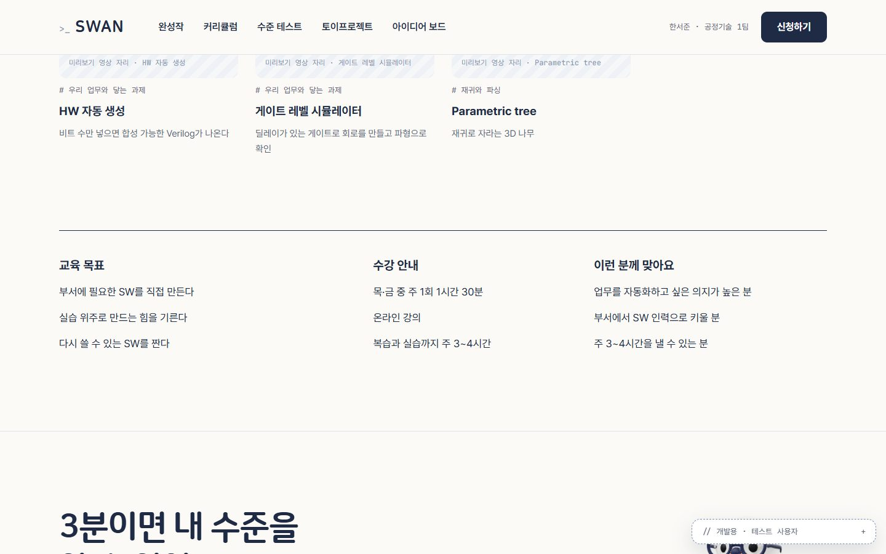 | 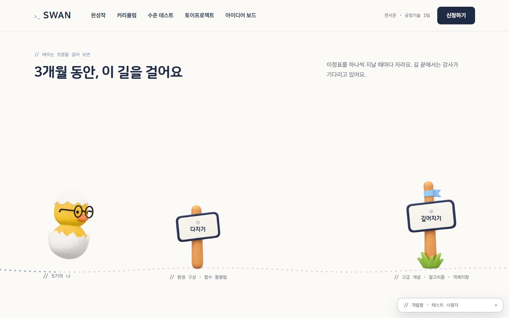 |
| 홈 · 모험길 30% | **바뀐 것** 이정표 ① 다지기를 지나 걷는 중. 지나온 길은 진한 점선으로 바뀐다  **왜** 어디까지 왔는지 한눈에 보이게 | (새 섹션) | 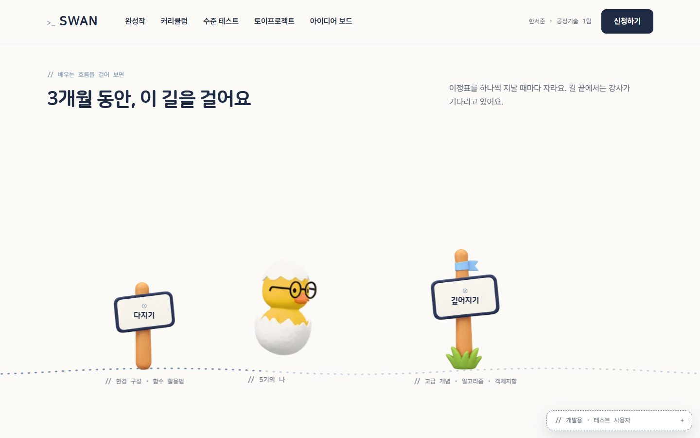 |
| 홈 · 모험길 60% | **바뀐 것** 이정표 ②를 지나 아기 오리로 자랐다  **왜** "단계를 지날 때마다 자란다"를 그림으로 보여 주려고 | (새 섹션) | 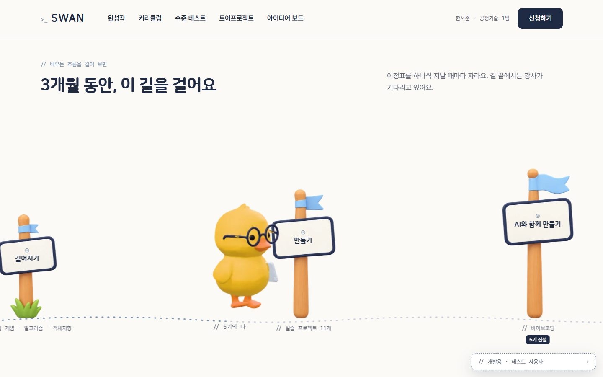 |
| 홈 · 모험길 끝 | **바뀐 것** ④ AI와 함께 만들기(5기 신설)를 지나 어린 백조가 되어 깃발 든 강사 앞에 선다. 이름표가 "3개월 뒤의 나"로 바뀐다  **왜** 히어로의 변신(오리 → 어린 백조)과 같은 이야기로 마무리하려고 | (새 섹션) | 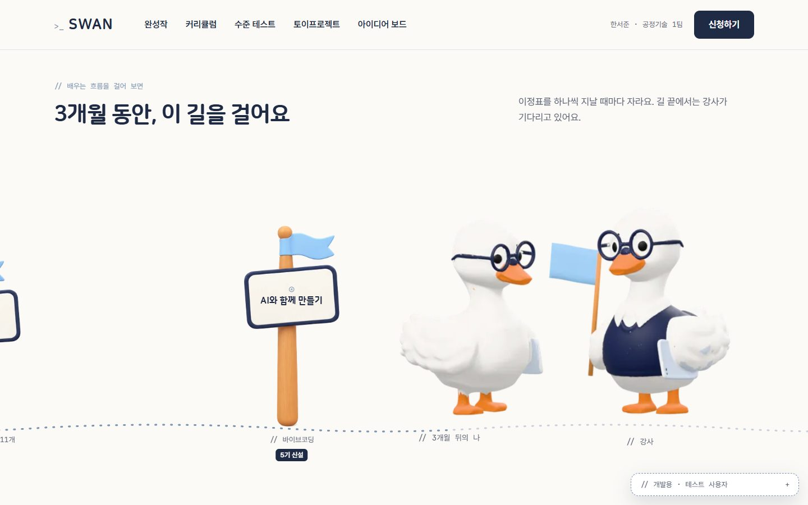 |
| 홈 · 수준 테스트 시작 | **바뀐 것** 모험길이 끝나면 바로 수준 테스트 안내가 이어진다 (내용은 그대로)  **왜** 길 끝의 "나는 지금 어디쯤일까?"가 테스트로 이어지게 |  | 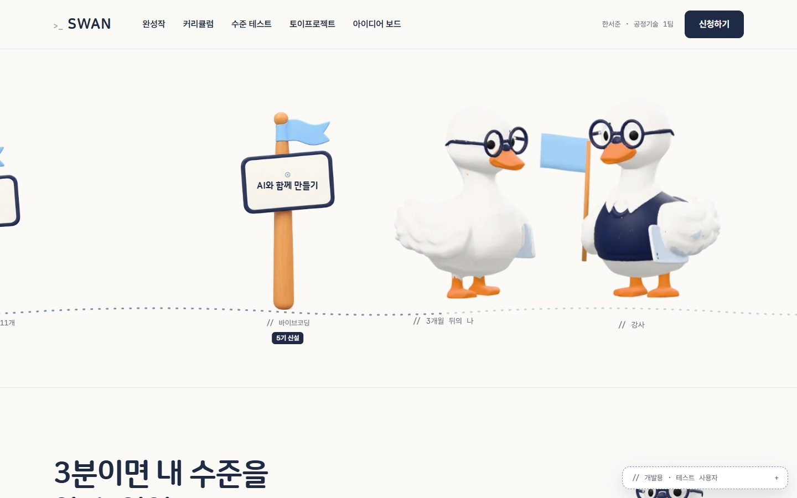 |

**아쉬운 점 (다음 단계의 이유)**: 머리말과 길 사이 여백이 1440×900에서 아직 넓다. 강사의 깃대가 날개 끝에서 조금 떨어져 보인다. 이정표 판의 번호(①~④)가 작아 잘 안 보인다. 홈 섹션이 10개에서 11개가 됐다(기획 문서 반영 필요).
**커밋**: 저장소가 git이 아니라 없음

---

## 2. 히어로 변신 정리 (2026-10-16)

**단계**: 홈 히어로 다듬기 (사용자 의견)
**왜**: "오리에서 백조로 바뀔 때 흩뿌려지는 게 먼지 같아 지저분하다", "백조 날개에 얼룩이 계속 있다". 확인해 보니 먼지는 Higgsfield(Kling)로 만든 변신 영상 25~45번째 프레임에 반짝이로 찍혀 있었고(변신 중간에 날개가 회색이 되는 것도 영상 자체), 날개 얼룩은 블렌더 3D 모델 텍스처에 노트북 색이 번진 자국이었다.
**한 일**:
- 영상 프레임에서 반짝이만 골라 지우는 필터를 두 번 시험했지만 점이 빽빽해서 거의 남았다 → 영상 대신 **"펑" 변신**: 오리가 스크롤에 따라 납작하게 움츠렸다가, 변신 정도 50%에서 컨페티가 터지며 어린 백조가 튀어나온다 (`components/Confetti.tsx`, 노랑 없는 7색)
- 비교용으로 영상 방식도 남김: 주소 뒤 `?morph=video` (영상 + 반짝이 구간에 컨페티)
- 블렌더에서 노트북 판을 기하로 찾아 지키고, 그 밖의 파란 얼룩 텍셀(백조 약 2만, 강사 약 1.8만)을 날개 흰색으로 다시 칠함 → `cygnet-baked-v2.png`, `instructor-baked-v2.png`
- 같은 구도로 다시 렌더해 바꿈: 히어로 숨쉬기(백조·강사 36장씩), 모험길 걷기(백조·강사 24장씩), 수준 테스트의 어린 백조 그림

| 화면 | 바뀐 것 · 왜 | 비포 | 애프터 |
|---|---|---|---|
| 홈 · 히어로 변신 중 | **바뀐 것** 몸에 반짝이 점이 박힌 영상 장면 대신, 깨끗한 오리가 움츠리고 있다  **왜** 사용자 의견 "먼지 같아 지저분하다" | 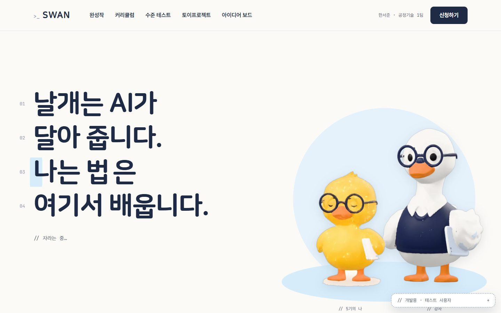 | 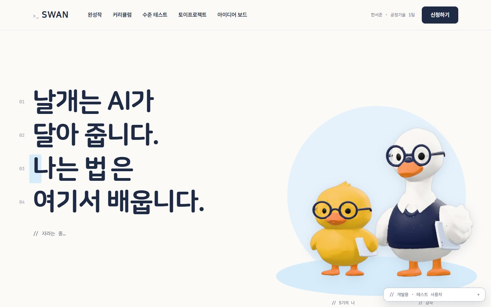 |
| 홈 · 바뀌는 순간 | **바뀐 것** 알록달록한 컨페티가 터지며 어린 백조로 바뀐다 (비포의 같은 순간은 반짝이 영상)  **왜** 사용자 의견 "컨페티처럼 알록달록하게" | 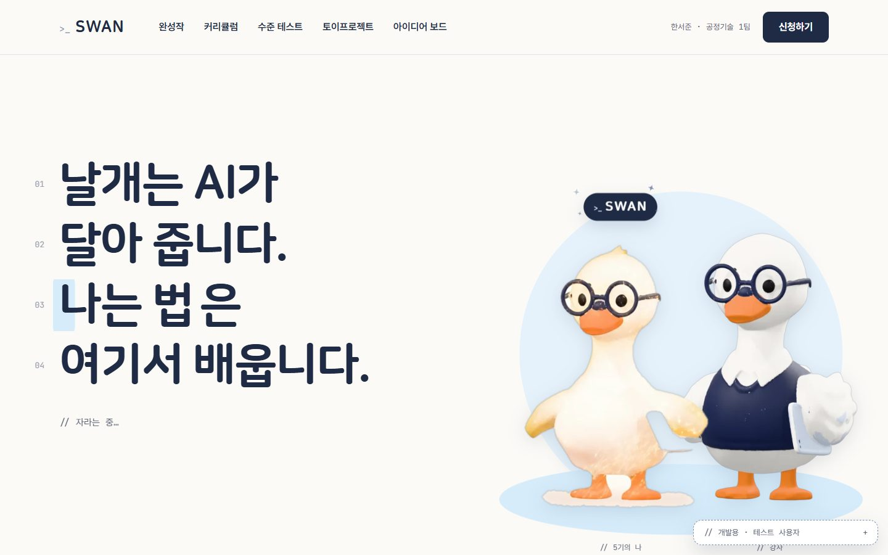 |  |
| 홈 · 변신 끝 | **바뀐 것** 어린 백조와 강사의 오른쪽 날개에 있던 하늘색 얼룩이 사라졌다  **왜** 사용자 의견 "날개 얼룩이 계속 있다" | 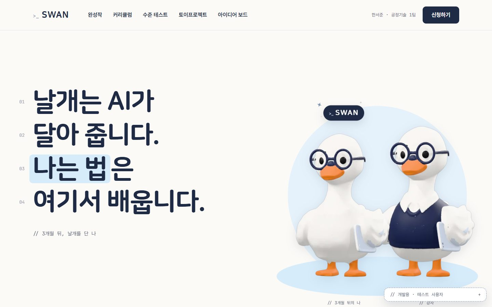 |  |
| 홈 · 비교용 영상 방식 | **바뀐 것** `?morph=video`로 열면 예전 영상 변신 위에 컨페티가 함께 터진다  **왜** 영상을 다시 뽑을지(약 7.25크레딧) 정하기 전에 나란히 비교하려고 |  | 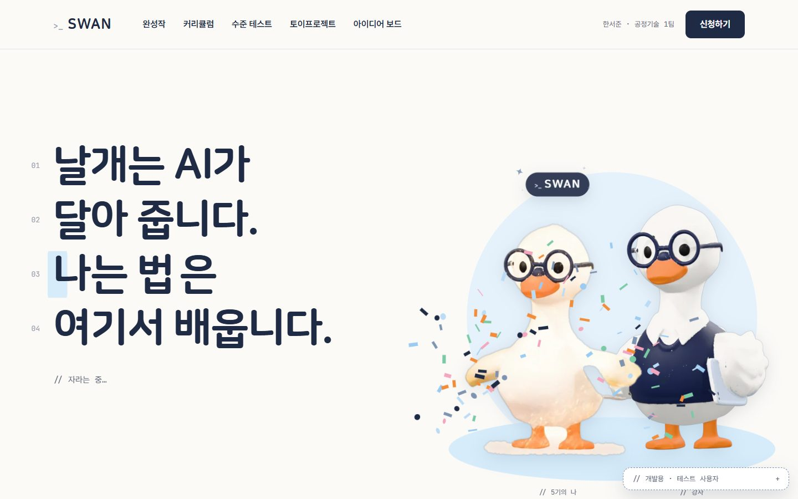 |

**아쉬운 점 (다음 단계의 이유)**: 펑 방식은 모양이 서서히 바뀌는 맛이 없다. 3D 히어로(`?hero=3d`)에는 컨페티를 아직 넣지 않았다. 강사 소개의 정지 그림 두 장은 얼룩이 안 보여서 그대로 뒀다.
**커밋**: 저장소가 git이 아니라 없음

---

## 3. 백조 재질 다시 만들기 (2026-10-16)

**단계**: 캐릭터 다듬기 (사용자 의견)
**왜**: 2단계 뒤에도 "백조 날개가 깨끗하지 않다, 강사 조끼도, 안경테도"라는 의견이 나왔다. 1600px로 크게 렌더해 보니, 구운 텍스처가 색 경계마다 번져 조끼·안경테에 흰 점, 날개에 파란 점이 남아 있었다.
**한 일**:
- 텍스처를 버리고 면마다 흰색 · 남색 · 주황 · 검정 · 노트북색 중 하나로 분류한 뒤, 외톨이 면과 작은 조각을 이웃 색으로 정리했다
- 면 단위로 칠하면 삼각형(1~3cm)이 커서 경계가 찢어진 종이처럼 보였다 → 정점마다 색 비율을 두고 목 아래만 매끄럽게 번지게 한 뒤, 셰이더에서 0.5를 넘는 곳만 칠해 경계가 삼각형 안을 지나는 매끈한 선이 되게 했다 (재질 `flat_cls`, 색 속성 `cls`)
- 사용자 확인 뒤 두 곳을 더 고쳤다: 노트북 옆 날개에 넘어온 하늘색(노트북은 판 두께 안의 면만), 부리 위 남색 코받침 덩어리(흰색으로)
- 정지 그림 한 장으로 확인을 받은 뒤 다시 렌더: 히어로 숨쉬기(백조·강사 36장씩), 모험길 걷기(24장씩), 강사 소개 그림, 수준 테스트의 어린 백조

| 화면 | 바뀐 것 · 왜 | 비포 | 애프터 |
|---|---|---|---|
| 캐릭터 확대 (1600px) | **바뀐 것** 1·3번(비포)의 조끼 흰 점, 안경테 흰 점, 날개 파란 점, 노트북·발 주변 톱니가 2·4번(애프터)에서 사라졌다  **왜** 사용자 의견 "날개·조끼·안경테가 깨끗하지 않다" | 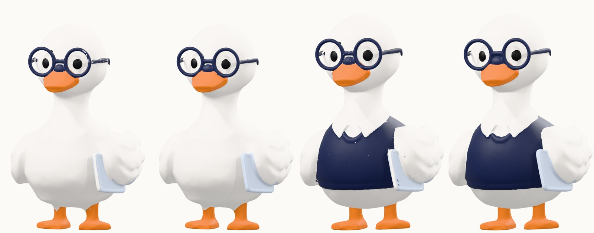 | 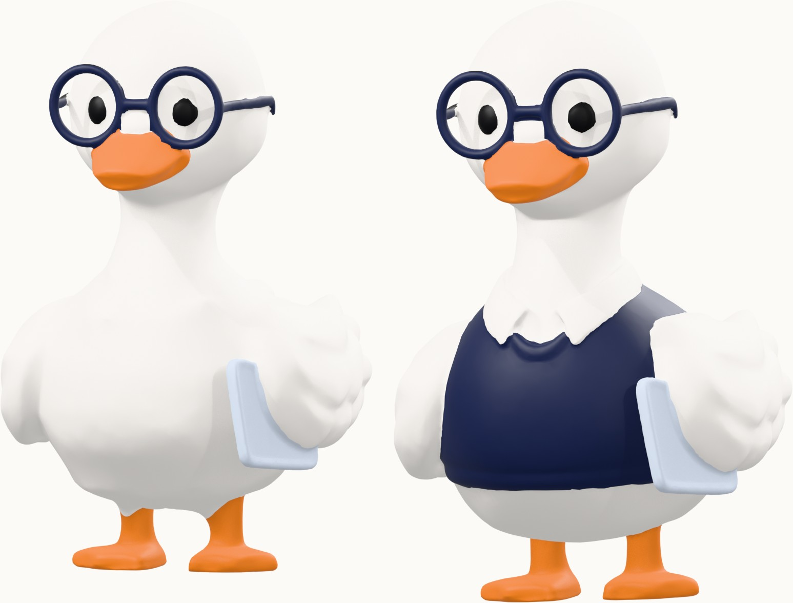 |
| 노트북 옆 날개 · 안경 코다리 | **바뀐 것** 윗줄(고치기 전)의 날개 아래 하늘색 조각과 부리 위 남색 덩어리가 아랫줄에서 사라졌다  **왜** 사용자 확인 때 "노트북 가까이 날개, 안경테 부리 위도 고쳐야겠다" | (같은 그림 윗줄) | 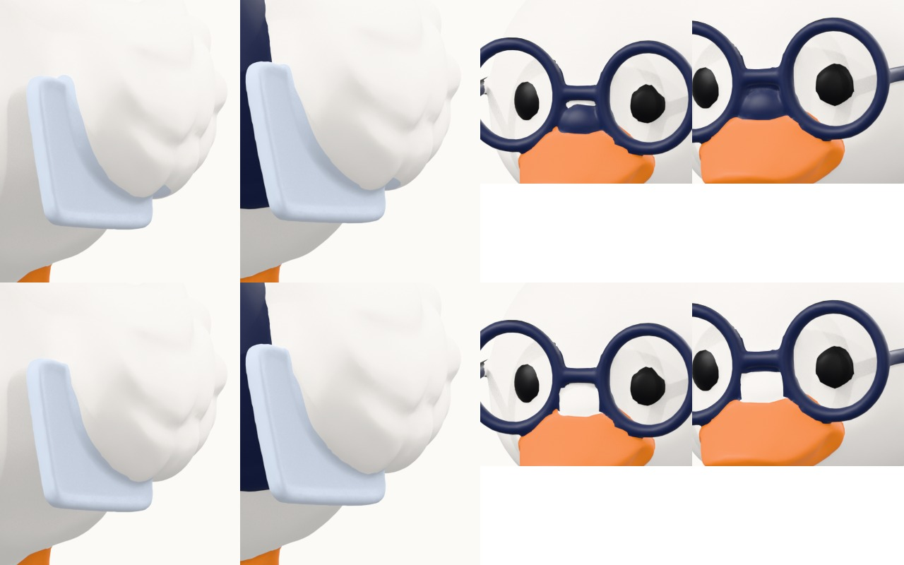 |
| 홈 · 히어로 끝 | **바뀐 것** 어린 백조와 강사가 새 재질로 숨쉰다  **왜** 위와 같음 |  |  |
| 홈 · 강사 소개 | **바뀐 것** 강사 그림을 새 재질로 바꿨다 (각도는 히어로와 같은 정면 쪽)  **왜** 조끼의 흰 점을 없애려고 | (비포 캡처 없음) | 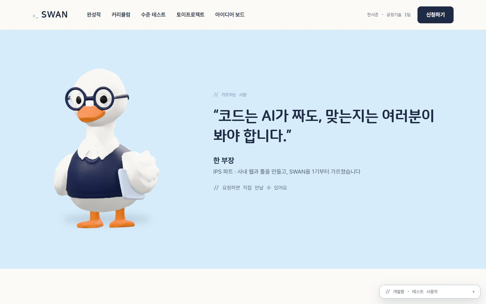 |
| 홈 · 모험길 끝 | **바뀐 것** 걷는 어린 백조와 깃발 든 강사를 새 재질로 바꿨다  **왜** 위와 같음 |  | 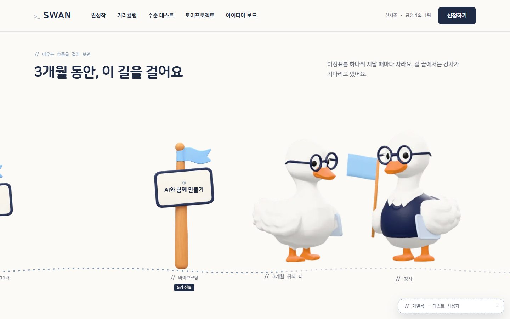 |
| 홈 · 수준 테스트 안내 | **바뀐 것** 어린 백조 그림을 새 재질로 바꿨다  **왜** 날개 얼룩 | (비포 캡처 없음) | 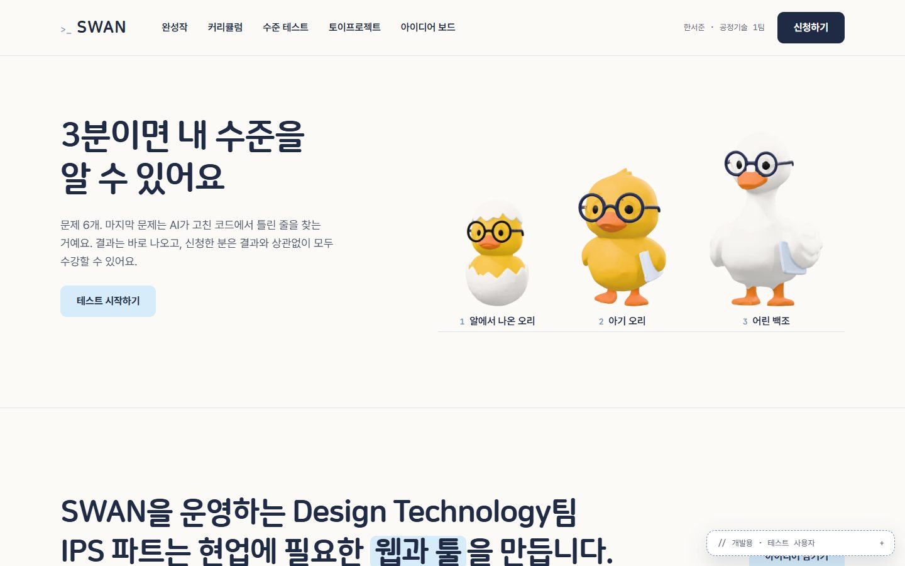 |

**아쉬운 점 (다음 단계의 이유)**: 3D 히어로(`?hero=3d`)의 GLB 파일과 오리·알에서 나온 오리는 아직 예전 텍스처다. 강사 소개 그림은 예전 그림과 각도가 조금 달라졌다.
**커밋**: 저장소가 git이 아니라 없음

---

## 4. 귓속말 변신 (2026-10-16)

**단계**: 홈 히어로 연출 (사용자 의견)
**왜**: "오리도 안경테 근처를 깨끗하게", "인사가 너무 짧다", "강사 백조가 귓속말 같은 행동으로 지식을 주입하면 아기 백조로 바뀌는 느낌으로 가고 싶다".
**한 일**:
- 오리도 백조와 같은 방식(노랑·주황·남색·검정·노트북색 단색 + 매끈한 경계)으로 재질을 바꿨다 (`flat_cls_duck`)
- 강사 귓속말 동작 `instructor_whisper`(24장): 오리 쪽으로 몸과 목을 기울이고 오리 쪽 날개를 들어 부리 옆을 가린다. 정지 그림으로 사용자 확인 뒤 렌더
- 오리 고개 갸웃 프레임(27장)을 새로 뽑고, 숨쉬기·손 흔들기·백조·강사 숨쉬기를 다시 뽑았다
- 손 흔들기를 두 번(약 5초)으로 늘렸다
- 스크롤 순서: 강사가 기울어 귓속말(변신 정도 0.08~0.30) → 오리가 갸웃(0.18~0.33) → 강사 부리 아래에서 `def` `{ }` `if` `for` `return` `import` 꼬리표가 오리 정수리로 들어간다(0.24~0.50) → 오리가 움츠림 → 0.50에서 컨페티와 함께 어린 백조 → 강사가 다시 바로 선다(0.50~0.65). 그동안 아래 문구는 "// 강사가 비법을 속삭이는 중…"

| 화면 | 바뀐 것 · 왜 | 비포 | 애프터 |
|---|---|---|---|
| 오리 확대 | **바뀐 것** 안경테 주변 점과 부리 위 얼룩이 없는 깨끗한 오리  **왜** 사용자 의견 "오리도 안경테 근처를 깨끗하게" | (비포: 2단계 히어로의 오리) | 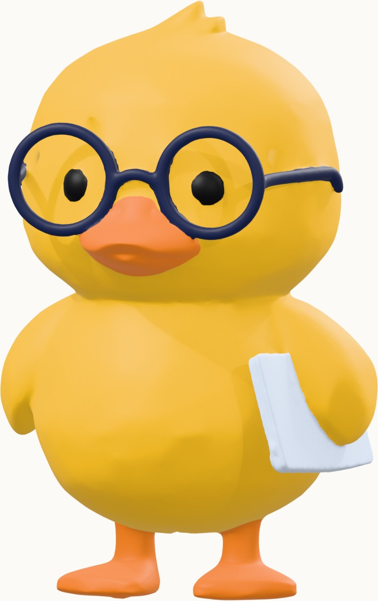 |
| 홈 · 인사 | **바뀐 것** 처음 들어오면 손을 두 번 흔든다 (사진은 두 번째 흔들기, 3.7초)  **왜** 사용자 의견 "인사가 너무 짧다" | (비포는 2.5초에 끝남) | 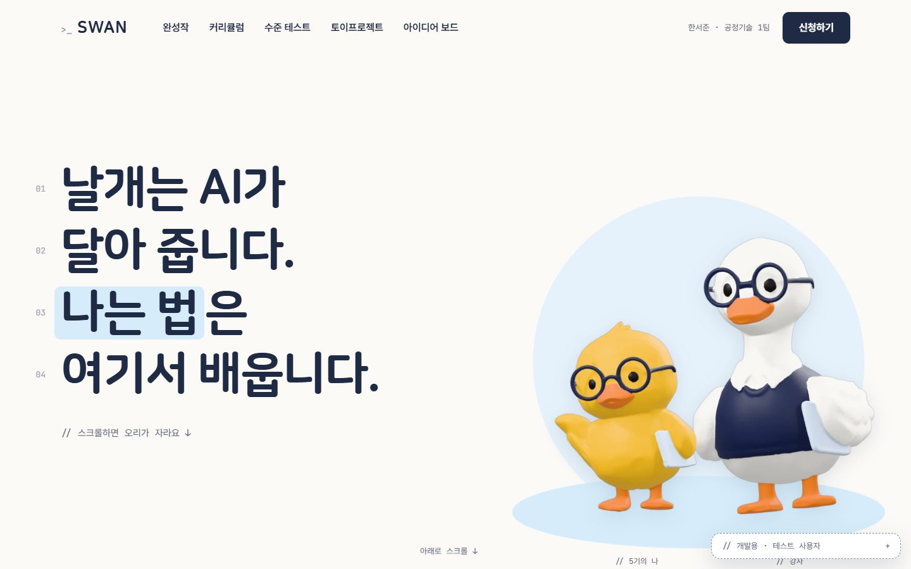 |
| 홈 · 귓속말 | **바뀐 것** 강사가 오리 쪽으로 기울어 날개로 부리를 가리고, 코드 꼬리표가 오리 머리로 들어간다. 오리는 고개를 갸웃한다  **왜** 사용자 의견 "귓속말로 지식을 주입하는 느낌" |  | 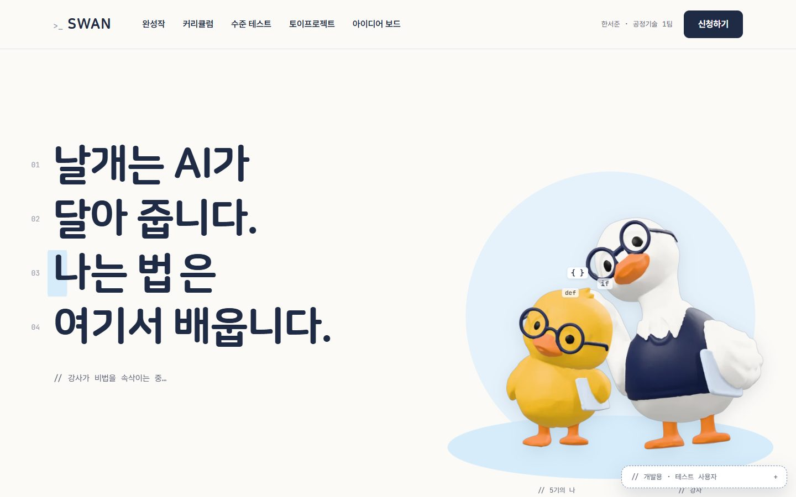 |
| 홈 · 바뀌기 직전 | **바뀐 것** 지식이 계속 들어가는 동안 오리가 움츠린다  **왜** 바뀌는 순간에 힘을 모으는 느낌 | (같은 비포) |  |
| 홈 · 펑 | **바뀐 것** 컨페티와 함께 어린 백조가 되고, 강사는 다시 일어서는 중이다  **왜** 귓속말 → 변신 → 마무리로 이어지게 |  | 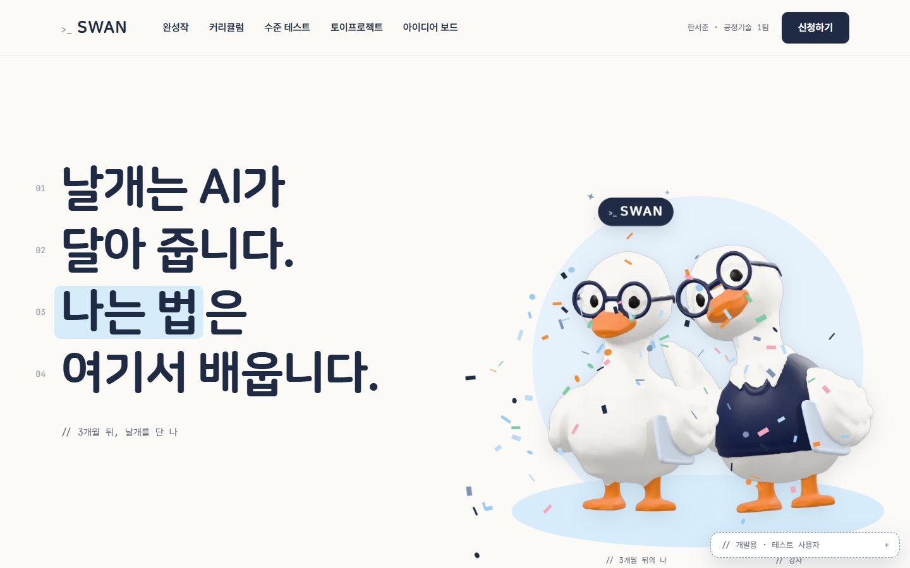 |

**아쉬운 점 (다음 단계의 이유)**: 오리의 갸웃이 정면 각도라 작게 보인다. 3D 히어로(`?hero=3d`)와 모험길의 알에서 나온 오리는 아직 예전 텍스처다. 영상 변신(`?morph=video`)에는 귓속말이 없다.
**커밋**: 저장소가 git이 아니라 없음

---

## 5. 긴 귓속말 · 꽃비 · 생동감 (2026-10-16)

**단계**: 홈 연출 다듬기 (사용자 의견)
**왜**: "귓속말을 더 길게, 커리큘럼의 decorator·coroutine도", "SWAN 별빛이 남색이라 심심하다, 알록달록하게", "변신하면 강사도 아기 백조도 손을 흔들자", "수준 테스트 캐릭터도 생동감 있게", "모험길 도착하면 축하 — 꽃비".
**한 일**:
- 히어로 고정 구간을 260vh → 340vh로 늘리고 귓속말 구간을 변신 정도 0.16~0.64로 넓혔다. 꼬리표를 커리큘럼 2부 용어 12개로 바꿨다 (`map()` `@decorator` `class` `coroutine` `closure` `generator` `reduce()` `재귀` `Strategy` `Observer` `Singleton` `MVP`)
- SWAN 로고 별빛을 남색 4개 → 주황·분홍·민트·하늘 7개로 (화면 요소에 노랑을 쓰지 않는 규칙 때문에 노랑 대신)
- 변신 뒤 강사가 다시 바로 서면(0.78) 강사와 어린 백조가 함께 손을 두 번 흔든다 (기존 손 흔들기 동작으로 새로 렌더)
- 수준 테스트: 알은 뒤뚱, 아기 오리·어린 백조는 서로 다른 박자로 들썩이고, 섹션에 들어오면 차례로 콩 뛴다. 마우스를 올려도 뛴다 (CSS만)
- 모험길 끝에 닿는 순간 화면 전체에 꽃잎 비 (`components/PetalRain.tsx`)
- 시안만 만든 것: 모험길 배경 2개(Higgsfield 3크레딧), 강사 가르치는 동작, 학사모 쓴 어린 백조

| 화면 | 바뀐 것 · 왜 | 비포 | 애프터 |
|---|---|---|---|
| 홈 · 긴 귓속말 | **바뀐 것** `@decorator` `class` `map()` 같은 커리큘럼 용어가 오리 머리로 들어간다  **왜** 사용자 의견 "커리큘럼에 있는 decorator, coroutine도" |  |  |
| 홈 · 변신 직후 | **바뀐 것** SWAN 로고 둘레 별빛이 알록달록해졌다  **왜** 사용자 의견 "별빛이 남색이라 심심하다" |  | 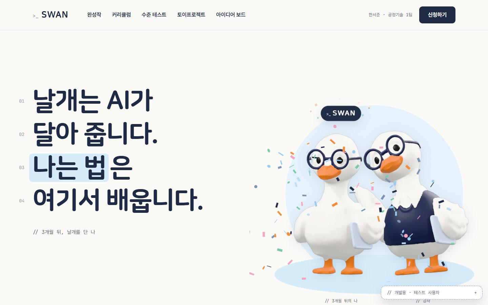 |
| 홈 · 함께 손 흔들기 | **바뀐 것** 어린 백조와 강사가 함께 손을 흔든다  **왜** 사용자 의견 "변신하면 둘 다 안녕하듯 손 흔들기" | 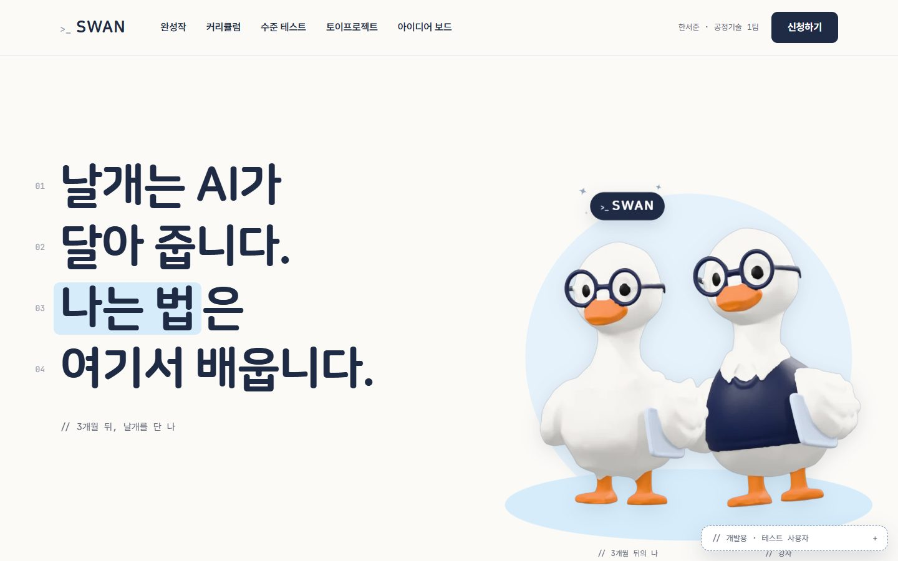 |  |
| 홈 · 모험길 도착 | **바뀐 것** 길 끝에 닿으면 화면 전체에 꽃잎이 흩날린다  **왜** 사용자 의견 "도착하면 축하하는 느낌, 꽃비" |  | 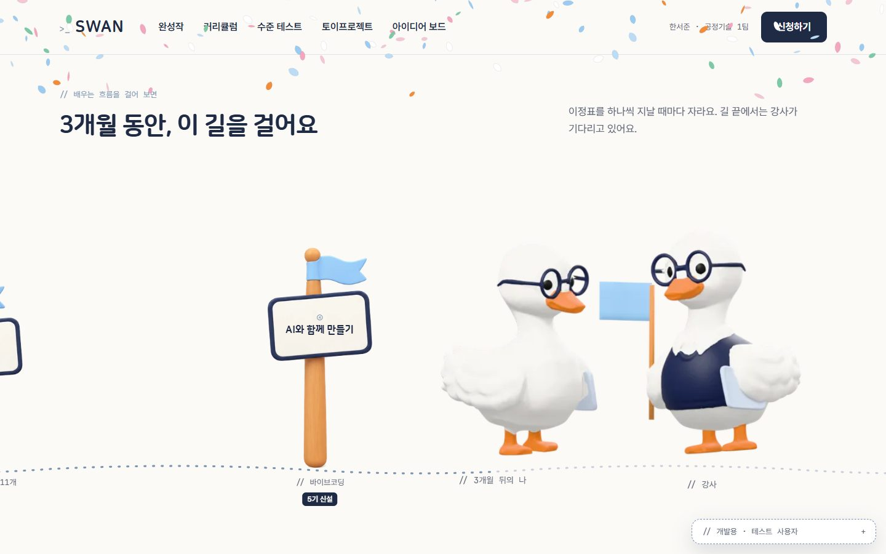 |
| 시안 · 모험길 배경 | **바뀐 것** A 비슷한 느낌(3D 게임풍) / B 다른 느낌(실사풍, 흐릿한 아침 호숫가) 위에 이정표·오리·학사모 백조를 얹어 본 미리보기  **왜** 사용자 의견 "배경이 없어 허전하다, 시안 2개" | 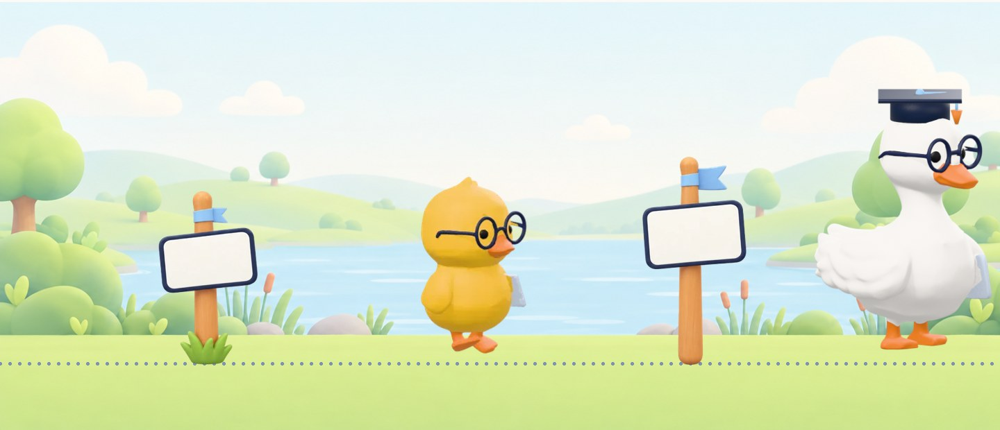 |  |

| 홈 · 모험길 배경 | **바뀐 것** 사용자가 고른 A(3D 게임풍)로 장면 4장을 더 뽑아(Higgsfield 6크레딧) 이정표에 다가갈 때마다 새벽 호숫가 → 아침 숲길 → 한낮 개울 다리 → 노을 호수로 0.8초 동안 겹쳐 바뀐다. 배경은 길의 6% 속도로 흘러 깊이감이 난다  **왜** 사용자 의견 "배경이 없어 허전하다, 이정표마다 배경을 바꾸자" |  | 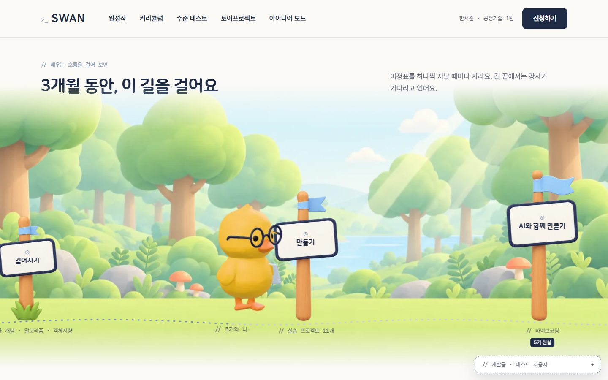 |
| 홈 · 강사 소개 | **바뀐 것** 정지 그림 대신 날개를 펴서 설명하듯 움직이는 강사(36장 반복)와, 3초마다 바뀌는 말풍선  **왜** 사용자 의견 "가르치는 것 같은 행동, 말하는 느낌" |  | 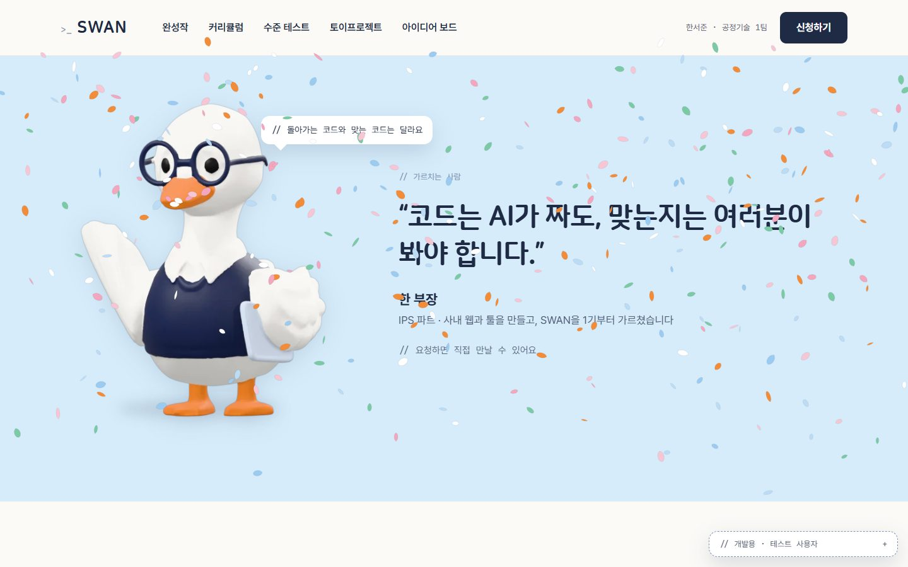 |
| 시안 · 도착 축하 | **바뀐 것** 학사모를 쓴 어린 백조에게 강사가 꽃다발을 건네는 장면 (블렌더로 학사모·꽃다발 모델과 건네는 자세를 만듦)  **왜** 사용자 의견 "도착하면 학사모, 꽃다발" | (새 장면) |  |

**아쉬운 점 (다음 단계의 이유)**: 학사모·꽃다발 장면은 사용자 확인 뒤 프레임을 뽑아 넣는다. 콩 뛰는 프레임은 모자가 걷기 프레임 자르기 영역 밖으로 나가서 영역을 넓혀야 한다.
**커밋**: 저장소가 git이 아니라 없음

---

## 6. 학사모 축하 (2026-10-16)

**단계**: 홈 연출 다듬기 (사용자 의견)
**왜**: "히어로에서 강사는 노트북을 든 채 다른 손으로 인사", "모험길 '// 5기의 나'가 가려진다, 머리 위로", "알일 때는 통통 튀며 이동", "꽃비 전에 둘을 가운데로 보이게 했다가 다시 제자리로", "꽃다발은 빼고 강사가 학사모를 씌워 주자".
**한 일**:
- 히어로: 강사 손 흔들기가 어깨 높이라 앞의 어린 백조에 가려졌다 → 노트북은 그대로 두고 화면 왼쪽 날개를 머리 위로 높이 흔드는 새 동작(`instructor_wave_high`, 30장)
- 모험길: 이름표를 지금 단계 캐릭터 머리 위로 (흰 바탕 꼬리표), 알 단계는 110px마다 포물선으로 통통 뛴다
- 꽃다발 모델을 지우고, 강사와 어린 백조를 블렌더 한 장면에 세워 학사모 씌우기 84장을 렌더 (`public/frames/cap-scene`): 강사가 학사모를 들고 통통 다가와 → 높이 들어 넘겨 씌우고 → 어린 백조가 콩콩 뛰며 강사는 제자리로 → 둘이 손 흔들기
- 도착 연출: 둘이 화면 가운데로 나와 1.15배 → 장면 재생(44번째 장에서 꽃비) → 원래 자리로 돌아가 마지막 장면에 머문다. 이름표는 "// 3개월 뒤의 나"로 학사모 위에. 축하하는 동안 이정표를 흐리게. 길을 되돌아가면 처음 상태로
- 시안 두 번(정지 그림) 사용자 확인 뒤 렌더

| 화면 | 바뀐 것 · 왜 | 비포 | 애프터 |
|---|---|---|---|
| 홈 · 히어로 손 흔들기 | **바뀐 것** 강사가 노트북을 든 채 왼쪽 날개를 머리 위로 높이 흔든다  **왜** 사용자 의견 "노트북 잡고 다른 손으로 인사" — 전에는 어린 백조에 가렸다 |  | 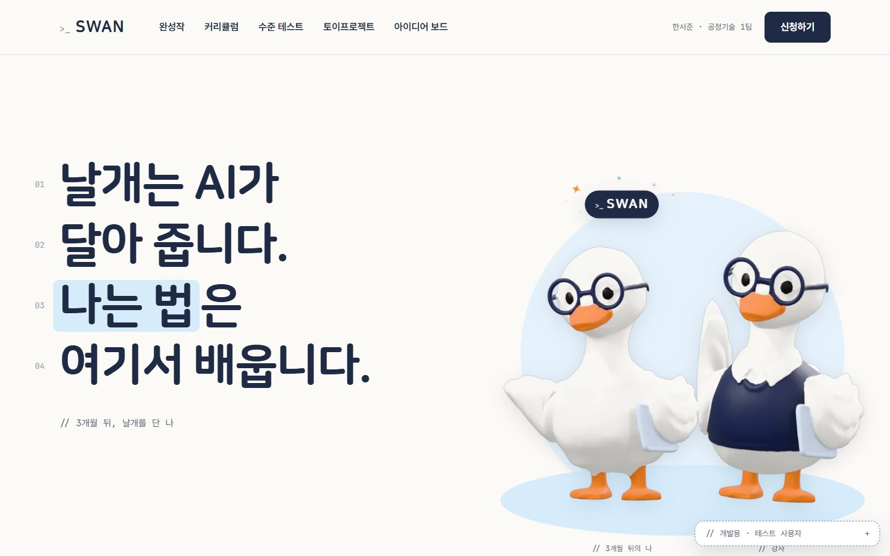 |
| 홈 · 모험길 도착 | **바뀐 것** 둘이 가운데로 나와 커진다 (이정표는 흐려짐)  **왜** 사용자 의견 "꽃비 전에 가운데에 배치해서 잘 보이게" |  | 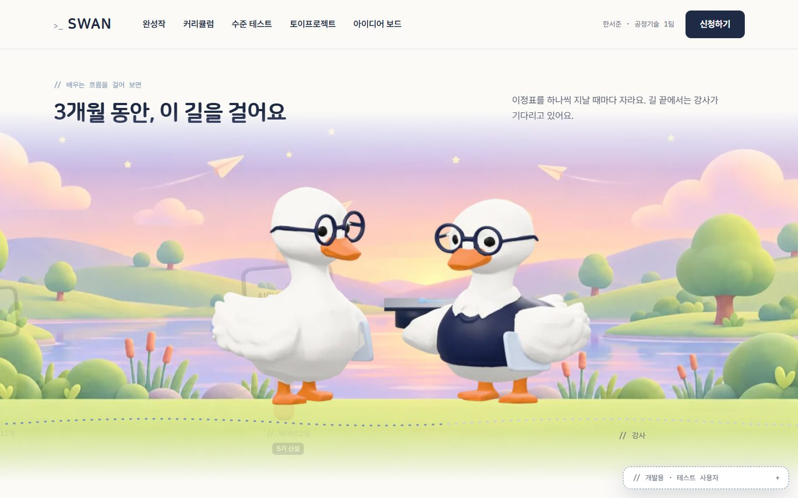 |
| 홈 · 학사모 씌우기 | **바뀐 것** 강사가 학사모를 들어 올려 어린 백조에게 씌워 준다  **왜** 사용자 의견 "꽃다발 대신 강사가 학사모를 씌워 주자" |  | 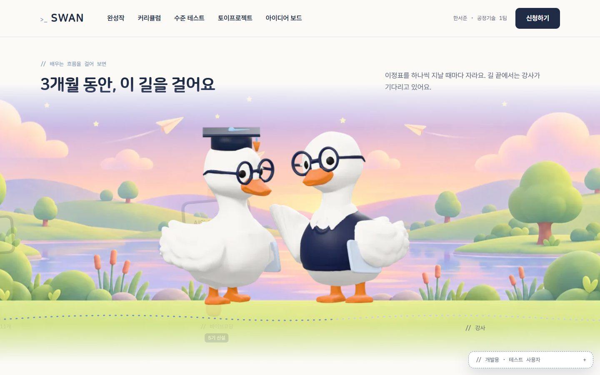 |
| 홈 · 꽃비 | **바뀐 것** 학사모를 쓴 뒤 둘이 기뻐할 때 꽃비가 내린다 | (같은 비포) | 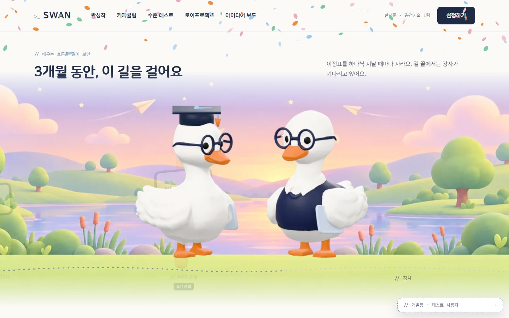 |
| 홈 · 제자리 | **바뀐 것** 원래 자리로 돌아가고 학사모 위에 "// 3개월 뒤의 나" | (같은 비포) |  |

**아쉬운 점 (다음 단계의 이유)**: 도착 순간 강사 그림이 깃발 든 모습에서 학사모 든 모습으로 바로 바뀐다. 축하 장면 프레임이 2.3MB라 처음 불러올 때 무겁다. 움직임 줄이기 설정에서는 축하 없이 바로 마지막 장면이 보인다.
**커밋**: 저장소가 git이 아니라 없음

---

## 7. 강사 눈웃음 · 축하 중 스크롤 고정 (2026-10-16)

**단계**: 홈 연출 다듬기 (사용자 의견)
**왜**: "히어로에서 강사 손 흔들기는 없애고 눈웃음치자", "모험길 도착하면 가운데로 오는데 스크롤을 내리면 가운데가 안 되니, 학사모 쓰고 꽃비 뿌릴 때까지만 스크롤 고정".
**한 일**:
- 강사 눈웃음: 셰이더에서 웃을 때만 눈동자 자리를 흰색으로 지우고(색 속성 `cls_smile`, 객체 속성 `smile`), "^" 곡선(`smile_arc0/1`, 머리 뼈에 붙임)을 띄운다. 히어로 크기에서 보이도록 선을 굵게. 정지 그림으로 사용자 확인 뒤 숨쉬기 36장 렌더 (`instructor-smile`)
- 히어로 변신 뒤: 어린 백조는 손을 두 번 흔들고 강사는 눈웃음
- 모험길 축하가 시작되면 휠·터치·키 스크롤을 막고, 꽃비가 시작된 뒤(54번째 장면) 풀어 준다. 스크롤바는 그대로라 화면이 흔들리지 않는다
- 강사 숨쉬기 프레임이 앞 동작의 회전값이 남아 몸이 틀어져 있던 것을 발견해 다시 렌더(히어로·모험길). 걷기 그림 자르기 영역이 바뀌어 학사모 장면 위치 값을 맞춤

| 화면 | 바뀐 것 · 왜 | 비포 | 애프터 |
|---|---|---|---|
| 강사 눈웃음 | **바뀐 것** 평소 눈 → "^ ^" 눈웃음 (오른쪽은 히어로에서 보이는 크기)  **왜** 사용자 의견 "강사 백조가 눈웃음치자" | (같은 그림 왼쪽) | 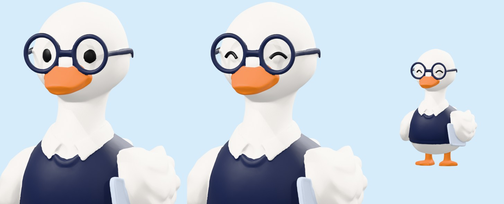 |
| 홈 · 히어로 변신 뒤 | **바뀐 것** 강사는 손 흔들기 대신 눈웃음, 어린 백조만 손을 흔든다  **왜** 같은 의견 |  | 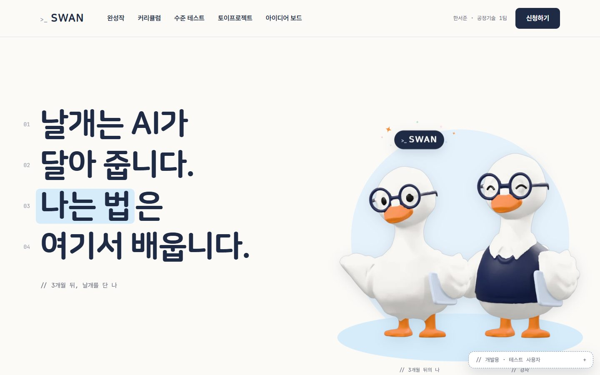 |
| 홈 · 히어로 처음 | **바뀐 것** 강사 숨쉬기 자세가 원래대로(몸이 틀어지지 않음)  **왜** 렌더 때 남은 회전값 때문에 자세가 달라져 있었다 | 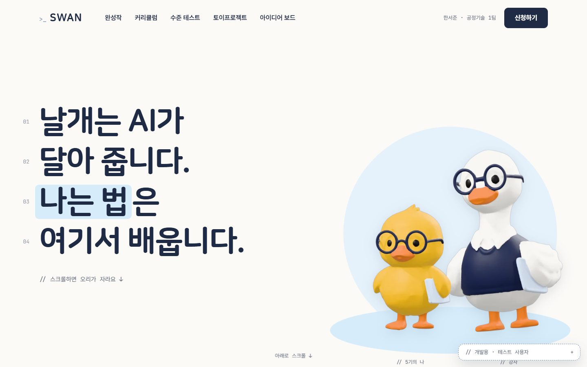 |  |

**아쉬운 점 (다음 단계의 이유)**: 스크롤 고정은 휠·터치·키만 막아서 스크롤바를 직접 끌면 움직인다(그때는 축하가 취소되고 처음 상태로 돌아간다).
**커밋**: 저장소가 git이 아니라 없음

---

## 8. 축하 빠르게 (2026-10-16)

**단계**: 홈 연출 다듬기 (사용자 의견 "가운데 와서 하는 행동을 좀 빠르게")
**한 일**: 학사모 장면 재생을 초당 12장 → 20장, 가운데로 나왔다 돌아가는 시간을 0.65초 → 0.4초로. 전체 약 8초 → 약 5초, 스크롤 고정은 약 3초 뒤 풀림 (휠 시험으로 확인)

| 화면 | 바뀐 것 · 왜 | 비포 | 애프터 |
|---|---|---|---|
| 홈 · 모험길 축하 끝 | **바뀐 것** 같은 장면이 약 5초 만에 제자리로 돌아온다 (사진은 5.8초 시점)  **왜** 사용자 의견 "전체적으로 빠르게" |  | 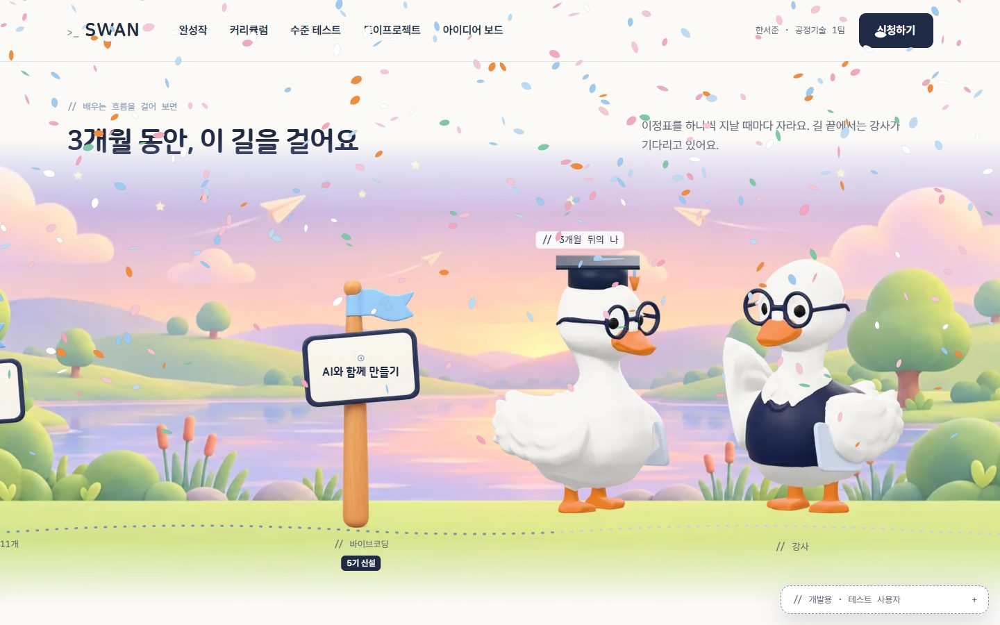 |

---

## 9. UI 체크리스트 · 첫 화면 모집 줄 (2026-10-16)

**단계**: UI 체크리스트 점검 (`docs/ui-review/home.md`) → FINAL 수정
**왜**: 체크리스트 점검에서 "수정 필요" 15개(목적 2 · 정보 3 · 위계 0 · 일관성 2 · 사용성 2 · 실제 상황 6). 1순위는 01-6·02-6 "① 첫 화면에 모집 상태·마감이 없다" — 모든 방문자가 보는 화면이고, 마감일까지 고정 스크롤 3.4화면을 내려가야 했다.
**한 일**: 히어로 헤드라인 아래에 한 줄 소개 섹션과 같은 모집 줄(sky 배지 "5기 모집 중" + "마감 D-7 · 10월 23일(금)")을 넣었다. 주 버튼은 상단 메뉴 하나라는 규칙에 따라 버튼은 더하지 않았다. 데이터가 오기 전에도 헤드라인이 움직이지 않게 높이를 미리 잡았다.

| 화면 | 바뀐 것 · 왜 | 비포 | 애프터 |
|---|---|---|---|
| 홈 · 첫 화면 1280×800 | **바뀐 것** 헤드라인 아래에 "5기 모집 중 · 마감 D-7 · 10월 23일(금)"  **왜** 체크리스트 01-6 · 02-6 — '지금 받는지 · 언제까지'가 첫 화면에 없었다 | 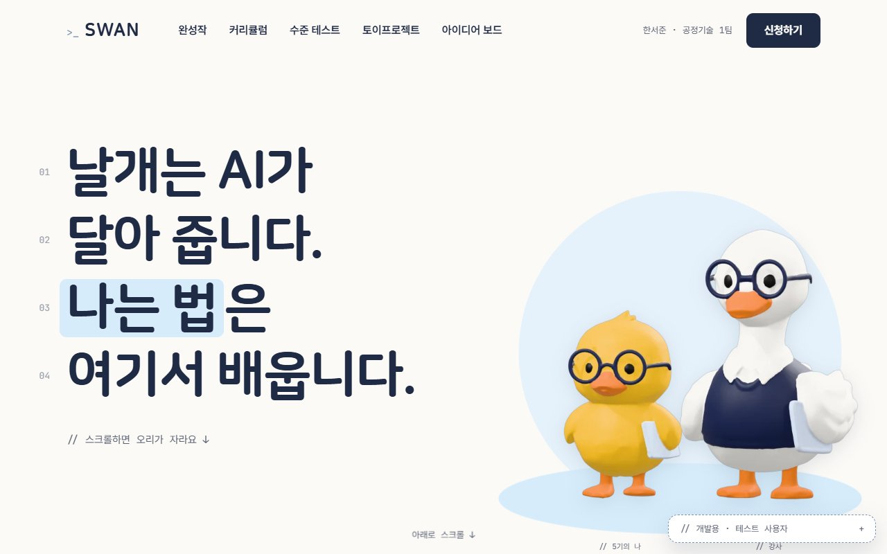 | 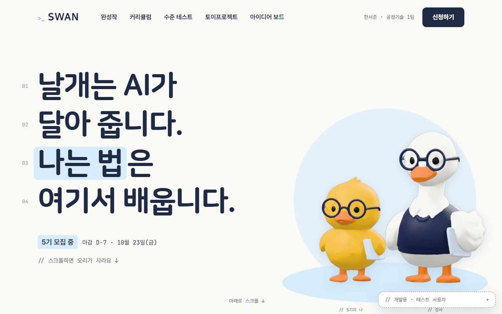 |
| 홈 · 첫 화면 1440×900 | **바뀐 것** 위와 같음 (기준 폭)  **왜** 같은 문항 | 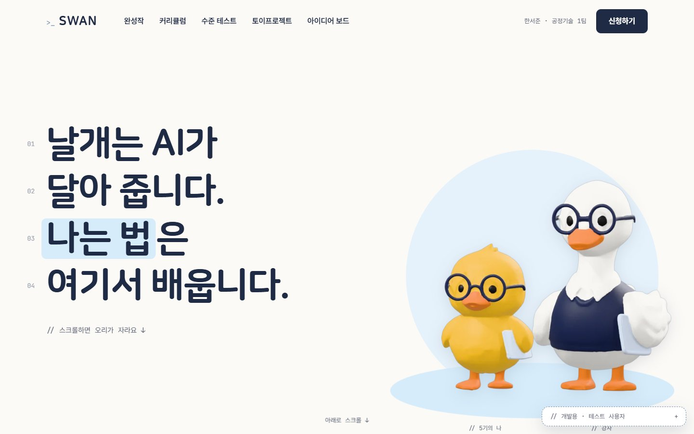 | 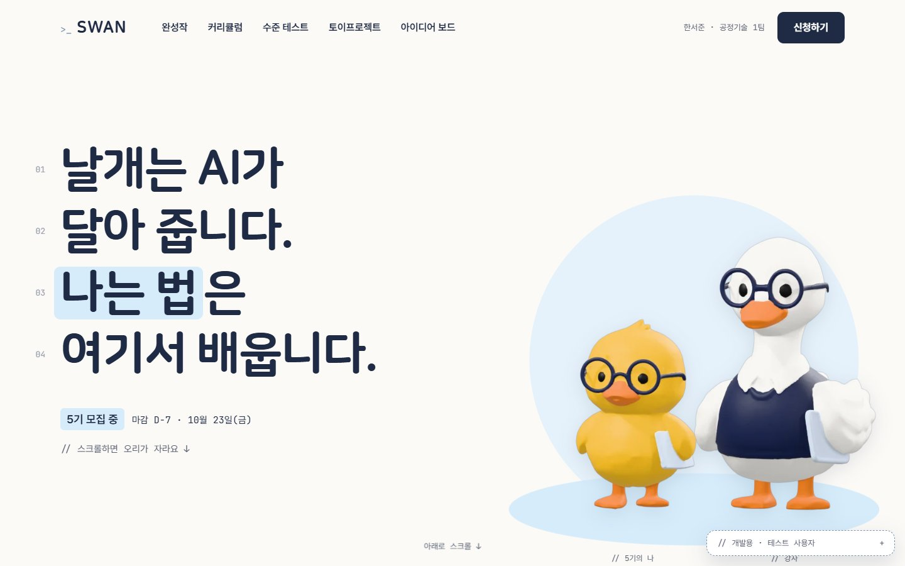 |

**다시 판정한 체크리스트 문항**: 01-6 수정 필요 → 확인, 02-6 수정 필요 → 확인, 3초 관찰 '헤드라인 → 모집 줄 → 캐릭터', 첫 사용자 과제 마감일까지 3.4화면 → 0화면 ([점검 기록](../ui-review/home.md))
**아쉬운 점 (다음 단계의 이유)**: 남은 수정 필요 10묶음 — 오류·로딩 상태, 섹션 제목 크기 통일, ②⑪ 주 버튼 중복, 개강일 없음, 1280×800 이름표 걸침 등 (점검 기록 끝 목록)
**커밋**: 저장소가 git이 아니라 없음

---

## 10. 홈 데이터 로딩·오류 상태 (2026-10-16)

**단계**: UI 체크리스트 남은 항목 (사용자 선택: 05-4 · 05-7)
**왜**: `/api/home`을 실패시켜 보니 ③ 숫자·이름 띠, ⑥ 단원·실습 프로젝트, ①②⑪ 모집 줄이 **안내 없이 사라졌다**. 받기 전에도 같은 자리가 비어 있었다.
**한 일**:
- `Home.tsx`가 불러오는 중 / 받음 / 실패와 다시 부르기를 관리 (`HomeLoad`)
- 한 줄 안내 부품 `components/DataNote.tsx`: 불러오는 중 "// 모집 정보를 불러오는 중…"(회색 고정폭), 실패 "모집 정보를 불러오지 못했어요." + [다시 시도 →]
- 데이터를 쓰는 다섯 곳(① 히어로 모집 줄, ② 소개 모집 줄, ③ 숫자, ⑥ 단원·실습 프로젝트, ⑪ 마감)에 같은 모양으로. ③⑥은 자리 높이를 지켜 아래 섹션이 들썩이지 않게, ⑪은 남색 바탕용 밝은 색
- 확인 도구 `tools/shot/datastates.cjs`: 응답을 멈추거나(loading) 500으로(error), 처음 두 번만 실패시킨 뒤 [다시 시도]를 눌러(retry) 찍는다

| 화면 | 바뀐 것 · 왜 | 비포 | 애프터 |
|---|---|---|---|
| ③ 숫자 · 실패 | **바뀐 것** 비어 있던 자리에 "수료 숫자를 불러오지 못했어요. 다시 시도 →"  **왜** 체크리스트 05-4 · 06-7 — 섹션이 조용히 사라졌다 | 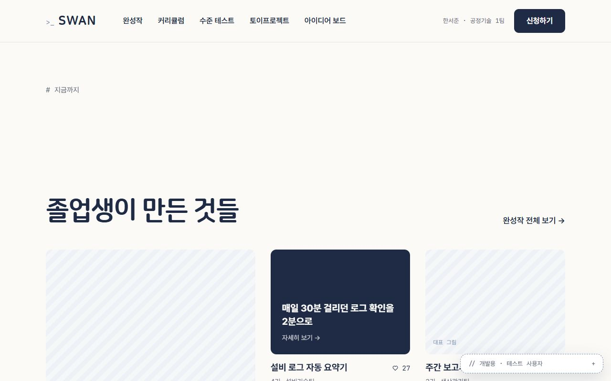 | 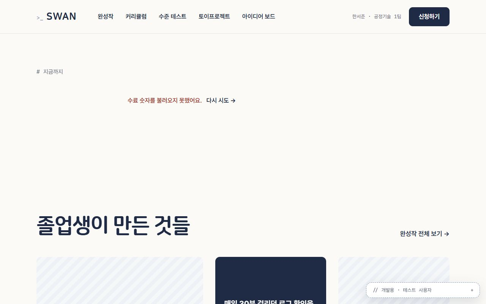 |
| ⑥ 실습 프로젝트 · 실패 | **바뀐 것** 프로젝트 모음 자리를 남기고 안내 + 다시 시도  **왜** 같은 문항 — 11개 프로젝트가 통째로 사라졌다 | 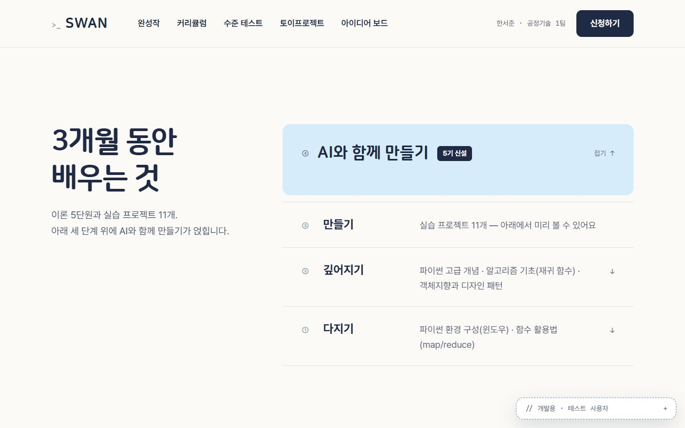 | 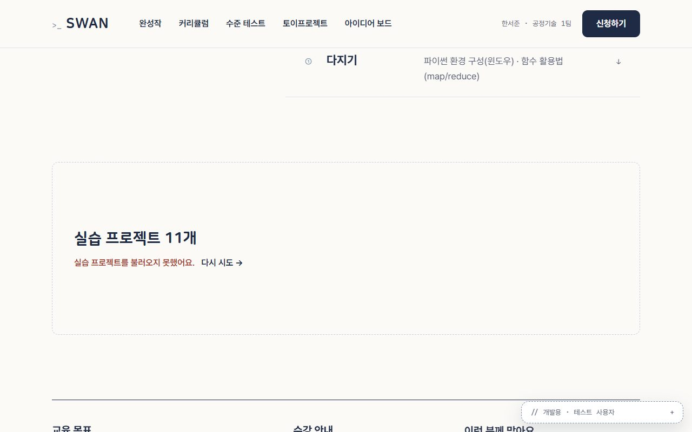 |
| ① 히어로 · 불러오는 중 | **바뀐 것** 모집 줄 자리에 "// 모집 정보를 불러오는 중…"  **왜** 체크리스트 05-7 · 06-6 — 로딩 상태가 없었다 | 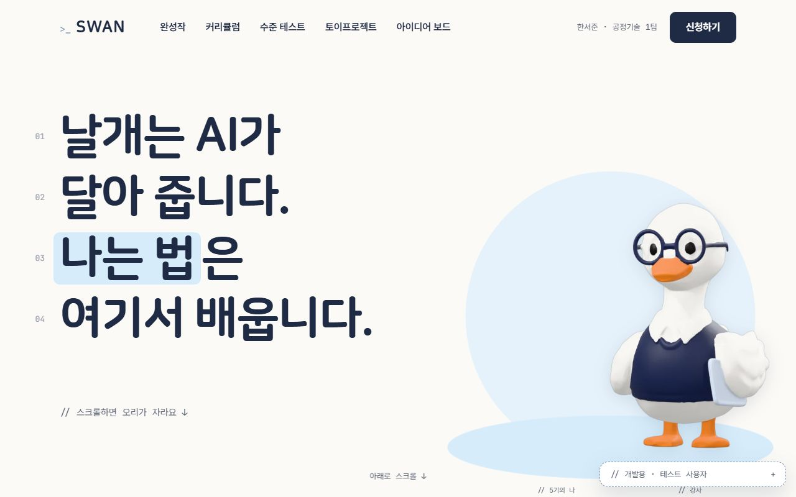 | 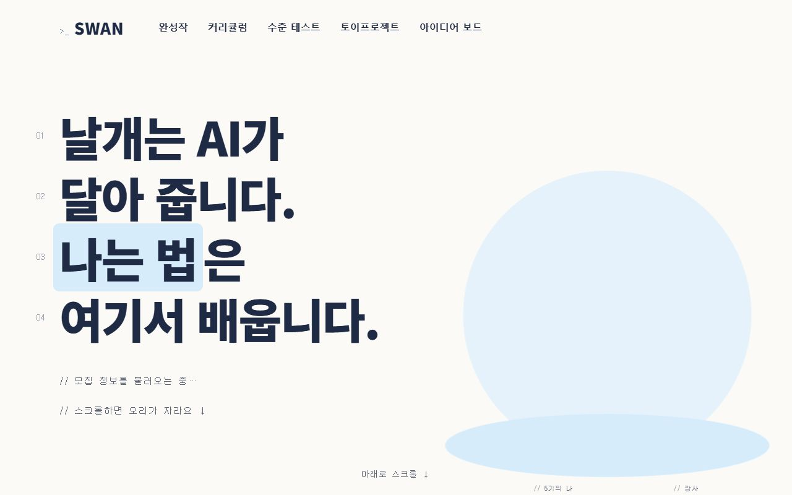 |
| ⑪ 마지막 신청 · 실패 | **바뀐 것** 남색 바탕 위 밝은 오류 문구 + 다시 시도  **왜** 같은 문항 | 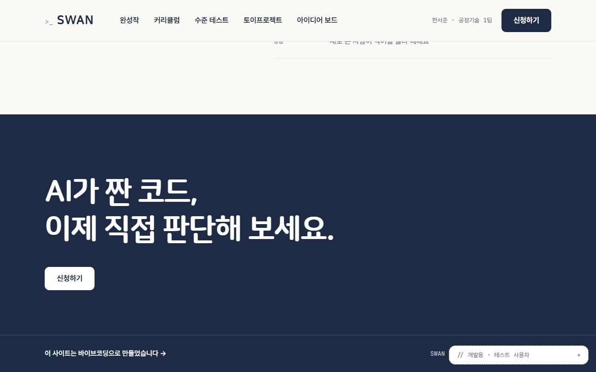 | 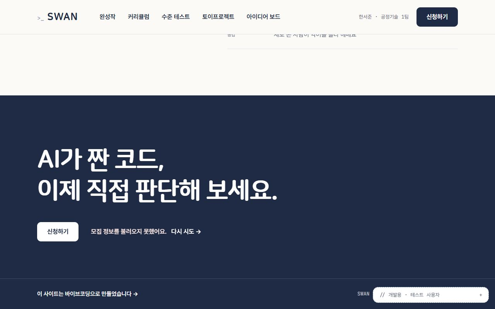 |
| ③ 숫자 · 다시 시도 후 | **바뀐 것** [다시 시도]를 누르면 다시 불러와 숫자·띠가 채워진다  **왜** 실패에서 빠져나올 길 | (없음) | 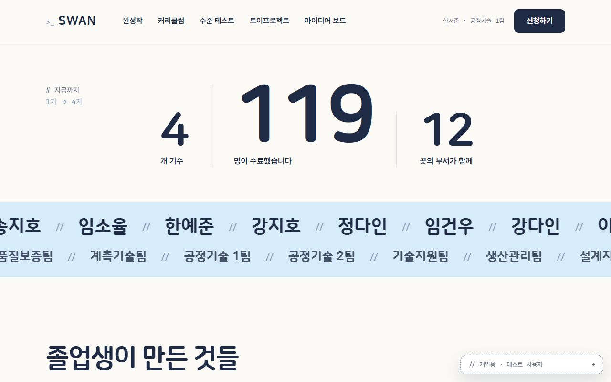 |

**다시 판정한 체크리스트 문항**: 05-4 · 05-7 · 06-6 · 06-7 수정 필요 → 확인 ([점검 기록](../ui-review/home.md))
**아쉬운 점 (다음 단계의 이유)**: 남은 수정 필요 8묶음. 개발 모드(StrictMode)에서는 첫 요청이 두 번 나가 시험 도구를 그에 맞췄다.
**커밋**: 저장소가 git이 아니라 없음

---

## 11. 섹션 제목 크기 · 주 버튼 하나 (2026-10-16)

**단계**: UI 체크리스트 남은 항목 (사용자 선택: 04-2 · 01-5)
**왜**: 섹션 제목이 40·48·54·64px 네 가지였고, ⑥ 소제목(64px)이 섹션 제목보다 컸다. ②·⑪에서는 메뉴와 섹션의 [신청하기]가 함께 보여 "주 행동 버튼은 한 화면에 하나" 규칙과 어긋났다.
**한 일**:
- 섹션 제목 부품 `SectionTitle`(H1 54px)을 만들어 ②④⑥⑦⑧⑨⑩과 ⑥ 소제목에 씀. ⑪만 마무리 강조 64px로 예외를 주석에 적음. ⑩은 왼쪽 단 420 → 500px, 세 줄로 끊음
- 주 버튼: 섹션 안 [신청하기]가 메뉴 아래로 조금이라도 보이면 메뉴 버튼을 자리만 남기고 흐리게 숨김 (`TopNav.tsx`, 공용 상태 + IntersectionObserver). 처음엔 '절반 보이면'으로 했다가 화면 아래에 걸칠 때 두 개가 보여 '조금이라도'로 바꿈
- 확인: 홈 전체 94곳에서 보이는 주 버튼 수를 셈 → 모두 1개

| 화면 | 바뀐 것 · 왜 | 비포 | 애프터 |
|---|---|---|---|
| ② 한 줄 소개 | **바뀐 것** 오른쪽 위 메뉴의 [신청하기]가 숨어 섹션 버튼 하나만  **왜** 체크리스트 01-5 — 주 버튼이 두 개였다 |  | 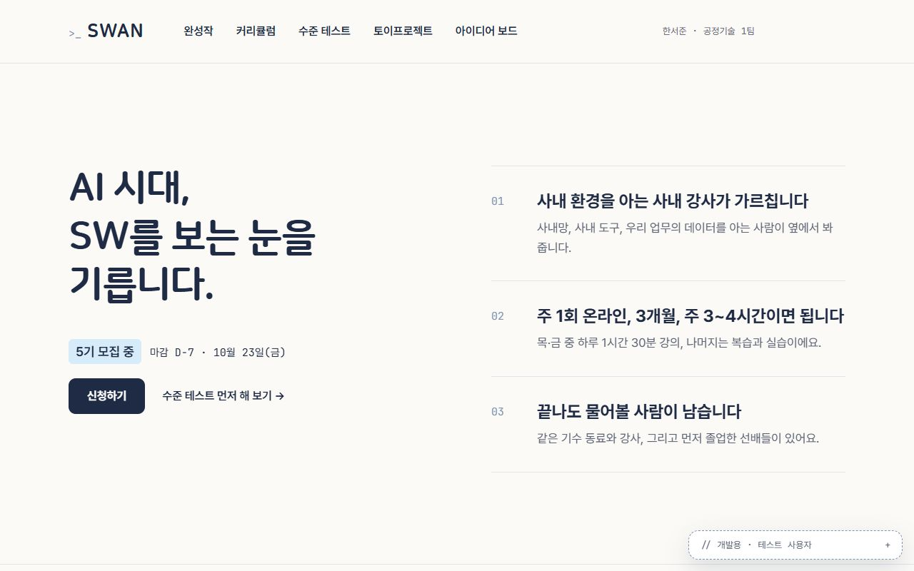 |
| ⑦ 모험길 | **바뀐 것** 제목 40 → 54px  **왜** 체크리스트 04-2 — 같은 레벨 제목 크기가 달랐다 |  | 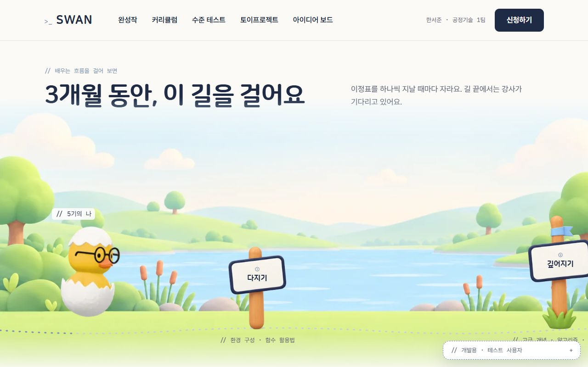 |
| ⑨ 파트 소개 | **바뀐 것** 제목 48 → 54px (세 줄)  **왜** 같은 문항 |  |  |
| ⑩ 아이디어 보드 | **바뀐 것** 제목 40 → 54px, 단을 넓혀 "부서장님께 말하긴 / 애매한 작은 불편, / 여기 남겨 주세요"  **왜** 같은 문항 |  |  |
| ⑪ 마지막 신청 | **바뀐 것** 메뉴 버튼이 숨어 흰 [신청하기] 하나만  **왜** 체크리스트 01-5 |  |  |

**다시 판정한 체크리스트 문항**: 01-5 · 04-2 수정 필요 → 확인 ([점검 기록](../ui-review/home.md))
**아쉬운 점 (다음 단계의 이유)**: 남은 수정 필요 6묶음 (③⑤ 제목, 개강일, 링크 위치, 긴 이름 시험, 0·1개 상태, 1280×800 이름표)
**커밋**: 저장소가 git이 아니라 없음

---

## 12. 히어로 이름표 · ③⑤ 제목 · 전체 보기 자리 (2026-10-16)

**단계**: UI 체크리스트 남은 항목 (사용자 선택: 06-10 · 02-3 · 04-8)
**왜**: 1280×800에서 히어로 이름표가 화면 아래 끝에 걸쳤다. ③⑤는 섹션 제목이 없어 무엇이 나올지 알기 어려웠다. '전체 보기' 링크가 ④는 오른쪽 위, ⑩은 제목 아래 왼쪽으로 달랐다.
**한 일**:
- 히어로 캐릭터 무대 아래에 40px 여백(`STAGE_FOOT`)을 두고 무대 크기 계산에서도 뺌
- ③ "4기 동안 함께한 사람들"(기수 수에 따라 바뀜) + "// 1기 → 4기 수료생과 부서", ⑤ "가르치는 사람" + 인용문 44 → 34px
- ⑩ "아이디어 보드 보기 →"를 오른쪽 목록 바로 위 오른쪽 끝으로 (④와 같은 규칙). 섹션 머리 보조 표시는 "//" 하나로

| 화면 | 바뀐 것 · 왜 | 비포 | 애프터 |
|---|---|---|---|
| ① 첫 화면 1280×800 | **바뀐 것** 무대가 40px 올라가 "// 5기의 나 · // 강사"가 화면 안에  **왜** 체크리스트 06-10 — 이름표가 화면 끝에 걸쳤다 |  |  |
| ③ 숫자 | **바뀐 것** "# 지금까지" 대신 54px 제목 "4기 동안 함께한 사람들"과 "//" 보조 줄  **왜** 체크리스트 02-3 — 제목이 없었다 |  |  |
| ⑤ 강사 | **바뀐 것** 제목 "가르치는 사람"을 두고 인용문을 한 단계 작게  **왜** 같은 문항 — 인용문으로 시작했다 |  |  |
| ⑩ 아이디어 보드 | **바뀐 것** "아이디어 보드 보기 →"가 목록 위 오른쪽 끝으로  **왜** 체크리스트 04-8 — ④와 위치가 달랐다 |  |  |

**다시 판정한 체크리스트 문항**: 06-10 · 02-3 · 04-8 수정 필요 → 확인 ([점검 기록](../ui-review/home.md))
**아쉬운 점 (다음 단계의 이유)**: 1280×800에서 히어로 무대가 약 5% 작아졌다. 남은 수정 필요 3묶음(개강일 · 긴 이름 시험 · 0·1개 상태)은 Phase 2·4·5와 함께
**커밋**: 저장소가 git이 아니라 없음

---

## 13. Phase 2 · 신청과 관리 (2026-10-16)

**단계**: Phase 2 (claude-code-prompt.md) — "5기 모집을 받을 수 있다"
**왜**: 홈의 [신청하기]가 빈 자리 화면으로 갔다. 관리자도 기수·신청자·졸업생을 볼 곳이 없었다. 체크리스트 02-7(개강일이 홈에 없음)도 함께.
**한 일**:
- 서버 `apply_api.py`: 신청 정보 · 신청(두 칸, 이름·부서·사번은 로그인 정보로) · 취소 · 다음 기수 알림. 한 기수에 유효한 신청 한 건(서버에서도 막음), 취소 뒤 다시 신청 가능
- 서버 `admin_api.py`(관리자만): 기수 목록·추가·수정·모집 열기/닫기(모집 중은 하나만)·수료 처리, 신청자 표·엑셀 내려받기, 졸업생 표·엑셀 올리기(미리보기 → 올리기). 엑셀은 multipart 없이 본문 그대로 받아 반입 패키지를 늘리지 않음
- 화면 `/apply`: 로고 + [나가기]만 있는 머리, 기수 정보(모집 기간·개강·강의·기간·주 3~4시간), 신청서 두 칸(경험은 고르기), 접수 완료(아기 오리가 콩 뛰고 컨페티), 이미 신청함(취소), 모집 기간 아님(알림 받기), 로그인 실패, 불러오기 실패
- 상단 버튼: [신청 완료] → "신청을 취소할까요?" → 취소, [다음 기수 알림 받기] → [✓ 알림 신청됨]
- 화면 `/admin`: 왼쪽 메뉴 240px, 기수 · 신청자 · 졸업생 (나머지 6개는 자리만)
- 홈: 모집 줄 세 곳(①②⑪)에 "· 개강 11월 5일(목)"
- 확인: 서버 자동 시험 13개 통과(`app/server/tests/test_phase2.py`), 화면 흐름 `tools/shot/phase2.cjs`

| 화면 | 바뀐 것 · 왜 | 비포 | 애프터 |
|---|---|---|---|
| 신청 | **바뀐 것** 빈 자리 화면 → 기수 정보 + 두 칸 신청서  **왜** Phase 2 — 10초 만에 신청 | (Phase 2 자리 화면) |  |
| 접수 완료 | **바뀐 것** "5기 신청이 접수됐어요", 이름·부서, 신청 일시, 개강까지 남은 날  **왜** 같은 단계 | (없음) |  |
| 상단 버튼 · 취소 | **바뀐 것** [신청 완료]를 누르면 한 번 더 묻고 취소  **왜** 되돌릴 수 없는 일은 한 번 더 묻는다 | (없음) |  |
| 모집 기간 아님 | **바뀐 것** 관리자가 모집을 닫으면 [다음 기수 알림 받기] → [✓ 알림 신청됨] | (없음) |  |
| 관리자 · 기수 | **바뀐 것** 기수 표와 모집 열기/닫기, 수료 처리 | (Phase 2 자리 화면) |  |
| 관리자 · 신청자 | **바뀐 것** 기수별 신청자 표, 취소한 사람은 따로, 엑셀로 내려받기 | (없음) |  |
| 관리자 · 졸업생 올리기 | **바뀐 것** 엑셀 미리보기(올릴 2명 · 건너뜀 1명 · 문제 1줄) → 올리면 홈 숫자 120 → 122 | (없음) |  |
| 홈 · 개강일 | **바뀐 것** 모집 줄에 "· 개강 11월 5일(목)"  **왜** 체크리스트 02-7 |  |  |

**다시 판정한 체크리스트 문항**: 02-7 수정 필요 → 확인 ([점검 기록](../ui-review/home.md))
**아쉬운 점 (다음 단계의 이유)**: 접수 완료의 3D 오리 hop은 Phase 7. 신청자 표의 '수준 테스트' 칸은 Phase 3에서 채운다. 관리자 메뉴 6개는 자리만
**커밋**: 저장소가 git이 아니라 없음

---

## 14. Phase 3 · 수준 테스트 (2026-10-16)

**단계**: Phase 3 (claude-code-prompt.md): "내 수준이 이 강의에 맞나?"에 3분 만에 답한다
**왜**: 홈의 [테스트 시작하기]와 상단 메뉴 '수준 테스트'가 빈 자리 화면으로 갔다. 관리자 신청자 표의 '수준 테스트' 칸은 "—"였다.
**한 일**:
- 서버 `quiz_api.py`: 문제는 정답 없이 내려주고, 제출하면 서버가 채점한다. 5번은 앞뒤 공백과 따옴표를 무시하고, 6번은 정답 줄과 부분 정답 줄을 구분한다(부분 정답은 0점). 성장 단계는 5~6 어린 백조, 3~4 아기 오리, 0~2 알에서 나온 오리
- 기록: 로그인한 사람만 남긴다. 응시할 때마다 문제별 답과 그때의 판정을 함께 남기고, 첫 응시에 기준 기록 표시를 한다. 로그인 실패면 채점만 한다
- 문제 데이터: `quiz_seed.py`에 level-test.md 6문제를 그대로 넣었다. 문제에는 칸 세 개(짧은 제목, 줄 옆 설명, 해설의 짧은 마크다운)를 더했다. 관리자 표와 응시 결과를 확인하려고 가상 응시 기록 5건을 함께 넣었다
- 화면 `/quiz`: 로고 + "수준 테스트" + 진행 표시(n / 6) + [나가기](풀던 중이면 한 번 더 묻는다). 아래 [← 이전] [다음]이 고정된 줄
  - 코드는 JetBrains Mono, 줄 번호, 문법 색(prism-react-renderer 2.4.1을 번들에 넣었다. 색은 방향 A 팔레트, 노랑 없음)
  - 6번은 상황 설명·원래 에러·로그 파일을 왼쪽에, AI가 고친 코드를 오른쪽에 둔다. 줄을 눌러 고르면 sky 바탕 + 왼쪽 ink 막대가 생기고 "고른 줄: 12"가 표시된다
  - 결과 카드: 앞면은 성장 단계 그림(sky 창, 접지 그림자)과 맞힌 개수. [해설 보기]를 누르면 Y축으로 0.7s 뒤집혀 문제별 해설 목록이 나온다(1~5는 접힘). 움직임 줄이기 설정이면 0.2s 교차 투명도로 바뀐다
  - 결과 옆: 단계별 메시지, 0~2개면 추천 기초 자료(가상 3개)와 [다음 기수 알림 받기] [그래도 신청하기], 이미 신청한 사람은 "✓ 이미 신청하셨어요", 기록 안내, [6번 해설 보기 ↓] [다시 풀기]
  - 6번 해설(펼친 채): 내 답 상자(정답·절반·오답 색), 코드 위 색 표시와 `//` 설명, 실제로 돌린 결과 표(48.0·0.0 크게), 숨은 문제 두 가지, 형광펜 한 줄 요약, 원래 코드와 더 나은 코드 나란히(바뀐 줄 sky), 강사 한마디
- 관리자 `/admin/quiz`: 문제 목록·추가·수정(보기는 동그라미로 정답 고르기, 줄 고르기는 코드에서 정답 줄·부분 정답 줄을 눌러 고르기, 코드 미리보기)과 응시 결과 표(첫 응시 점수·단계·응시 횟수·문제별 ○△×). 신청자 표의 '수준 테스트' 칸은 첫 응시 점수 "5 / 6"
- 확인: 서버 자동 시험 25개 추가, 모두 38개 통과(`tests/test_phase3.py`). 화면 흐름 `tools/shot/phase3.cjs`(여섯 가지 풀이 + 관리자), 첫 화면 비교 `tools/shot/pages.cjs`

| 화면 | 바뀐 것 · 왜 | 비포 | 애프터 |
|---|---|---|---|
| 시작 | **바뀐 것** 빈 자리 화면 → 문제 구성 3줄, 기록 안내, 성장 3단계 그림과 점수 범위  **왜** 무엇을 몇 분 동안 푸는지 먼저 보여 준다 |  |  |
| 1~4번 보기 고르기 | **바뀐 것** 왼쪽 코드(문법 색), 오른쪽 질문과 보기 4개 | (없음) |  |
| 5번 주관식 | **바뀐 것** "출력:" 입력 칸 하나, 비어 있으면 [다음]을 쓸 수 없음 | (없음) |  |
| 6번 줄 고르기 | **바뀐 것** 상황·에러·로그 → AI가 고친 코드, 줄을 눌러 고름 | (없음) |  |
| 결과 · 어린 백조 | **바뀐 것** 성장 단계 카드 + 메시지 + [신청하기] | (없음) |  |
| 결과 · 카드 뒷면 | **바뀐 것** 문제별 정답·절반·오답, 누르면 해설 | (없음) |  |
| 결과 · 알에서 나온 오리 | **바뀐 것** 추천 기초 자료 + 알림 받기 + 그래도 신청하기  **왜** 결과가 낮아도 신청은 막지 않는다 | (없음) |  |
| 결과 · 이미 신청함 | **바뀐 것** [신청하기] 대신 "✓ 이미 신청하셨어요" | (없음) |  |
| 6번 해설 · 절반 | **바뀐 것** "절반 맞았어요. 더 직접적인 원인이 있어요", 10·11줄 warning, 12줄 success | (없음) |  |
| 6번 해설 전체 | **바뀐 것** 실행 결과 표 → 숨은 문제 → 요약 → 더 나은 코드 → 강사 한마디 | (없음) |  |
| 관리자 · 문제 | **바뀐 것** 자리 화면 → 문제 목록과 편집 |  |  |
| 관리자 · 줄 고르기 편집 | **바뀐 것** 코드에서 정답 줄·부분 정답 줄을 눌러 고르고 줄 옆 설명을 적는다  **왜** 고르는 방식 우선, 줄 번호를 손으로 세지 않게 | (없음) |  |
| 관리자 · 응시 결과 | **바뀐 것** 첫 응시 점수·단계·응시 횟수·문제별 ○△× | (없음) |  |
| 관리자 · 신청자 | **바뀐 것** '수준 테스트' 칸 "—" → 첫 응시 점수 "5 / 6" |  |  |

**고친 것 (캡처를 보고)**: 개발용 사용자 상자가 고정된 [다음] 버튼을 가려 /quiz에서는 상자를 위로 올렸다. ①②③④가 JetBrains Mono에 없어 작게 나와 본문 글꼴로 바꿨다. 6번 내 답 상자의 "pass을" 조사, 더 나은 코드의 주석 잘림도 고쳤다([build-log](../../planning/v3-1013/build-log.md))
**아쉬운 점 (다음 단계의 이유)**: 추천 기초 자료는 가상이라 실제 자료가 정해지면 바꿔야 한다. 성장 단계 그림은 정지 그림이고, 결과 화면에서 캐릭터가 움직이는 연출은 없다. 문제 내용은 강사와 검토 전이다
**커밋**: 저장소가 git이 아니라 없음

---

## 15. 숫자 가운데 · 모험길 끝에서 멈춤 · 수준 테스트 버튼 위치 (2026-10-18)

**단계**: 사용자 피드백 반영
**왜**: 사용자가 세 가지를 짚었다. ③ "4기 동안 함께한 사람들"이 왼쪽으로 치우쳐 오른쪽이 비어 보인다. 모험길 끝에 닿으면 스크롤이 잠깐 멈추고 백조들을 보여 주기로 했는데 멈추지 않는다. 수준 테스트의 [다음]이 화면 맨 아래에 있어 고른 보기에서 멀다.
**한 일**:
- ③ 숫자 섹션만 가운데 정렬: 제목, `// 1기 → 4기` 주석, 숫자 세 개
- 모험길: 축하 장면 동안 스크롤을 붙잡는 방식을 바꿨다. 예전에는 휠·터치·키 입력만 막아서, 실제 브라우저에서 휠을 세게 굴리면 이미 시작된 부드러운 스크롤, 터치패드 관성, 스크롤바 끌기가 그대로 지나갔다. 이제는 도착한 자리(고정 구간 안으로 맞춤)에서 벗어나면 바로 되돌린다. 약 2.5초 뒤 꽃비가 내리면 풀린다
- 수준 테스트: 아래 고정 줄을 없애고 [← 이전] [다음]을 보기·입력 칸·코드 바로 아래로 옮겼다. 고정 줄 때문에 올려 두었던 개발용 사용자 상자도 원래 자리로 돌렸다
- 확인: `tools/shot/walkstop.cjs`(휠을 쉬지 않고 굴리고, 도착 0.5초 뒤 스크롤바를 끈 것처럼 1500px 내려 봄 → 제자리로 돌아옴), `phase3.cjs` 여섯 가지 풀이 다시 통과

| 화면 | 바뀐 것 · 왜 | 비포 | 애프터 |
|---|---|---|---|
| ③ 숫자 | **바뀐 것** 왼쪽 정렬 → 가운데  **왜** 숫자가 왼쪽에 몰려 오른쪽이 비었다 |  |  |
| 모험길 도착 1.5초 뒤 | **바뀐 것** 화면은 같다. 축하 중 스크롤바를 끌어도 제자리로 돌아온다  **왜** 실제 브라우저에서는 멈추지 않았다 |  |  |
| 수준 테스트 1번 | **바뀐 것** [다음]이 화면 맨 아래 → 보기 바로 아래  **왜** 고른 곳에서 눈과 손이 멀리 가지 않게 |  |  |
| 수준 테스트 6번 | **바뀐 것** "고른 줄: 12"와 [결과 보기]가 코드 바로 아래 |  |  |

**아쉬운 점**: 헤드리스 브라우저에는 부드러운 휠 스크롤이 없어서, 실제 휠 관성은 자동 시험으로 재현하지 못했다. 스크롤바 끌기와 같은 방식(스크롤 위치를 직접 바꿈)으로 대신 확인했다
**커밋**: 저장소가 git이 아니라 없음

---

## 16. Phase 4 · 완성작 갤러리 · 날아오르는 백조 · 모험길 문구 (2026-10-18)

**단계**: Phase 4 (claude-code-prompt.md) + 사용자 요청 두 가지
**왜**: 홈의 '졸업생이 만든 것들'은 가상 카드였고, 목록·상세·올리기는 빈 자리 화면이었다. 사용자가 마지막 신청 섹션의 백조 영상(보류 중이던 것)을 만들자고 했고, 모험길 설명을 제목 아래로 옮기자고 했다.
**한 일**:
- 서버 `projects_api.py`: 공개된 것만 목록에 · 기수/부서 필터 · 최신순/좋아요순 · 상세(승인 전에는 올린 사람과 관리자만) · 좋아요 한 사람 한 번(다시 누르면 취소) · 졸업생만 올리기/고치기/지우기 · 고치면 다시 승인 대기 · 관리자 승인/반려/내리기(이유 필수, 올린 사람에게 보임) · 홈 미리보기(좋아요 많은 순 5개)
- 파일: `python-multipart`로 받고(사용자 결정), 서버 폴더 `data/uploads`에 서버가 지은 이름으로 저장. 종류는 확장자와 파일 앞부분으로, 크기는 서버에서 확인(이미지 5MB, 캡처 8장, 발표자료 PDF/PPT 30MB)
- 자세한 설명: Toast UI Editor 3.2.2(사용자 결정)를 이 부품이 나올 때만 불러온다. 사용 통계 전송은 끔
- 화면: `/projects`(필터·정렬·카드 마우스 올림·내 완성작 상태 줄), `/projects/:id`(대표 이미지 → 만든 사람·좋아요 → 문제 → 효과 → 캡처 크게 보기 → 발표자료 → 자세한 설명 → 저장소 → 신청 → 같은 부서·기수 완성작), `/projects/new`·`/projects/:id/edit`(민감 정보 안내, 확인 체크해야 올리기), 관리자 '완성작 검수'(상태별 탭, 공개됐을 때와 같은 미리보기, 승인·반려)
- 가상 데이터: 공개 6(1~4기 모두) · 승인 대기 1 · 반려 1. 대표 그림은 자리 그림을 webp로 줄여 `app/server/seed_assets/`에 넣고 seed가 복사
- 마지막 신청 섹션: 어린 백조가 날개를 펴고 날아올라 공중에서 날갯짓 (Higgsfield Kling O3 5초 6.25크레딧 + 배경 제거 1크레딧, 원본·합성 스크립트 `design/fly/`). 배경 제거가 노트북까지 지워 원본에서 되살려 합성, 투명 프레임 61장
- 모험길: 설명 문구를 제목 바로 아래로. 축하 중 스크롤 붙잡기는 위에서 걸어 내려와 닿았을 때만 (메뉴로 건너뛰거나 아래에서 올라오면 붙잡지 않음)
- 확인: 서버 자동 시험 15개 추가, 모두 53개 통과(`tests/test_phase4.py`, 업로드는 `tests/conftest.py`의 임시 폴더). 화면 흐름 `tools/shot/phase4.cjs`: 졸업생이 올림 → 관리자 반려 → 졸업생이 이유 보고 고쳐 다시 올림 → 관리자 승인 → 직원 좋아요, 콘솔 오류 없음

| 화면 | 바뀐 것 · 왜 | 비포 | 애프터 |
|---|---|---|---|
| 완성작 목록 | **바뀐 것** 빈 자리 → 기수 칩·부서 고르기·정렬과 3열 카드  **왜** Phase 4 |  |  |
| 카드 마우스 올림 | **바뀐 것** 그림 위로 ink 면이 올라오며 짧은 설명과 효과 | (없음) |  |
| 완성작 상세 | **바뀐 것** 기획 순서대로 전체 | (없음) |  |
| 올리기 | **바뀐 것** 민감 정보 안내 + 칸 9개 + 편집기 + 확인 체크 |  |  |
| 관리자 검수 | **바뀐 것** 자리 화면 → 승인 대기 목록과 미리보기, 반려 이유 |  |  |
| 내 완성작 · 반려 | **바뀐 것** 반려 이유와 "고쳐서 다시 올리기" | (없음) |  |
| 직원의 /projects/new | **바뀐 것** "완성작은 졸업생만 올릴 수 있어요" | (없음) |  |
| 홈 ④ 완성작 | **바뀐 것** 가상 카드·줄무늬 자리 → 실제 완성작(좋아요 많은 순), 0개면 안내  **왜** 체크리스트 06-2·06-3 |  |  |
| ⑪ 마지막 신청 | **바뀐 것** 오른쪽에 날아오르는 어린 백조 |  |  |
| 모험길 머리 | **바뀐 것** 설명을 오른쪽 끝 → 제목 아래 |  |  |

**고친 것 (확인하다 찾은 것)**: 이번에 바꾼 스크롤 붙잡기가 메뉴 이동처럼 모험길을 건너뛰기만 해도 걸렸다. 홈 미리보기가 내 좋아요를 몰라 이미 누른 하트가 비어 보였다(누르면 취소됨). 파일 미리보기 주소를 개발 모드에서 너무 일찍 지웠다. 모두 고치고 시험에 넣었다 ([build-log](../../planning/v3-1013/build-log.md))
**아쉬운 점**: 백조 노트북에 작은 얼룩 몇 점(배경 제거 흔적)이 남았다. 발표자료는 브라우저가 여는 대로 보여 PPT는 내려받기가 된다
**커밋**: GitHub 비공개 저장소 haeji1124/SWAN

## 17. 날아오른 백조가 로고를 띄우고 내려앉기 (2026-10-19)

**단계**: 사용자 요청 (Phase 5 시작 전)
**왜**: 마지막 신청 섹션의 어린 백조가 꼭대기 날갯짓 구간을 끝없이 오가서 "계속 날아오르려다 실패하는 것" 같다는 의견. 꼭대기에서 SWAN 로고가 생기고, 그다음 다시 내려오자고 했다.
**한 일**:
- 섹션이 보이면 한 번만: 날아오름(0→60장) → 꼭대기에 닿는 순간 머리 위에 `>_ SWAN` 로고(히어로 변신 때와 같은 반짝이는 별) → 공중 날갯짓 두 번 → 같은 장면을 거꾸로 돌려 내려앉음(60→0장)에서 멈춤. 로고는 하늘에 남는다. 약 15초
- 새로 생성하지 않고 기존 프레임 61장을 순서만 바꿔 썼다 (크레딧·블렌더 렌더 없음)
- 히어로의 로고를 공용 부품 `components/SwanLogo.tsx`로 빼고, ink 바탕에서는 미색 알약으로
- 로고 자리를 위해 섹션 위 여백 96 → 128px. 움직임 줄이기 설정이면 서 있는 장면 + 로고를 바로 보여 준다
- 확인: `tools/shot/fly.cjs`(마지막 섹션으로 건너뛰어 정한 초마다 캡처), 콘솔 오류 없음

| 화면 | 바뀐 것 · 왜 | 비포 | 애프터 |
|---|---|---|---|
| ⑪ 마지막 신청 (10초) | **바뀐 것** 꼭대기에서 날갯짓만 반복 → 머리 위에 SWAN 로고 |  |  |
| 흐름 (3·6·9·13·17초) | **바뀐 것** 날아오름 → 로고 → 날갯짓 → 내려오는 중 → 착지 | (반복) |  |

**아쉬운 점**: 내려앉기는 이륙 장면을 거꾸로 돌린 것이라 날개 접는 모양이 이륙과 똑같다. 더 자연스러운 착지가 필요하면 착지 영상을 따로 만들어야 한다(크레딧)

## 18. Phase 5 · 아이디어 보드와 토이프로젝트 (2026-10-19)

**단계**: Phase 5 (claude-code-prompt.md)
**왜**: `/ideas`·`/toys`와 관리자 두 메뉴가 자리 화면이었고, 홈 ⑩ 아이디어 미리보기는 가상 데이터였다(공감 42 같은 숫자도 지어낸 것). 둘 다 "가볍게 올린다"가 핵심이라 승인 없이 바로 공개된다.
**한 일**:
- 서버 `ideas_api.py`: 공감순·최신순 · 남기기(제목 60자·설명 300자·이름 표시 방식) · 내 것만 고치기/지우기 · 공감 한 번(다시 누르면 취소) · 관리자 상태 변경(접수됨/검토 중/만드는 중/완료/보류 — 모델에 빠져 있던 '보류'를 더함)·한 줄 답변(100자, 줄바꿈은 한 줄로)·숨기기/다시 보이기 · 관리자 목록에는 늘 이름과 부서 · 홈 `ideas` 공감 많은 순 3개
- 서버 `toys_api.py`: 누구나 보기, 글쓰기·참여는 수강생·졸업생만(관리자도 직원이면 안 됨) · 모집 중 먼저 · 참여 토글(내 글·마감은 막고, 취소는 마감 뒤에도) · 희망자 목록은 글쓴이에게만 · 글쓴이가 고치기·지우기·마감·다시 열기(사용자 결정) · 관리자 숨기기
- 화면: `/ideas`(왼쪽 진행 단계 안내, 오른쪽 카드 목록, [나도 필요해요] 칸, 남기기·고치기 창, 빈 상태) · `/toys`(목록, 직원에게는 버튼 대신 안내) · `/toys/:id`(오른쪽 참여 상자: 글쓴이는 희망자·마감, 수강생·졸업생은 참여, 직원은 안내) · `/toys/new`·`/toys/:id/edit`(예상 기간은 고르기) · 관리자 '아이디어'(상태 고르기·답변 쓰기·숨기기 표)와 '토이프로젝트'(목록·숨기기)
- 홈 ⑩: 가상 3줄 → 공감 많은 순 3개. 0개면 "아직 남겨진 아이디어가 없어요", 1~2개면 빈 자리에 "아이디어를 더 남겨 주세요" 줄. 답변이 있으면 설명 대신 답변을 보여 준다
- 가상 데이터: 아이디어 8개(상태 다섯 가지 모두, 답변 3개, 이름 표시 두 방식), 모집 글 3개(모집 중 2·마감 1, 참여 희망 포함)
- 확인: 서버 자동 시험 15개 추가, 모두 68개 통과(`tests/test_phase5.py`). 화면 흐름 `tools/shot/phase5.cjs` — 직원이 남김(부서만) → 다른 직원 공감 → 관리자 상태·답변 → 카드에 보임 → 관리자 숨김 → 직원에게 토이 버튼 없음 → 졸업생 모집 글 → 수강생 참여 → 졸업생만 희망자 확인·마감 → 관리자 숨김 → 홈 ⑩ 3·1·0개. 콘솔 오류 없음

| 화면 | 바뀐 것 · 왜 | 비포 | 애프터 |
|---|---|---|---|
| 아이디어 보드 | **바뀐 것** 자리 화면 → 진행 단계 안내 + 공감순 카드, 상태 배지·파트 답변·[나도 필요해요]  **왜** Phase 5 |  |  |
| 남기기 창 | **바뀐 것** 칸 셋(제목·설명·이름 표시). 고른 표시가 내 이름으로 미리 보인다 | (없음) |  |
| 남긴 직후 | **바뀐 것** 최신순으로 바뀌며 새 아이디어가 맨 위에 잠깐 하늘색 | (없음) |  |
| 상태·답변이 카드에 | **바뀐 것** 관리자가 '검토 중'과 답변을 달자 카드에 보임 | (없음) |  |
| 관리자 아이디어 | **바뀐 것** 자리 → 공감·이름(부서만 표시 여부)·상태 고르기·답변·숨기기 |  |  |
| 토이프로젝트 (직원) | **바뀐 것** 자리 → 모집 글 목록. 직원에게는 버튼 대신 "수강생과 졸업생만" 안내 |  |  |
| 모집 글 쓰기 | **바뀐 것** 칸 넷, 예상 기간은 고르기 | (없음) |  |
| 참여 (수강생) | **바뀐 것** [참여하고 싶어요] → "✓ 참여 희망함 · 누르면 취소" | (없음) |  |
| 희망자 (글쓴이) | **바뀐 것** 글쓴이에게만 이름·부서, [모집 마감] → [모집 다시 열기] | (없음) |  |
| 관리자 토이 | **바뀐 것** 자리 → 목록·숨기기 |  |  |
| 홈 ⑩ | **바뀐 것** 가상 → 실제 공감 많은 순 3개  **왜** 체크리스트 06-2·06-3 |  |  |
| 홈 ⑩ 1개 · 0개 | **바뀐 것** 1개면 남기러 가는 줄, 0개면 첫 아이디어 안내 | (없음) |   |

**고친 것 (확인하다 찾은 것)**: 게시판 버튼이 주 버튼이라 메뉴 [신청하기]와 두 개가 됐다 → 보조 버튼으로. [나도 필요해요] 칸이 카드 높이만큼 늘어났다 → 위에 붙임. 입력 안내가 고쳐 쓴 뒤에도 남았다. 지우기 확인 문구의 조사가 틀렸다 ([build-log](../../planning/v3-1013/build-log.md))
**아쉬운 점**: 공감 수는 가상 사용자 12명 안에서라 예전 가상 화면(42·35·28)보다 작다. 완성작 목록의 [완성작 올리기]는 여전히 주 버튼이라 메뉴와 두 개다(Phase 4 화면, 이번에 손대지 않음)
**커밋**: GitHub 비공개 저장소 haeji1124/SWAN

## 19. 아이디어에 그림 붙이기 · 백조 비행 짧게 (2026-10-19)

**단계**: 사용자 요청 두 가지 (Phase 5 다듬기)
**왜**: 아이디어는 줄글만 적을 수 있어 "이 화면의 이 칸이 불편해요"를 말로 풀어야 했다. 마지막 신청 섹션의 백조는 올라갔다 내려오는 데 약 15초가 걸려 너무 길다는 의견.
**한 일**:
- 아이디어 남기기·고치기 창에 '그림(선택)' 칸: 3장까지, 한 장 5MB, png·jpg·webp·gif. [그림 붙이기]로 고르거나, 화면을 캡처해 창 안에서 Ctrl+V로 붙여 넣는다. 고칠 때 [빼기]로 기존 그림을 뺄 수 있다
- 서버: 남기기·고치기를 multipart로 받고, 파일 검사(확장자 + 파일 앞부분 + 크기)와 저장은 완성작과 같은 함수를 쓴다(`uploads/ideas/…`). 뺀 그림과 지운 아이디어의 그림은 서버 폴더에서도 지운다. `Idea.images` 칸 추가(개발 DB는 `seed.py`로 다시 만듦)
- 카드에 작은 그림, 누르면 크게 보기. 관리자 표에도 작은 그림(숨길지 판단용, 누르면 새 탭)
- 백조: 초당 12 → 16장, 공중 날갯짓 두 번 → 한 번, 내려앉기는 한 장씩 건너뛰어 약 15초 → 8초
- 확인: 서버 시험 1개 추가(첨부·3장 제한·가짜 그림 막기·고치기에서 빼기·지우기), 모두 69개 통과. `phase5.cjs`에 파일 고르기 + 붙여넣기 첨부와 크게 보기를 더함, 콘솔 오류 없음

| 화면 | 바뀐 것 · 왜 | 비포 | 애프터 |
|---|---|---|---|
| 남기기 창 | **바뀐 것** 그림 칸(고르기·붙여넣기, 미리보기와 [빼기]) |  |  |
| 카드 | **바뀐 것** 설명 아래 작은 그림 |  |  |
| 크게 보기 | **바뀐 것** 누르면 화면 가득 (Esc·바깥 누르면 닫힘) | (없음) |  |
| 관리자 아이디어 | **바뀐 것** 설명 아래 작은 그림 |  |  |

**아쉬운 점**: 그림 말고 엑셀·PDF 같은 파일은 받지 않는다(사내 자료가 그대로 올라올 수 있어 그림만). 필요하면 종류를 더할 수 있다

## 20. 수준 테스트에도 상단 메뉴 · 로고로 맨 위 (2026-10-19)

**단계**: 사용자 요청
**왜**: 수준 테스트는 구현 전달 3장대로 상단 메뉴 대신 "로고 + 수준 테스트 + [나가기]"만 있어서, 들어가면 다른 메뉴로 갈 수 없었다. 홈에서 로고를 누르면 주소가 같아 아무 일도 일어나지 않았다.
**한 일**:
- 수준 테스트도 다른 화면처럼 상단 메뉴를 그대로 쓰고, 그 아래 얇은 줄에 `// 수준 테스트` · 진행 표시 · [나가기](풀던 중이면 한 번 더 묻기). 신청 화면은 그대로 로고 + [나가기]만
- 결과 화면의 [신청하기]·[다음 기수 알림 받기]가 보이는 동안에는 메뉴의 [신청하기]를 숨긴다 (홈 섹션에 쓰던 장치를 `useHideNavPrimary`로 꺼내 재사용, 주 버튼은 한 화면에 하나)
- 홈에서 로고를 누르면 맨 위로 부드럽게 올라간다
- 확인: `tools/shot/quizstep.cjs`(첫 화면·1번 문제, 메뉴 5개와 로고 확인), `phase3.cjs quiz`(결과 화면 여섯 경우), 콘솔 오류 없음

| 화면 | 바뀐 것 · 왜 | 비포 | 애프터 |
|---|---|---|---|
| 수준 테스트 1번 | **바뀐 것** 로고·나가기만 → 상단 메뉴 + 진행 줄 |  |  |
| 결과 (어린 백조) | **바뀐 것** 메뉴가 생겼지만 [신청하기]는 하나만 | (메뉴 없음) |  |
| 결과 (알에서 나온 오리) | **바뀐 것** 같은 규칙, [다음 기수 알림 받기]가 주 버튼 | (메뉴 없음) |  |

**아쉬운 점**: 풀던 중에 상단 메뉴를 누르면 묻지 않고 바로 넘어가 고른 답이 사라진다([나가기]만 묻는다). 6문제라 크게 아깝지 않아 두었다
