# UI 체크리스트 점검 · 홈 (`/`)

점검일 2026-10-16 · 기준: 'UI를 만들고 난 후 확인해봐야 할 체크리스트' 8페이지
판정: 확인 = 충족 · 수정 필요 = 개선 필요 · 해당 없음 = 검토 대상 아님

---

## 01 / 08 · START

### A. 검토 대상 기록
- **검토 서비스 / 화면**: SWAN 사내 교육 사이트 · 홈 · `http://localhost:5174/` (개발 서버, 2026-10-16 작업 상태, Phase 1 + 연출 다듬기 7단계까지)
- **사용자와 사용 상황**: 예비 수강생(파이썬은 쓰지만 AI가 짠 코드를 판단할 눈이 없는 현업 엔지니어). 업무 중 사내 메일·게시판의 [신청하기]를 눌러 **사내망 PC**로 들어온다. 짧게 훑어보고 "나에게 맞나 / 언제까지 / 어떻게 신청하나"를 확인해 그 자리에서 신청하려고 들어온다.
- **본 데이터**: 가상 데이터(seed, 테스트 사용자 한서준·직원, 5기 모집 중 D-7). 로그인 실패 상태와 `/api/home` 실패(500)도 직접 만들어 봤다.
- **본 크기**: PC 1280×800 (주 점검) · 1440×900 (기준 폭, 앞선 작업에서 확인). 이 사이트는 **PC 전용**이라(CLAUDE.md "만들지 않는다: 모바일 화면") 모바일 375 · 태블릿 768은 해당 없음.

### B. 화면 캡처와 표시 번호 (1280×800, 섹션 윗변에서 한 화면씩)
| 번호 | 영역 | 캡처 |
|---|---|---|
| ⓝ | 상단 고정 메뉴 (로고 · 메뉴 5개 · 이름 · [신청하기]) | 모든 캡처 맨 위 |
| ① | 인트로(히어로) — 340vh 고정 스크롤, 오리 → 어린 백조 | 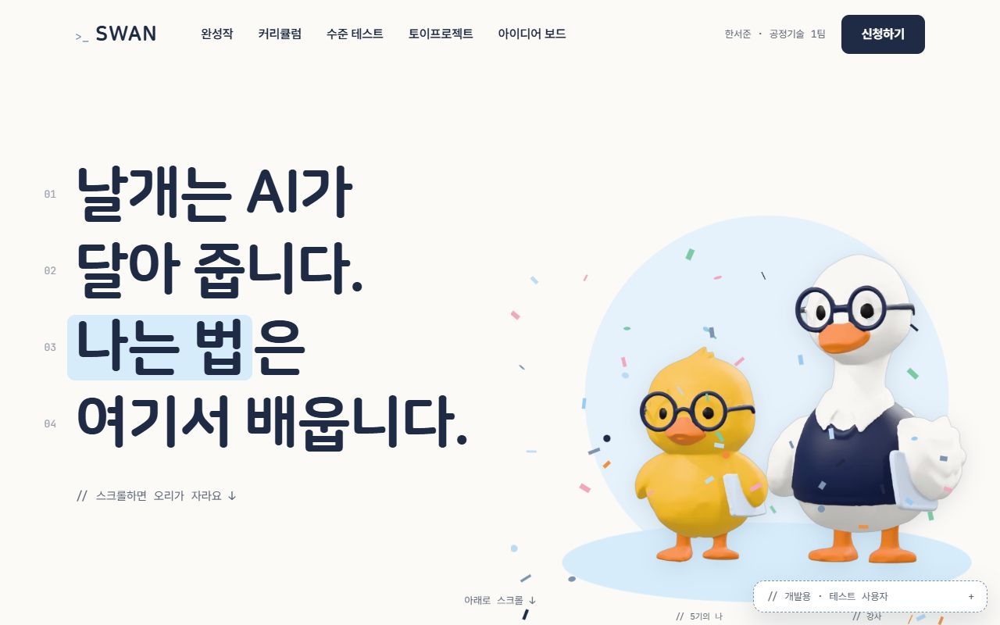 |
| ② | 한 줄 소개 + 모집 상태 + [신청하기] | 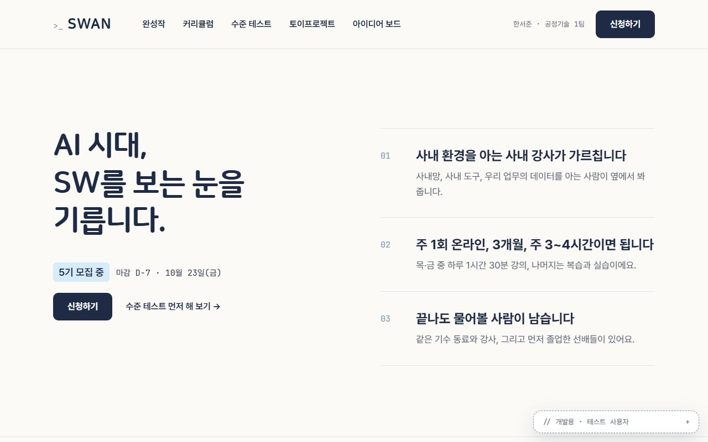 |
| ③ | 숫자와 이름·부서 띠 | 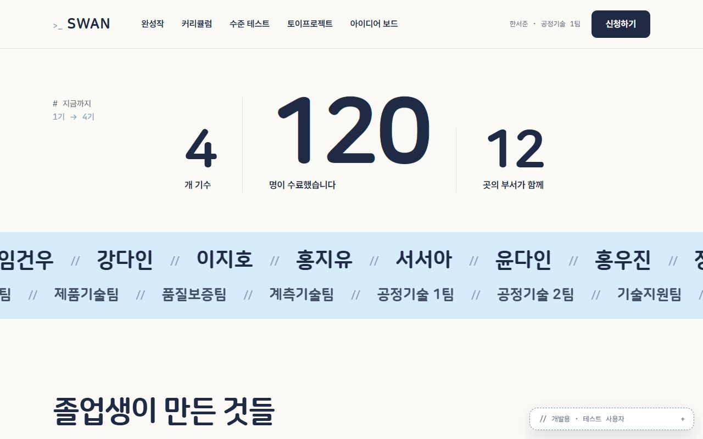 |
| ④ | 졸업생 완성작 미리보기 | 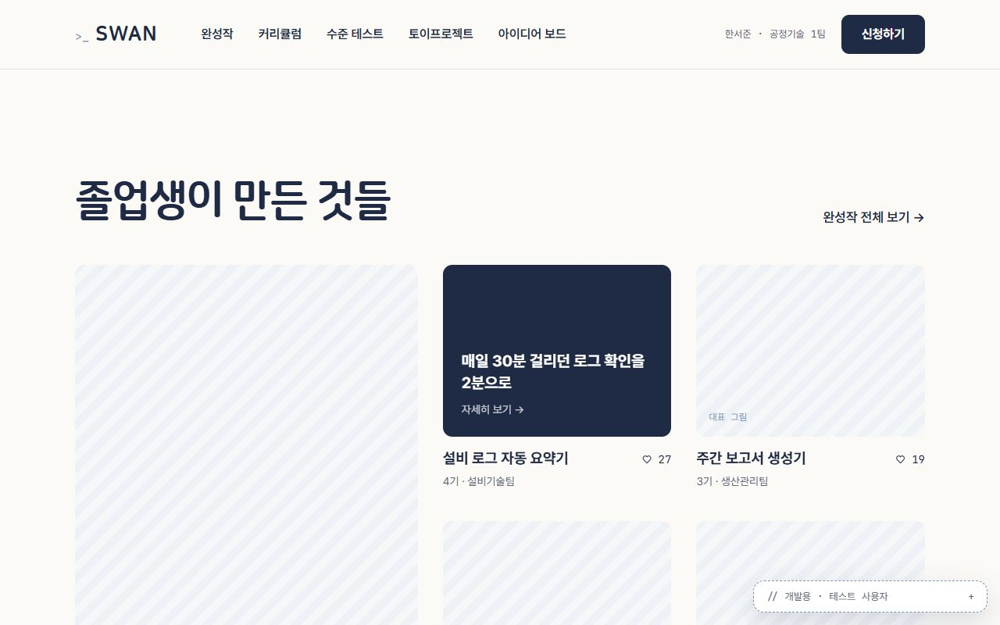 |
| ⑤ | 강사 소개 | 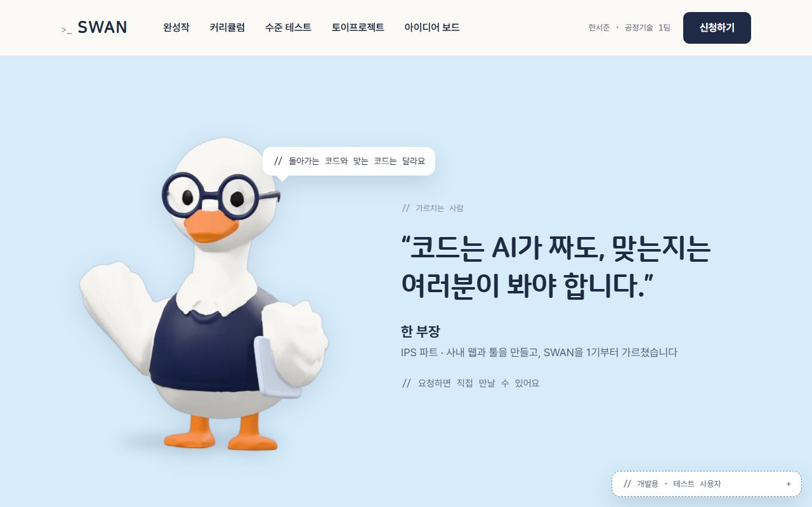 |
| ⑥ | 커리큘럼 (배우는 흐름 + 실습 프로젝트 + 수강 안내) |  |
| ⑦ | 모험길 — 320vh 고정 가로 스크롤 | 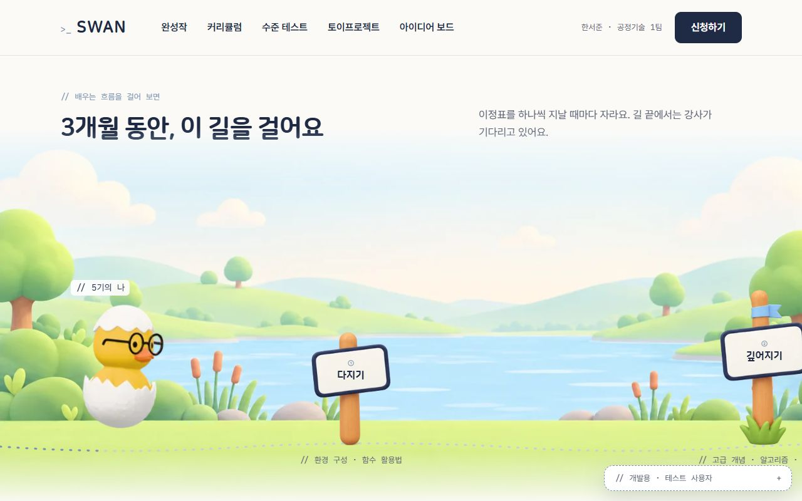 |
| ⑧ | 수준 테스트 안내 | 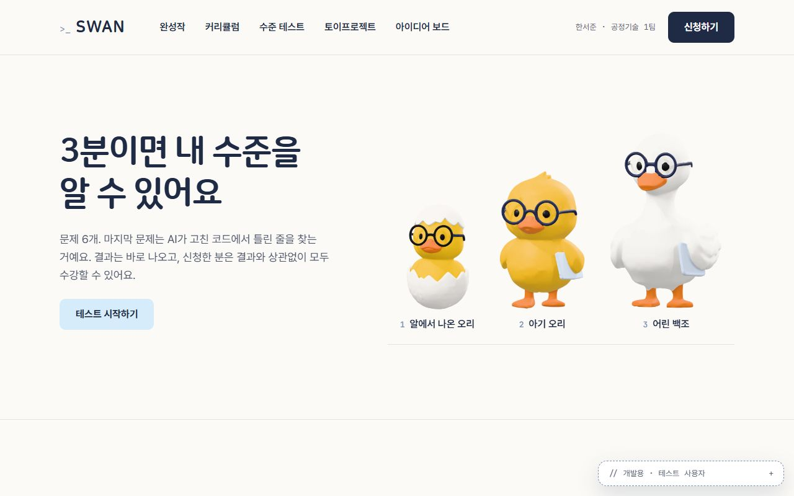 |
| ⑨ | 파트 소개 | 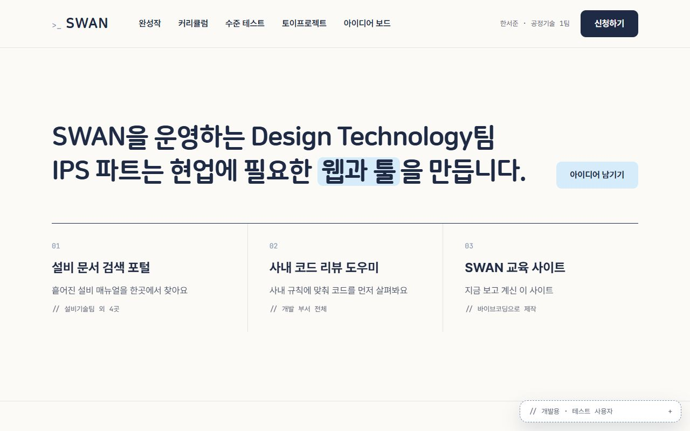 |
| ⑩ | 아이디어 보드 미리보기 | 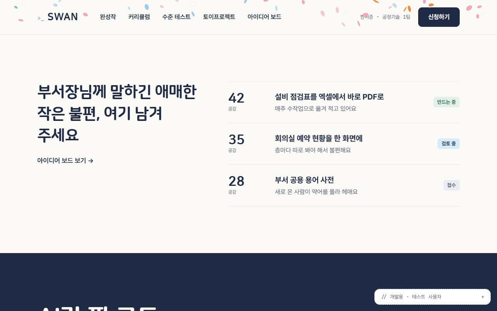 |
| ⑪ | 마지막 신청 안내 | 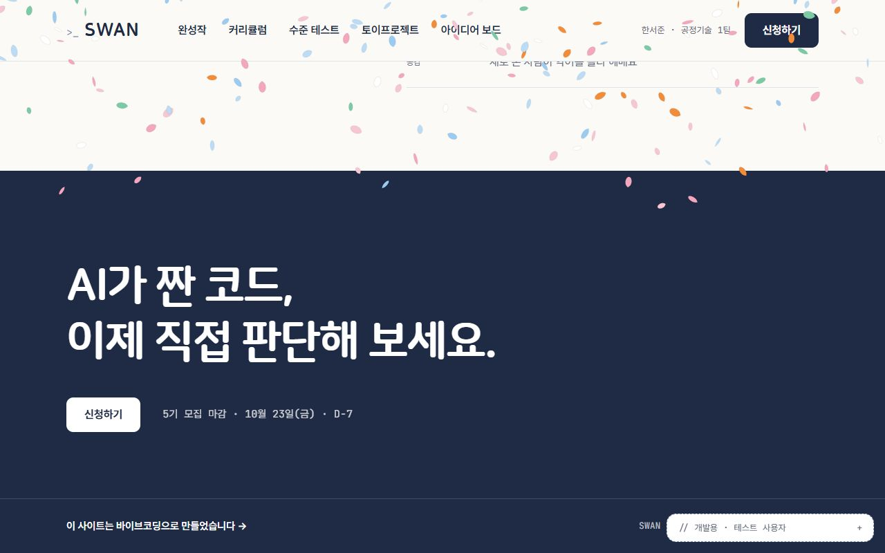 |

참고: 캡처 오른쪽 아래의 "// 개발용 · 테스트 사용자" 상자는 개발용이라 실제 화면에는 없다(점검 대상 아님). ①·⑩·⑪에 보이는 컨페티·꽃잎은 캡처 스크립트가 페이지 끝까지 내려갔다 올라오며 생긴 것이다.

### C. 검토 순서
목적 → 정보 → 위계 → 일관성 → 사용성 → 실제 상황

---

## 02 / 08 · 01. PURPOSE · 목적
핵심 질문: 이 화면에서 사용자가 해야 할 가장 중요한 행동이 명확한가?

### A. 문항별 검토
| 검토 문항 | 판정 | 근거 (위치 · 이유) |
|---|---|---|
| 1. 목적을 한 문장으로 설명할 수 있는가 | 확인 | ①의 "날개는 AI가 달아 줍니다. 나는 법은 여기서 배웁니다."와 ②의 "AI 시대, SW를 보는 눈을 기릅니다." + [신청하기]로 '교육을 알고 신청하는 화면'이 드러난다 |
| 2. 들어온 이유가 바로 이해되는가 | 확인 | 메일의 [신청하기]로 들어오면 ⓝ 오른쪽 위에 같은 이름의 [신청하기]가 바로 보인다 |
| 3. 가장 중요한 행동이 1~2개인가 | 확인 | 신청하기(ⓝ②⑪)와 수준 테스트(②⑧) 두 가지. ⑨[아이디어 남기기]는 다른 사용자(실무진)용으로 보조 버튼 |
| 4. Primary CTA가 한눈에 보이는가 | 확인 | ⓝ [신청하기]가 ink 바탕 버튼으로 항상 고정돼 있다 |
| 5. 중요하지 않은 버튼이 핵심 행동과 경쟁하지 않는가 | 수정 필요 | ②·⑪ 화면에서 ⓝ[신청하기]와 섹션 안 [신청하기]가 **같은 주 버튼 두 개**로 동시에 보인다. 디자인 기준 "주 행동 버튼은 한 화면에 하나"와 어긋난다 (경쟁 요소는 다른 버튼이 아니라 같은 버튼의 중복) |
| 6. '그래서 뭘 하면 되지?'가 들지 않는가 | 수정 필요 | ① 첫 화면 안내가 "// 스크롤하면 오리가 자라요 ↓"뿐이고, **5기 모집 중 · 마감 D-7**은 340vh 고정 구간을 지나 ②에서 처음 나온다. 첫 화면만 보고는 "지금 신청을 받는 중인지, 언제까지인지"를 알 수 없다 |

### B. 목적과 핵심 행동 정리
- 페이지 목적 한 문장: "이 화면은 **예비 수강생이 SWAN이 자기에게 맞는지 눈으로 확인하고 그 자리에서 5기 신청을 하기** 위한 화면이다."
- 핵심 행동: ① 신청하기 ② (선택) 수준 테스트
- Primary CTA: ⓝ [신청하기] / 경쟁 요소: ②·⑪ 섹션 안의 같은 [신청하기] (중복), ① 고정 스크롤 연출이 행동 정보보다 먼저 길게 나옴

### C. 관찰과 개선 기록
- 관찰 위치: ① 첫 화면, ②·⑪
- 문제와 근거: 첫 화면에 '지금 모집 중 / 마감'이 없다(문항 6). ②·⑪에서 주 버튼이 두 개다(문항 5).
- 개선 방향: ① 헤드라인 아래에 모집 상태 한 줄(배지 + 마감)을 둔다. ②·⑪의 섹션 버튼은 두되, 그 섹션이 보이는 동안에는 ⓝ 버튼을 보조 모양으로 낮추거나, 섹션 버튼을 글자 버튼으로 낮추는 규칙을 정한다.

**요약: 수정 필요 2 · 가장 큰 문제 — ① 첫 화면에 모집 상태·마감이 없다.**

---

## 03 / 08 · 02. INFORMATION · 정보
핵심 질문: 사용자가 행동하기 위해 필요한 정보가 충분하고 적절한가?

### A. 문항별 검토
| 검토 문항 | 판정 | 근거 (위치 · 이유) |
|---|---|---|
| 1. 결정에 필요한 정보가 모두 있는가 | 확인 | 모집 상태·마감(②⑪), 수업 방식·시간(② 02), 강사(⑤), 배우는 것(⑥⑦), 결과물(④), 내 수준(⑧) |
| 2. 지금 필요 없는 정보까지 보여주지 않는가 | 확인 | ⑨ 파트 소개는 신청 결정과 거리가 있지만 기획 범위('파트를 알린다')에 있고 맨 아래쪽에 있다 |
| 3. 제목만 읽어도 각 영역이 예상되는가 | 수정 필요 | ③에는 섹션 제목이 없고 "# 지금까지"라는 작은 표시(15px, 대비 3.0:1)만 있다. ⑤도 제목 없이 인용문으로 시작한다(위쪽 "// 가르치는 사람"은 12px) |
| 4. 비슷한 정보끼리 묶여 있는가 | 확인 | ② 강점 3개 목록, ⑥ 단계 → 프로젝트 → 수강 안내 순서로 묶임 |
| 5. 설명이 길어 핵심을 가리지 않는가 | 확인 | 각 섹션 본문이 1~2문장(②⑧⑨) |
| 6. 궁금한 정보를 적절한 위치에 주는가 | 수정 필요 | 마감일이 ②·⑪에만 있다. 메일로 들어온 사람이 가장 먼저 궁금한 '언제까지'가 ①에 없다 |
| 7. 숫자·상태·날짜가 빠지지 않았는가 | 수정 필요 | **개강일**이 홈 어디에도 없다(② "목·금 중 하루 1시간 30분"은 있지만 언제 시작하는지 없음). 마감일은 있음 |

### B. 필요한 정보와 배치 정리
- 필요한 정보: 모집 중 여부 · 마감일 · 개강일 · 수업 방식(온라인 주 1회, 3개월, 주 3~4시간) · 배우는 것 · 결과물
- 불필요한 정보: 없음 (⑨는 다른 사용자용, 아래쪽 배치라 방해 적음)
- 누락 정보와 배치 개선: 모집 상태·마감 / 현재 ②⑪ / 필요한 곳 ① 첫 화면 · 개강일 / 현재 없음 / ② 모집 줄과 ⑪

### C. 관찰과 개선 기록
- 관찰 위치: ①, ②, ③
- 문제와 근거: 첫 화면에 모집 정보 없음, 개강일 없음, ③ 제목 없음
- 개선 방향: ①에 모집 줄 추가, ② 모집 줄에 "개강 ○월 ○일" 추가(데이터에 개강일 있음), ③에 짧은 제목

**요약: 수정 필요 3 · 가장 큰 문제 — '언제까지'가 첫 화면에 없다.**

---

## 04 / 08 · 03. HIERARCHY · 정보 위계
핵심 질문: 중요한 정보가 실제로 더 중요하게 보이는가?

### A. 문항별 검토
| 검토 문항 | 판정 | 근거 (위치 · 이유) |
|---|---|---|
| 1. 가장 먼저 봐야 할 요소가 먼저 보이는가 | 확인 | ① 76px 헤드라인과 오른쪽 캐릭터가 먼저 보인다 (아래 3초 관찰) |
| 2. 제목 / 본문 / 보조가 구분되는가 | 확인 | ② 54px 제목 · 24px 항목 제목 · 17px 회색 설명 · 15px 고정폭 번호 |
| 3. 모든 텍스트가 비슷한 크기·굵기는 아닌가 | 확인 | 위와 같음. 섹션마다 큰 제목과 작은 보조가 분명하다 |
| 4. 모든 콘텐츠가 Card에 들어가 있지 않은가 | 확인 | 카드는 ④ 완성작만. ②⑥⑩은 선 목록, ⑤⑦은 그림 중심 |
| 5. Primary / Secondary / Tertiary 차이가 보이는가 | 확인 | ink 버튼(신청하기) · sky 버튼(테스트 시작하기, 아이디어 남기기) · 글자 버튼(→ 링크) 세 단계 |
| 6. 여백으로 그룹이 구분되는가 | 확인 | 섹션 위아래 120~144px, 섹션 사이 가는 선 |
| 7. 강조가 너무 많지 않은가 | 확인 | 하늘색 형광펜은 ① "나는 법" 한 곳, ⑨ "웹과 툴" 한 곳. 컨페티·별빛은 변신 순간에만 |

### B. 3초 관찰 기록 (AI 점검: ① 캡처를 1/4로 줄이고 흐리게 본 결과)
- 의도한 첫 요소: 헤드라인 → 5기 모집 중·마감 → [신청하기]
- 실제 첫 요소: 헤드라인 → 오리·강사 캐릭터 → ⓝ [신청하기]. **모집 중·마감은 화면에 없음**
- 수정할 위계: 먼저 보일 요소 = 헤드라인 바로 아래 모집 줄 / 덜 강조할 요소 = "// 스크롤하면 오리가 자라요" 안내(보조로) / 바꿀 것 = 모집 배지를 sky 바탕 18px 굵게(② 규칙 그대로)

### C. 관찰과 개선 기록
- 관찰 위치: ①
- 문제와 근거: 위계 자체는 정리돼 있으나 첫 화면에 있어야 할 요소(모집 줄)가 빠져 의도한 순서가 성립하지 않는다 → 01-6, 02-6과 같은 문제
- 개선 방향: 01과 같음

**요약: 수정 필요 0 · 위계 규칙은 지켜짐. 다만 3초 관찰에서 의도한 두 번째 요소(모집 줄)가 없다.**

---

## 05 / 08 · 04. CONSISTENCY · 일관성
핵심 질문: 같은 역할의 요소가 같은 규칙으로 표현되는가?

### A. 문항별 검토
| 검토 문항 | 판정 | 근거 (위치 · 이유) |
|---|---|---|
| 1. 같은 역할의 버튼이 같은 스타일인가 | 확인 | [신청하기]는 ⓝ②에서 ink, ⑪에서는 ink 바탕 위라 흰 버튼(반전 규칙). 보조 버튼은 ⑧⑨ 모두 sky |
| 2. 같은 레벨 제목이 같은 크기·스타일인가 | 수정 필요 | 섹션 제목(h2) 실측: ②④⑥⑧ **54px**, ⑨ **48px**, ⑦⑩ **40px**, ⑪ **64px**. ③⑤는 h2 없음 |
| 3. 입력창·카드·배지 형태가 제각각이지 않은가 | 확인 | 배지는 모두 radius 6px(② "5기 모집 중", ⑥ "5기 신설", ⑩ 상태 배지) |
| 4. 같은 의미의 색이 다른 용도로 쓰이지 않는가 | 확인 | sky = 형광펜·보조 버튼·배지·밝은 바탕(⑤), 구현 전달 1장 정의대로 |
| 5. 간격 규칙이 일관적인가 | 확인 | 8단위 여백(섹션 py-30 = 120px 등), 화면 좌우 96px |
| 6. Border Radius가 이유 없이 달라지지 않는가 | 확인 | 배지 6 · 버튼 10 · 카드 12 · 말풍선 14 토큰만 씀 |
| 7. 아이콘 크기·스타일이 통일돼 있는가 | 확인 | 아이콘 대신 글자(→ ↓ ♡ ✓)만 써서 크기가 글자를 따른다 |
| 8. 같은 기능의 위치·표현이 같은가 | 수정 필요 | '전체 보기' 링크가 ④에서는 **제목 오른쪽 위**("완성작 전체 보기 →"), ⑩에서는 **제목 아래 왼쪽**("아이디어 보드 보기 →"). 섹션 머리 표시도 ③ "#", ⑤⑦ "//", 나머지 없음으로 제각각 |

### B. 비교와 규칙 정리
- 비교할 화면 / 요소: ②~⑪ 섹션 제목 · ④⑩ 전체 보기 링크 · ③⑤⑦ 머리 표시
- 현재 서로 다른 규칙: 제목 40/48/54/64px · 링크 위치 오른쪽 위 vs 제목 아래 · 머리 표시 # / // / 없음
- 통일할 규칙: 섹션 제목은 H1 54px(마지막 ⑪만 강조용 64px 허용), 전체 보기는 제목 줄 오른쪽 끝, 머리 표시는 "// 설명" 하나로 쓰거나 모두 뺀다

### C. 관찰과 개선 기록
- 관찰 위치: ⑦ 40px, ⑨ 48px, ⑩ 40px 제목 / ④⑩ 링크
- 문제와 근거: 같은 레벨인데 크기가 4가지라 섹션의 무게가 달라 보인다
- 개선 방향: ⑦⑨⑩ 제목을 54px로(⑦은 가로 공간 때문에 2줄 허용), ⑩ 링크를 제목 줄 오른쪽으로

**요약: 수정 필요 2 · 가장 큰 문제 — 섹션 제목 크기가 40~64px로 4가지.**

---

## 06 / 08 · 05. USABILITY · 사용성
핵심 질문: 사용자가 고민하지 않고 다음 행동을 할 수 있는가?

### A. 문항별 검토
| 검토 문항 | 판정 | 근거 (위치 · 이유) |
|---|---|---|
| 1. 클릭 가능한 요소가 클릭 가능해 보이는가 | 확인 | 버튼은 바탕색, 링크는 "→", ⑥ 단계 줄은 접기 표시(↓/접기 ↑) |
| 2. 버튼 이름만 보고 결과를 예상할 수 있는가 | 확인 | "신청하기", "테스트 시작하기", "완성작 전체 보기 →", "아이디어 남기기" |
| 3. 입력해야 할 내용이 명확한가 | 해당 없음 | 홈에는 입력 칸이 없다 |
| 4. 오류가 나면 무엇을 고칠지 알 수 있는가 | 수정 필요 | `/api/home`을 500으로 막아 보니 ③ 숫자·띠가 통째로 사라지고 "# 지금까지"만 남음, ⑥ 단원·실습 프로젝트가 빠짐, ②⑪ 모집 줄이 사라짐. **안내 문구도 다시 시도도 없다** ([캡처](img/home/error-03-numbers.jpg)) |
| 5. 취소 / 뒤로 / 닫기 같은 탈출 경로가 있는가 | 확인 | 로그인 실패 안내 창에 [닫기], ⑦ 축하 중 스크롤 고정은 약 3초 뒤 풀림 |
| 6. 실수하기 쉬운 행동에 확인 과정이 있는가 | 확인 | 홈에는 되돌릴 수 없는 행동이 없다. 신청 취소 확인 창은 Phase 2 범위 |
| 7. 로딩 / 완료 / 실패 상태가 보이는가 | 수정 필요 | 데이터가 오기 전 ②⑥⑪은 빈 채로 있다가 채워진다(로딩 표시 없음). 실패는 문항 4와 같음 |
| 8. 터치 44px 이상인가 | 해당 없음 | PC 전용 사이트. 참고로 글자 링크 높이 24~26px(② "수준 테스트 먼저 해 보기 →", ⑩ "아이디어 보드 보기 →")는 마우스로는 문제없음 |
| 9. 중요한 정보를 Hover에만 의존하지 않는가 | 확인 | ④ 카드의 짧은 설명만 마우스를 올려야 보인다(기획 의도). 제목·만든 사람·좋아요는 항상 보인다 |

### B. 첫 사용자 과제와 관찰
- 과제: "메일 링크로 들어와 5기 신청 마감일을 확인하고 [신청하기]를 누른다." 완료 기준 = 마감일을 읽고 버튼을 누름
- 막힌 지점: 첫 화면에서 마감일을 찾지 못하고 스크롤을 시작 → ① 고정 구간(340vh) 동안 변신 연출만 보다가 약 **3.4화면**을 내려가서 ②에서 마감일을 본다. 버튼은 ⓝ에 처음부터 있어 누르기는 쉽다
- 오류 / 탈출 경로 개선: 데이터 실패 시 섹션마다 "불러오지 못했어요 · 다시 시도"를 둔다

### C. 관찰과 개선 기록
- 관찰 위치: ①→②, ③⑥ (오류)
- 문제와 근거: 과제 수행 중 마감일까지 3.4화면, 오류·로딩 상태 없음
- 개선 방향: ①에 모집 줄, ③⑥에 오류·로딩 표시

**요약: 수정 필요 2 · 가장 큰 문제 — 데이터를 못 불러오면 섹션이 조용히 사라진다.**

---

## 07 / 08 · 06. CONTEXT · 실제 상황
핵심 질문: 실제 콘텐츠와 실제 데이터가 들어와도 화면이 유지되는가?

### A. 문항별 검토
| 검토 문항 | 판정 | 근거 (위치 · 이유) |
|---|---|---|
| 1. 이름이 길어져도 레이아웃이 깨지지 않는가 | 수정 필요 | 이번에 긴 이름·부서로 시험하지 못했다(가상 데이터는 3글자 이름). ⓝ 이름·부서 칸은 줄바꿈 없이 버튼 왼쪽에 붙어 있어 긴 부서명에서 메뉴와 겹칠 위험 — 시험 필요 |
| 2. 데이터가 0개일 때 화면이 있는가 | 수정 필요 | ④ 완성작·⑩ 아이디어는 아직 가상 데이터 고정(Phase 4·5에서 연결). 0개일 때 빈 상태가 없다 |
| 3. 데이터가 1개일 때도 자연스러운가 | 수정 필요 | ④는 큰 카드 1 + 작은 카드 격자 구성이라 1개면 큰 카드만 남는다 — 시험 필요(위와 같은 이유) |
| 4. 100개여도 쓸 수 있는가 | 확인 | 홈은 상위 몇 개만 보여 주고 전체 보기로 넘긴다. ③ 띠는 120명이 흐름 |
| 5. 이미지가 없는 경우를 고려했는가 | 확인 | ④⑥ 미리보기 자리에 줄무늬 자리 그림 + "대표 그림" 표시 |
| 6. 로딩 상태가 있는가 | 수정 필요 | 05-7과 같음 |
| 7. 오류 상태가 있는가 | 수정 필요 | 05-4와 같음 |
| 8. 검색 결과가 없을 때 안내가 있는가 | 해당 없음 | 홈에 검색이 없다 |
| 9. 긴 텍스트는 어떻게 처리되는가 | 확인 | 한글 단어 단위 줄바꿈(word-break: keep-all), ⑩ 아이디어 제목은 한 줄 |
| 10. 모바일 / 태블릿 / 데스크톱에서 의미가 유지되는가 | 수정 필요 | 모바일·태블릿은 해당 없음(PC 전용). **PC 1280×800에서 ① 이름표 "// 5기의 나", "// 강사"가 화면 아래 끝(788px)에 걸치고 "아래로 스크롤 ↓"와 붙는다** |
| 11. 로그인 전 / 후 상태를 고려했는가 | 확인 | 로그인 실패로 보면 ⓝ 이름이 빠지고 [신청하기]를 누르면 "로그인이 필요해요" 창 ([캡처](img/home/fail/02-home_02-summary.jpg)) |
| 12. 권한이 없는 사용자의 상태가 있는가 | 확인 | 홈은 누구나 보는 화면. 로그인 실패 시 안내 창이 권한 안내를 맡는다 |

### B. 실제 데이터 / 예외 상황 테스트 기록
| 테스트 (입력 · 화면 · 기기 · 로그인) | 기대 동작 | 현재 문제와 근거 | 수정안 |
|---|---|---|---|
| 로그인 실패 쿠키 · 홈 전체 · PC 1280×800 · 로그인 실패 | 모든 내용이 보이고 버튼을 누르면 안내 | 문제 없음. ⓝ 이름 칸이 빠지고 레이아웃 유지 | — |
| `/api/home` 500 응답 · ②③⑥⑪ · PC 1280×800 · 직원 | 섹션은 남고 "불러오지 못했어요" 안내 | ③ 숫자·띠 사라짐, ⑥ 단원·프로젝트 사라짐, ②⑪ 모집 줄 사라짐. 안내 없음 ([③](img/home/error-03-numbers.jpg), [⑥](img/home/error-06-curriculum.jpg)) | 섹션별 오류 줄 + [다시 시도] |
| 가상 데이터 · ① · PC 1280×800 · 직원 | 첫 화면에 헤드라인·캐릭터·이름표·모집 정보 | 이름표가 아래 끝에 걸침, 모집 정보 없음 ([①](img/home/1280/01-home_01-intro.jpg)) | 무대 아래 여백 확보 · 모집 줄 추가 |

### C. 관찰과 개선 기록
- 관찰 위치: ①, ③⑥, ④⑩
- 문제와 근거: 오류·로딩·0개 상태가 없다. 1280×800에서 ① 이름표가 걸친다
- 개선 방향: 홈 데이터 상태(불러오는 중 / 실패 / 0개)를 섹션마다 정의하고, Phase 4·5에서 실제 데이터를 연결할 때 빈 상태를 같이 만든다

**요약: 수정 필요 6 · 가장 큰 문제 — 데이터 실패 시 섹션이 안내 없이 사라진다.**

---

## 08 / 08 · FINAL · 최종 체크 및 AI 디렉팅

### A. 가장 우선 개선할 문제
**① 첫 화면에 모집 상태와 마감일이 없다.** 기준: 01 PURPOSE(문항 6) · 02 INFORMATION(문항 6) · 05 사용성 첫 사용자 과제.
먼저 고치는 이유: 모든 방문자가 가장 먼저 보는 화면이고(빈도 최대), 핵심 행동인 신청의 판단 근거('지금 받는지 · 언제까지')를 340vh 고정 구간 뒤 ②로 미뤄 핵심 행동을 직접 늦춘다. 오류 상태(05-4)는 더 심각하지만 실제로 일어나는 빈도가 낮다.

### B. 네 가지 질문
1. **어디가 문제인가?** 홈 ① 인트로, 헤드라인 "날개는 AI가 … 배웁니다." 아래(캡처 ①). 지금은 "// 스크롤하면 오리가 자라요 ↓" 안내만 있다.
2. **왜 문제인가?** 01-6('그래서 뭘 하면 되지?'), 02-6(궁금한 정보를 적절한 위치에) 미충족. 3초 관찰에서 의도한 두 번째 요소(모집 줄)가 화면에 없었다. 첫 사용자 과제 "마감일 확인 후 신청"에서 마감일까지 약 3.4화면을 내려가야 했다.
3. **사용자에게 어떤 영향?** 메일로 들어온 사람이 지금 신청을 받는 중인지 모른 채 긴 연출을 지나야 한다. 업무 중 짧게 보는 사람은 그 전에 떠날 수 있다.
4. **어떻게 바꿀 것인가?** 헤드라인 바로 아래에 ②와 같은 모집 줄(sky 배지 "5기 모집 중" + 고정폭 "마감 D-7 · 10월 23일(금)")을 둔다. 모집 기간이 아니면 "지금은 모집 기간이 아니에요. 6기 모집이 열리면 알려 드릴게요." 유지할 것: 헤드라인 크기·위치, 스크롤 안내, 오른쪽 캐릭터 무대, 주 버튼은 ⓝ 하나(새 버튼을 더하지 않음). 기대 효과: 첫 화면만으로 '모집 중 · D-7 · 신청 버튼(ⓝ)'이 한 번에 읽힌다.

### C. AI 수정 요청 (실제로 쓴 문장)
> 홈 히어로(`pages/home/Hero.tsx`)의 왼쪽 단에는 헤드라인과 "// 스크롤하면 오리가 자라요 ↓" 안내만 있어서, 메일로 들어온 사람이 첫 화면에서 지금 모집 중인지와 마감일을 알 수 없습니다. 이 정보는 340vh 고정 스크롤 뒤의 한 줄 소개 섹션에서야 처음 나옵니다. 헤드라인 바로 아래(스크롤 안내 위)에 한 줄 소개 섹션과 **같은 모양**의 모집 줄을 넣어 주세요: sky 바탕 6px 모서리 배지 "{n}기 모집 중"(18px 굵게) + 고정폭 15px "마감 D-n · 날짜". 모집 기간이 아니면 같은 섹션의 안내 문장을 그대로 씁니다. 데이터는 `Home.tsx`가 이미 불러온 `/api/home`의 `recruit`를 Hero에 넘겨 쓰고, 데이터가 오기 전에도 헤드라인이 들썩이지 않게 높이를 미리 잡아 주세요. 상단 메뉴의 [신청하기]가 주 버튼이므로 히어로에는 버튼을 더하지 말고, 헤드라인 크기·캐릭터 무대·스크롤 안내는 그대로 두세요.

### D. 전달 전 최종 체크
- [x] 문제 위치와 근거를 구체적으로 적었다. (① 헤드라인 아래, 01-6 · 02-6, 3.4화면)
- [x] 사용자에게 미치는 영향과 개선 방향을 연결했다. (판단 근거 지연 → 첫 화면 모집 줄)
- [x] AI에게 바꿀 요소와 변경 방법을 명확히 요청했다. (위치 · 모양 · 데이터 · 유지할 것)

### E. 수정 결과 (비포 → 애프터, PC 1280×800 · 1440×900, 가상 데이터 · 직원)
| 화면 | 비포 | 애프터 |
|---|---|---|
| ① 1280×800 |  |  |
| ① 1440×900 |  |  |

다시 판정:
| 문항 | 전 | 후 | 근거 |
|---|---|---|---|
| 01-6 '그래서 뭘 하면 되지?' | 수정 필요 | 확인 | ① 첫 화면에 "5기 모집 중 · 마감 D-7 · 10월 23일(금)" + ⓝ [신청하기] |
| 02-6 궁금한 정보의 위치 | 수정 필요 | 확인 | 마감일이 ①에서 바로 보인다 |
| 03 3초 관찰 | 의도한 2번째 요소 없음 | 헤드라인 → 모집 줄 → 캐릭터 | 축소·흐림 보기에서 sky 배지가 헤드라인 다음으로 보임 |
| 05 첫 사용자 과제 | 마감일까지 3.4화면 | 0화면 | 첫 화면에서 완료 |

### 남은 `수정 필요`
1. 01-5 · ②⑪에서 주 버튼 [신청하기]가 ⓝ와 겹쳐 두 개 보인다
2. 02-3 · ③ 섹션 제목 없음, ⑤ 제목이 인용문
3. 02-7 · 개강일이 홈에 없다 (`/api/home`에 개강일 필드부터 필요)
4. 04-2 · 섹션 제목 크기 40/48/54/64px 네 가지 (⑦⑨⑩ 54px로)
5. 04-8 · '전체 보기' 링크 위치(④ 오른쪽 위 vs ⑩ 제목 아래), 섹션 머리 표시(# / // / 없음) 제각각
6. 05-4 · 06-7 · `/api/home` 실패 시 ③⑥ 내용과 ②⑪ 모집 줄이 안내 없이 사라짐
7. 05-7 · 06-6 · 로딩 상태 없음
8. 06-1 · 긴 이름·부서 시험 필요(ⓝ 이름 칸)
9. 06-2 · 06-3 · ④⑩ 0개·1개 상태 (Phase 4·5에서 실제 데이터 연결 때)
10. 06-10 · 1280×800에서 ① 이름표 "// 5기의 나 · // 강사"가 화면 아래 끝에 걸침

---

## 추가 수정 · 홈 데이터 오류·로딩 상태 (2026-10-16)

사용자 요청으로 남은 항목 중 6번(05-4 · 06-7)과 7번(05-7 · 06-6)을 먼저 고쳤다.

### AI 수정 요청 (실제로 쓴 문장)
> 홈은 `/api/home` 한 번으로 모집 정보·수료 숫자·이름 띠·단원·실습 프로젝트를 받는데, 받기 전에는 해당 자리가 비어 있고, 실패하면 `catch`에서 아무것도 하지 않아 ③ 숫자와 ⑥ 단원·실습 프로젝트, ①②⑪ 모집 줄이 안내 없이 사라집니다. `Home.tsx`에서 불러오는 중 / 받음 / 실패 상태와 다시 부르는 함수를 관리하고, 한 줄 안내 부품을 만들어 데이터를 쓰는 다섯 곳(①②③⑥⑪)에 같은 모양으로 넣어 주세요: 불러오는 중은 회색 고정폭 "// 모집 정보를 불러오는 중…", 실패는 오류색 "모집 정보를 불러오지 못했어요." + 글자 버튼 [다시 시도 →]. ③ 숫자와 ⑥ 실습 프로젝트 자리는 높이를 지켜 아래 섹션이 들썩이지 않게 하고, ⑪ 남색 바탕에서는 밝은 색으로 바꿔 주세요. 데이터를 받은 뒤의 모양은 그대로 둡니다.

### 수정 결과 (PC 1280×800, `/api/home`을 일부러 멈추거나 500으로 돌려 확인)
| 상태 | ① 히어로 | ③ 숫자 | ⑥ 커리큘럼 | ⑪ 마지막 신청 |
|---|---|---|---|---|
| 비포 · 실패 |  |  |  |  |
| 애프터 · 불러오는 중 |  | 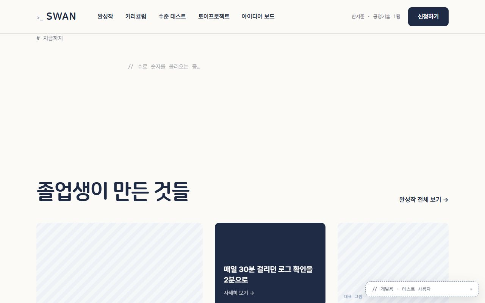 | 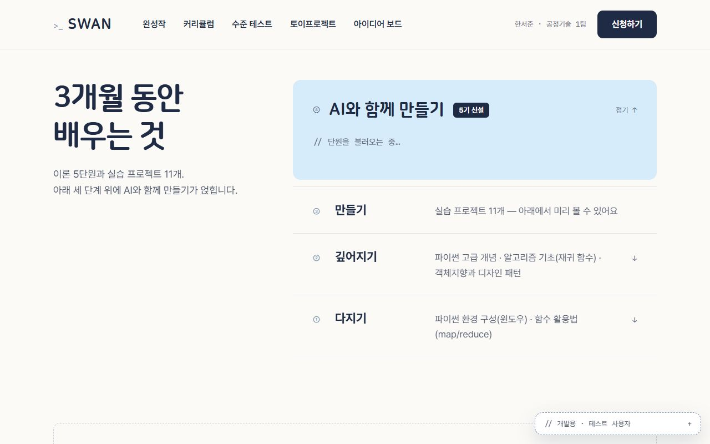 | 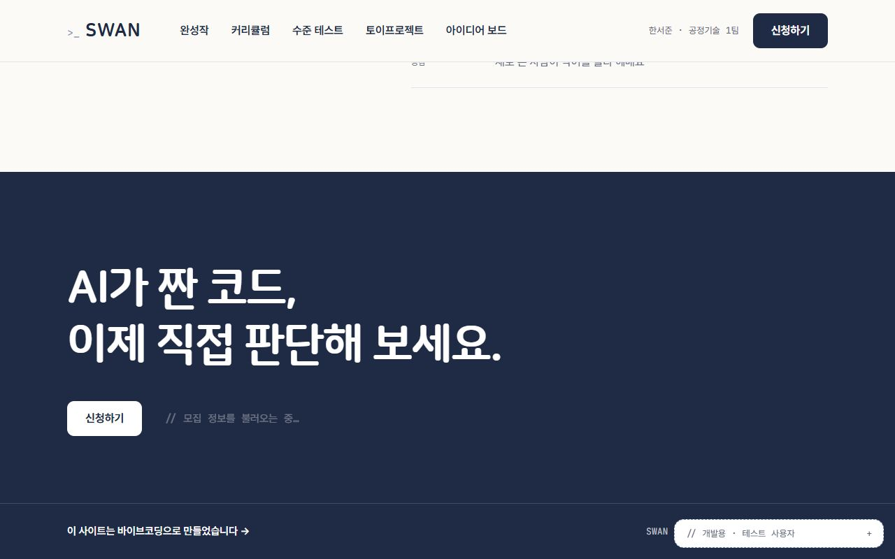 |
| 애프터 · 실패 | 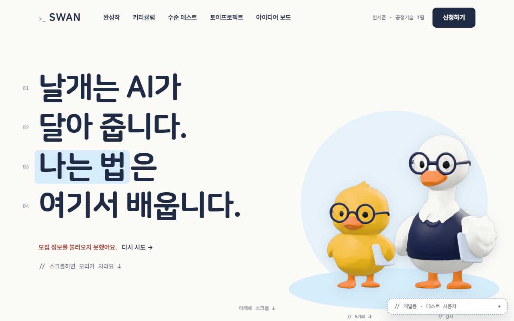 |  |  |  |
| 애프터 · [다시 시도] 후 | — |  | 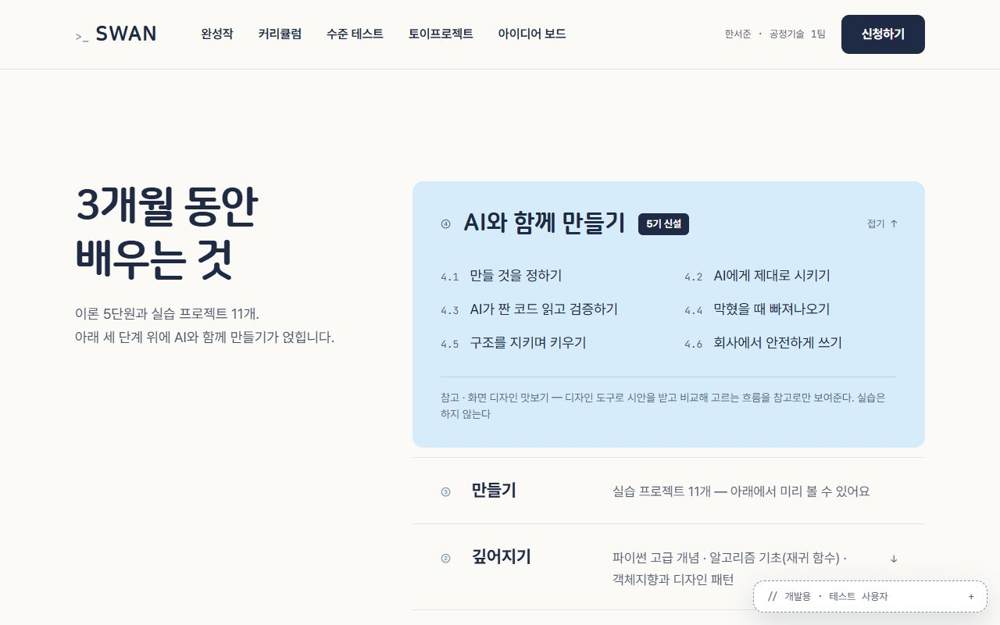 | 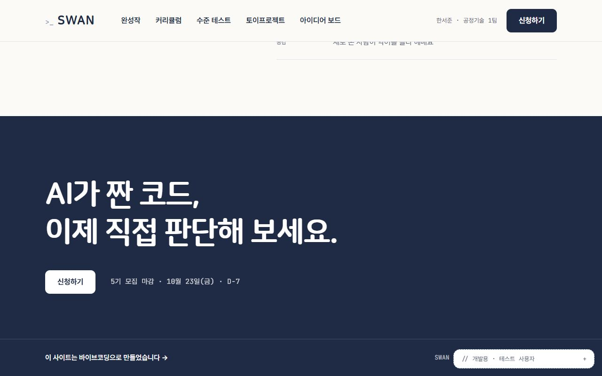 |

다시 판정:
| 문항 | 전 | 후 | 근거 |
|---|---|---|---|
| 05-4 오류가 나면 무엇을 할지 알 수 있는가 | 수정 필요 | 확인 | ①②③⑥⑪에 "…를 불러오지 못했어요. 다시 시도 →". 눌러 보니 요청이 다시 나가 내용이 채워짐 |
| 05-7 로딩 / 완료 / 실패 상태가 보이는가 | 수정 필요 | 확인 | 불러오는 중 "// …불러오는 중…"(깜빡임, 움직임 줄이기면 멈춤), 실패는 오류색 |
| 06-6 로딩 상태가 있는가 | 수정 필요 | 확인 | 위와 같음 |
| 06-7 오류 상태가 있는가 | 수정 필요 | 확인 | 위와 같음. ③ 숫자·⑥ 실습 프로젝트 자리는 높이를 지켜 아래가 들썩이지 않음 |

### 남은 `수정 필요` (8묶음)
1. 01-5 · ②⑪ 주 버튼 [신청하기] 중복
2. 02-3 · ③ 제목 없음, ⑤ 제목이 인용문
3. 02-7 · 개강일 없음 (API 필드부터)
4. 04-2 · 섹션 제목 크기 40/48/54/64px
5. 04-8 · '전체 보기' 링크 위치, 섹션 머리 표시 제각각
6. 06-1 · 긴 이름·부서 시험 필요
7. 06-2 · 06-3 · ④⑩ 0개·1개 상태 (Phase 4·5)
8. 06-10 · 1280×800 ① 이름표 걸침

---

## 추가 수정 · 섹션 제목 크기 통일(04-2) · 주 버튼 중복(01-5) (2026-10-16)

### AI 수정 요청 (실제로 쓴 문장)
> 홈 섹션 제목(h2) 크기가 ②④⑥⑧ 54px, ⑨ 48px, ⑦⑩ 40px, ⑪ 64px로 네 가지이고, ⑥ 안의 소제목 "모든 실습은 무엇을 만들지 미리 보여 드려요"(h3)는 64px로 섹션 제목보다 큽니다. 디자인 기준 H1(NanumSquareRound 800 · 54px / 1.25 · 자간 -3%)을 쓰는 섹션 제목 부품을 하나 만들어 ②④⑥⑦⑧⑨⑩과 ⑥의 소제목에 쓰고, ⑪만 마무리 강조로 64px을 남겨 그 이유를 주석에 적어 주세요. ⑩은 왼쪽 단(420px)에서 줄이 잘게 나뉘지 않도록 단을 넓히고 줄을 의미 단위로 끊어 주세요.
> 또 ②·⑪이 보일 때 상단 메뉴의 [신청하기]와 섹션 안의 [신청하기]가 함께 보여 주 버튼이 두 개가 됩니다("주 행동 버튼은 한 화면에 하나"). 섹션 안의 버튼이 메뉴 아래로 조금이라도 보이는 동안에는 메뉴 버튼을 자리만 남기고 흐리게 숨겨 주세요(메뉴가 흔들리지 않게, 숨긴 동안 키보드로 잡히지 않게). 버튼 모양·동작은 그대로 둡니다.

### 수정 결과 (PC 1280×800, 가상 데이터 · 직원)
| 화면 | 비포 | 애프터 |
|---|---|---|
| ② 한 줄 소개 (메뉴 버튼) |  |  |
| ⑦ 모험길 제목 40 → 54px |  |  |
| ⑨ 파트 소개 제목 48 → 54px |  |  |
| ⑩ 아이디어 보드 제목 40 → 54px |  |  |
| ⑪ 마지막 신청 (메뉴 버튼) |  |  |

측정:
- 섹션 제목 실측: ②④⑥⑦⑧⑨⑩ 모두 54px, ⑪ 64px(예외), ⑥ 소제목 h3 64 → 54px
- 주 버튼 개수: 홈 전체를 150px씩 94곳에서 내려 보며 화면에 보이는 [신청하기]를 셈 → **94곳 모두 1개** (메뉴 버튼이 0.2초 흐려지는 동안은 제외)

다시 판정:
| 문항 | 전 | 후 | 근거 |
|---|---|---|---|
| 01-5 경쟁하는 버튼이 없는가 | 수정 필요 | 확인 | ②⑪이 보이면 메뉴 버튼이 숨어 주 버튼이 언제나 하나 (94곳 측정) |
| 04-2 같은 레벨 제목이 같은 크기인가 | 수정 필요 | 확인 | 섹션 제목 부품(`SectionTitle`) 하나로 54px. ⑪ 64px은 마무리 강조 예외로 규칙에 적음 |

### 남은 `수정 필요` (6묶음)
1. 02-3 · ③ 제목 없음, ⑤ 제목이 인용문
2. 02-7 · 개강일 없음 (API 필드부터)
3. 04-8 · '전체 보기' 링크 위치, 섹션 머리 표시 제각각
4. 06-1 · 긴 이름·부서 시험 필요
5. 06-2 · 06-3 · ④⑩ 0개·1개 상태 (Phase 4·5)
6. 06-10 · 1280×800 ① 이름표 걸침

---

## 추가 수정 · 히어로 이름표(06-10) · ③⑤ 제목(02-3) · 전체 보기 링크 위치(04-8) (2026-10-16)

### AI 수정 요청 (실제로 쓴 문장)
> ① 히어로의 캐릭터 무대는 오른쪽 단 맨 아래에 붙어 있어서, 1280×800에서는 무대 맨 아래의 이름표 "// 5기의 나", "// 강사"가 화면 아래 끝(788px)에 걸칩니다. 무대 아래에 40px 여백을 두고 무대를 줄이는 계산에서도 그 여백을 빼 주세요. 캐릭터 배치와 비율은 그대로 둡니다.
> ③ 숫자 섹션에는 제목 없이 "# 지금까지"라는 작은 표시만 있고, ⑤ 강사 섹션은 인용문으로 시작해 제목만 읽어서는 무엇이 나올지 알 수 없습니다. 섹션 제목 부품(54px)으로 ③ "{기수}기 동안 함께한 사람들"(데이터가 없으면 "지금까지 함께한 사람들"), ⑤ "가르치는 사람"을 넣고, ③의 기수 범위는 다른 섹션처럼 "// 1기 → 4기 수료생과 부서" 주석으로, ⑤ 인용문은 제목보다 한 단계 작게(34px) 해 주세요.
> '전체 보기' 링크가 ④에서는 제목 줄 오른쪽(카드 바로 위 오른쪽), ⑩에서는 제목 아래 왼쪽입니다. "목록 바로 위 오른쪽 끝"으로 규칙을 정하고 ⑩ 링크를 오른쪽 목록 위로 옮겨 주세요. 섹션마다 다른 좌우 배치는 유지합니다.

### 수정 결과 (PC 1280×800 · 1440×900, 가상 데이터 · 직원)
| 화면 | 비포 | 애프터 |
|---|---|---|
| ① 첫 화면 1280×800 |  |  |
| ③ 숫자 |  |  |
| ⑤ 강사 |  |  |
| ⑩ 아이디어 보드 |  |  |

다시 판정:
| 문항 | 전 | 후 | 근거 |
|---|---|---|---|
| 06-10 PC 크기에서 의미가 유지되는가 | 수정 필요 | 확인 | 1280×800에서 이름표가 화면 아래 끝에서 약 50px 위에 온전히 보임 (1440×900도 확인). 대신 1280×800에서 무대가 약 5% 작아짐 |
| 02-3 제목만 읽어도 내용이 예상되는가 | 수정 필요 | 확인 | ③ "4기 동안 함께한 사람들", ⑤ "가르치는 사람" (54px 섹션 제목) |
| 04-8 같은 기능의 위치·표현이 같은가 | 수정 필요 | 확인 | '전체 보기'는 ④⑩ 모두 목록 바로 위 오른쪽 끝. 섹션 머리 보조 표시는 모두 "//" 주석(③의 "#" 없앰) |

### 남은 `수정 필요` (3묶음)
1. 02-7 · 개강일이 홈에 없다 (`/api/home`에 개강일 필드부터 필요 — Phase 2 기수 관리와 함께)
2. 06-1 · 긴 이름·부서로 시험 필요 (ⓝ 이름 칸)
3. 06-2 · 06-3 · ④⑩ 0개·1개 상태 (Phase 4·5에서 실제 데이터 연결 때)

---

## 추가 수정 · 개강일(02-7) (2026-10-16, Phase 2와 함께)
`/api/home`의 모집 정보에 개강일·강의 요일·시간을 더하고, 모집 줄 세 곳(① 히어로 · ② 한 줄 소개 · ⑪ 마지막 신청)에 "· 개강 11월 5일(목)"을 붙였다.

| 문항 | 전 | 후 | 근거 |
|---|---|---|---|
| 02-7 숫자·상태·날짜가 빠지지 않았는가 | 수정 필요 | 확인 | ①②⑪ 모두 "마감 D-7 · 10월 23일(금) · 개강 11월 5일(목)" ([②](../devlog/img/13-phase2/16-home-summary-start.jpg)) |

### 남은 `수정 필요` (2묶음)
1. 06-1 · 긴 이름·부서로 시험 필요 (ⓝ 이름 칸)
2. 06-2 · 06-3 · ④⑩ 0개·1개 상태 (Phase 4·5에서 실제 데이터 연결 때)

---

## 추가 수정 · ④⑩ 0개·1개 상태(06-2 · 06-3) (2026-10-19, Phase 4·5와 함께)
④ 완성작은 Phase 4에서, ⑩ 아이디어 보드는 Phase 5에서 실제 데이터로 바꾸며 0개·1개 상태를 함께 만들었다.

| 화면 | 0개 | 1개 |
|---|---|---|
| ④ 완성작 | "곧 졸업생들의 작품이 걸립니다" 안내 (devlog 16단계) | 큰 카드 하나를 860px 폭으로 (오른쪽 2×2 자리를 비워 두지 않음) |
| ⑩ 아이디어 |  "아직 남겨진 아이디어가 없어요" + 첫 아이디어 남기기 |  남은 자리에 점선 줄 "아이디어를 더 남겨 주세요 →" |

| 문항 | 전 | 후 | 근거 |
|---|---|---|---|
| 06-2 데이터가 없을 때 화면이 무너지지 않는가 | 수정 필요 | 확인 | ④⑩ 모두 빈 칸 대신 안내 문장과 다음 행동 (phase5.cjs 26번, 관리자가 모두 숨겨 만든 0개) |
| 06-3 데이터가 하나뿐일 때 어색하지 않은가 | 수정 필요 | 확인 | ⑩ 1개일 때 목록이 끊겨 보이지 않게 남기러 가는 줄 (25번) |

### 남은 `수정 필요` (1묶음)
1. 06-1 · 긴 이름·부서로 시험 필요 (ⓝ 이름 칸)
