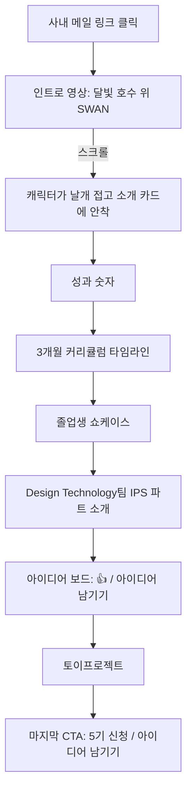

# STEP 06~08. Core Feature · User Flow · Core Screens (프로토타입 기준 통합)

상태: 작성 완료 (2026-10-07) — 프로토타입 v0.1 범위로 압축

## 프로토타입 범위
- **원페이지 홍보 사이트**. 홍보(SWAN + Design Technology팀 IPS 파트 알리기)가 1순위.
- 실제 기능(SSO, 게시판 저장, 신청 처리)은 다음 단계. 프로토타입은 화면과 인터랙션만, 데이터는 예시.

## 기능 도출 (요약)
| 사용자 핵심 행동 | 필요한 기능 | 이유 |
|---|---|---|
| 첫 화면에 꽂히기 | 인트로 영상 → 캐릭터가 카드로 날아와 앉는 스크롤 연출 | 메일 클릭 후 5초 안에 흥미 (STEP 03) |
| SWAN 이해하기 | 소개 카드 + 걱정 해소 3가지 | 긴 시간·결과물 부담 해소 (STEP 02) |
| 성과 확인 | 숫자 카운트업 (기수·졸업생·자동화 수) | "3개월 뒤의 나" 근거 |
| 일정·커리큘럼 확인 | 3개월 타임라인, 스크롤 진행선 | 사용자가 가장 중요하다고 한 정보 |
| "나도 되겠다" 확신 | 졸업생 쇼케이스 (직무·기수·Before/After 시간) | 비슷한 직무 결과물 = 최강 설득 |
| 부서 알기 | Design Technology팀 IPS 파트 소개 + 대표 사례 | 홍보 목표 |
| 가볍게 요청 | 아이디어 보드 (공개 아이디어 + 👍 공감) | 공식 요청의 무게감 해소 (STEP 02-B) |
| 커뮤니티 | 토이프로젝트 모집 카드 | 졸업생 참여 |
| 다음 행동 | 고정 내비 [5기 신청], 마지막 CTA | 언제든 신청 가능 |

### 우선순위
- **MVP(프로토타입)**: 위 전부를 화면으로 (예시 데이터, 버튼은 안내 모달)
- **2단계**: SSO 로그인, 아이디어 등록·공감 저장, 쇼케이스·토이프로젝트 작성, 관리자 화면
- **3단계**: 수강신청 폼·선발 관리(부서장님), 상태 알림

## User Flow (대표 여정)

## 화면 (원페이지 섹션, 위 → 아래)
| # | 섹션 | 내용 | 연출 |
|---|---|---|---|
| 0 | 상단 내비 | SWAN 로고, 섹션 바로가기, [5기 신청] 고정 | 인트로 이후 등장, 블러 배경 |
| 1 | 인트로 | 영상 → "처음이어도, 우아하게." → 캐릭터가 소개 카드 슬롯에 안착 | GSAP ScrollTrigger, 날개 접기 프레임 시퀀스 |
| 2 | 성과 숫자 | 4개 기수 / 졸업생 / 만든 자동화 | 카운트업 |
| 3 | 커리큘럼 | 3개월 4단계 타임라인, 주 2~3회 · 회당 2시간 | 스크롤 진행선 |
| 4 | 쇼케이스 | 졸업생 결과물 카드 | 가로 스크롤(핀 고정) |
| 5 | 부서 소개 | Design Technology팀 IPS 파트, 대표 사례 | 등장 애니메이션 |
| 6 | 아이디어 보드 | 공개 아이디어 + 👍 | 클릭 반응 |
| 7 | 토이프로젝트 | 모집 카드 | — |
| 8 | CTA + 푸터 | "5기에서 만나요" | 달빛 글로우 |

### 마스코트 여정 (확정)
백조 캐릭터는 인트로 전용이 아니라 사이트 전체의 가이드. 데모의 "슬롯으로 날아가 앉기" 계산을 **공용 부품(MascotGuide)**으로 만들고, 섹션은 빈 슬롯 + 스크롤 구간만 등록한다.

| 단계 | 백조가 등장하는 곳 |
|---|---|
| **1차 (프로토타입)** | ① 인트로 변신 → SWAN 소개 카드 착지 · ② IPS 파트 소개 카드 · ③ 마지막 CTA에서 날개를 다시 펴고 날아오름 (날개 접기 프레임 역재생) |
| 2차 | ④ 커리큘럼 타임라인을 따라 칸 이동 · ⑤ 아이디어 보드에서 말풍선 "남겨 보세요!" |
| 3차 (선택) | 섹션별 새 포즈 에셋 (손 흔들기, 코딩하기 등) |

- 포즈는 2개(날개 편/접은)뿐 → 기울기·흔들림·말풍선으로 변화
- 모바일: 비행 없이 각 카드에 앉아 있는 정적 상태

### 공통 인터랙션
- 스크롤: Lenis(관성 스크롤) + GSAP ScrollTrigger
- 섹션 전환 시 배경이 호수의 시간대처럼 바뀜 (달밤 → 새벽 안개 → 금빛) (제안)
- 화면보다 큰 키네틱 타이포가 스크롤에 맞춰 가로로 흐름
- 주요 버튼: 달빛(moon) 색 알약형. 보조: 시안 글로우 외곽선
- 섹션 진입 시 아래에서 페이드업
- prefers-reduced-motion: 모든 연출 끄고 최종 상태만

원문 메모

- 추천대로 가자 부서 이름은 Design Technology팀 IPS 파트야
- 수강신청보다 홍보 먼저, 프로토타입을 뽑고 싶어

