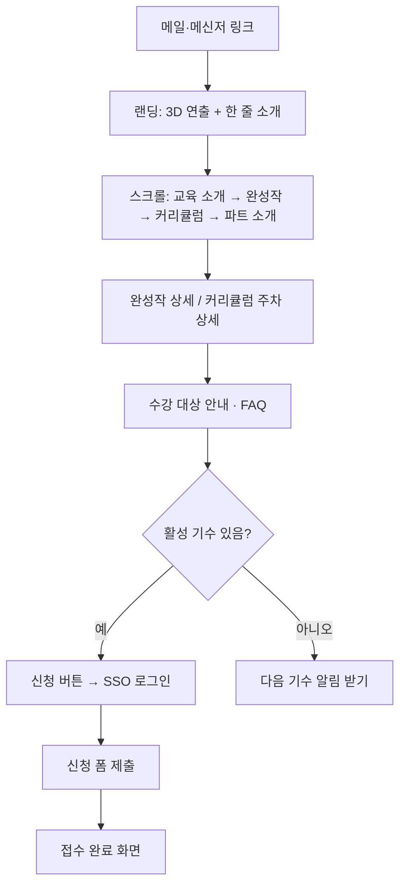

# STEP 07. User Flow — SWAN 웹사이트

## 대표 여정: 예비 수강생 (6단계)
- 진입 경로: 모집 메일이나 부장님 메신저의 링크
1. 첫 화면 접속 — 랜딩에서 3D 연출과 함께 SWAN 한 줄 소개를 본다
2. 스크롤 탐색 — 교육 소개 → 졸업생 완성작 미리보기 → 커리큘럼 요약 → 파트 소개
3. 상세 정보 선택 — 관심 가는 완성작이나 커리큘럼 주차를 눌러 자세히 본다
4. 수준 확인 — 수강 대상 안내와 자주 묻는 질문을 본다
5. 핵심 행동 실행 — 신청 버튼 → SSO 로그인 → 사번·부서명·이름·녹스 아이디 확인 후 제출 (현재 활성 기수로 자동 접수)
6. 최종 완료 — 접수 완료 화면과 이후 일정 안내
- 최종 가치 실현: 메일만으로는 못 내리던 결정을 그 자리에서 내린다

## 모집 기간이 아닐 때
- 활성 기수가 없으면 신청 버튼 대신 "다음 기수 알림 받기"를 보여준다
- 알림 받기를 누르면 SSO 로그인 후 관심 등록이 된다
- 알림 전달 방식 (제안): MVP에서는 관리자 화면에 관심 등록자 명단이 쌓이고, 새 기수가 열리면 관리자가 그 명단으로 모집 메일을 보낸다. 사이트 내 알림(2단계)이 생기면 로그인 시에도 표시한다. 자동 메신저·메일 발송은 3단계

## 졸업생: 진입부터 핵심 행동까지
1. SSO 로그인 → 졸업생 명단과 대조해 졸업생으로 인식됨
2. 갤러리 → 완성작 등록 → "검수 대기" 상태 → 관리자 승인 후 공개
3. (2단계) 토이프로젝트 → 모집 글 작성 또는 참가 신청 → 작성자 승인 → 사이트 내 알림 확인

## 관리자
1. SSO 로그인 → 관리자 화면
2. 새 기수 생성 후 활성화 → 신청 목록 확인 → 교육 종료 후 졸업 처리
3. 갤러리 검수 대기 목록 → 승인/반려
4. 기존 1~4기 졸업생 수동 등록 (최초 1회)
5. 관심 등록자 명단 확인

## 보는 사람 (부서장·실장님)
- 링크로 진입 → 랜딩과 갤러리를 본다 (로그인 없이)

## 접근 범위
- 보는 것은 전부 로그인 없이 가능 (사내망이라 사내 직원만 접속)
- 신청, 알림 받기, 글쓰기(갤러리 등록·모집 글), 관리자 화면은 SSO 로그인 필요

## 범위 밖 (나중에)
- 신청 취소, 내 신청 내역 확인 화면

## 단계 간 연결 체크 (STEP 06 → 07)
- 랜딩 → 1·2단계 ✓ / 갤러리·커리큘럼 상세 → 3단계 ✓ / 수강 안내·FAQ → 4단계 ✓
- 신청 폼·SSO → 5단계 ✓ / 접수 완료 화면 → 6단계 ✓
- 갤러리 등록·검수 → 졸업생 2, 관리자 3 ✓ / 관리자 화면 → 관리자 흐름 ✓
- 신규 기능: "다음 기수 알림 받기(관심 등록)" — STEP 06 MVP 목록에 추가 필요

원문 메모

제안대로 가자.... 다음기수 알림받기로 하고... 취소부분은 일단 나중에 하자

