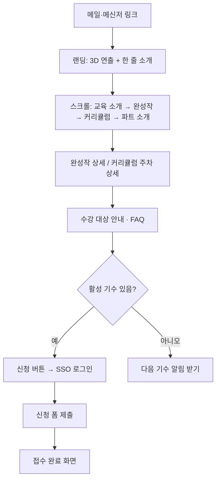

# SWAN 웹사이트 기획서

> "우리 파트가 하는 신입 대상 SW 교육 SWAN을 소개하고 신청받는 사이트인데, 3D랑 인터랙션으로 한눈에 '여기 잘한다'는 느낌을 주는 곳이야."

작성일: 2026-10-12 · 버전: v1

표기 규칙: `(제안)`은 Claude가 보완했고 아직 사실로 확인되지 않은 내용이다. 확인되지 않은 항목은 부록 B에 모았다.

---

## 요약: 프로젝트 기획 10단계

| 단계 | 핵심 질문 | 우리의 답 |
|---|---|---|
| 01 Project Idea | 무엇을 만들고 싶은가? 어떤 서비스인가? | SWAN(SW Academy for Newbie) 교육과 운영 파트를 홍보하는 사내 웹사이트. 커리큘럼을 보고 교육을 신청하며, 졸업생은 완성작을 갤러리에 올리고 토이프로젝트 팀원을 모은다. 3D와 인터랙션으로 완성도를 보여준다. |
| 02 Problem | 누가, 어떤 상황에서, 어떤 어려움을 겪고 있는가? | 타 부서 비개발자(예: 공정 엔지니어 5년차)가 모집 메일을 받아도 뭘 얻는지, 내 수준에 맞는지 알 수 없고, 8주 파견 부담과 교육 후 기대가 걱정돼 신청을 망설인다. 회사 입장의 시급성은 낮다. |
| 03 User | 어떤 사람인가? 언제 문제를 겪는가? 현재 어떻게 해결하는가? | 예비 수강생(비개발자, 신입), 졸업생, 보는 사람(부서장·실장님), 관리자. 가장 큰 순간은 신청을 고민할 때. 페인포인트: "듣고 싶은 마음은 있는데, 교육이 끝난 뒤의 내 모습을 미리 볼 방법이 없다." |
| 04 Goal | Before를 어떤 After로 바꾸려 하는가? | 메일을 닫고 미루던 사람이 졸업생 완성작을 보고 그 자리에서 신청한다. 지표: 갤러리 완성작 수, 토이프로젝트 팀 결성 수, 부장님의 보고 활용, 다른 파트의 제작 문의. |
| 05 Core Action | 사용자가 반드시 해야 하는 행동은? | 교육 신청. ① 쇼케이스·커리큘럼을 본다 ② 내 수준에 맞는지 확인한다 ③ 신청서를 제출한다. |
| 06 Core Feature | 각 행동을 가능하게 하는 기능은? 왜 필요한가? | MVP: 3D 랜딩, 커리큘럼·수강 안내·FAQ, 갤러리(열람·등록·검수), 신청 폼, 다음 기수 알림 받기, SSO 로그인, 관리자 화면. 2단계: 토이프로젝트 모집, 알림, 성과 요약. |
| 07 User Flow | 들어와서 목적을 달성하기까지의 순서는? | 메일 링크 → 랜딩(3D) → 스크롤(교육 소개 → 완성작 → 커리큘럼 → 파트 소개) → 상세 → 수강 안내·FAQ → 로그인 후 신청 → 접수 완료 |
| 08 Core Screens | 어떤 화면들이 필요한가? | 랜딩 / 갤러리 목록 / 완성작 상세 / 커리큘럼 / 신청 / 관리자 |
| 09 Research | 무엇을 조사했고 무엇을 알게 되었는가? | 교육 사이트는 증거(결과물·사례)를 먼저 보여주는 구성이 권장된다. 브라우저 3D는 품질 단계와 정지 이미지 대체가 필요하고, 사내망에서는 모든 자원을 사이트에 포함해야 한다. SWAN의 자리는 "현업 비개발자가 8주 뒤 만든 것"을 사내 사례로 보여주는 것. |
| 10 Reference | 무엇을 참고했고 무엇을 적용하는가? | 소이정 → 인트로 연출, 캐릭터·3D 오브젝트가 이끄는 톤, 드래그 요소 / Atmos → 스크롤 경로를 따라가는 3D / Bruno Simon → 로우폴리와 장난기 / SSAFY → 사람과 결과로 보여주는 콘텐츠 |

---

## STEP 01. Project Idea

### 프로젝트 이름
SWAN (SW Academy for Newbie) 웹사이트

### 한 문장 정의 (친구에게 설명하듯)
"우리 파트가 하는 신입 대상 SW 교육 SWAN을 소개하고 신청받는 사이트인데, 3D랑 인터랙션으로 한눈에 '여기 잘한다'는 느낌을 주는 곳이야."

### 서비스 개요
SWAN 교육과 이를 운영하는 파트를 홍보하는 웹사이트다. 방문자는 커리큘럼을 살펴보고 교육을 신청할 수 있고, 졸업생은 사이트 안에서 팀원을 모아 토이프로젝트를 하고 완성작을 갤러리에 올릴 수 있다.

### 작동 방식 — 사용자가 쓰면 무슨 일이 일어나나
1. 둘러보기: 방문자가 사이트에 들어오면 인터랙티브·3D 연출과 함께 SWAN 교육과 파트 소개를 본다.
2. 커리큘럼 확인: 교육 과정이 어떻게 구성되는지 본다.
3. 교육 신청: 신청서를 제출한다.
4. 졸업 후 팀원 모집: 졸업생이 토이프로젝트 팀원을 모집하거나 모집 글에 참여한다.
5. 완성작 공유: 완성한 토이프로젝트를 갤러리에 올리고 서로 본다.

### 주요 특징
- 교육 홍보: SWAN이 어떤 교육인지 알린다.
- 파트 홍보: 교육을 운영하는 우리 파트를 알린다.
- 교육 신청 접수: 사이트에서 바로 신청을 받는다.
- 커리큘럼 열람: 교육 과정을 한눈에 볼 수 있다.
- 졸업생 토이프로젝트: 팀원 모집 + 완성작 갤러리 (진행 관리는 범위 밖).
- 높은 완성도: 인터랙티브 요소와 3D를 많이 사용한다.

### 제공 방식
- 플랫폼: 웹사이트
- 교육 대상: 사내 신입사원, 타 부서 비개발자
- 가입·로그인 / 공개 범위(사내망·외부) / 알림 / 배포 위치: 미정 → STEP 11에서 확인

### 왜 이 프로젝트인가
- 계기: 부장님이 최근 교육생을 모집하고 있다.
- 개인 동기: 퀄리티 높은 사이트를 직접 개발해서 내 역량이 이 정도라는 것을 보여주고 싶다.

## STEP 02. Problem

### 누가 — 대표 타겟: 공정 엔지니어 5년차 (이름·부서는 STEP 03에서 구체화)
- 일: 공정 엔지니어, 평소 업무량이 많음
- SWAN을 알게 된 경로: 메일 공지
- 신청 방법: 메일로 수강 신청, 파견으로 가려면 자기 부서장 결재가 필요함
- 교육 규모: 한 기수 약 10명, 약 8주 (대략적인 수치)

#### 얼마나 자주 겪나
- 1년에 2~3회, 모집 공지가 올 때마다

#### 이 사람이 바라는 것
> "듣고는 싶은데… 내가 들어도 되는 수준인지, 듣고 나면 뭐가 남는지 알고 싶다."

#### 함께 겪는 사람들
- 부서장: 파견 결재를 해 줘야 하는 사람 (제안: 결재 판단 근거가 부족할 수 있음, 확인 필요)
- 운영 측(부장님·파트): 교육 성과를 실장님·사업부장님께 매번 보고함
- 졸업생: 졸업 후 연결 통로가 부장님의 일방적인 메신저뿐임

### 어떤 상황에서 — 문제 발생 장면
#### 1. 메일 공지를 열었을 때
- 상황: 모집 메일을 읽지만 이 과정에서 뭘 얻는지 정확히 그려지지 않는다.
- 고충: 내 수준에 맞는 교육인지 판단할 근거가 없다.

#### 2. 파견 신청을 고민할 때
- 상황: 부서장 결재를 받아야 한다. 약 8주 동안 업무 공백이 생긴다.
- 고충: "교육 갔다 왔으니 개발 잘하겠네, 자동화해 봐" 하고 일을 떠안을까 두렵고, 떠안았을 때 해낼 수 있을지도 두렵다.

#### 3. 비파견 수강으로 돌아설 때
- 상황: 그럼 비파견으로 들을까 생각한다.
- 고충: 업무가 많은데 강의에 집중할 수 있을지 자신이 없다. 결국 선뜻 신청하지 못한다.

### 왜 중요하고 시급한가
- 심리적 영향: 듣고 싶은 마음은 있는데 불확실성과 부담 때문에 신청을 미룬다.
- 운영 측 영향: 성과 보고 때 한눈에 보여줄 자료가 있으면 더 좋다 (없어도 보고는 가능).
- 시급성: 낮음. 회사 입장에서는 지금처럼 수동으로 해도 돌아간다. 신청자가 많지 않아 메일 접수도 크게 번거롭지 않다.
- 해결했을 때의 가치: 운영 효율보다 "신청을 망설이는 사람의 불확실성을 줄이는 것"과 "교육 성과를 한눈에 보여주는 쇼케이스"에 있다. (사용자 확인)

### 현재 임시방편과 한계
| 방법 | 어떻게 쓰고 있나 | 한계 |
|---|---|---|
| 메일 공지 | 모집 안내를 메일로 보냄 | 얻는 것과 요구 수준이 잘 전달되지 않음 |
| 메일 신청 | 메일로 수강 신청을 받음 | 신청자가 적어 불편은 크지 않음 |
| 부장님 메신저 | 졸업생에게 일방적으로 연락 | 졸업생끼리의 교류나 후속 활동으로 이어지지 않음 |
| 성과 보고 | 매번 실장님·사업부장님께 보고 | 한눈에 보여줄 상시 자료가 없음 |

#### 정리: 왜 여전히 고통받는가
문제의 중심은 접수의 번거로움이 아니라 정보와 확신의 부족이다. 교육이 내게 맞는지, 듣고 나면 뭐가 남는지, 그 뒤에 어떤 기대를 받게 되는지 알 수 없어서 듣고 싶은 사람이 신청을 망설인다.

### 검증되지 않은 가정 (STEP 09에서 확인)
- "교육 후 일을 떠안을까 두렵다"는 실제 사례가 아니라 기획자 본인의 추측("나라면 그럴 것 같아서")이다. 실제 예비 수강생·졸업생에게 확인 필요.
- 부서장이 결재 판단 근거 부족을 겪는지 여부.

## STEP 03. User

### 핵심 사용자 집단의 공통 특성
- 대상: 사내 신입사원, 타 부서 비개발자 (공정 엔지니어 등)
- 접속 환경: 사내망 PC 전용, 모바일 불가
- 관련 습관: 모집 정보를 메일 공지로 접하고 메일로 신청함
- 코딩 경험: 대부분 적음 (제안, 확인 필요)
- 가치관: 배우고 싶은 마음은 있으나 현업 부담과 교육 후 기대를 걱정함
- 교육 이력: 4기까지 진행, 한 기수 약 10명

### 페르소나
#### 페르소나 1: 예비 수강생 A, 김도현 (32) (제안)
- 직업: 공정 엔지니어 5년차
- 습관: 엑셀로 데이터 정리를 반복, 코딩 경험 거의 없음
- 이 서비스에서 하는 일: 내 수준에 맞는지, 뭘 얻는지 확인하고 신청

#### 페르소나 2: 예비 수강생 B, 이서연 (26) (제안)
- 직업: 입사 1년차 신입사원, 부서장이 보내서 옴
- 이 서비스에서 하는 일: 뭘 배우는지, 8주 일정이 어떤지 미리 파악

#### 페르소나 3: 졸업생, 박준영 (34) (제안)
- 직업: 2기 졸업, 과제로 자동화 도구를 만듦
- 이 서비스에서 하는 일: 팀원 모집, 완성작 갤러리 등록

#### 페르소나 4: 보는 사람 — 부서장, 실장님·사업부장님
- 이 서비스에서 하는 일: 파견 보낼 가치와 교육 성과를 한눈에 확인

#### 참고: 운영자·조교 (기획자 본인)
- 파트 소속. 파이썬 강의 경험이 있어 부장님이 후계로 키우려고 수강시킴
- 이후 조교로 환경 설정 대부분을 도움
- 이 서비스에서 하는 일: 사이트 제작·운영, 콘텐츠 관리
- 전형적인 예비 수강생 A와 출발점이 달라 별도 유형으로 둠

### 언제, 어떤 동선에서 문제를 마주하나
| 시점 | 행동 | 고충의 순간 | 서비스가 들어갈 자리 |
|---|---|---|---|
| 모집 공지 | 메일을 읽음 | 뭘 얻는지, 내 수준에 맞는지 모름 | 커리큘럼, 수준 안내, 졸업생 결과물 |
| **신청 고민 ★ (가장 큰 순간)** | 파견/비파견을 저울질, 부서장 결재 고민 | 8주 공백 부담, 교육 후 일을 떠안을까 걱정 | 졸업생 사례, 쇼케이스 (부서장에게 보여줄 근거) |
| 수강 중 | 강의와 과제 | 현업이 바빠 진도를 놓침 | 커리큘럼·주차별 자료 다시 보기 (제안, STEP 06에서 포함 여부 결정) |
| 졸업 후 | 현업 복귀 | 부장님 메신저 외에 연결 통로 없음 | 팀원 모집, 완성작 갤러리 |

- 환경 설정은 조교가 대부분 도와줘서 큰 문제가 아니었음

#### 패턴 정리
가장 큰 순간은 신청을 고민하는 때다. 사이트는 그 순간에 볼 "교육 후의 모습"을 가장 앞에 둬야 한다.

### 기존 자구책
| 방법 | 어떻게 했나 | 왜 부족한가 |
|---|---|---|
| 메일 공지만 보고 판단 | 공지 내용으로 결정 | 수준과 결과물이 전달되지 않음 |
| 주변에 물어보기 | 미확인 | 사람들이 실제로 정보를 어떻게 구하는지 모름 |

### 궁극적 페인포인트
> "듣고 싶은 마음은 있는데, 교육이 끝난 뒤의 내 모습을 미리 볼 방법이 없다."

- 수준, 얻는 것, 교육 후 기대라는 세 가지 불안이 모두 여기서 나온다.
- 그래서 이 서비스가 풀어야 할 단 하나: 졸업생의 실제 결과물과 변화를 눈으로 보여주는 것.

### 다음에 확인할 것
- 예비 수강생이 신청 전에 정보를 어떻게 구하는지 (졸업생 1~2명에게 확인)
- 자동화에 기여한 졸업 과제의 구체적 내용 (쇼케이스의 핵심 재료, 부장님께 확인)
- 페르소나 1~3의 세부가 실제 수강생 모습과 맞는지

## STEP 04. Goal

### Before (현재 상태)
김도현 씨는 모집 메일을 열어 보지만 뭘 배우는지, 내 수준에 맞는지 알 수 없다. 8주 파견을 부서장에게 말 꺼내기도 부담스럽고, 다녀온 뒤 자동화 업무를 떠안을까 걱정된다. 결국 메일을 닫고 다음 기수로 미룬다. 부장님은 성과 보고 때마다 자료를 새로 만든다. 졸업생은 현업으로 돌아간 뒤 서로 볼 일이 없다.

### After (이상적 목표 상태)
김도현 씨는 메일의 링크를 눌러 SWAN 사이트에 들어간다. 첫 화면의 3D 연출에 눈이 가고, 커리큘럼과 "나 같은 비개발자 졸업생이 8주 뒤 만든 것"을 본다. 부서장에게 사이트 링크를 보내 결재를 올리고 그 자리에서 신청한다. 부장님은 보고 자리에서 사이트의 쇼케이스를 그대로 띄운다. 졸업생은 갤러리에 완성작을 올리고 다음 토이프로젝트 팀원을 구한다.

- 참고: "부서장에게 링크를 보내 결재 근거로 쓴다"는 사용자가 동의한 시나리오지만 실제 결재 관행으로 검증된 것은 아니다.

### 측정 지표
목표치는 모두 제안이며, 현재 기준값(기수당 신청자 수 등)을 확인한 뒤 조정한다.

#### 졸업생 활동이 살아나는가 (사용자가 꼽은 핵심)
- 갤러리 완성작 수: 오픈 시 기존 1~4기 과제 5건 이상 등록, 이후 기수마다 3건 이상 추가 (제안) — 쇼케이스가 채워지는지
- 토이프로젝트 팀 결성 수: 반기에 2팀 이상 (제안) — 졸업 후 교류가 실제로 일어나는지
- 팀원 모집 글 수: 분기에 3건 이상 (제안)

#### 신청 망설임이 줄었는가
- 기수당 신청자 수: 현재 기준값 확인 후 설정 (미확인)
- 사이트를 통한 신청 비율: 전체 신청의 80% 이상 (제안)

#### 운영 측에 쓸모가 있는가
- 부장님이 실장님·사업부장님 성과 보고에 사이트를 사용: 1회 이상 (사용자 목표)

#### 기획자 개인 목표
- 다른 파트에서 제작 문의가 온다: 1건 이상 (사용자 목표) — 사이트가 아니더라도 "웹으로 할 수 있는 무언가"에 대한 문의면 성공

## STEP 05. Core Action

### 궁극적 목적
SWAN을 들을지 망설이는 사람이 졸업생의 실제 결과물을 보고 확신을 얻어 신청하게 돕는 것.

### 핵심 행동 (반드시 해야 하는 것)
- 한 문장 정의: 예비 수강생이 교육을 신청한다. (쇼케이스를 보는 것은 신청으로 가는 길)
- 세부 단계: ① 쇼케이스·커리큘럼을 본다 → ② 내 수준에 맞는지 확인한다 → ③ 신청서를 제출한다
- 신청서 항목: 사번, 부서명, 이름, 녹스 아이디
- 기수: 관리자가 설정한 "현재 활성화된 기수"로 자동 신청된다 (사용자가 기수를 고르지 않음)
- 파견/비파견 선택: 나중에 추가 (MVP 범위 밖)

### 처음 한 번만 하는 행동
- SSO 로그인 (졸업생 기능 사용 시 필수)

### 하면 좋은 행동 (필수 아님)
- 파트 소개 보기: 교육을 누가 운영하는지 안다
- 갤러리 둘러보기: 졸업생이 만든 것을 더 본다

### 다른 사용자 유형의 핵심 행동
| 유형 | 핵심 행동 | 세부 단계 |
|---|---|---|
| 졸업생 | 완성작을 갤러리에 올린다 | ① 프로젝트 정보를 적는다 ② 스크린샷·설명을 붙인다 ③ 등록한다 |
| 졸업생 | 토이프로젝트 팀원을 구한다 | ① 모집 글을 쓴다 ② 참가 신청을 받는다 ③ 작성자가 승인한다 |
| 졸업생 | 토이프로젝트에 참가한다 | ① 모집 글을 본다 ② 참가 신청한다 ③ 작성자 승인을 기다린다 |
| 보는 사람 (부서장·실장님) | 성과를 훑어본다 | 쇼케이스를 본다 (입력 행동 없음) |
| 관리자 | 신청과 기수를 관리한다 | ① 활성 기수를 설정한다 ② 접수된 신청 목록을 본다 |

### 동기와 트리거
- 즉각적 혜택: 메일 공지로는 알 수 없던 "교육 후의 모습"을 바로 본다
- 호기심: "나도 저런 거 만들 수 있을까?" (쇼케이스를 본 직후)
- 외부 트리거: 모집 메일 속 사이트 링크, 부장님 메신저의 링크
- 내부 트리거: 쇼케이스를 본 뒤 생기는 호기심과 확신
- 귀찮음을 낮추는 장치: SSO 자동 입력으로 신청 항목 최소화 (연동 범위는 STEP 11에서 확인), 스크롤만 해도 핵심이 보이는 구성
- 한 줄 정리: 보여주고, 확신을 주고, 버튼 한 번으로 신청하게 한다

### 완료 시점의 결과물과 보상
- 신청 직후: 접수 완료 화면 (연출 포함) + 이후 일정 안내
- 완성작 등록 직후: 내 작품 카드가 "검수 대기"로 보이고, 관리자 승인 후 갤러리에 공개됨 (STEP 06에서 검수 추가)
- 팀 참가 승인 시: 사이트 내 승인 알림
- 알림 방식: 사이트 안에서만 표시 (MVP). 메신저·메일 알림은 나중에 추가

## STEP 06. Core Feature

### 기능 도출 표
| 사용자 핵심 행동 | 필요한 기능 | 이 기능이 필요한 이유 | 우선순위 |
|---|---|---|---|
| 사이트에 들어온다 | 3D·인터랙티브 랜딩 (교육·파트 소개) | 첫인상으로 완성도를 보여줌. 메일 공지로는 전달되지 않던 것을 전달 | MVP |
| 쇼케이스를 본다 | 완성작 갤러리 (목록 + 상세) | "교육 후의 내 모습"을 미리 봄 (STEP 03 페인포인트 직결) | MVP |
| 커리큘럼을 본다 | 8주 커리큘럼 (주차별 내용) | 뭘 배우는지, 내 수준에 맞는지 판단 | MVP |
| 수준을 확인한다 | 수강 대상·사전 지식 안내, 자주 묻는 질문 | "들어도 되는 수준인가"에 답함 | MVP |
| 신청한다 | 신청 폼 (사번·부서명·이름·녹스 아이디) + 접수 완료 화면 | 핵심 행동 | MVP |
| 로그인한다 | SSO 로그인 | 졸업생 기능의 전제 | MVP |
| 완성작을 올린다 | 갤러리 등록·수정 + 관리자 검수 | 쇼케이스를 채움 | MVP |
| 신청·기수·졸업생을 관리한다 | 관리자 화면 | 신청이 어디로 가는지, 누가 졸업생인지 해결 | MVP |
| 팀원을 구한다 | 모집 글 작성, 참가 신청, 작성자 승인 | 졸업 후 교류 | 2단계 |
| 승인 결과를 안다 | 사이트 내 알림 | 승인 여부 확인 | 2단계 |
| 성과를 보고한다 | 성과 요약 (기수 수, 졸업생 수, 완성작 수) | 부장님 보고용 한눈에 보기 | 2단계 |

### 행동별 상세
#### 처음 한 번: 로그인
- SSO 로그인 — 사내 계정으로 본인 확인. 졸업생 기능과 관리자 기능의 전제

#### 핵심 행동: 교육 신청
- 3D·인터랙티브 랜딩 — 교육과 파트를 소개하고 완성도를 보여줌
- 커리큘럼, 수강 대상 안내, 자주 묻는 질문 — 수준과 얻는 것에 대한 불확실성을 줄임
- 완성작 갤러리 열람 — 교육 후의 모습을 보여줌
- 신청 폼 — 사번, 부서명, 이름, 녹스 아이디. 현재 활성 기수로 자동 접수
- 접수 완료 화면 — 연출 + 이후 일정 안내

#### 졸업생: 완성작 올리기
- 갤러리 등록·수정 — 졸업생만 가능
- 관리자 검수 — 등록 후 관리자가 승인해야 공개된다 (사내 자동화 과제라 민감한 내용이 섞일 수 있음)

#### 관리자
- 활성 기수 설정 — 신청이 자동으로 이 기수에 붙는다
- 신청 목록 보기
- 졸업생 명단 관리 — 사이트로 신청해 수료한 사람은 DB에 이미 있으므로 졸업 처리만 하면 된다. 기존 1~4기 졸업생만 수동으로 등록한다
- 갤러리 검수 (승인/반려)

#### 다시 쓰게 만드는 기능 (2단계)
- 토이프로젝트 팀원 모집 — 모집 글 작성, 참가 신청, 작성자 승인
- 사이트 내 알림 — 참가 신청 도착, 승인 결과, 갤러리 검수 결과
- 성과 요약 — 기수 수, 졸업생 수, 완성작 수

### 우선순위
- MVP (1단계): 랜딩, 커리큘럼·수강 안내·FAQ, 갤러리(열람·등록·검수), 신청 폼, 다음 기수 알림 받기(관심 등록, STEP 07에서 추가), SSO 로그인, 관리자 화면(기수·신청·졸업생·검수·관심 등록자 명단)
- 2단계: 토이프로젝트 팀원 모집, 사이트 내 알림, 성과 요약
- 3단계: 파견/비파견 선택, 메신저·메일 알림, 주차별 자료 다시 보기

### 단계 간 연결 체크 (STEP 05 → 06)
- 교육 신청 → 신청 폼, 접수 완료 화면 ✓
- 완성작 올리기 → 갤러리 등록·검수 ✓
- 팀원 구하기·참가하기 → 모집 글, 참가 신청, 승인 (2단계) ✓
- 성과 훑어보기 → 갤러리(MVP), 성과 요약(2단계) ✓
- 신청·기수 관리 → 관리자 화면 ✓

## STEP 07. User Flow

### 대표 여정: 예비 수강생 (6단계)
- 진입 경로: 모집 메일이나 부장님 메신저의 링크
1. 첫 화면 접속 — 랜딩에서 3D 연출과 함께 SWAN 한 줄 소개를 본다
2. 스크롤 탐색 — 교육 소개 → 졸업생 완성작 미리보기 → 커리큘럼 요약 → 파트 소개
3. 상세 정보 선택 — 관심 가는 완성작이나 커리큘럼 주차를 눌러 자세히 본다
4. 수준 확인 — 수강 대상 안내와 자주 묻는 질문을 본다
5. 핵심 행동 실행 — 신청 버튼 → SSO 로그인 → 사번·부서명·이름·녹스 아이디 확인 후 제출 (현재 활성 기수로 자동 접수)
6. 최종 완료 — 접수 완료 화면과 이후 일정 안내
- 최종 가치 실현: 메일만으로는 못 내리던 결정을 그 자리에서 내린다

### 모집 기간이 아닐 때
- 활성 기수가 없으면 신청 버튼 대신 "다음 기수 알림 받기"를 보여준다
- 알림 받기를 누르면 SSO 로그인 후 관심 등록이 된다
- 알림 전달 방식 (제안): MVP에서는 관리자 화면에 관심 등록자 명단이 쌓이고, 새 기수가 열리면 관리자가 그 명단으로 모집 메일을 보낸다. 사이트 내 알림(2단계)이 생기면 로그인 시에도 표시한다. 자동 메신저·메일 발송은 3단계

### 졸업생: 진입부터 핵심 행동까지
1. SSO 로그인 → 졸업생 명단과 대조해 졸업생으로 인식됨
2. 갤러리 → 완성작 등록 → "검수 대기" 상태 → 관리자 승인 후 공개
3. (2단계) 토이프로젝트 → 모집 글 작성 또는 참가 신청 → 작성자 승인 → 사이트 내 알림 확인

### 관리자
1. SSO 로그인 → 관리자 화면
2. 새 기수 생성 후 활성화 → 신청 목록 확인 → 교육 종료 후 졸업 처리
3. 갤러리 검수 대기 목록 → 승인/반려
4. 기존 1~4기 졸업생 수동 등록 (최초 1회)
5. 관심 등록자 명단 확인

### 보는 사람 (부서장·실장님)
- 링크로 진입 → 랜딩과 갤러리를 본다 (로그인 없이)

### 접근 범위
- 보는 것은 전부 로그인 없이 가능 (사내망이라 사내 직원만 접속)
- 신청, 알림 받기, 글쓰기(갤러리 등록·모집 글), 관리자 화면은 SSO 로그인 필요

### 범위 밖 (나중에)
- 신청 취소, 내 신청 내역 확인 화면

### 단계 간 연결 체크 (STEP 06 → 07)
- 랜딩 → 1·2단계 ✓ / 갤러리·커리큘럼 상세 → 3단계 ✓ / 수강 안내·FAQ → 4단계 ✓
- 신청 폼·SSO → 5단계 ✓ / 접수 완료 화면 → 6단계 ✓
- 갤러리 등록·검수 → 졸업생 2, 관리자 3 ✓ / 관리자 화면 → 관리자 흐름 ✓
- 신규 기능: "다음 기수 알림 받기(관심 등록)" — STEP 06 MVP 목록에 추가 필요

## STEP 08. Core Screens

### 핵심 화면 6
#### 화면 1. 랜딩 (유형: 메인/홈)
- 역할: 첫인상, 교육과 파트 전체 소개
- 레이아웃 (위→아래): 3D 히어로 + 한 줄 소개 + 신청 버튼 → 교육 소개 → 완성작 미리보기 → 커리큘럼 요약 → 파트 소개 → FAQ → 신청 버튼
- 주요 버튼/동작: 신청하기(활성 기수 없으면 "다음 기수 알림 받기"), 완성작 카드 → 상세, 커리큘럼 더 보기

#### 화면 2. 갤러리 목록 (유형: 검색·리스트)
- 역할: 졸업생 완성작 쇼케이스
- 레이아웃: 제목 → 기수 필터 → 작품 카드 그리드 → (졸업생에게만) 등록 버튼
- 주요 버튼/동작: 카드 → 완성작 상세, 등록 → 완성작 등록 폼

#### 화면 3. 완성작 상세 (유형: 상세)
- 역할: 한 작품을 깊이 보여줌 ("교육 후의 내 모습")
- 레이아웃: 대표 이미지 → 제목·만든 사람·기수·부서 → 무슨 문제를 풀었나 → 스크린샷 → 효과(절감 시간 등 수치)
- 스크린샷과 수치를 싣는다 (사용자 확인). 공개 전 관리자 검수를 거친다

#### 화면 4. 커리큘럼 (유형: 상세)
- 역할: 8주 과정 상세, 수준 판단
- 레이아웃: 8주 타임라인(징검돌) → 주차별 내용 → 수강 대상·사전 지식 → 신청 버튼

#### 화면 5. 신청 (유형: 핵심 행동)
- 역할: 교육 신청
- 레이아웃: 활성 기수 정보 → 폼(사번·부서명·이름·녹스 아이디) → 제출 → 접수 완료 연출 + 이후 일정 안내

#### 화면 6. 관리자 (유형: 설정)
- 역할: 운영
- 레이아웃: 탭 — 기수 / 신청 목록 / 졸업생 / 갤러리 검수 / 관심 등록자

### 종합 메모: 공통 인터랙션
- 상단 고정 메뉴: 소개 / 커리큘럼 / 갤러리 / 토이프로젝트 / 신청하기 버튼
- 스크롤에 따라 섹션이 등장하는 연출, 카드에 마우스를 올리면 반응
- PC 전용이라 넓은 화면 기준으로 설계 (모바일 대응 불필요)

### 3D·인터랙션 계획 (Claude 추천안, 사용자의 명시적 확정 전)
컨셉: "아기 오리가 8주 뒤 백조가 된다" — SWAN이라는 이름과 newbie의 성장을 한 이야기로 묶는다.

| 위치 | 연출 | 강도 |
|---|---|---|
| 랜딩 히어로 | 수면 위 로우폴리 아기 오리. 마우스를 따라 고개가 움직이고 물결이 인다 | WebGL 3D |
| 랜딩 스크롤 | 카메라가 수면을 따라 이동, 섹션마다 오리가 자라 마지막 신청 버튼 앞에서 백조가 되어 날개를 편다 | WebGL 3D, 대표 장면 |
| 커리큘럼 | 8주를 수면 위 징검돌 8개로 표현. 누르면 주차 내용이 펼쳐진다 | 가벼운 3D |
| 갤러리 | 카드가 입체로 기울어지는 정도 | CSS 효과 |
| 신청 완료 | 깃털이 흩날리는 짧은 연출 | 파티클 |
| 관리자·폼 | 없음 | 없음 |

원칙
- 3D는 랜딩에 집중하고 정보를 읽는 화면은 가볍게 둔다
- 그래픽카드가 없거나 느린 PC에서는 정지 이미지로 대체한다
- 사내망이라 외부 서버에서 자원을 불러올 수 없으므로 모델·라이브러리를 모두 사이트에 포함해 배포한다
- 오리·백조 로우폴리 모델은 직접 제작이 필요하다 (Blender)

### 전체 화면 목록
#### 홈과 상세
- 랜딩 — 3D 히어로와 전체 소개 (파트 소개는 랜딩의 한 섹션으로 시작)
- 커리큘럼 — 8주 과정과 수강 대상 안내

#### 핵심 행동
- 신청 — 폼과 접수 완료 연출
- 다음 기수 알림 받기 확인 팝업

#### 갤러리
- 갤러리 목록, 완성작 상세, 완성작 등록·수정 폼

#### 토이프로젝트 (2단계)
- 토이프로젝트 목록, 모집 글 상세(참가 신청·승인), 모집 글 작성, 알림 목록

#### 설정
- 관리자 (기수 / 신청 목록 / 졸업생 / 갤러리 검수 / 관심 등록자)

#### 공통
- SSO 로그인 연결, 상단 메뉴

### 환경
- 사내망 PC 전용, 대부분 그래픽카드 있음 (사용자 추정)
- 사내 표준 브라우저: 미확인

### 단계 간 연결 체크 (STEP 07 → 08)
- 랜딩 접속·스크롤 → 화면 1 ✓ / 완성작·커리큘럼 상세 → 화면 3·4 ✓ / 수준 확인 → 화면 4, 랜딩 FAQ ✓
- 신청·완료 → 화면 5 ✓ / 알림 받기 → 확인 팝업 ✓
- 졸업생 등록 → 등록 폼 ✓ / 관리자 흐름 → 화면 6 ✓

## STEP 09. Research

조사일: 2026-10-12. 웹 조사는 Claude가 WebSearch로 진행했다. 검색 결과 상당수가 업체 블로그·템플릿 판매 페이지라 수치는 참고 수준으로만 본다. 사용자 본인의 사전 조사는 없으며, 사내 확인 항목은 모두 "아직 확인하지 못한 것"에 남겼다.

### 영역별 조사

#### 기존 서비스 — 교육 홍보 사이트는 신청 망설임을 어떻게 줄이는가
- 무엇을 조사했나: 부트캠프·강의 랜딩페이지 구성 사례와 조언, SSAFY의 홍보 방식
- 새로 알게 된 것
  - 실제 사용자가 왜 쓰고 좋아하는지 같은 증거를 먼저 보여주고, 글로만 설명하지 말고 스크린샷·표·예제로 보여주라는 조언. 행동 유도 버튼은 충분한 정보를 준 뒤에 두어야 하며, 너무 이르거나 큰 버튼은 이탈 원인으로 꼽힌다. ([200개의 랜딩페이지를 Roasting 하고 배운 것](https://news.hada.io/topic?id=4275))
  - 교육 상품은 방문자의 질문이 많다. 무엇을 배우는지, 누가 가르치는지, 현실적인 결과가 무엇인지, 신청이 어떻게 진행되는지 순서대로 답하는 구성이 권장된다. 일반적인 칭찬보다 구체적인 결과가 담긴 후기가 강하고, 주 행동 버튼은 하나로 두라고 한다. ([Online Course Landing Page Examples](https://superprofile.bio/blog/course-landing-page-design-inspiration), [Cohort Launch System 템플릿](https://northstar.cosmicthemes.com/landing-2/), [Education landing page optimization](https://www.gitnexa.com/blogs/education-landing-page-optimization))
  - 부트캠프 전용 가이드는 기수 중심 구성으로 졸업생 실제 사례 3~5건, 기수 일정, 신청 폼, 긴 FAQ를 든다. ([Tech bootcamp landing guide](https://kolonell.com/en/blog/tech-bootcamp-africa-landing-student-recruitment-2026))
  - SSAFY는 수료생 인터뷰와 프로젝트 사례(예: 특화 프로젝트에서 만든 유아 한글 교육 앱), 누적 수료생·취업률 같은 숫자로 교육 성과를 알린다. ([삼성 CSR SSAFY 스토리](https://csr.samsung.com/ko/story/inspiring-journeys/꿈을-현실로-만드는-기회), [한경 매거진 기사](https://magazine.hankyung.com/money/article/202510135992c))
- 프로젝트에 어떻게 적용하나
  - 랜딩에서 완성작 미리보기를 커리큘럼보다 앞에 둔 현재 순서를 유지한다
  - 완성작 상세는 "무슨 문제 → 스크린샷 → 절감 수치" 구조로 구체적 결과를 보여준다
  - 오픈 시 실제 졸업생 사례를 최소 3~5건 확보한다 (STEP 04의 "오픈 시 5건" 목표와 일치)
  - 주 행동은 "신청하기" 하나로 두고, 히어로의 신청 버튼은 작게, 정보를 다 본 페이지 끝의 버튼을 크게 한다
  - FAQ에 예비 수강생의 걱정(수준, 파견 부담, 교육 후 기대)을 직접 다룬다
  - 성과 요약(2단계)에 기수 수·졸업생 수·완성작 수를 숫자로 보여준다

#### 시장·기술 — 브라우저 3D의 성능 제약
- 무엇을 조사했나: three.js / react-three-fiber 성능 관리와 저사양 대응
- 새로 알게 된 것
  - 드로우콜 권장 한도는 출처마다 다르다 (프레임당 100 미만 ~ 데스크톱 300 미만). 경험칙일 뿐이므로 실제 대상 PC에서 측정해야 한다. ([100 Three.js Tips](https://www.utsubo.com/blog/threejs-best-practices-100-tips), [three.js 포럼](https://discourse.threejs.org/t/how-to-improve-three-js-performance-with-react-three-fiber/69562))
  - 같은 물체가 많으면 인스턴싱으로 드로우콜을 줄이고, 프레임마다 객체를 새로 만들지 않으며, 형상·재질을 공유한다. ([Three.js performance best practices](https://metadesignsolutions.com/blog/threejs-performance-optimization-best-practices))
  - 저사양 대응은 단계형이 일반적이다: 전체 → 축소 → 최소 → 정지 이미지. 프레임 속도를 실행 중에 재서 느리면 단계를 내린다. 픽셀 비율 제한과 그림자·후처리 끄기가 첫 단계다. 단, 대체 화면이 최적화를 대신하지는 않는다. ([저사양 기기 대응 토론](https://redlib.hackliberty.org/r/threejs/comments/1gltlq7/how_to_deal_with_low_end_devices), [100 Three.js Tips](https://www.utsubo.com/blog/threejs-best-practices-100-tips))
- 프로젝트에 어떻게 적용하나
  - 오리·백조와 수면은 로우폴리로, 징검돌·깃털은 인스턴싱으로 만든다
  - 품질 단계를 두고, 느린 PC에서는 정지 이미지로 자동 전환한다
  - 실제 사내 사무용 PC에서 프레임 속도를 재는 것을 Phase 1 완료 조건에 넣는다

#### 시장·기술 — 외부 인터넷 없는 사내망 배포
- 무엇을 조사했나: three.js 자원을 외부 서버 없이 직접 서비스하는 방법
- 새로 알게 된 것
  - three.js 기본 예제는 Draco 압축 해제기를 구글 서버에서 받는다. 사내망에서는 `node_modules/three/examples/jsm/libs/draco/` 폴더를 정적 폴더로 복사하고 경로를 자기 서버로 지정해야 한다. 이 파일들은 별도 워커에서 실행되므로 번들에 넣지 않고 그대로 둔다. ([sbcode Draco 가이드](https://sbcode.net/threejs/loaders-draco/), [three.js 포럼: Vite에서 Draco](https://discourse.threejs.org/t/cant-access-draco-loader-files-when-working-with-vite/34099))
  - 오프라인 PC에서 Draco 경로가 외부를 가리켜 오류가 난 실제 사례가 있고, 로컬 경로 지정으로 해결했다. ([Needle 포럼](https://forum.needle.tools/t/build-is-trying-to-fetch-draco-decoder-js-from-the-web/1425))
  - 다른 엔진의 오프라인 배포 사례에서는 `.wasm` 파일의 MIME 형식과 보안 정책(CSP) 설정이 걸림돌이었다. 사내 서버도 같은 문제가 있을 수 있다. ([Babylon.js 포럼](https://forum.babylonjs.com/t/serving-draco-decoder-locally-and-hosted-with-webpack/61222))
- 프로젝트에 어떻게 적용하나
  - 라이브러리, 모델, 글꼴, 이미지 전부를 사이트에 포함한다. 구글 폰트 등 외부 링크를 쓰지 않는다
  - 네트워크를 차단한 상태에서 모든 화면이 뜨는지 확인하는 것을 배포 전 점검 항목으로 둔다
  - 모델이 작으면 Draco 압축 자체를 쓰지 않는 것이 가장 단순하다 (제안)

#### 트렌드 — 스크롤 연동 3D 스토리텔링
- 무엇을 조사했나: 스크롤에 따라 3D 장면이 진행되는 사이트의 구현 방식
- 새로 알게 된 것
  - 일반적인 구조는 화면에 고정된 3D 캔버스를 뒤에 두고 그 위로 글이 스크롤되는 방식이다. 카메라·모델 변화를 하나의 타임라인으로 만들고 스크롤 위치에 묶는다(GSAP ScrollTrigger의 scrub). 부드러운 스크롤 라이브러리(Lenis)를 함께 쓰기도 한다. ([Codrops: Cinematic 3D Scroll Experiences with GSAP](https://tympanus.net/codrops/2025/11/19/how-to-build-cinematic-3d-scroll-experiences-with-gsap/))
- 프로젝트에 어떻게 적용하나
  - "오리 → 백조" 성장 장면을 하나의 스크롤 타임라인으로 만든다
- 한계: 수상작 목록 같은 구체적 사례는 이번 검색으로 찾지 못했다. STEP 10에서 레퍼런스로 보완한다.

### 기존 서비스 비교
| 서비스 | 대표 기능·규모 | 장점(증명한 것) | 한계 (SWAN 관점) |
|---|---|---|---|
| SSAFY 홍보 | 수료생 인터뷰, 프로젝트 사례, 누적 성과 숫자 | 결과와 사람을 앞세운 홍보가 통한다 | 사외 취업 준비생 대상이라 "현업과 병행", "부서장 결재" 같은 사내 맥락이 없다 |
| 일반 부트캠프 랜딩 | 커리큘럼, 후기, 기수 일정, 신청 폼, FAQ | 질문 순서대로 답하는 구성 | 수강료·취업이 핵심 설득 요소라 사내 무료 교육과 동기가 다르다 |
| 현재 SWAN (메일 공지) | 메일 안내와 메일 신청 | 신청자가 적어 운영은 무리 없음 | 결과물과 수준이 전달되지 않는다 |

### 기술 제약과 대응
- 사내망, 외부 인터넷 없음 → 모든 자원을 사이트에 포함, 네트워크 차단 상태로 점검
- PC 사양 편차 → 품질 단계와 정지 이미지 대체
- 3D 모델 직접 제작 필요 → 로우폴리로 범위를 좁힌다
- SSO 연동 방식 미확인 → STEP 11에서 확인, 불확실하면 개발 중에는 임시 로그인으로 대체

### 정리: 그래서 우리 서비스의 자리는
외부 교육 사이트는 취업과 수강료로 설득한다. SWAN은 사내 교육이라 설득 포인트가 다르다. "나 같은 현업 비개발자가 8주 뒤 실제로 무엇을 만들었고, 그게 업무에 어떤 효과를 냈는지"를 사내 사례로 보여주는 것이 SWAN 사이트만의 자리다.

### 아직 확인하지 못한 것 (사내 확인 필요)
- 1~4기 신청자 수와 졸업생 수
- 자동화에 기여한 졸업 과제의 구체적 내용, 스크린샷·수치 공개 가능 범위
- 예비 수강생이 신청 전에 정보를 어떻게 구하는지
- "교육 후 일을 떠안을까 두렵다"가 실제로 있는 걱정인지 (현재는 기획자 추측)
- 부서장이 사이트 링크를 결재 근거로 쓸지
- 사내 표준 브라우저와 사무용 PC의 실제 3D 성능
- SSO 연동 방법, 사이트를 올릴 서버

## STEP 10. Reference

참고: 레퍼런스 사이트는 Claude가 페이지의 글과 구조만 확인했고 화면을 직접 보지는 못했다. 색감·움직임에 대한 서술은 사용자의 인상과 공개 설명 자료에 근거한다.

### 레퍼런스

#### 1. 소이정 (https://www.soijeong.com/) — 사용자가 직접 고른 레퍼런스
- 무엇을 참고했나: 전체 분위기. 특히 인트로 연출(로딩 셔터), 귀여운 캐릭터와 3D 오브젝트가 사이트를 이끄는 방식. 그 외 드래그할 수 있는 스티커, 포트폴리오 카드, STEP 01~06 프로세스 소개
- 왜 참고했나: 3D와 인터랙션이 많은데도 무겁지 않고 친근하다. 에이전시의 실력을 사이트 자체로 증명한다
- 무엇을 적용하나
  - 인트로: 짧은 로딩 연출로 시작한다
  - 캐릭터: 오리·백조 캐릭터와 3D 오브젝트가 사이트를 이끈다
  - 드래그 스티커: 방문자가 끌어 움직일 수 있는 장난스러운 요소를 둔다 (예: 히어로의 스티커나 수면 위 소품)
  - 포트폴리오 카드 → 완성작 갤러리 카드
  - 프로세스 STEP → 8주 커리큘럼 표현
  - 차별화: 택배 주문 메타포 대신 "성장" 메타포를 쓴다

#### 2. Atmos, Leeroy (https://www.awwwards.com/case-study-atmos.html , https://leeroy.ca/en/projects/atmos) — 스크롤 3D 연출
- 무엇을 참고했나: 스크롤하면 비행기 한 대가 하늘의 곡선 경로를 따라 날고, 경로 위에 글 패널이 차례로 나타나는 구성. Three.js, Blender, GSAP로 제작
- 왜 참고했나: 물체 하나와 단순한 배경만으로 몰입감을 만든다. 제작 범위가 작아 혼자 만들기에 현실적이다
- 무엇을 적용하나: 하늘 대신 수면, 비행기 대신 오리. 경로를 따라가며 오리가 자라고 섹션 글이 차례로 나타난다

#### 3. Bruno Simon 포트폴리오 (https://bruno-simon.com/) — 로우폴리 인터랙션
- 무엇을 참고했나: 로우폴리 자동차를 직접 몰고 다니는 포트폴리오. three.js 분야에서 널리 알려진 사례
- 왜 참고했나: 로우폴리 스타일이 가볍다. 만든 사람의 역량을 사이트로 보여준 대표 사례라 기획자의 개인 목표와 맞는다
- 무엇을 적용하나: 조작형 게임까지는 가지 않고, 오리가 마우스에 반응하는 정도의 장난기만 가져온다

#### 4. SSAFY 홍보 콘텐츠 (https://csr.samsung.com/ko/story/inspiring-journeys/꿈을-현실로-만드는-기회) — 콘텐츠 형식
- 무엇을 참고했나: 수료생 인터뷰, 프로젝트 사례, 누적 성과 숫자
- 왜 참고했나: 교육의 가치를 설명 대신 사람과 결과로 보여준다
- 무엇을 적용하나: 완성작 상세를 "어떤 부서의 누가, 무슨 문제를, 어떻게 풀었고, 효과는" 구조로 쓴다. 취업 대신 현업 자동화 효과를 내세운다

### 레퍼런스에서 정리한 디자인·인터랙션 방향 (사용자 확정)
- 톤: 밝고 친근하게. 비개발자가 겁먹지 않도록 어두운 테크 느낌은 피한다
- 색: 물빛 파랑과 흰색을 바탕으로, 아기 오리의 노랑을 강조색으로 쓴다
- 3D는 로우폴리로 통일하고, 정보를 읽는 화면은 깔끔한 2D로 둔다
- 인트로에 짧은 로딩 연출을 두고, 스크롤이 이야기를 진행시킨다
- 캐릭터(오리·백조)와 3D 오브젝트가 사이트를 이끌고, 드래그 가능한 요소로 장난기를 더한다

---

## 부록 A. 구현 준비 (STEP 11)

### 목표 수준과 범위
- 수준: 동작하는 MVP (저장·로그인이 실제로 동작, 우선 개인 PC에서 시연)
- 개발 경험: 조금 해 봄 (파이썬은 익숙, 웹 프런트와 3D는 경험 적음)
- 기간: 정해진 마감 없음 (완성도 우선)
- 개발 환경: 개인 PC에서 Claude Code로 개발 후 사내망으로 반입

#### 이번에 만들 것
- 인트로 연출 + 3D 랜딩 (교육 소개, 완성작 미리보기, 커리큘럼 요약, 파트 소개, FAQ)
- 커리큘럼 화면 (8주, 수강 대상 안내)
- 갤러리: 목록, 상세, 등록·수정, 관리자 검수
- 신청 폼 + 접수 완료 연출
- 다음 기수 알림 받기 (관심 등록)
- 관리자 화면: 기수 / 신청 목록 / 졸업생 / 갤러리 검수 / 관심 등록자

#### 임시로 처리
- SSO → 개발 중에는 "테스트 사용자 고르기" 임시 로그인. 사내 반입 후 SSO로 교체할 수 있도록 인증 부분을 분리해 둔다
- 3D 모델 → 초반에는 기본 도형으로 만든 임시 오리·백조. 나중에 Blender로 제작해 교체
- 데이터 → 가상의 이름·사번·완성작

#### 이번엔 제외
- 2단계: 토이프로젝트 팀원 모집, 사이트 내 알림, 성과 요약
- 3단계: 파견/비파견 선택, 메신저·메일 알림, 주차별 자료 다시 보기, 신청 취소·내 신청 내역

### 기술
- 플랫폼: 데스크톱 웹 전용 (사내망 PC, 모바일 대응 불필요)
- 화면: React + Vite + TypeScript + Tailwind CSS
- 3D·연출: three.js (react-three-fiber, drei), GSAP ScrollTrigger
- 서버: Python FastAPI
- DB: SQLite로 시작 (사내 표준 DB가 있으면 반입 후 교체)
- 파일: 완성작 이미지는 서버 로컬 폴더에 저장
- 배포: 화면을 빌드해 FastAPI가 함께 서비스하는 한 덩어리. 외부 서버 의존 없음
- 사내 표준 기술(서버 OS, DB 등): 미확인 → 추천안대로 진행

#### 로그인·권한
| 유형 | 할 수 있는 것 |
|---|---|
| 비로그인 | 모든 화면 보기 (랜딩, 커리큘럼, 갤러리) |
| 로그인한 직원 | 교육 신청, 다음 기수 알림 받기 |
| 졸업생 | 완성작 등록·수정 (본인 것) |
| 관리자 | 관리자 화면 전체 |

#### 데이터 모델 초안
- User: 사번, 이름, 부서명, 녹스 아이디, 역할(직원/관리자), 졸업 기수(없으면 비졸업생)
- Cohort(기수): 기수 번호, 이름, 모집 시작·종료일, 교육 시작·종료일, 활성 여부 (활성은 최대 1개)
- Application(신청): 사용자, 기수, 신청 시각, 상태(접수/수료) — 사용자·기수 조합은 1건만
- Interest(관심 등록): 사용자, 등록 시각
- Project(완성작): 작성자, 제목, 기수, 부서, 문제 설명, 해결 방법, 효과(수치), 대표 이미지, 스크린샷 여러 장, 검수 상태(대기/승인/반려), 반려 사유

#### 외부 연동
- SSO: 개발 중 목업, 반입 후 실제 연동 (연동 방식 미확인)
- 그 외 외부 API 없음

#### 민감 정보와 제약
- 실제 사내 정보(졸업생 명단, 사번, 과제 스크린샷)는 개인 PC에 넣지 않는다. 개발은 가짜 데이터로 하고 실제 데이터는 반입 후 입력한다
- 사내망이라 외부 인터넷이 없다. 라이브러리·모델·글꼴·이미지를 모두 사이트에 포함한다. CDN, 구글 폰트 등 외부 링크 금지
- 반입 절차 미확인: 소스와 함께 npm·파이썬 패키지도 가져가야 한다. 사내 패키지 저장소 유무와 반입 승인 절차를 확인해야 한다
- 완성작은 관리자 검수 후 공개 (보안상 민감한 내용 걸러내기)

### 디자인
- 톤 키워드: 밝음, 친근함, 장난기
- 색: 물빛 파랑, 흰색, 오리 노랑(강조)
- 폰트: 둥글고 읽기 쉬운 한글 고딕 (파일을 사이트에 포함) (제안: Pretendard)
- 스타일: 로우폴리 3D, 둥근 모서리, 캐릭터(오리·백조) 중심

#### UX 원칙
- 주 행동은 "신청하기" 하나. 히어로의 버튼은 작게, 페이지 끝의 버튼을 크게
- 증거(완성작)를 설명보다 먼저 보여준다
- 3D는 랜딩에 집중하고 정보를 읽는 화면은 깔끔한 2D로 둔다
- 느린 PC에서는 3D 품질을 낮추고, 안 되면 정지 이미지로 대체한다
- 움직임 줄이기 설정을 켠 사용자에게는 연출을 줄인다

#### 하지 말 것
- 어두운 테크 느낌
- 정보 화면에 과한 3D
- 외부 서버에서 불러오는 자원
- 실제 사내 정보를 개발 데이터로 사용

---

## 부록 B. 열린 질문 / 다음에 확인할 것

### 사내에서 확인할 사실
- [ ] 1~4기 신청자 수와 졸업생 수 — 부장님께 확인. 지표 기준값으로 쓴다
- [ ] 자동화에 기여한 졸업 과제의 구체적 내용, 스크린샷·수치 공개 가능 범위 — 쇼케이스의 핵심 재료
- [ ] 사내 표준 브라우저와 사무용 PC의 실제 3D 성능 — 임시 랜딩을 사내 PC에서 띄워 측정
- [ ] SSO 연동 방법, 사이트를 올릴 서버와 OS, 사내 표준 DB
- [ ] 반입 절차 — 소스와 npm·파이썬 패키지 반입 승인, 사내 패키지 저장소 유무

### 검증되지 않은 가정
- [ ] "교육 후 일을 떠안을까 두렵다"는 기획자 본인의 추측이다 — 졸업생·예비 수강생 2~3명에게 물어본다
- [ ] 예비 수강생이 신청 전에 정보를 어떻게 구하는지 모른다 — 같은 인터뷰에서 확인
- [ ] 부서장이 사이트 링크를 결재 근거로 쓸지 — 부서장 1명에게 확인
- [ ] 신입사원은 부서장이 보내서 온다는 것은 추측이다

### 제안으로 남아 있는 것
- [ ] 페르소나 1~3(김도현, 이서연, 박준영)의 세부 설정
- [ ] 측정 지표의 목표치 (완성작 5건, 반기 2팀 등)
- [ ] "오리 → 백조" 3D 컨셉 — 사용자의 명시적 확정 전
- [ ] 다음 기수 알림을 관리자가 관심 등록자 명단으로 메일 발송하는 방식
- [ ] 파트 소개를 랜딩의 한 섹션으로 두는 것 (별도 페이지 여부)
- [ ] 글꼴 Pretendard 사용

### 나중에 정할 것
- [ ] 2단계(토이프로젝트 모집, 알림, 성과 요약) 착수 시점
- [ ] 오리·백조 3D 모델 제작 (Blender)
