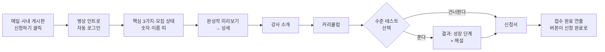

# STEP 07. User Flow — SWAN 웹사이트

진행: 완료

## 진입 경로
- 모집 공지를 **메일**로 받는다. 포스터 형태의 한 페이지 메일에서 [신청하기] 버튼을 누른다
- 도착 지점 (사용자 확정): **첫 화면 맨 위.** 인트로부터 보고 스크롤해 내려간다. 신청 화면으로 바로 보내지 않는다
- 들어오는 순간 자동으로 SSO 로그인된다 (실패해도 열람은 가능)
- 다른 경로: **사내 게시판**의 모집 공지. 여기서도 같은 링크로 첫 화면 맨 위에 도착한다

## 사용자 여정 (6단계) — 예비 수강생 박준영
칸 이름은 이 사이트에 맞게 바꿨다.

1. **첫 화면 접속 (시작점)** — 메일의 [신청하기]를 누른다. 자동으로 로그인되고 영상 인트로가 재생된다. "오, 뭐지?" 하며 스크롤을 시작한다.
2. **훑어보기** — SWAN의 핵심 3가지와 "5기 모집 중, D-7"을 본다. 숫자와 흘러가는 졸업생 이름 띠에서 아는 이름을 발견하고, 참여 부서에서 우리 팀을 찾는다.
3. **자세히 보기** — 갤러리 미리보기에서 같은 부서 졸업생의 완성작을 눌러 상세 내용을 읽는다. "나도 이런 걸 만들 수 있겠구나." 이어서 커리큘럼 타임라인에서 궁금한 주차를 열어 본다.
4. **내 수준 재 보기 (선택)** — "내 수준에 맞나?"가 궁금해져 수준 테스트를 푼다. 6문제를 3분 만에 풀고 "아기 오리" 결과와 해설을 받는다.
5. **신청하기 (핵심 행동)** — [신청하기]를 누른다. 이름과 부서는 이미 채워져 있고, 경험과 요일 선호 등 몇 칸만 고르고 제출한다.
6. **완료 (끝점)** — 축하 연출과 함께 "5기 신청이 접수됐어요"를 본다. 개강일을 확인하고, 버튼은 [신청 완료]로 바뀐다.

### 첫 화면의 섹션 순서 (사용자 확정)
완성작을 커리큘럼보다 위로, 강사 소개도 커리큘럼 앞으로 올렸다.

1. 영상 인트로
2. SWAN 한 줄 소개와 핵심 3가지, 모집 상태
3. 숫자로 보는 SWAN, 졸업생 이름 띠, 참여 부서 띠
4. 완성작 갤러리 미리보기 — 증거를 먼저 보여준다
5. **강사 소개** — "누가 가르치는지"를 알고 나서 커리큘럼을 본다
6. 커리큘럼
7. 수준 테스트로 가는 안내
8. 파트 소개
9. 아이디어 보드 미리보기
10. 마지막 신청 안내, "이 사이트도 바이브코딩으로 만들었습니다"

## 최종 가치 실현 (Claude 제안, 사용자가 따로 고치지 않음)
### 예비 수강생
메일 한 통으로 들어와 10분 만에, 이 교육이 내 수준에 맞는지와 듣고 나면 무엇을 만들 수 있는지를 눈으로 확인하고 신청까지 끝낸다. "다음 기수에 듣지 뭐"가 아니라 "이번에 듣자"로 마음이 정해진다.

### 다른 사용자 유형의 흐름과 경험
- 졸업생: 들어오면 졸업생으로 인식된다 → [완성작 올리기] → 입력 폼 작성, 민감 정보 확인 → 승인 대기 → 공개 → 좋아요를 받는다. 토이프로젝트 모집 글을 쓰거나 [참여하고 싶어요]를 누른다. "내가 만든 게 다른 부서에도 쓸모가 있구나"
- 실무진: 파트 소개나 아이디어 보드 미리보기 → [아이디어 남기기] → 두 줄 작성, 이름 표시 방식 선택 → 등록 → 며칠 뒤 "검토 중". "말하면 들어 주는 곳이 있구나"
- 팀장: 팀원이 보낸 링크 → 숫자, 완성작, 강사 소개, 커리큘럼을 본다 → 팀원을 보낼지 판단
- 관리자: 관리자 화면 → 신청자 목록 확인·엑셀 내려받기, 완성작 승인·반려, 아이디어 상태 변경과 답변, 기수·문제·커리큘럼 수정

원문 메모

- Q7-1: "(가)로 가자 다른 경로는 사내게시판" (처음엔 "없어"라고 했다가 정정)
- Q7-2: 제안 → "완성작을 올리자" (섹션 순서에서 완성작을 커리큘럼 위로)
- Q7-3: 제안 제시 → "강사소개도 커리큘럼 전에 있어야겠다" (최종 가치 초안은 따로 고치지 않음)

