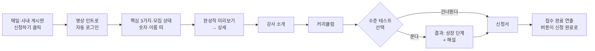

# SWAN 웹사이트 기획서

> "우리 파트가 하는 SW 교육 SWAN을 소개하고 신청받는 사이트야. 파이썬 초급 딱지를 막 뗀 사람이 고급이랑 바이브코딩 노하우까지 배우는 과정인데, 졸업생들이 뭘 만들었는지 보여주고 3D랑 인터랙션으로 한눈에 '여기 잘한다'는 느낌을 주는 곳이지."

작성: Design Technology팀 IPS 파트 · 작성일: 2026-10-14 · 버전: v3 (1차 2026-10-07, 2차 2026-10-12에 이은 세 번째 기획)

표기 규칙: `(제안)`은 Claude가 보완했고 아직 사실로 확인되지 않은 내용이다. 페르소나의 이름과 연차는 가상이다. 확인되지 않은 항목은 부록 B에 모았다.

---

## 요약: 프로젝트 기획 10단계

| 단계 | 핵심 질문 | 우리의 답 |
|---|---|---|
| 01 Project Idea | 무엇을 만들고 싶은가? 어떤 서비스인가? | SWAN(SW Academy for Newbie) 교육과 Design Technology팀 IPS 파트를 알리는 사내 웹사이트. 실제 커리큘럼과 역대 기수의 성과를 보고 신청하고, 수준 테스트로 내 수준을 재 본다. 졸업생은 완성작을 올리고 토이프로젝트 팀원을 모으며, 실무진은 아이디어 보드에 가벼운 개발 요청을 남긴다. 교육은 Python 중고급과 바이브코딩, 주 1회 온라인 3개월 과정이다. |
| 02 Problem | 누가, 어떤 상황에서, 어떤 어려움을 겪고 있는가? | 파이썬을 어느 정도 쓸 줄 알지만 AI 시대에 바이브코딩을 어떻게 잘할지, 내 아이디어를 어떻게 구현할지 고민하는 현업 엔지니어. AI가 짠 코드가 안 돌아가도 어디가 틀렸는지 모르고, 한 부분에서 막혀도 물어볼 사람이 없다. 기존 교육은 온라인이거나 사외이고 강사가 사내 환경을 모른다. |
| 03 User | 어떤 사람인가? 언제 문제를 겪는가? 현재 어떻게 해결하는가? | 반도체 공정·개발·품질 부서의 엔지니어(예비 수강생), 졸업생, 아이디어를 남기는 실무진, 보는 사람(팀장급), 관리자. 포스터 메일의 [신청하기]를 눌러 들어온다. 궁극적 페인포인트: **"AI가 코드를 짜 줘도, 그 코드가 맞는지 판단할 눈이 없다."** |
| 04 Goal | Before를 어떤 After로 바꾸려 하는가? | 글로 된 공지만 보고 "다음 기수에 듣지 뭐" 하던 사람이, 완성작과 커리큘럼, 수준 테스트라는 눈으로 보는 증거로 확신을 얻어 그 자리에서 신청한다. 지표: 5기 신청 65명 안팎, 갤러리 완성작 기수마다 1개씩 4개 이상, 아이디어 3개 이상. |
| 05 Core Action | 사용자가 반드시 해야 하는 행동은? | 교육 신청. ① 커리큘럼과 완성작을 확인한다 ② 수준 테스트로 내 수준을 재 본다(선택) ③ 신청서를 제출한다. 가장 강한 동기는 호기심이다. |
| 06 Core Feature | 각 행동을 가능하게 하는 기능은? 왜 필요한가? | 영상 인트로와 일부 3D, 숫자와 졸업생 이름 띠, 완성작 갤러리와 좋아요, 강사·파트 소개, 커리큘럼, 수준 테스트 6문제, 두 칸짜리 신청서, 완성작 올리기와 승인, 토이프로젝트, 아이디어 보드, 제작 과정 화면, 관리자 화면. 자동 SSO 로그인과 방문 기록이 바탕이다. 통계 화면과 갤러리 댓글만 2순위. |
| 07 User Flow | 들어와서 목적을 달성하기까지의 순서는? | 메일·사내 게시판의 [신청하기] → 영상 인트로(자동 로그인) → 핵심 3가지와 숫자 → 완성작 → 강사 소개 → 커리큘럼 → 수준 테스트(선택) → 신청 → 접수 완료 |
| 08 Core Screens | 어떤 화면들이 필요한가? | 핵심 7개: 홈 / 완성작 갤러리 / 완성작 상세 / 수준 테스트 / 신청 / 제작 과정 / 관리자. 그 밖에 완성작 올리기, 토이프로젝트, 아이디어 보드. PC 전용. |
| 09 Research | 무엇을 조사했고 무엇을 알게 되었는가? | 개발자의 66%가 "거의 맞지만 딱 맞지는 않는 AI 답"을 겪고, AI 결과를 불신하는 사람이 신뢰하는 사람보다 많다(Stack Overflow 2025). 수준 테스트가 신청을 늘린다는 독립 근거는 없어 직접 잰다. 사내망에서는 모든 자원을 사이트에 포함해야 한다. |
| 10 Reference | 무엇을 참고했고 무엇을 적용하는가? | 소이정 → 캐릭터가 이끄는 연출과 흐르는 띠 / Boot.dev → 캐릭터 멘토와 "먼저 해 보기" / Josh W. Comeau → 제작 과정 공개와 작은 반응 / Brilliant → "왜 배워야 하나"를 말하는 방식 / SSAFY → 사람과 결과로 보여주기. 디자인 방향은 세 개(개발자의 노트, 밝은 물가, 달빛 호수 다시)를 비교해 **A 개발자의 노트 + 3D 캐릭터**로 정했다 (2026-10-16). |

### 한 장 컨셉
- **메인 문구**: "날개는 AI가 달아 줍니다. 나는 법은 여기서 배웁니다."
- **서브 문구 (잠정)**: "AI 시대, SW를 보는 눈을 기릅니다."
- **SWAN의 자리**: 사내 환경을 아는 사내 강사가 가르치고, 코드를 볼 줄 아는 눈을 길러 주며, 막혔을 때 물어볼 사람이 생기는 곳
- **사이트 자체가 증거**: 이 사이트도 바이브코딩으로 만들었고, 그 과정을 공개한다
- **캐릭터**: 알 → 아기 오리 → 백조로 자라는 성장 이야기. 수준 테스트 결과와 신청 완료에 등장한다
- **만드는 순서**: ① 모집을 받을 수 있는 최소한 → ② 수준 테스트와 갤러리 → ③ 나머지 기능 → ④ 디자인과 연출

### 1·2차 기획에서 달라진 점
| 항목 | 1차 (10/7) | 2차 (10/12) | 3차 (10/14, 실제 자료 반영) |
|---|---|---|---|
| 교육 대상 | 코딩이 처음인 현업 | 신입사원, 타 부서 비개발자 | 파이썬 초급 딱지를 막 뗀 현업 엔지니어 |
| 교육 형태 | 주 2~3회 오프라인, 기수당 8~10명 | 8주 파견 | 주 1회 온라인 3개월, 4기 65명, 선발 없음 |
| 페인포인트 | 3개월 투자의 결과가 안 보인다 | 교육 뒤의 내 모습을 볼 방법이 없다 | AI가 짠 코드를 판단할 눈이 없다 |
| 사이트 범위 | 원페이지 홍보 | 갤러리와 신청이 있는 사이트 | + 수준 테스트, 아이디어 보드, 제작 과정, 토이프로젝트 |
| 디자인 | 달빛 호수의 밤 | 밝은 물가, 로우폴리 | 세 방향 시안을 비교해 결정 |

---

## STEP 01. Project Idea — 만들 프로젝트 정하기

### 프로젝트 이름
SWAN (SW Academy for Newbie) 웹사이트

### 어떤 서비스인가
SWAN 교육과 이를 운영하는 Design Technology팀 IPS 파트를 알리는 사내 웹사이트다. 방문자는 실제 커리큘럼과 역대 기수의 성과를 보고 교육을 신청한다. 졸업생은 완성작을 갤러리에 올리고 토이프로젝트 팀원을 모은다. 실무진은 아이디어 보드에 가벼운 개발 요청을 남긴다.

#### 작동 방식
1. 둘러보기: 인트로 연출과 함께 SWAN과 파트 소개를 본다.
2. 숫자로 확인하기: 기수 수, 누적 졸업생, 참여 부서 수를 실제 숫자로 본다.
3. 커리큘럼 보기: 주차별로 무엇을 배우고 무엇을 만드는지 실제 과정표로 확인한다.
4. 졸업생 이름 흐름: 역대 교육생 이름이 라벨처럼 가로로 흘러간다. 검색·목록 기능은 두지 않는다.
5. 완성작 구경하기: 갤러리에서 졸업생이 만든 결과물을 본다.
6. 수준 확인하기: 짧은 테스트 문제를 풀고 이 강의를 들을 수 있는 수준인지 본다.
6-1. 신청하기: 로그인 후 신청서를 제출한다.
7. 졸업 후 활동: 졸업생이 완성작을 올리고 토이프로젝트 팀원을 모집한다.
8. 아이디어 남기기: 실무진이 "이런 거 있으면 좋겠다"를 가볍게 남기고, 다른 사람은 공감한다.

#### 주요 특징
- 교육·파트 홍보: SWAN과 IPS 파트를 알린다.
- 실제 데이터 기반 성과: 진짜 기수, 인원, 부서 분포를 보여준다.
- 졸업생 이름 마키: 교육생 이름 라벨이 가로로 흐르는 띠. "이만큼 많은 사람이 거쳐 갔다"를 한눈에 보여준다. (검색형 디렉터리는 제외)
- 커리큘럼 열람: 실제 주차별 과정표.
- 교육 신청 접수: 사이트에서 바로 신청.
- 갤러리 + 토이프로젝트 모집: 졸업생 활동 공간.
- 아이디어 보드: 부서장님을 거치지 않는 가벼운 개발 요청 창구 (1차 기획에서 가져옴).
- 수준 테스트 (STEP 04에서 추가): 문제를 풀어 보고 "이 정도면 이 강의를 들을 수 있다"를 확인하는 공간.
- 갤러리 좋아요 (STEP 04에서 추가): 완성작에 좋아요 수를 기록한다. 댓글은 Phase 2 후보로 보류.
- 사이트 자체가 증거 (STEP 05에서 추가): 이 사이트도 바이브코딩으로 만들었다는 것을 보여줘 교육에 대한 기대를 심는다.
- 높은 완성도: 인터랙션과 3D 연출.

#### 제공 방식
- 플랫폼: 사내망 데스크톱 웹 (가정)
- 가입·로그인: SSO (가정)
- 세부는 STEP 11에서 확인

#### 교육 대상과 내용 (1·2차 기획에서 정정)
- 대상: **신입사원이 아니다.** Python 초급 딱지를 이제 막 뗀 사람이 고급까지 가는 과정
- 내용: Python 중고급 과정 + 바이브코딩을 잘하는 노하우
- 톤 변화: "처음이어도 괜찮아요"가 아니라 "조금 하는 사람이 제대로 잘하게 되는 곳"

#### 교육 운영 정보 (4기 자료 기준, 사용자 제공)
- 형태: **주로 온라인**. 강사가 사내 사람이라 요청하면 직접 만날 수 있다
- 기간·빈도: 3개월, 주 1회(목요일 또는 금요일) 1시간 30분 강의
- 인원: 4기 65명 (온라인이라 많이 받음)
- 교육 목표
  1. 각 부서에서 필요한 SW를 자체 개발할 수 있는 인력 양성
  2. 실습 위주의 프로그래밍 역량 강화를 통한 SW 제작 능력 향상
  3. 재사용성이 높은 SW를 작성하는 방법 교육
- 모집 대상
  1. 부서 업무를 SW로 자동화하려는 의지가 높은 인력
  2. 각 부서에서 SW 인력으로 양성할 인력 (본업을 하면서 필요한 SW를 자체 개발)
  3. 주 3~4시간(강의 1시간 30분 + 복습 + 실습)을 확보할 수 있는 인력
- 참여 부서 예: CMP기술팀, CVD기술팀, Etch기술팀, FAB2팀, post FAB팀, YE팀, 미래FAB혁신그룹, IP개발팀, PA2팀, PDK개발팀, 개발품질팀, 기술지원팀 등

### 한 문장 정의
"우리 파트가 하는 SW 교육 SWAN을 소개하고 신청받는 사이트야. 파이썬 초급 딱지를 막 뗀 사람이 고급이랑 바이브코딩 노하우까지 배우는 과정인데, 졸업생들이 뭘 만들었는지 보여주고 3D랑 인터랙션으로 한눈에 '여기 잘한다'는 느낌을 주는 곳이지." (제안 — 사용자 답을 바탕으로 Claude가 문장화)

### 왜 이 프로젝트인가
- 계기: 부장님이 교육생을 모집하고 있다.
- 교육 홍보: SWAN은 **AI 시대에 SW를 볼 수 있는 능력을 갖춘 실무 인력을 양성하는 교육**이다. 이 취지를 사업부에 알린다.
- 파트 홍보: SW 개발자가 적은 사업부에 Design Technology팀 IPS 파트를 알린다.
- 개인 동기: 퀄리티 높은 사이트를 직접 만들어 내 역량을 보여준다.

## STEP 02. Problem — 해결할 문제 정의하기

### 누가 — 대표 타겟
파이썬을 어느 정도 쓸 줄 알지만, AI 시대에 바이브코딩을 어떻게 잘할 수 있는지, 내 아이디어를 어떻게 구현할 수 있을지 고민하는 사람.

- 수준: 파이썬 초급 딱지를 막 뗌. 문법은 알고 간단한 스크립트는 짠다
- 고민 1: AI에게 코드를 시켜 보지만 "잘" 시키는 방법을 모른다 (바이브코딩 노하우 부족)
- 고민 2: 만들고 싶은 아이디어는 있는데 스크립트 수준을 넘어 "돌아가는 무언가"로 만드는 길을 모른다
- 직무·연차·이름: 미정 (STEP 03에서 구체화)

### 어떤 상황에서
#### ① 평일 오후, 자기 자리 — AI가 짜 준 코드가 안 돌아갈 때
- 상황: AI에게 "이 엑셀들 합쳐 줘"라고 시켜서 코드를 받았는데, 실행하니 에러가 난다.
- 고충: 에러 메시지를 다시 AI에게 붙여넣기를 반복하지만 계속 다른 에러가 난다. 코드를 읽을 줄 몰라 어디가 문제인지 판단을 못 하고, 한 시간을 쓰고 포기한다.

#### ② 업무 중 반복 작업을 하다가 — "이거 만들면 되는데" 싶을 때
- 상황: 매주 하는 취합이나 정리 작업을 하다가 "이거 툴로 만들면 편하겠다"는 아이디어가 떠오른다.
- 고충: 간단한 스크립트는 짜 봤지만, 화면이 있고 여러 사람이 같이 쓰는 툴은 어디서부터 시작할지 모른다. 아이디어는 메모장에만 남는다.

#### ③ 회의나 옆자리에서 — 동료가 AI로 뚝딱 만든 걸 볼 때
- 상황: 동료가 "이거 AI로 반나절 만에 만들었어"라며 툴을 보여준다.
- 고충: 나도 같은 AI를 쓰는데 왜 내 결과물은 저 수준이 안 되는지 모른다. 뭘 다르게 시키는지 궁금하지만 물어보기 애매하다.

#### ④ 혼자 공부하려고 검색할 때 — 정보가 너무 많고 흩어져 있을 때
- 상황: 바이브코딩이나 프롬프트 잘 쓰는 법을 찾아본다.
- 고충: 글과 영상은 넘치지만 수준이 제각각이고, 우리 회사 환경에서 되는지도 알 수 없다. 무엇이 맞는 방법인지 기준이 없다.

#### ⑤ 만든 스크립트가 커졌을 때 — 내가 짠 코드를 내가 못 고칠 때
- 상황: AI 도움으로 만든 스크립트를 몇 달 쓰다가 양식이 바뀌어 고쳐야 한다.
- 고충: 코드가 수백 줄인데 구조를 이해하지 못한 채 만들어서 손을 못 댄다. 처음부터 다시 시키는 수밖에 없다.

#### ⑥ 아이디어를 구현하다가 — 딱 한 부분에서 막혔을 때 (사용자 직접 제시)
- 상황: 아이디어를 구현하다 보면 대부분은 되는데 일부분에서 막힌다.
- 고충: 도움을 요청할 사람이 없고, 해결하는 방법도 모른다. 그 한 부분 때문에 전체가 멈춘다.

(①~⑤는 Claude 제안을 사용자가 모두 채택)

### 왜 중요하고 시급한가 (제안을 사용자가 채택)
#### 시간적 영향
- AI가 짜 준 코드의 에러를 붙여넣고 다시 받는 일을 반복하다가 반나절이 사라진다.
- 만들면 편해질 반복 업무를 계속 손으로 한다. 매주 같은 시간이 새어 나간다.
- 구현하다 한 부분에서 막히면 며칠씩 멈춰 있다가 결국 접는다.

#### 심리적 영향
- "나도 AI를 쓰는데 왜 안 되지?"라는 답답함과 뒤처지는 느낌이 쌓인다.
- 아이디어가 있어도 "어차피 못 만들 텐데"라며 스스로 접는 습관이 생긴다.
- 물어볼 사람이 없어 혼자 헤매는 외로움이 있다.

#### 업무와 조직에 끼치는 영향
- 현업을 가장 잘 아는 사람이 떠올린 개선 아이디어가 구현되지 못하고 사라진다.
- 구조를 이해하지 못한 채 만든 코드는 양식이 바뀌면 고칠 수 없어 오히려 짐이 된다.
- 작은 툴 하나까지 개발 부서에 요청해야 해서, 요청은 밀리고 현업은 기다린다.

#### 왜 지금 시급한가
- AI로 코드를 만드는 건 누구나 할 수 있게 됐다. 차이는 그 코드를 보고 판단할 수 있느냐에서 난다. 그 눈이 없으면 AI를 써도 금방 한계가 온다.
- AI 도구를 잘 쓰는 사람과 못 쓰는 사람의 격차가 빠르게 벌어지고 있다.
- SW 개발자가 적은 사업부일수록 현업 안에 SW를 볼 줄 아는 사람이 있어야 한다.
- (사업부·회사 차원의 구체적 사정은 확인되지 않음 → 열린 질문)

#### 해결했을 때의 가치
- 개인: 떠올린 아이디어를 실제로 돌아가는 것으로 만들 수 있다. 막혀도 어디가 문제인지 스스로 짚는다.
- 조직: 현업의 개선 아이디어가 현업 안에서 바로 구현된다. 개발 부서는 큰 일에 집중한다.
- 관계: 졸업생끼리 "막혔을 때 물어볼 사람"이 생긴다.

### 현재 임시방편과 한계
| 방법 | 어떻게 쓰고 있나 | 한계 |
|---|---|---|
| AI에게 계속 다시 묻기 | 에러 메시지를 붙여넣고 고쳐 달라고 반복 | 코드를 읽지 못해 AI의 답이 맞는지 판단할 수 없다. 같은 자리를 맴돈다 |
| 유튜브·블로그 검색 | 바이브코딩이나 프롬프트 요령을 찾아봄 | 수준이 제각각이고 우리 회사 환경에서 되는지 알 수 없다. 단편적 요령만 쌓인다 |
| **기존 강의·교육** (사용자 확인) | 온라인 교육을 듣거나 사외 교육에 다녀옴 | 온라인이라 질문을 못 하거나, 사외에서 진행되거나, **강사가 사내 환경을 잘 모른다**. 배운 걸 회사 안에서 그대로 쓰기 어렵다 |
| 아는 개발자에게 묻기 | 친한 개발자에게 메신저로 질문 | 사업부에 개발자가 적고, 바쁜 사람에게 계속 묻기 미안하다 |
| 혼자 책·강의로 공부 | 파이썬 책이나 온라인 강의 수강 | 문법은 늘지만 "내 아이디어를 구현하는 법"은 안 알려 준다. 막혔을 때 물어볼 곳이 없다 |
| 개발 부서에 요청 | 부서장님을 통해 공식 요청 | 절차가 무거워 작은 아이디어는 말을 못 꺼낸다. 순서를 기다려야 한다 |
| 그냥 손으로 하기 | 포기하고 수작업 | 시간이 계속 새고 아이디어는 사라진다 |

#### 정리: 왜 여전히 고통받는가
방법들은 모두 "혼자서" 하거나 "남에게 맡기는" 것이다. 기존 교육은 사내 환경을 모르는 강사가 온라인이나 사외에서 진행한다. 정작 필요한 것은 내가 직접 만들되, **사내 환경을 아는 사람에게** 체계적으로 배우고, 막혔을 때 찾아가 물어볼 수 있는 환경이다. 그 자리가 비어 있다.

→ SWAN의 자리: **사내 환경을 아는 사내 강사가 가르치고(주로 온라인, 요청하면 직접 만날 수 있음), 코드를 볼 줄 아는 눈을 길러 주며, 막혔을 때 물어볼 사람이 생기는 곳.**

## STEP 03. User — 핵심 사용자 구체화하기

### 핵심 사용자 집단의 공통 특성
- 소속: 반도체 공정·개발·품질 관련 기술 부서 (CMP기술팀, CVD기술팀, Etch기술팀, FAB2팀, post FAB팀, YE팀, 미래FAB혁신그룹, IP개발팀, PA2팀, PDK개발팀, 개발품질팀, 기술지원팀 등)
- 본업: SW 개발이 아닌 엔지니어링 업무. 본업을 하면서 필요한 SW를 직접 만들려는 사람
- 수준: 파이썬을 어느 정도 쓸 줄 안다 (초급 딱지를 막 뗌)
- 의지: 부서 업무를 SW로 자동화하려는 의지가 높다
- 시간: 주 3~4시간(강의 1시간 30분 + 복습 + 실습)을 낼 수 있다
- 연차: 미확인 (데이터 추출 필요)

### 페르소나 (이름·연차는 가상, Claude 제안을 사용자가 채택)
#### 페르소나 1: 예비 수강생, 박준영 (Etch기술팀 엔지니어)
- 파이썬으로 데이터 정리 스크립트는 짜 봤고, AI로 툴을 만들어 보려다 막힌 경험이 있다
- 이 사이트에서 하는 일: 커리큘럼과 완성작을 보고 "내 수준에 맞나, 뭘 만들 수 있게 되나"를 확인한 뒤 신청

#### 페르소나 2: 졸업생, 이서연 (YE팀 엔지니어, 4기 수료)
- 부서에서 쓰는 분석 툴을 만들었다
- 이 사이트에서 하는 일: 완성작을 갤러리에 올리고, 토이프로젝트 팀원을 모집

#### 페르소나 3: 아이디어를 남기는 실무진, 최민수 (기술지원팀)
- 교육을 들을 시간은 없지만 "이런 툴 있으면 좋겠다"는 생각은 많다
- 이 사이트에서 하는 일: 아이디어 보드에 가볍게 요청을 남기고, 남의 아이디어에 공감

#### 페르소나 4: 보는 사람, 각 부서 팀장·그룹장
- 팀원을 SW 인력으로 키울지 판단한다 (모집 대상 ② "부서에서 SW 인력으로 양성할 인력"의 결정권자)
- 이 사이트에서 하는 일: 교육 성과와 완성작을 보고 팀원을 보낼지 결정

#### 페르소나 5: 관리자, 나 + 부장님
- 이 사이트에서 하는 일: 신청 관리, 완성작 검수, 아이디어 처리

### 언제, 어떤 동선에서 문제를 마주하나
#### 유입 경로 (사용자 확정)
모집 공지는 **메일**로 받는다. 포스터 형태의 한 페이지 메일을 보내고, 메일의 **[신청하기] 버튼을 누르면 홈페이지로 이동**한다. 신청하려면 누구나 홈페이지를 반드시 거치게 한다.

#### 평일 타임라인 — 예비 수강생 박준영 (일과는 Claude 제안)
- 오전 | 출근 후 메일 확인 — 행동: 밤사이 쌓인 메일을 훑는다 / 고충의 순간: 공지 메일은 제목만 보고 넘기기 쉽다 / 서비스가 들어갈 자리: **눈에 띄는 포스터 메일 + [신청하기] 버튼**
- 오전~오후 | 데이터 정리·보고 등 반복 업무 — 행동: 장비·공정 데이터를 모아 엑셀로 정리한다 / 고충의 순간: "이거 툴로 만들면 되는데" 싶지만 방법을 모른다 / 서비스가 들어갈 자리: 완성작 갤러리("우리 부서 같은 일을 이렇게 풀었네")
- 오후 | 짬이 날 때 AI로 코드 시도 — 행동: AI에게 스크립트를 시켜 본다 / 고충의 순간: 에러가 나거나 한 부분에서 막히는데 물어볼 사람이 없다 ← **문제가 가장 크게 터지는 순간** / 서비스가 들어갈 자리: 커리큘럼("이걸 배우면 저 벽을 넘는다"), 사내 강사 소개
- 오후 늦게 | 메일을 다시 열어 봄 — 행동: 아까 본 포스터 메일의 [신청하기]를 누른다 / 고충의 순간: "주 3~4시간 낼 수 있을까, 내 수준에 맞을까" / 서비스가 들어갈 자리: **홈페이지 첫 화면에서 끝까지 스크롤 → 신청**
- 수시 | 팀장과 면담·업무 조율 — 행동: 교육을 들어도 되는지 이야기한다 / 고충의 순간: 팀장에게 설명할 근거가 없다 / 서비스가 들어갈 자리: 팀장에게 보여줄 성과·완성작 화면

#### 패턴 정리
- 진입은 항상 **메일 → [신청하기] → 홈페이지**. 방문자는 "신청하러" 들어온다 → 첫 화면부터 신청까지의 길이 끊기면 안 되고, 그 길 위에 홍보 콘텐츠를 놓는다
- 사내망 PC, 업무 시간 중 짧게 본다
- 본인 설득과 팀장 설득, 두 가지 근거가 모두 필요하다

#### 홍보물 아이디어 (사용자 제안)
- 페르소나의 하루(막히는 순간 → SWAN을 만나는 과정)를 **짧은 영상**으로 만들어 홍보 메일에 넣는다
- 포스터 형태의 한 페이지 메일도 함께 만든다

### 기존 자구책 (STEP 02와 같음, 추가 없음)
| 방법 | 어떻게 했나 | 왜 오래 못 갔나 |
|---|---|---|
| AI에게 계속 다시 묻기 | 에러 메시지를 붙여넣고 반복 | 코드를 읽지 못해 답이 맞는지 판단할 수 없다 |
| 유튜브·블로그 검색 | 바이브코딩·프롬프트 요령 검색 | 수준이 제각각이고 사내 환경에서 되는지 모른다 |
| 기존 강의·교육 | 온라인 교육, 사외 교육 | 질문을 못 하거나, 강사가 사내 환경을 모른다 |
| 아는 개발자에게 묻기 | 메신저로 질문 | 개발자가 적고 계속 묻기 미안하다 |
| 혼자 책·강의로 공부 | 파이썬 책, 온라인 강의 | 문법은 늘지만 아이디어 구현법은 안 알려 준다 |
| 개발 부서에 요청 | 부서장님을 통한 공식 요청 | 절차가 무거워 작은 아이디어는 말을 못 꺼낸다 |
| 그냥 손으로 하기 | 수작업 | 시간이 새고 아이디어는 사라진다 |

#### 실패한 공통 이유
혼자 하거나 남에게 맡기는 방법뿐이고, 사내 환경을 아는 사람에게 배우며 막힐 때 물어볼 수 있는 길이 없다.

### 궁극적 페인포인트
> **AI가 코드를 짜 줘도, 그 코드가 맞는지 판단할 눈이 없다.**

- 왜 가장 본질적인 구멍인가
  - 코드를 만드는 일은 AI가 대신해 주지만, 그 결과를 읽고 판단하는 일은 대신해 주지 않는다
  - 판단할 눈이 없으면 에러를 붙여넣고 다시 받는 반복에서 벗어날 수 없다
  - 나머지 두 불편(길을 모른다, 물어볼 사람이 없다)도 여기서 나온다. 볼 줄 알면 어디서 막혔는지 스스로 짚고, 무엇을 물어야 할지도 안다
- 결과적으로 겪는 것: AI를 쓰는데도 결과물이 늘 제자리이고, 만든 코드를 스스로 고치지 못한다
- 그래서 풀어야 할 단 하나: **"SW를 볼 수 있는 눈"을 길러 준다는 것을 믿게 만들기** — 교육 취지("AI 시대에 SW를 볼 수 있는 능력을 갖춘 실무 인력 양성")와 정확히 같다

## STEP 04. Goal — 서비스가 만들어낼 변화 정의하기

여기서 "서비스"는 교육이 아니라 웹사이트다.

### Before (현재 상태) — 사이트가 없는 지금
- **예비 수강생 (박준영)**: 모집 메일을 받는다. 본문에는 일정과 대상, 신청 방법이 글로 적혀 있다. "Python 중고급? 내 수준에 맞나? 듣고 나면 뭘 만들 수 있지?" 감이 오지 않는다. 주 3~4시간을 쓸 만한지 판단할 근거가 없어 "다음 기수에 듣지 뭐" 하고 메일을 닫는다.
- **팀장**: 팀원이 교육을 듣겠다고 하는데, 팀에 어떤 도움이 되는지 보여줄 자료가 없다. 말로만 듣고 판단한다.
- **졸업생 (이서연)**: 수료하며 만든 툴은 자기 부서 안에서만 쓴다. 다른 부서 졸업생이 뭘 만들었는지 모르고, 수료 후에는 서로 볼 일이 없다. 막혀도 여전히 혼자다.
- **실무진 (최민수)**: "이런 툴 있으면 좋겠다"는 생각이 있지만 부서장님을 통해 공식 요청할 만큼은 아니라 그냥 넘어간다.
- **부장님과 파트**: 4기까지 진행했고 65명이 들은 기수도 있는데, 성과가 한곳에 모여 있지 않다. 보고할 때마다 자료를 새로 만든다. 사업부는 IPS 파트가 무슨 일을 하는지 잘 모른다. (보고 자료 활용은 제안 — 실제 필요 여부 미확인)

### After (이상적 목표 상태) — 사이트가 생긴 뒤
- **예비 수강생**: 포스터 메일의 [신청하기]를 누르면 사이트가 열린다. 인트로를 지나 스크롤하니 실제 주차별 커리큘럼이 보인다. **수준 테스트**에서 문제 몇 개를 풀어 보고 "이 정도면 들을 수 있다"는 결과를 받는다. 갤러리에서 같은 공정 부서 졸업생이 만든 툴을 보고 "나도 이런 걸 만들 수 있겠구나" 한다. 그 자리에서 신청서를 제출한다.
- **팀장**: 팀원이 보내 준 링크를 연다. 역대 기수와 인원, 참여 부서, 완성작을 보고 "우리 팀에도 SW 볼 줄 아는 사람이 있으면 좋겠다"고 판단한다.
- **졸업생**: 만든 툴을 갤러리에 올리니 **좋아요**가 쌓이고 다른 부서에서 "우리도 쓰고 싶다"는 반응이 온다. 뿌듯하다. 토이프로젝트 모집 글로 팀원을 구하고, 막힐 때 물어볼 동료가 생긴다.
- **실무진**: 아이디어 보드에 두 줄로 남긴다. 며칠 뒤 공감이 여러 개 달리고 "검토 중"으로 바뀐다.
- **부장님과 파트**: 성과 보고 때 사이트 화면을 그대로 띄운다. 흘러가는 졸업생 이름 띠와 완성작 갤러리가 그 자체로 성과 자료다. 사이트를 본 다른 부서에서 제작 문의가 온다.

#### 대비의 핵심
"글로 된 공지"가 "눈으로 보는 증거"로 바뀐다. 커리큘럼, 완성작, 졸업생 이름, 수준 테스트가 모두 판단의 근거가 된다.

#### 이 단계에서 추가된 기능
- 수준 테스트: 문제를 풀고 "이 정도 수준이면 이 강의를 들을 수 있다"를 확인하는 공간
  - 앞부분: 진짜 중급인지 판단하는 파이썬 문제
  - 마지막: "AI가 짠 코드에서 잘못된 곳 찾기" 문제 (페인포인트 "판단할 눈"을 체험)
- 갤러리 좋아요: 완성작마다 좋아요 수 기록
- 갤러리 댓글: 보류 (Phase 2 후보)

### 측정 지표
4기 인원 65명과 사용자가 정한 목표 외에는 Claude 제안값이다.

#### 신청으로 이어지는가
- 5기 신청자 수: 4기와 비슷한 65명 안팎 (사용자 확정) — 사이트가 신청을 유지·확대했는가
- 메일 [신청하기] 클릭 → 신청 완료 비율: 방문자의 20% 이상 (제안) — 사이트가 설득에 성공했는가
- 수준 테스트 완료 → 신청 비율: 완료자의 50% 이상 (제안) — 테스트가 확신을 주는가

#### 끝까지 보는가
- 수준 테스트 시작 수: 방문자의 30% 이상 (제안) — "내 수준에 맞나"가 궁금해 눌러 보는가
- 갤러리까지 스크롤한 비율: 방문자의 50% 이상 (제안) — 인트로에서 떠나지 않고 내려오는가
  - 측정 방법: 갤러리 섹션이 화면에 처음 들어오는 순간을 브라우저가 감지해 사이트 서버에 한 번 기록한다. (갤러리 도달 방문자 수 ÷ 전체 방문자 수)

#### 졸업생이 참여하는가
- 갤러리 완성작 등록 수: 오픈 한 달 내 4개 이상, **기수마다 1개씩** (사용자 확정) — 1~4기 모두의 결과물이 걸리는가
- 완성작당 평균 좋아요: 5개 이상 (제안) — 올린 사람이 뿌듯함을 느끼는가
- 토이프로젝트 모집 글: 오픈 후 3개 이상 (제안) — 수료 후에도 연결이 이어지는가

#### 파트가 알려지는가
- 아이디어 보드 등록 수: 3개 이상 (사용자 확정) — 가벼운 요청 창구가 작동하는가
- 다른 부서의 제작 문의: 1건 이상 (제안) — 사이트가 파트의 포트폴리오 역할을 하는가
- 부장님이 보고에 사이트를 활용: 1회 이상 (제안) — 성과 자료로 쓸 만한가

#### 나의 목표
- 부장님의 반응: "이거 누가 만들었어?"

#### 측정을 위해 필요한 것
방문, 섹션 도달, 버튼 클릭을 기록하는 기능을 사이트에 직접 넣어야 한다 (사내망이라 외부 분석 도구 사용 불가). 넣을지는 STEP 11에서 결정.

## STEP 05. Core Action — 핵심 행동 정의하기

### 궁극적 목적
파이썬은 쓸 줄 알지만 AI가 짠 코드를 판단할 눈이 없어 망설이는 사람이, 교육 뒤의 자기 모습을 눈으로 확인하고 확신을 얻어 신청하게 돕는 것.

### 핵심 행동
- 한 문장 정의: **교육을 신청한다.**
- 세부 단계 (핵심 루프)
  1. 확인하기: 스크롤하며 커리큘럼과 졸업생 완성작을 본다
  2. 내 수준 재 보기: 수준 테스트를 풀고 결과를 받는다 — **선택 사항** (신청의 필수 조건이 아님)
  3. 신청하기: 신청서를 제출한다

#### 처음 한 번만 하는 행동 (제안)
- 없음. 홈페이지에 들어오면 자동으로 SSO 로그인된다 (STEP 06에서 확정)

#### 하면 좋은 행동 (필수 아님)
- 수준 테스트 풀기: "내 수준에 맞나"에 대한 확신
- 갤러리 완성작에 좋아요 누르기
- "이 사이트도 바이브코딩으로 만들었다" 제작 과정 보기: 교육에 대한 기대

#### 다른 사용자 유형의 핵심 행동 (제안)
- 졸업생: 완성작을 갤러리에 올린다 / 토이프로젝트 모집 글을 올린다
- 실무진: 아이디어 보드에 요청을 남긴다, 남의 아이디어에 공감한다
- 보는 사람(팀장급): 성과와 완성작을 본다 (행동 없음, 보기만)
- 관리자: 신청 확인, 완성작 검수, 아이디어 상태 변경

#### 사이트 자체가 증거 (사용자 아이디어)
이 사이트도 바이브코딩으로 만들었다는 것을 보여줘서 교육에 대한 기대를 심는다. "SWAN에서 배우면 이런 것도 만든다"의 가장 가까운 증거가 지금 보고 있는 화면이다.

### 동기와 트리거 (제안을 사용자가 채택)
#### 즉각적인 혜택
- 3분이면 내 수준을 안다: 수준 테스트를 풀면 "이 강의를 들을 수 있는지" 바로 결과가 나온다. 신청하지 않아도 얻어 가는 것이 있다
- 신청이 1분이면 끝난다: 로그인하면 이름과 부서가 자동으로 채워지고 몇 칸만 쓴다

#### 호기심 (가장 강한 동기)
- "같은 부서 사람은 뭘 만들었지?": 갤러리에서 우리 팀·옆 팀 이름이 붙은 완성작을 찾아본다
- "아는 이름이 있나?": 흘러가는 졸업생 이름 띠에서 아는 사람을 발견한다
- "이 사이트는 어떻게 만든 거지?": 3D와 인터랙션을 보고 궁금해지고, 바이브코딩으로 만들었다는 것을 알게 된다
- "AI가 짠 코드에서 틀린 곳을 내가 찾을 수 있을까?": 테스트 마지막 문제에 도전하고 싶어진다

#### 명확한 필요성
- 모집 기간이 정해져 있다: 이번 기수를 놓치면 다음 기수까지 기다려야 한다
- 주변과의 격차: 동료는 AI로 뚝딱 만드는데 나는 막혀 있다
- 부서의 필요: 팀장이 "우리 팀에도 SW 볼 줄 아는 사람이 있어야 한다"고 말한 경우

#### 외부 트리거
- 포스터 메일의 [신청하기] 버튼
- 팀장이나 동료가 보내 준 링크
- "5기 모집 마감 D-7" 같은 마감 표시

#### 내부 트리거
- AI에게 시킨 코드가 또 안 돌아갔을 때
- "이거 툴로 만들면 되는데" 싶은 순간

#### 귀찮음을 낮추는 장치
- 들어오면 자동으로 SSO 로그인된다. 로그인 버튼을 누를 일이 없다 (STEP 06에서 변경)
- 수준 테스트는 문제 수를 적게, 객관식 위주로
- [신청하기] 버튼이 화면 어디서든 보인다
- "주 3~4시간이면 됩니다"를 눈에 띄게 적어 시간 부담을 먼저 던다

#### 한 줄 정리
궁금해서 눌러 본 수준 테스트와 완성작이 "나도 되겠다"는 확신으로 바뀌고, 그 자리에서 1분 만에 신청한다.

### 완료 시점의 결과물과 보상 (제안을 사용자가 채택)
#### 수준 테스트를 다 풀었을 때
결과를 점수가 아니라 캐릭터의 성장 단계로 보여준다. 합격·불합격이 아니다.

| 결과 | 화면 | 메시지 |
|---|---|---|
| 중급 문제를 대부분 맞힘 | 날개를 편 어린 백조 | "지금 딱 SWAN이 필요한 단계예요. 고급까지 함께 가요." → [신청하기] |
| 절반쯤 맞힘 | 물에 뜬 아기 오리 | "기초는 있어요. 복습 시간을 조금 더 잡으면 충분히 따라올 수 있어요." → [신청하기] |
| 대부분 틀림 | 알에서 막 나온 오리 | "지금은 기초를 먼저 다지는 걸 추천해요." → 추천 기초 자료 안내, [다음 기수 알림 받기] |

- 어떤 결과를 받아도 **신청은 막지 않는다.** 추천만 한다
- 틀린 문제는 짧은 해설을 바로 보여준다
- 마지막 "AI가 짠 코드에서 잘못된 곳 찾기" 문제는 결과와 상관없이 "이걸 한눈에 찾아내는 눈, SWAN에서 기릅니다."로 마무리

#### 신청서를 제출한 직후
- 축하 연출: 알이 깨지고 오리가 나오거나, 백조가 날개를 펴는 짧은 애니메이션
- 확인 화면: "5기 신청이 접수됐어요" + 내 이름, 부서, 신청 일시
- 다음에 일어날 일: 개강일과 개강까지 남은 날짜, 강의 접속 방법 안내 시점 (선발 없음 — 신청하면 수강 확정)
- 이어서 할 일: "기다리는 동안 졸업생 완성작을 구경해 보세요" → 갤러리

#### 조금 뒤에 돌아오는 보상
- 접수 확인 메일, 개강 안내
- 수료하면 내 이름이 졸업생 이름 띠에 흐르고, 내 완성작이 갤러리에 걸린다

#### 다른 유형의 보상
- 졸업생: 완성작에 좋아요가 쌓인다
- 실무진: 남긴 아이디어에 공감이 달리고 상태가 "검토 중"으로 바뀐다

#### 사용자가 얻는 이해
- "내 수준이 어디쯤인지 알았다."
- "이 교육을 들으면 저런 걸 만들 수 있구나."
- "신청은 끝났고, 다음에 뭘 기다리면 되는지 안다."

## STEP 06. Core Feature — 필요한 기능 도출하기

### 사용자 핵심 행동 (확정)
| # | 누가 | 행동 |
|---|---|---|
| 1 | 예비 수강생 | SWAN이 어떤 교육인지 한눈에 파악하기 |
| 2 | 예비 수강생 | 커리큘럼에서 무엇을 배우는지 확인하기 |
| 3 | 예비 수강생 | 졸업생이 만든 완성작 구경하기 |
| 4 | 예비 수강생 | 내 수준이 이 강의에 맞는지 재 보기 |
| 5 | 예비 수강생 | 교육 신청하기 |
| 6 | 졸업생 | 완성작 올리기, 토이프로젝트 팀원 모으기 |
| 7 | 실무진 | 아이디어 남기고 공감하기 |
| 8 | 관리자 | IPS 파트와 강사 알기 | 파트 소개, 강사 소개, 아이디어 보드 연결 | 사업부에 파트를 알리고, 사내 강사라는 차별점을 보여주기 위함 |
| 신청·완성작·아이디어 관리하기 |

### 행동별 상세 기능
#### 행동 1. SWAN이 어떤 교육인지 한눈에 파악하기
- 인트로 연출 — 첫 5초에 머물게 하고 "이 파트는 잘 만든다"는 인상을 준다
  - 방향 (사용자 확정): **영상 인트로 + 아래 섹션 한두 곳에만 3D 오브젝트** (섞기)
  - 단, 시각 디자인 방향은 미정. 이전에 달빛 호수 영상을 토대로 Claude Design에서 받은 시안이 마음에 들지 않았다 → 여러 방향 시안을 비교해 보고 정한다 (STEP 10·디자인 프롬프트에서 처리)
- 한 줄 소개 + 핵심 3가지 — ① 사내 환경을 아는 사내 강사 ② 주 1회 온라인, 3개월, 주 3~4시간 ③ 끝나도 물어볼 사람이 남음
- 모집 상태 표시 ("5기 모집 중, 마감 D-7") — 지금 신청할 수 있는지와 기한을 첫 화면에서 알린다
- 숫자로 보는 SWAN (기수, 누적 수료생, 참여 부서 수) — 규모와 실적을 숫자로 보여준다. 팀장 설득 근거
- 졸업생 이름 띠 (가로로 흐르는 라벨) — "이만큼 많은 사람이 거쳐 갔다", 아는 이름 찾는 재미
- 참여 부서 띠 — "우리 부서도 있네"
- "이 사이트도 바이브코딩으로 만들었습니다" — 지금 보는 화면이 교육의 증거
  - 범위 (사용자 확정): 한 줄 표시 + **실제로 쓴 프롬프트와 제작 과정을 보여주는 별도 화면**

#### 행동 2. 커리큘럼에서 무엇을 배우는지 확인하기 (2026-10-14 실제 커리큘럼 반영, 전체 내용은 `curriculum.md`)
실제 커리큘럼은 주차표가 아니라 **이론 5단원 + 실습 프로젝트 11개**로 이뤄져 있다. 그래서 "주차별 타임라인"을 "배우는 흐름 3단계 + 실습 프로젝트 모음"으로 바꾼다.

- 배우는 흐름 4단계 — 전체 흐름을 먼저 이해하게 한다 (묶음은 제안)
  1. 다지기: 파이썬 환경 구성(윈도우), 함수 활용법(map/reduce)
  2. 깊어지기: 파이썬 고급 개념(class, closure, decorator, generator, coroutine), 알고리즘 기초(재귀), 객체지향과 디자인 패턴
  3. 만들기: 실습 프로젝트
  4. **AI와 함께 만들기 (5기 신설)**: 바이브코딩 단원. 도구와 무관한 원칙 중심 — 만들 것을 정하기, AI에게 제대로 시키기, AI가 짠 코드 읽고 검증하기, 막혔을 때 빠져나오기, 구조를 지키며 키우기, 회사에서 안전하게 쓰기. 디자인은 참고 수준. 세부 내용은 잠정이라 사이트에 "5기 신설" 표시를 붙인다
- 단원별 상세 (누르면 펼쳐짐: 배우는 것) — 내 수준에 맞는지 판단할 근거
- **실습 프로젝트 모음** — 커리큘럼 섹션의 중심. 프로젝트마다 **미리보기 캡처나 동영상**, 한 줄 설명, 기르는 힘을 보여준다. 모든 실습에 "무엇을 구현할지 미리 보여주는" 캡처·영상이 이미 있다
  - 11개: Fourier Series 도형 그리기, 테트리스, Equation parser, 미로찾기 solver, Eight puzzle solver, Bird simulator, 2048, 8마디 작곡, HW 자동 생성(Verilog), 게이트 레벨 시뮬레이터, Parametric tree
  - 주제로 묶어 보여준다 (제안): 재귀와 파싱 / 탐색 알고리즘 / 아키텍처(MVP) / 객체지향·함수형 / 수학과 시각화 / 우리 업무와 닿는 과제
  - "우리 업무와 닿는 과제"(HW 자동 생성, 게이트 레벨 시뮬레이터)는 반도체 부서 엔지니어에게 "내 일과 이어진다"는 것을 보여주는 가장 강한 재료다
- 교육 목표 3가지 — 부서에 필요한 SW 자체 개발, 실습 위주의 제작 능력, 재사용성 높은 SW 작성법. 팀장이 보는 정보
- 수강 안내 (목·금 중 주 1회 1시간 30분, 온라인, 주 3~4시간 필요) — 시간 부담을 먼저 던다
- "이런 분께 맞아요" (모집 대상 3가지) — 내가 대상인지 스스로 확인
- 수준 테스트로 가는 버튼 — "내 수준에 맞나?"가 궁금해진 자리에서 바로 이어 준다
- 확인 필요: 바이브코딩 단원의 세부 내용 확정(부장님과 상의), 주차별 배분, 프로젝트를 모두 하는지 골라서 하는지, 미리보기 캡처·영상을 사이트에 올려도 되는지

#### 행동 3. 졸업생이 만든 완성작 구경하기
- 첫 화면의 완성작 미리보기 (대표작 몇 개) — 갤러리까지 들어가지 않는 사람에게도 증거를 보여준다
- 갤러리 목록 (카드 그리드) — 전체 완성작을 한곳에서
- 기수·부서 필터 — "같은 부서 사람은 뭘 만들었지?"에 바로 답한다
- 완성작 카드 (사용자 확정): 목록에서는 **대표 이미지와 좋아요 수**가 보이고, **마우스를 올리면 짧은 설명**이 나타나며, **클릭하면 상세 내용**으로 들어간다
- 완성작 상세 (무슨 문제를 풀었나 → 어떻게 만들었나 → 화면 → 효과) — "교육 뒤의 내 모습"을 구체적으로 보여주는, 가장 설득력 있는 화면
- 효과를 숫자로 (예: 주 2시간 → 5분) — 팀장이 판단할 근거
- 좋아요 — **로그인한 사람만, 한 사람이 한 번** (사용자 확정). 누가 눌렀는지 알 수 있어 "OO팀에서 좋아요를 눌렀어요" 같은 반응을 보여줄 수 있다
- "나도 이런 걸 만들고 싶다면" → [신청하기]
- 공개 전 **관리자 승인** (사용자 확정) — 공정 데이터·장비 정보 등 민감한 화면을 걸러 낸다
- 등록 화면의 안내 문구 (사용자 요청으로 Claude가 다듬음, 확정 전)
  > **올리기 전에 확인해 주세요**
  > 등록한 완성작은 관리자 승인을 거쳐 **사내 모든 임직원에게 공개**됩니다.
  > 화면 캡처나 설명에 공정 조건, 장비 정보, 수율, 고객사·제품명처럼 **민감한 내용이 보이면 지우거나 가린 뒤** 올려 주세요.
  > 가리기 어려우면 실제 데이터 대신 예시 데이터로 바꾼 화면을 써도 좋습니다.
  - 등록 버튼 앞에 확인 체크: "민감한 내용이 없는지 확인했습니다"

#### 공통: 자동 SSO 로그인과 방문 기록 (사용자 확정)
- 홈페이지에 들어오면 **모든 사람이 자동으로 SSO 로그인**된다. 로그인 버튼을 누르는 단계가 없다
- **누가 방문했는지 기록**을 남긴다
- 영향
  - 신청·좋아요·아이디어 등록 때 따로 로그인할 필요가 없다. 이름과 부서가 항상 채워져 있다
  - 지표(방문자 수, 섹션 도달, 신청 전환)를 사람 단위로 정확히 잴 수 있다. 부서별 방문 현황도 볼 수 있다
  - **SSO 로그인이 실패해도 사이트는 볼 수 있다** (사용자 확정). 신청·좋아요·등록처럼 사람이 누구인지 알아야 하는 행동만 막힌다
  - 확인 필요: 방문 기록을 개인 단위로 남기는 것에 대한 사내 규정·고지 여부

#### 행동 4. 내 수준이 이 강의에 맞는지 재 보기
- 수준 테스트 시작 화면 ("3분이면 내 수준을 알 수 있어요") — 문제 수와 걸리는 시간을 먼저 알려 부담을 던다
- 문제 **6개** (사용자 확정): 객관식 4문제 + 주관식 1문제(재귀 실행 결과 적기) + 마지막 "AI가 짠 코드에서 결과를 틀리게 만드는 줄 찾기" 1문제. 문제 내용은 `level-test.md`
- 중급 판단 문제 — 1~4번은 객관식(코드를 보고 결과 고르기), 5번은 주관식(실행 결과를 직접 적기). 보기가 있으면 감으로 고를 수 있어서 하나는 직접 적게 한다 (사용자 요청)
- 6번: 에러를 고쳐 달라고 했더니 AI가 `except Exception: pass`로 에러를 숨긴 코드. 에러는 안 나지만 평균이 80이 아니라 48로 나온다. 결과를 틀리게 만드는 줄(`count += 1`)을 클릭한다 (사용자 확정)
- 진행 표시 (3/6) — 중간에 그만두지 않게 한다
- 결과 화면 (캐릭터 성장 단계와 메시지) — 합격·불합격이 아니라 "지금 이 단계"
- 문제별 해설 — 테스트만 풀어도 배워 간다
- 결과에 맞는 다음 행동 ([신청하기] 또는 [다음 기수 알림 받기] + 기초 자료 안내)
- **개인별 결과 저장, 관리자가 볼 수 있음** (사용자 확정) — 누가 어떤 문제를 맞히고 틀렸는지까지 모두 쌓는다
  - 이유: 테스트의 목적은 확신 주기이지만, 점수 기록이 있으면 교육 방향을 잡는 데 쓸 수 있다. 데이터를 남겨 두면 나중에 통계로만 볼지 개인별로 볼지 고를 수 있고, 남기지 않으면 고를 수 없다
  - 시작 화면 안내 (제안): "결과는 교육 운영에 참고하기 위해 기록됩니다. 신청한 분은 모두 수강할 수 있으니 편하게 풀어 보세요." (선발이 없으므로 점수는 수강 여부와 무관)

#### 행동 5. 교육 신청하기
- 어디서든 보이는 [신청하기] 버튼 — 확신이 든 순간 바로 누른다
- 모집 중인 기수 정보 (5기, 모집 기간, 개강일, 강의 요일)
- 신청서 (STEP 08에서 사용자가 줄임)
  - 이름·부서·사번은 자동 로그인 정보로 뒤에서 저장하고 화면에는 보여주지 않는다
  - 직접 쓰는 항목은 두 개: 파이썬을 써 본 경험(선택형: 거의 없음 / 간단한 스크립트 / 업무에 꾸준히 사용), 만들고 싶은 것 또는 자동화하고 싶은 업무(한두 줄, 선택)
  - 요일 선호, 시간 확보 체크, 팀장 상의 체크는 뺐다
- **선발 없음** (사용자 확정) — 온라인이라 신청한 사람을 모두 받는다. 신청 = 수강 확정
- 중복 신청 방지 — 한 사람이 한 기수에 한 번
- **버튼 상태 전환** (사용자 확정) — 이미 신청한 사람에게는 [신청하기] 대신 **[신청 완료]** 버튼을 보여준다. 누르면 "신청을 취소할까요?"라고 묻고, 확인하면 취소한다
- 접수 완료 화면과 축하 연출
- 모집 기간이 아닐 때: [다음 기수 알림 받기]

#### 행동 6. 완성작 올리기, 토이프로젝트 팀원 모으기
##### 완성작 올리기
- 졸업생에게만 보이는 [완성작 올리기] 버튼
- 쓰기 방식 (사용자 확정): **입력 폼 + 선택형 자유 편집기**
  | 칸 | 필수 여부 | 쓰이는 곳 |
  |---|---|---|
  | 제목 | 필수 | 카드, 상세 |
  | 짧은 설명 (한두 줄) | 필수 | 카드 호버 |
  | 대표 이미지 | 필수 | 카드 |
  | 무슨 문제를 풀었나 | 필수 | 상세 |
  | 효과 (예: 주 2시간 → 5분) | 선택 | 상세, 팀장 설득 |
  | 화면 캡처 여러 장 | 선택 | 상세 |
  | 발표자료 업로드 | 선택 | 상세에서 바로 보기 |
  | 저장소 주소 (깃허브 등) | 선택 | 상세 |
  | 자세한 설명 (Toast UI Editor) | 선택 | 상세 |
  - 이유: 카드와 호버 설명에 쓸 대표 이미지·짧은 설명이 따로 있어야 하고, 품질이 고르게 나오며, 검수가 쉽다
  - 발표자료 업로드 포함 (사용자 확정). 관리자가 파일 안까지 열어 검수해야 한다
- 민감 정보 안내 문구와 확인 체크
- 승인 상태 표시 (승인 대기 → 공개됨 / 반려와 그 이유)
- 내 완성작 수정·삭제
- 받은 좋아요 보기

##### 토이프로젝트 팀원 모으기
- 참여 범위 (사용자 확정): **수강생과 졸업생끼리**
- 시점 (사용자 확정): **1단계에 포함**
- 모집 글 목록 (제목, 만들 것, 필요한 인원, 모집 상태)
- 모집 글 쓰기 (만들고 싶은 것, 필요한 역할과 인원, 예상 기간)
- [참여하고 싶어요] 버튼 — 글쓴이에게 내 이름과 부서가 전달된다
- 참여 희망자 목록 (글쓴이만 봄)
- 모집 마감 처리
- 완성되면 갤러리로 연결

#### 행동 7. 아이디어 남기고 공감하기
- 아이디어 목록 (제목, 올린 사람 표시, 공감 수, 상태)
- [아이디어 남기기] (제목과 두세 줄 설명만) — 칸이 적어야 가볍게 남긴다
- **모든 직원이 남길 수 있다** (사용자 확정) — 교육을 들을 시간이 없는 사람도 파트와 닿는 길
- **이름 표시는 쓰는 사람이 선택** (사용자 확정) — 이름+부서 / 부서만 중에서 고른다. 어느 쪽이든 관리자는 누가 썼는지 알 수 있다
- [나도 필요해요] 공감 버튼 — 한 사람이 한 번. 공감 수는 파트가 무엇부터 만들지 정하는 근거
- 상태 표시 (접수됨 → 검토 중 → 만드는 중 → 완료 / 보류) — 방치된 게시판처럼 보이지 않게 한다
- 파트의 한 줄 답변 — 검토 결과나 보류 이유. 답이 달려야 다음에도 남긴다
- 완료된 아이디어 → 만든 결과물 연결 — "요청했더니 진짜 만들어졌다"
- 공감순·최신순 정렬

#### 행동 8. 신청·완성작·아이디어 관리하기
- 관리자 (사용자 확정): 지금은 **나와 부장님**, 나중에 추가될 수 있다 → 관리자를 화면에서 추가·해제할 수 있게 한다 (제안)
  - 부장님은 주로 **보기와 상태 변경**
- 기수 관리 (기수 번호, 모집 기간, 개강일, 강의 요일, 모집 상태) — 첫 화면의 "5기 모집 중, D-7"이 여기서 나온다
- 신청자 목록 (이름, 부서, 신청 일시, 신청서 내용, 수준 테스트 결과)
- 신청자 명단 엑셀로 내려받기
- 수료 처리 (수강생 → 졸업생)
- 역대 졸업생 명단 올리기 (1~4기, 엑셀 업로드) — 이름 띠와 "숫자로 보는 SWAN"의 재료
- 완성작 검수 (승인 / 반려와 이유, 발표자료 열어 보기)
- 아이디어 관리 (상태 바꾸기, 한 줄 답변 쓰기)
- 수준 테스트 문제 관리 (문제, 보기, 정답, 해설)
- 커리큘럼 관리 (주차별 내용 수정)
- 통계 화면 (방문자 수, 부서별 방문, 섹션 도달률, 신청 전환율, 테스트 점수 분포) — **첫 오픈에서는 제외** (사용자 확정). 단, 방문·도달·클릭 기록 자체는 처음부터 쌓는다 (제안)

#### 행동 9 (추가). IPS 파트와 강사 알기 — 보는 사람 누구나
- 파트 소개 섹션 (사용자 확정) — 파트가 하는 일, 지금까지 만든 것. 파트를 알리는 것은 처음부터 중요한 목적이다
- 강사 소개 (사용자 확정) — "사내 환경을 아는 사내 강사"라는 SWAN의 차별점을 보여준다. 요청하면 직접 만날 수 있다는 점도 함께
- 아이디어 보드로 가는 연결 — "이런 툴이 필요하면 남겨 주세요"

#### 기록 (사용자 확정)
- 방문, 섹션 도달, 클릭 기록을 **처음부터 쌓는다.** 통계 화면은 나중에 만들고, 그사이에는 데이터베이스에서 직접 뽑아 본다

### 기능 도출 및 당위성 정의 (요약 표)
| 사용자 핵심 행동 (Action) | 필요한 기능 (Core Feature) | 이 기능이 필요한 이유 (Reason) |
|---|---|---|
| SWAN이 어떤 교육인지 한눈에 파악하기 | 영상 인트로 + 일부 3D, 한 줄 소개와 핵심 3가지, 모집 상태, 숫자로 보는 SWAN, 졸업생 이름 띠, 참여 부서 띠, 제작 과정 화면 | 메일을 타고 온 사람을 첫 5초에 붙잡고, 글이 아닌 증거로 교육의 정체와 실적을 보여주기 위함 |
| 커리큘럼에서 무엇을 배우는지 확인하기 | 주차별 타임라인과 상세, 단계 묶음, 교육 목표, 수강 안내, 모집 대상 | "내 수준에 맞나, 시간을 낼 만한가"를 판단할 근거를 주기 위함 |
| 졸업생이 만든 완성작 구경하기 | 갤러리 목록(대표 이미지·호버 설명·좋아요), 기수·부서 필터, 상세, 효과 수치 | "교육 뒤의 내 모습"을 같은 부서 사람의 결과물로 보여주기 위함 |
| 내 수준이 이 강의에 맞는지 재 보기 | 수준 테스트 6문제, 성장 단계 결과, 해설, 결과 저장 | 가장 먼저 드는 의문에 3분 만에 답하고, "판단할 눈"을 체험하게 하기 위함 |
| 교육 신청하기 | 자동 채움 신청서, 중복 방지, [신청 완료] 버튼과 취소, 접수 완료 연출, 다음 기수 알림 | 확신이 든 순간 1분 안에 신청을 끝내게 하기 위함 |
| 완성작 올리기, 토이프로젝트 팀원 모으기 | 입력 폼 + 선택형 편집기, 민감 정보 안내, 승인 상태 / 모집 글, 참여 희망 | 졸업생이 결과를 자랑하고, 막힐 때 물어볼 동료를 만나게 하기 위함 |
| 아이디어 남기고 공감하기 | 아이디어 목록, 가벼운 등록, 공감, 상태, 파트 답변 | 부서장님을 거치지 않는 가벼운 요청 창구로 현업의 필요를 모으기 위함 |
| IPS 파트와 강사 알기 | 파트 소개, 강사 소개, 아이디어 보드 연결 | 사업부에 파트를 알리고, 사내 강사라는 차별점을 보여주기 위함 |
| 신청·완성작·아이디어 관리하기 | 기수·신청자·졸업생·검수·아이디어·문제·커리큘럼 관리 | 코드를 고치지 않고 운영하고, 민감한 내용을 걸러 내기 위함 |

### 우선순위
- **1순위 (첫 오픈)**: 위 표의 모든 기능 (통계 화면 제외). 토이프로젝트 포함
- **2순위**: 통계 화면, 갤러리 댓글
- 공통 기반: 자동 SSO 로그인(실패해도 열람 가능), 방문·섹션 도달·클릭 기록
- 양이 많으므로 **나눠서 만든다** (사용자 확정). 구현 순서는 "5기 모집에 꼭 필요한 것 먼저"로 짜서, 중간에 멈춰도 쓸 수 있는 상태가 되게 한다 (STEP 11·구현 프롬프트에서 구체화)

## STEP 07. User Flow — 사용 흐름 만들기

### 진입 경로
- 모집 공지를 **메일**로 받는다. 포스터 형태의 한 페이지 메일에서 [신청하기] 버튼을 누른다
- 도착 지점 (사용자 확정): **첫 화면 맨 위.** 인트로부터 보고 스크롤해 내려간다. 신청 화면으로 바로 보내지 않는다
- 들어오는 순간 자동으로 SSO 로그인된다 (실패해도 열람은 가능)
- 다른 경로: **사내 게시판**의 모집 공지. 여기서도 같은 링크로 첫 화면 맨 위에 도착한다

### 사용자 여정 (6단계) — 예비 수강생 박준영
칸 이름은 이 사이트에 맞게 바꿨다.

1. **첫 화면 접속 (시작점)** — 메일의 [신청하기]를 누른다. 자동으로 로그인되고 영상 인트로가 재생된다. "오, 뭐지?" 하며 스크롤을 시작한다.
2. **훑어보기** — SWAN의 핵심 3가지와 "5기 모집 중, D-7"을 본다. 숫자와 흘러가는 졸업생 이름 띠에서 아는 이름을 발견하고, 참여 부서에서 우리 팀을 찾는다.
3. **자세히 보기** — 갤러리 미리보기에서 같은 부서 졸업생의 완성작을 눌러 상세 내용을 읽는다. "나도 이런 걸 만들 수 있겠구나." 이어서 커리큘럼 타임라인에서 궁금한 주차를 열어 본다.
4. **내 수준 재 보기 (선택)** — "내 수준에 맞나?"가 궁금해져 수준 테스트를 푼다. 6문제를 3분 만에 풀고 "아기 오리" 결과와 해설을 받는다.
5. **신청하기 (핵심 행동)** — [신청하기]를 누른다. 이름과 부서는 이미 채워져 있고, 경험과 요일 선호 등 몇 칸만 고르고 제출한다.
6. **완료 (끝점)** — 축하 연출과 함께 "5기 신청이 접수됐어요"를 본다. 개강일을 확인하고, 버튼은 [신청 완료]로 바뀐다.

#### 첫 화면의 섹션 순서 (사용자 확정)
완성작을 커리큘럼보다 위로, 강사 소개도 커리큘럼 앞으로 올렸다.

1. 영상 인트로
2. SWAN 한 줄 소개와 핵심 3가지, 모집 상태
3. 숫자로 보는 SWAN, 졸업생 이름 띠, 참여 부서 띠
4. 완성작 갤러리 미리보기 — 증거를 먼저 보여준다
5. **강사 소개** — "누가 가르치는지"를 알고 나서 커리큘럼을 본다
6. 커리큘럼
7. 수준 테스트로 가는 안내
8. 파트 소개
9. 아이디어 보드 미리보기
10. 마지막 신청 안내, "이 사이트도 바이브코딩으로 만들었습니다"

### 최종 가치 실현 (Claude 제안, 사용자가 따로 고치지 않음)
#### 예비 수강생
메일 한 통으로 들어와 10분 만에, 이 교육이 내 수준에 맞는지와 듣고 나면 무엇을 만들 수 있는지를 눈으로 확인하고 신청까지 끝낸다. "다음 기수에 듣지 뭐"가 아니라 "이번에 듣자"로 마음이 정해진다.

#### 다른 사용자 유형의 흐름과 경험
- 졸업생: 들어오면 졸업생으로 인식된다 → [완성작 올리기] → 입력 폼 작성, 민감 정보 확인 → 승인 대기 → 공개 → 좋아요를 받는다. 토이프로젝트 모집 글을 쓰거나 [참여하고 싶어요]를 누른다. "내가 만든 게 다른 부서에도 쓸모가 있구나"
- 실무진: 파트 소개나 아이디어 보드 미리보기 → [아이디어 남기기] → 두 줄 작성, 이름 표시 방식 선택 → 등록 → 며칠 뒤 "검토 중". "말하면 들어 주는 곳이 있구나"
- 팀장: 팀원이 보낸 링크 → 숫자, 완성작, 강사 소개, 커리큘럼을 본다 → 팀원을 보낼지 판단
- 관리자: 관리자 화면 → 신청자 목록 확인·엑셀 내려받기, 완성작 승인·반려, 아이디어 상태 변경과 답변, 기수·문제·커리큘럼 수정

## STEP 08. Core Screens — 필요한 화면 도출하기

### 화면 구성 (확정)
#### 핵심 화면 7개
워크시트 기본은 6개지만, 사용자가 "제작 과정도 중요하다"고 해서 7개로 한다.

| # | 화면 이름 | 유형 | 한 줄 설명 |
|---|---|---|---|
| 1 | 홈 | 메인 | 10개 섹션이 이어지는 긴 첫 화면 |
| 2 | 완성작 갤러리 | 목록 | 졸업생 완성작 카드 모음, 기수·부서 필터 |
| 3 | 완성작 상세 | 상세 | 한 작품의 문제, 화면, 효과, 발표자료 |
| 4 | 수준 테스트 | 핵심 행동 | 6문제 풀기와 성장 단계 결과 |
| 5 | 신청 | 핵심 행동 | 신청서와 접수 완료 |
| 6 | 제작 과정 | 안내 | "이 사이트는 이렇게 만들었습니다" (프롬프트와 과정) |
| 7 | 관리자 | 운영 | 기수, 신청자, 검수, 아이디어, 문제, 커리큘럼 관리 |

#### 그 밖의 화면
| 화면 이름 | 한 줄 설명 |
|---|---|
| 완성작 올리기 | 졸업생용 입력 폼 |
| 토이프로젝트 | 모집 글 목록과 글쓰기 |
| 아이디어 보드 | 아이디어 목록, 남기기, 공감 |

커리큘럼, 강사 소개, 파트 소개는 별도 화면 없이 홈 안의 섹션이다.

### 서비스 핵심 화면 도감
#### 화면 1. 홈 (메인)
- 역할과 기능: 메일을 타고 온 사람이 스크롤만으로 SWAN을 이해하고 신청까지 가게 한다
- 상단 메뉴 (항상 고정): 로고 · 완성작 · 커리큘럼 · 수준 테스트 · 토이프로젝트 · 아이디어 보드 · 오른쪽 끝 [신청하기] (신청한 사람에게는 [신청 완료])
- 메인 문구 (사용자 확정): **"날개는 AI가 달아 줍니다. 나는 법은 여기서 배웁니다."**
- 서브 문구 (잠정): "AI 시대, SW를 보는 눈을 기릅니다." — 다른 후보는 `copy-candidates.md`
- 레이아웃 (위→아래)
  1. 영상 인트로 — 전체 화면 영상, 메인 문구, 아래로 스크롤 안내
  2. 한 줄 소개 — 서브 문구, 핵심 3가지 카드, "5기 모집 중, D-7" / [신청하기]
  3. 숫자와 띠 — 기수·누적 수료생·참여 부서 수, 졸업생 이름 띠, 부서 이름 띠
  4. 완성작 미리보기 — 대표 완성작 카드 4~6개 (호버하면 짧은 설명, 좋아요 수) / [완성작 전체 보기]
  5. 강사 소개 — **부장님 한 분, 캐릭터로 표현** (사용자 확정). 이름, 하는 일, 한마디, "요청하면 직접 만날 수 있어요"
  6. 커리큘럼 — 배우는 흐름 4단계(다지기 → 깊어지기 → 만들기 → AI와 함께 만들기), 단원별 상세(누르면 펼쳐짐), **실습 프로젝트 11개 모음(미리보기 캡처·영상)**, 교육 목표, 수강 안내, 모집 대상
  7. 수준 테스트 안내 — "3분이면 내 수준을 알 수 있어요", 성장 단계 캐릭터 미리보기 / [테스트 시작하기]
  8. 파트 소개 — IPS 파트가 하는 일, 만든 것들 / [아이디어 남기기]
  9. 아이디어 보드 미리보기 — 공감 많은 아이디어 3개 / [아이디어 보드 보기]
  10. 마지막 신청 안내 — 마무리 문구, 모집 마감일 / [신청하기], "이 사이트는 이렇게 만들었습니다" → 제작 과정

#### 화면 2. 완성작 갤러리 (목록)
- 역할과 기능: 졸업생 완성작을 한곳에서 구경하고, 같은 부서 사람의 결과물을 찾게 한다
- 레이아웃 (위→아래): 제목과 완성작 수 → 기수·부서 필터, 정렬(최신순·좋아요순) → 카드 그리드 → (졸업생에게만) [완성작 올리기]
- 카드: 대표 이미지와 좋아요 수가 보이고, 마우스를 올리면 짧은 설명이 나타나며, 클릭하면 상세로 들어간다

#### 화면 3. 완성작 상세 (상세)
- 역할과 기능: 한 작품을 깊이 보여줘 "교육 뒤의 내 모습"을 그리게 한다
- 레이아웃 (위→아래): 대표 이미지 → 제목, 만든 사람, 좋아요 버튼 → 무슨 문제를 풀었나 → 효과(숫자) → 화면 캡처 → 발표자료 보기 → 자세한 설명 → 저장소 주소 → "나도 이런 걸 만들고 싶다면" [신청하기] → 같은 부서·같은 기수의 다른 완성작
- 만든 사람 표시 (사용자 확정): **이름, 부서, 기수를 모두 표시한다.** 선택 사항이 아니다

#### 화면 4. 수준 테스트 (핵심 행동)
- 역할과 기능: "내 수준에 맞나?"에 3분 만에 답하고, 마지막 문제로 "판단할 눈"을 체험하게 한다
- 흐름
  | 단계 | 화면에 보이는 것 | 버튼 |
  |---|---|---|
  | 시작 | "3분이면 내 수준을 알 수 있어요", 문제 수(6개), 안내 문구("결과는 교육 운영에 참고하기 위해 기록됩니다. 신청한 분은 모두 수강할 수 있으니 편하게 풀어 보세요.") | [시작하기] |
  | 문제 1~4 | 진행 표시(2/6), 코드 한 덩어리, 질문, 보기 4개 | 보기를 고르면 [다음] |
  | 문제 5 (주관식) | 코드, "출력되는 그대로 적어 주세요", 입력 칸 하나 | 입력하면 [다음] |
  | 문제 6 | 상황 설명("에러를 붙여넣고 고쳐 달라고 했더니 AI가 이렇게 고쳤어요. 이제 에러 없이 숫자가 나옵니다"), 원래 에러 메시지, 로그 파일 내용, AI가 고친 코드. "결과를 틀리게 만드는 줄을 클릭하세요." **코드에서 줄을 직접 클릭** (사용자 확정) | [제출하기] |
  | 결과 | 성장 단계 캐릭터(알에서 나온 오리 / 아기 오리 / 어린 백조), 메시지, 맞힌 개수 | [신청하기] 또는 [다음 기수 알림 받기] |
  | 해설 | 문제별 정답과 짧은 해설 (접어 둠) | [다시 풀기] |
- 다시 풀기 (사용자 확정): 다시 풀 수 있지만 **기록은 첫 번째 결과를 남긴다**

#### 화면 5. 신청 (핵심 행동)
- 역할과 기능: 확신이 든 사람이 1분 안에 신청을 끝내게 한다
- 흐름
  | 단계 | 화면에 보이는 것 | 버튼 |
  |---|---|---|
  | 기수 정보 | 5기, 모집 기간, 개강일, 강의 요일과 시간, "주 3~4시간이 필요해요" | 없음 |
  | 신청서 | 파이썬을 써 본 경험(선택형), 만들고 싶은 것 또는 자동화하고 싶은 업무(선택) | [신청하기] |
  | 접수 완료 | 축하 연출, "5기 신청이 접수됐어요", 내 이름·부서와 신청 일시, 개강까지 남은 날 | [완성작 구경하기], [홈으로] |
  | 이미 신청한 경우 | "이미 신청하셨어요", 신청 내용 | [신청 취소] → "신청을 취소할까요?" 확인 |
  | 모집 기간이 아닌 경우 | "지금은 모집 기간이 아니에요" | [다음 기수 알림 받기] |
- 신청서 항목 (사용자 확정)
  - 자동으로 채워지는 이름·부서·사번은 **신청서에 보여주지 않는다** (자동 로그인 정보로 뒤에서 저장)
  - 요일 선호, 시간 확보 체크, 팀장 상의 체크는 **뺀다**
  - 남는 항목은 두 개: 파이썬 경험, 만들고 싶은 것(선택)

#### 화면 6. 제작 과정 (안내)
- 역할과 기능: 지금 보고 있는 이 사이트가 바이브코딩으로 만들어졌다는 것을 과정과 함께 보여준다. "SWAN에서 배우면 이런 걸 만들 수 있다"는 가장 가까운 증거
- 레이아웃 (위→아래)
  1. 머리말: "이 사이트는 바이브코딩으로 만들었습니다" + 한 줄 요약 (만든 사람, 걸린 기간, 쓴 도구)
  2. 숫자로 보는 제작: 걸린 기간, AI와 나눈 대화 수, 화면 수 등
  3. 제작 타임라인: **기획** → 화면 구조 → 디자인 → 구현 → 다듬기. 단계마다 무엇을 했는지 짧게
     - 기획 과정 포함 (사용자 확정): AI와 질문·답으로 기획한 과정, 세 번에 걸친 기획 변화. "바이브코딩은 코드만이 아니다"
  4. 실제로 쓴 프롬프트: 단계별 대표 프롬프트 몇 개. "이렇게 시켰더니" → "이게 나왔다"를 화면과 나란히
     - 공개 범위 (사용자 확정): **대표 프롬프트를 기본으로 보여주고, 원하는 사람은 전체를 펼쳐 본다**
  5. 막혔던 순간과 해결: AI가 틀린 결과를 냈을 때 무엇을 보고 어떻게 바로잡았는지 — **가장 중요한 대목.** "판단할 눈"이 왜 필요한지 보여준다. 프롬프트만 보여주면 "AI가 다 해 주네, 교육이 왜 필요하지?"로 끝난다
  6. SWAN에서 배우는 것과의 연결: "이 과정에서 쓴 방법을 커리큘럼 O주차에서 다룹니다"
  7. [신청하기]
- 버튼: 프롬프트 [복사하기], [펼쳐 보기], [신청하기]
- 주의: 공개하는 프롬프트와 기획 기록에 사내 정보(실명, 부서 내부 사정)가 섞이지 않게 걸러 낸다

#### 화면 7. 관리자 (운영)
- 역할과 기능: 코드를 고치지 않고 사이트를 운영한다
- 레이아웃: 왼쪽에 메뉴, 오른쪽에 내용
  | 메뉴 | 화면에 보이는 것 | 버튼 |
  |---|---|---|
  | 기수 | 기수 목록, 모집 기간, 개강일, 강의 요일, 모집 상태 | [기수 추가], [수정], [모집 열기/닫기] |
  | 신청자 | 기수별 신청자 표 (이름, 부서, 신청 일시, 파이썬 경험, 만들고 싶은 것, 테스트 결과) | [엑셀로 내려받기] |
  | 졸업생 | 기수별 졸업생 표 | [엑셀로 올리기], [수료 처리] |
  | 완성작 검수 | 승인 대기 목록, 내용 미리보기, 발표자료 열기 | [승인], [반려] (이유 입력) |
  | 토이프로젝트 | 모집 글 목록 | [숨기기] |
  | 아이디어 | 아이디어 목록, 공감 수 | [상태 변경], [답변 쓰기], [숨기기] |
  | 수준 테스트 | 문제 목록, 응시 결과 표 | [문제 추가/수정] |
  | 커리큘럼 | 단원 내용, 실습 프로젝트(제목, 설명, 주제 묶음, 미리보기 그림·영상) | [수정], [프로젝트 추가], [순서 바꾸기] |
  | 관리자 | 관리자 목록 | [추가], [해제] |

### 그 밖의 화면
#### 완성작 올리기
- 레이아웃: 민감 정보 안내 문구 → 입력 폼(제목, 짧은 설명, 대표 이미지, 무슨 문제를 풀었나, 효과, 화면 캡처, 발표자료, 저장소 주소, 자세한 설명) → "민감한 내용이 없는지 확인했습니다" 체크 → [올리기]
- 올린 뒤: "승인 대기 중" 표시. 반려되면 이유를 보고 고쳐서 다시 올린다

#### 토이프로젝트
- 레이아웃: 모집 글 목록(제목, 만들 것, 필요한 인원, 모집 상태) → [모집 글 쓰기] → 글 상세에서 [참여하고 싶어요]
- 수강생과 졸업생만 쓰고 참여할 수 있다

#### 아이디어 보드
- 레이아웃: 정렬(공감순·최신순) → 아이디어 카드(제목, 설명, 올린 사람, 공감 수, 상태, 파트 답변) → [나도 필요해요] → [아이디어 남기기] (제목, 설명, 이름 표시 방식 선택)

#### 공개와 숨기기 규칙 (사용자 확정)
- 완성작: 관리자 **승인 후** 공개
- 토이프로젝트 모집 글, 아이디어: **올리면 바로 공개.** 부적절한 글은 관리자가 [숨기기]로 내린다. 승인을 거치게 하면 "가볍게 남긴다"는 장점이 사라진다

### 종합 메모: 공통 인터랙션 (제안을 사용자가 채택)
#### 어디서든 신청으로
- 상단 메뉴가 항상 고정돼 있고, 오른쪽 끝에 [신청하기] 버튼이 있다
- 버튼은 사람에 따라 바뀐다: 신청 전 [신청하기] / 신청 후 [신청 완료] / 모집 기간이 아니면 [다음 기수 알림 받기]

#### 누구인지에 따라 달라지는 화면
- 들어오면 자동으로 로그인되고, 상단에 내 이름이 작게 보인다
- 졸업생에게만 [완성작 올리기], 수강생과 졸업생에게만 토이프로젝트 글쓰기가 보인다
- 관리자에게만 [관리자] 메뉴가 보인다
- 로그인에 실패하면 보기만 가능하고, 버튼을 누르면 "로그인이 필요해요"라고 안내한다

#### 움직임
- 홈은 스크롤에 따라 섹션이 하나씩 등장한다
- 카드에 마우스를 올리면 살짝 떠오르며 추가 정보가 나타난다
- 좋아요와 공감은 누르는 순간 숫자가 올라가고 작은 반응이 있다
- 캐릭터(오리, 백조)가 주요 순간에 등장한다: 테스트 결과, 신청 완료, 빈 목록

#### 쓰기는 최소로
- 고르는 방식(선택형, 체크)을 우선하고 타이핑은 꼭 필요한 곳에만
- 무언가를 올리거나 바꾸면 "저장됐어요" 같은 짧은 확인을 화면 구석에 보여준다
- 되돌릴 수 없는 일(신청 취소, 삭제)은 한 번 더 묻는다

#### 기록
- 방문, 섹션 도달, 주요 버튼 클릭을 뒤에서 기록한다

#### 화면 크기
- **PC 전용** (사용자 확정). 사내망 PC 기준으로 만들고 모바일은 지원하지 않는다

## STEP 09. Research — 필요한 정보 조사하기

조사일: 2026-10-14. 웹 조사는 Claude가 WebSearch로 진행했다. 사용자 본인의 사전 조사는 없다. 2차 기획(2026-10-12) 때 조사한 내용은 아래 "2차 기획 조사에서 가져온 것"에 그대로 옮겼다. 원문 조사 보고서를 직접 확인한 것은 Stack Overflow 설문뿐이고, 나머지 수치는 2차 자료(요약 기사, 업체 글)에서 왔으므로 사이트에 인용하기 전에 원문을 확인해야 한다.

### 주제별 다각도 조사서 (3차에서 새로 조사)

#### 01 문제(Problem) 조사 — AI가 짠 코드를 사람이 검토하지 않으면 어떤 문제가 생기는가
- 🕵️ 무엇을 조사했는가: "AI generated code security vulnerabilities study", "Stack Overflow developer survey trust accuracy of AI tools almost right" 로 검색. Stack Overflow 2025 개발자 설문 AI 편은 원문을 직접 확인했다.
- 🔍 무엇을 새로 알게 되었는가
  - 개발자의 84%가 AI 도구를 쓰거나 쓸 계획이다. 그런데 AI 결과의 정확성을 불신하는 사람(다소 불신 26.1% + 매우 불신 19.6%)이 신뢰하는 사람(다소 신뢰 29.6% + 매우 신뢰 3.1%)보다 많다. ([Stack Overflow 2025 Developer Survey — AI](https://survey.stackoverflow.co/2025/ai))
  - 가장 흔한 불만은 **"거의 맞지만 딱 맞지는 않는 AI 답"(66%)**이고, 45.2%는 **"AI가 만든 코드를 디버깅하는 데 시간이 더 든다"**고 답했다. (같은 출처)
  - 전문 개발자조차 이렇다. 코드를 읽는 훈련이 덜 된 사람은 "거의 맞는" 코드의 틀린 곳을 찾기가 더 어렵다고 볼 수 있다. (추론, 직접 근거 없음)
  - 보안 관점: GitHub Copilot에게 보안 관련 상황 89개를 주고 프로그램 1,689개를 만들게 한 초기 연구에서 약 40%에 취약점이 있었고, 2026년의 다른 연구는 6개 모델 522개 표본 중 25.7%에서 취약점을 확인했다고 한다. 두 수치는 모델·과제·표본이 달라 직접 비교할 수 없고, 둘 다 2차 자료로만 확인했다. ([Developers Have Been Shipping AI-Generated Vulnerabilities Since 2021](https://levelup.gitconnected.com/developers-have-been-shipping-ai-generated-vulnerabilities-since-2021-d1c93c3787b9), [AI Code Security](https://appsecsanta.com/ai-code-security))
- 💡 어떻게 프로젝트에 적용할 것인가 (제안)
  - "판단할 눈"이라는 핵심 주장의 근거로 Stack Overflow 수치를 쓴다. 홈의 한 줄 소개 근처나 수준 테스트 마지막 문제 해설에 "개발자 3명 중 2명이 '거의 맞지만 틀린 AI 답'을 겪는다"를 넣는다
  - 수준 테스트 마지막 문제를 **"거의 맞지만 한 군데가 틀린 코드"**로 낸다. 설문에서 가장 흔한 불만과 같은 상황이다
  - 제작 과정 화면의 "막혔던 순간과 해결"도 같은 주제로 묶는다

#### 02 시장·트렌드(Market) 조사 — 비개발 직군의 AI 코딩(바이브코딩)은 어떤 흐름인가
- 🕵️ 무엇을 조사했는가: "vibe coding non-developers citizen developers enterprise trend survey 2026" 로 검색
- 🔍 무엇을 새로 알게 되었는가
  - 바이브코딩 플랫폼(Lovable, Taskade 등)이 스스로 밝힌 수치로는 사용자의 60% 남짓이 비개발자다. 업체 자체 보고라 참고 수준이다. ([Vibe Coding Demographics 2026](https://13labs.au/blog/vibe-coding-demographics-2026))
  - 한 업체 설문(임원 50명, 표본이 작음)에서 기업의 50%가 "운영·기획·분석 같은 비개발 조직이 AI로 사내 앱을 만들고 있다"고 답했다. ([Superblocks 보고서 보도](https://www.galvnews.com/70-of-engineering-leaders-say-ai-won-t-replace-engineers-reveals-new-superblocks-report/article_a6b750ac-9748-535a-8f81-51d0fc3f514d.html))
  - 반면 전문 개발자 쪽은 신중하다. Stack Overflow 설문에서 72%가 "바이브코딩을 하지 않는다"고 답했다. ([Stack Overflow 2025 Developer Survey — AI](https://survey.stackoverflow.co/2025/ai))
  - 정리: 비개발 직군이 AI로 직접 만드는 흐름은 커지고 있지만, 믿을 만한 독립 조사는 적고 업체 자료가 대부분이다. 사내의 실제 상황(AI 코딩 도구 도입 여부, 사용 방침)이 가장 중요한 근거인데 아직 확인하지 못했다.
- 💡 어떻게 프로젝트에 적용할 것인가 (제안)
  - "왜 지금인가"는 외부 통계보다 **사내 사정**으로 말한다. 사내 AI 도구 도입 현황이나 방침을 확인해 넣는다 (TODO)
  - 사이트 문구에 업체발 수치는 쓰지 않는다. 쓰더라도 Stack Overflow 원문 수치만 쓴다
  - "전문 개발자도 바이브코딩에 신중하다"는 점은 SWAN의 접근(Python 중고급을 먼저 다지고 바이브코딩을 배운다)을 뒷받침한다

#### 03 기존 서비스(Competitor) 분석 — 수준 진단 테스트를 둔 교육 사이트는 어떻게 구성하고, 효과가 있는가
- 🕵️ 무엇을 조사했는가: "placement quiz skill assessment course landing page conversion", "placement test before enrollment level test quiz funnel case study" 로 검색
- 🔍 무엇을 새로 알게 되었는가
  - **수준 테스트가 신청을 늘린다는 독립적인 측정 결과는 찾지 못했다.** "퀴즈가 일반 자료보다 2~3배 잘 전환된다"는 주장은 있으나 출처를 밝히지 않은 업체 글이다. ([Learnybox](https://learnybox.com/blog/how-to-sell-an-online-course-with-a-quiz-funnel/), [Ruzuku](https://www.ruzuku.com/learn/tools/ai/chatgpt-quiz-funnel))
  - 교육 기관은 수준 테스트를 홍보가 아니라 **알맞은 과정으로 안내하는 용도**로 쓴다. 괴테 인스티투트는 온라인 배치 테스트로 사전 지식을 확인하고 알맞은 과정을 고르게 하고, 멜버른 대학은 7개 언어의 온라인 배치 테스트 결과를 수강 신청 시스템과 연결한다. ([Goethe-Institut](https://goethe.de/ins/nz/en/spr/kur/tst.html), [University of Melbourne](https://arts.unimelb.edu.au/language-testing-research-centre/research/projects/language-placement-test-review))
- 💡 어떻게 프로젝트에 적용할 것인가 (제안)
  - 수준 테스트의 효과를 미리 장담하지 않는다. 대신 **직접 잰다**: 테스트 시작 수, 완료 수, 결과 단계별 신청 비율을 기록한다 (STEP 04 지표와 방문 기록으로 가능)
  - 결과는 "합격/불합격"이 아니라 "알맞은 다음 걸음 안내"로 준다. 교육 기관의 쓰임새와 같고, 이미 정한 성장 단계 방식과 맞는다
  - 테스트는 짧게(6문제), 결과는 바로 보여준다

#### 04 사용자(User) 조사
- 🕵️ 무엇을 조사했는가: 따로 웹 조사를 하지 않았다. 사용자가 제공한 4기 자료(인원, 모집 대상, 참여 부서)가 가장 직접적인 근거다 (STEP 01, 03에 기록)
- 🔍 새로 알게 된 것: 4기 65명, 주 1회 온라인 3개월, 반도체 공정·개발·품질 부서의 엔지니어가 본업과 병행
- 💡 적용: 페르소나와 섹션 구성에 이미 반영. 연차 분포와 1~3기 인원은 미확인 (TODO)

### 기술 제약과 대응
- 사내망이라 외부 인터넷이 없다 → 라이브러리, 글꼴, 이미지, 영상을 모두 사이트에 포함한다. 외부 링크를 쓰지 않는다
- 3D는 느린 사내 PC에서 버벅일 수 있다 → 3D는 한두 곳에만 쓰고, 느리면 정지 이미지로 바꾼다

### 정리: 그래서 우리 서비스의 자리는
전문 개발자도 3명 중 2명이 "거의 맞지만 틀린 AI 답"을 겪는다. AI로 코드를 만드는 일은 쉬워졌지만 그 결과를 판단하는 일은 여전히 사람 몫이다. SWAN 사이트는 이 사실을 수준 테스트의 마지막 문제와 제작 과정 화면으로 직접 체험하게 하고, 사내 강사가 사내 환경에 맞춰 그 눈을 길러 준다는 것을 졸업생의 완성작으로 보여준다.

### 아직 확인하지 못한 것
- 사내 AI 코딩 도구 도입 현황과 회사 방침 ("왜 지금인가"의 근거)
- 사내 SSO 연동 방식
- 방문 기록을 개인 단위로 남겨도 되는지
- 사내 서버 환경과 반입 절차
- 사내 PC의 사양 (3D가 돌아가는지)
- 수준 테스트가 신청을 늘리는지 → 오픈 후 직접 측정
- 보안 취약점 비율 등 2차 자료로만 확인한 수치의 원문

### 2차 기획 조사에서 가져온 것 (2026-10-12, 그대로 유효)
2차 때는 8주 파견 과정과 3D 중심 랜딩을 전제로 조사했다. "8주", "파견" 같은 표현은 지금 기획과 다르지만 조사 결과 자체는 그대로 쓸 수 있다.

#### 영역별 조사

##### 기존 서비스 — 교육 홍보 사이트는 신청 망설임을 어떻게 줄이는가
- 무엇을 조사했나: 부트캠프·강의 랜딩페이지 구성 사례와 조언, SSAFY의 홍보 방식
- 새로 알게 된 것
  - 실제 사용자가 왜 쓰고 좋아하는지 같은 증거를 먼저 보여주고, 글로만 설명하지 말고 스크린샷·표·예제로 보여주라는 조언. 행동 유도 버튼은 충분한 정보를 준 뒤에 두어야 하며, 너무 이르거나 큰 버튼은 이탈 원인으로 꼽힌다. ([200개의 랜딩페이지를 Roasting 하고 배운 것](https://news.hada.io/topic?id=4275))
  - 교육 상품은 방문자의 질문이 많다. 무엇을 배우는지, 누가 가르치는지, 현실적인 결과가 무엇인지, 신청이 어떻게 진행되는지 순서대로 답하는 구성이 권장된다. 일반적인 칭찬보다 구체적인 결과가 담긴 후기가 강하고, 주 행동 버튼은 하나로 두라고 한다. ([Online Course Landing Page Examples](https://superprofile.bio/blog/course-landing-page-design-inspiration), [Cohort Launch System 템플릿](https://northstar.cosmicthemes.com/landing-2/), [Education landing page optimization](https://www.gitnexa.com/blogs/education-landing-page-optimization))
  - 부트캠프 전용 가이드는 기수 중심 구성으로 졸업생 실제 사례 3~5건, 기수 일정, 신청 폼, 긴 FAQ를 든다. ([Tech bootcamp landing guide](https://kolonell.com/en/blog/tech-bootcamp-africa-landing-student-recruitment-2026))
  - SSAFY는 수료생 인터뷰와 프로젝트 사례(예: 특화 프로젝트에서 만든 유아 한글 교육 앱), 누적 수료생·취업률 같은 숫자로 교육 성과를 알린다. ([삼성 CSR SSAFY 스토리](https://csr.samsung.com/ko/story/inspiring-journeys/꿈을-현실로-만드는-기회), [한경 매거진 기사](https://magazine.hankyung.com/money/article/202510135992c))
- 프로젝트에 어떻게 적용하나
  - 랜딩에서 완성작 미리보기를 커리큘럼보다 앞에 둔 현재 순서를 유지한다
  - 완성작 상세는 "무슨 문제 → 스크린샷 → 절감 수치" 구조로 구체적 결과를 보여준다
  - 오픈 시 실제 졸업생 사례를 최소 3~5건 확보한다 (STEP 04의 "오픈 시 5건" 목표와 일치)
  - 주 행동은 "신청하기" 하나로 두고, 히어로의 신청 버튼은 작게, 정보를 다 본 페이지 끝의 버튼을 크게 한다
  - FAQ에 예비 수강생의 걱정(수준, 파견 부담, 교육 후 기대)을 직접 다룬다
  - 성과 요약(2단계)에 기수 수·졸업생 수·완성작 수를 숫자로 보여준다

##### 시장·기술 — 브라우저 3D의 성능 제약
- 무엇을 조사했나: three.js / react-three-fiber 성능 관리와 저사양 대응
- 새로 알게 된 것
  - 드로우콜 권장 한도는 출처마다 다르다 (프레임당 100 미만 ~ 데스크톱 300 미만). 경험칙일 뿐이므로 실제 대상 PC에서 측정해야 한다. ([100 Three.js Tips](https://www.utsubo.com/blog/threejs-best-practices-100-tips), [three.js 포럼](https://discourse.threejs.org/t/how-to-improve-three-js-performance-with-react-three-fiber/69562))
  - 같은 물체가 많으면 인스턴싱으로 드로우콜을 줄이고, 프레임마다 객체를 새로 만들지 않으며, 형상·재질을 공유한다. ([Three.js performance best practices](https://metadesignsolutions.com/blog/threejs-performance-optimization-best-practices))
  - 저사양 대응은 단계형이 일반적이다: 전체 → 축소 → 최소 → 정지 이미지. 프레임 속도를 실행 중에 재서 느리면 단계를 내린다. 픽셀 비율 제한과 그림자·후처리 끄기가 첫 단계다. 단, 대체 화면이 최적화를 대신하지는 않는다. ([저사양 기기 대응 토론](https://redlib.hackliberty.org/r/threejs/comments/1gltlq7/how_to_deal_with_low_end_devices), [100 Three.js Tips](https://www.utsubo.com/blog/threejs-best-practices-100-tips))
- 프로젝트에 어떻게 적용하나
  - 오리·백조와 수면은 로우폴리로, 징검돌·깃털은 인스턴싱으로 만든다
  - 품질 단계를 두고, 느린 PC에서는 정지 이미지로 자동 전환한다
  - 실제 사내 사무용 PC에서 프레임 속도를 재는 것을 Phase 1 완료 조건에 넣는다

##### 시장·기술 — 외부 인터넷 없는 사내망 배포
- 무엇을 조사했나: three.js 자원을 외부 서버 없이 직접 서비스하는 방법
- 새로 알게 된 것
  - three.js 기본 예제는 Draco 압축 해제기를 구글 서버에서 받는다. 사내망에서는 `node_modules/three/examples/jsm/libs/draco/` 폴더를 정적 폴더로 복사하고 경로를 자기 서버로 지정해야 한다. 이 파일들은 별도 워커에서 실행되므로 번들에 넣지 않고 그대로 둔다. ([sbcode Draco 가이드](https://sbcode.net/threejs/loaders-draco/), [three.js 포럼: Vite에서 Draco](https://discourse.threejs.org/t/cant-access-draco-loader-files-when-working-with-vite/34099))
  - 오프라인 PC에서 Draco 경로가 외부를 가리켜 오류가 난 실제 사례가 있고, 로컬 경로 지정으로 해결했다. ([Needle 포럼](https://forum.needle.tools/t/build-is-trying-to-fetch-draco-decoder-js-from-the-web/1425))
  - 다른 엔진의 오프라인 배포 사례에서는 `.wasm` 파일의 MIME 형식과 보안 정책(CSP) 설정이 걸림돌이었다. 사내 서버도 같은 문제가 있을 수 있다. ([Babylon.js 포럼](https://forum.babylonjs.com/t/serving-draco-decoder-locally-and-hosted-with-webpack/61222))
- 프로젝트에 어떻게 적용하나
  - 라이브러리, 모델, 글꼴, 이미지 전부를 사이트에 포함한다. 구글 폰트 등 외부 링크를 쓰지 않는다
  - 네트워크를 차단한 상태에서 모든 화면이 뜨는지 확인하는 것을 배포 전 점검 항목으로 둔다
  - 모델이 작으면 Draco 압축 자체를 쓰지 않는 것이 가장 단순하다 (제안)

##### 트렌드 — 스크롤 연동 3D 스토리텔링
- 무엇을 조사했나: 스크롤에 따라 3D 장면이 진행되는 사이트의 구현 방식
- 새로 알게 된 것
  - 일반적인 구조는 화면에 고정된 3D 캔버스를 뒤에 두고 그 위로 글이 스크롤되는 방식이다. 카메라·모델 변화를 하나의 타임라인으로 만들고 스크롤 위치에 묶는다(GSAP ScrollTrigger의 scrub). 부드러운 스크롤 라이브러리(Lenis)를 함께 쓰기도 한다. ([Codrops: Cinematic 3D Scroll Experiences with GSAP](https://tympanus.net/codrops/2025/11/19/how-to-build-cinematic-3d-scroll-experiences-with-gsap/))
- 프로젝트에 어떻게 적용하나
  - "오리 → 백조" 성장 장면을 하나의 스크롤 타임라인으로 만든다
- 한계: 수상작 목록 같은 구체적 사례는 이번 검색으로 찾지 못했다. STEP 10에서 레퍼런스로 보완한다.

#### 기존 서비스 비교
| 서비스 | 대표 기능·규모 | 장점(증명한 것) | 한계 (SWAN 관점) |
|---|---|---|---|
| SSAFY 홍보 | 수료생 인터뷰, 프로젝트 사례, 누적 성과 숫자 | 결과와 사람을 앞세운 홍보가 통한다 | 사외 취업 준비생 대상이라 "현업과 병행", "부서장 결재" 같은 사내 맥락이 없다 |
| 일반 부트캠프 랜딩 | 커리큘럼, 후기, 기수 일정, 신청 폼, FAQ | 질문 순서대로 답하는 구성 | 수강료·취업이 핵심 설득 요소라 사내 무료 교육과 동기가 다르다 |
| 현재 SWAN (메일 공지) | 메일 안내와 메일 신청 | 신청자가 적어 운영은 무리 없음 | 결과물과 수준이 전달되지 않는다 |

#### 기술 제약과 대응
- 사내망, 외부 인터넷 없음 → 모든 자원을 사이트에 포함, 네트워크 차단 상태로 점검
- PC 사양 편차 → 품질 단계와 정지 이미지 대체
- 3D 모델 직접 제작 필요 → 로우폴리로 범위를 좁힌다
- SSO 연동 방식 미확인 → STEP 11에서 확인, 불확실하면 개발 중에는 임시 로그인으로 대체

#### 정리: 그래서 우리 서비스의 자리는
외부 교육 사이트는 취업과 수강료로 설득한다. SWAN은 사내 교육이라 설득 포인트가 다르다. "나 같은 현업 비개발자가 8주 뒤 실제로 무엇을 만들었고, 그게 업무에 어떤 효과를 냈는지"를 사내 사례로 보여주는 것이 SWAN 사이트만의 자리다.

#### 아직 확인하지 못한 것 (사내 확인 필요)
- 1~4기 신청자 수와 졸업생 수
- 자동화에 기여한 졸업 과제의 구체적 내용, 스크린샷·수치 공개 가능 범위
- 예비 수강생이 신청 전에 정보를 어떻게 구하는지
- "교육 후 일을 떠안을까 두렵다"가 실제로 있는 걱정인지 (현재는 기획자 추측)
- 부서장이 사이트 링크를 결재 근거로 쓸지
- 사내 표준 브라우저와 사무용 PC의 실제 3D 성능
- SSO 연동 방법, 사이트를 올릴 서버

## STEP 10. Reference — 레퍼런스 수집하기

참고: 소이정은 1차 기획 때 Claude가 화면을 직접 열어 스크롤하며 확인했다. 새로 추천한 세 곳(Boot.dev, Josh W. Comeau, Brilliant)은 2026-10-14에 페이지의 글과 구조만 확인했고, 색감과 움직임은 직접 보지 못했다. Atmos, Bruno Simon, SSAFY는 2차 기획의 서술을 그대로 옮겼다.

### 수집한 레퍼런스 카드
#### 01 소이정 (https://www.soijeong.com/) — 사용자가 직접 고른 레퍼런스
- 무엇을 참고했나: 전체 분위기. 인트로 연출, 캐릭터와 3D 오브젝트가 섹션을 넘나들며 사이트를 이끄는 방식, 화면보다 큰 글자가 스크롤에 따라 흐르는 연출, 섹션마다 배경이 통째로 바뀌는 장면 전환. GSAP + ScrollTrigger + Lenis로 만들어졌다
- 왜 참고했나: 3D와 인터랙션이 많은데도 무겁지 않고 친근하다. 에이전시의 실력을 사이트 자체로 증명한다
- 무엇을 적용하나: 영상 인트로, 캐릭터(오리·백조)가 주요 순간에 등장, 졸업생 이름 띠와 부서 띠(가로로 흐르는 라벨), 스크롤에 따른 섹션 등장

#### 02 Atmos, Leeroy (https://www.awwwards.com/case-study-atmos.html) — 스크롤 3D 연출
- 무엇을 참고했나: 스크롤하면 물체 하나가 경로를 따라 움직이고, 경로 위에 글이 차례로 나타나는 구성
- 왜 참고했나: 물체 하나와 단순한 배경만으로 몰입감을 만든다. 혼자 만들기에 현실적이다
- 무엇을 적용하나: 3D를 한두 곳에만 쓴다는 이번 방침에 맞춰, 한 섹션에서만 오리·백조가 스크롤에 따라 움직이게 한다 (후보: 커리큘럼 또는 수준 테스트 안내)

#### 03 Bruno Simon 포트폴리오 (https://bruno-simon.com/) — 로우폴리 인터랙션
- 무엇을 참고했나: 로우폴리 3D의 가벼움과 장난기
- 왜 참고했나: 만든 사람의 역량을 사이트로 보여준 대표 사례라 개인 목표와 맞는다
- 무엇을 적용하나: 캐릭터가 마우스에 반응하는 정도의 장난기

#### 04 SSAFY 홍보 콘텐츠 (https://csr.samsung.com/ko/story/inspiring-journeys/꿈을-현실로-만드는-기회) — 콘텐츠 형식
- 무엇을 참고했나: 수료생 인터뷰, 프로젝트 사례, 누적 성과 숫자
- 왜 참고했나: 교육의 가치를 설명 대신 사람과 결과로 보여준다
- 무엇을 적용하나: 완성작 상세를 "누가, 무슨 문제를, 어떻게 풀었고, 효과는" 구조로 쓴다

#### 05 Boot.dev (https://www.boot.dev/) — 코딩 교육 사이트 (3차 추천)
- 무엇을 참고했나: 마법사 곰 캐릭터 "Boots"가 멘토로 나와 답을 주지 않고 되묻는 질문으로 이끄는 장면을 첫 화면에서 보여준다. 가장 큰 버튼이 "코드 좀 써 보기 (2분이면 돼요)". 수강생 통계, 강사 소개, FAQ가 이어진다
- 왜 참고했나: 캐릭터가 장식이 아니라 "가르치는 방식"을 보여준다. 신청 전에 가볍게 해 보게 하는 흐름이 수준 테스트와 같다
- 무엇을 적용하나: 수준 테스트 버튼에 걸리는 시간을 함께 적는다. 강사 캐릭터가 한마디 건네는 장면. 숫자 → 강사 → 커리큘럼 순서

#### 06 Josh W. Comeau (https://www.joshwcomeau.com/ , https://www.joshwcomeau.com/blog/how-i-built-my-blog-v2/) — 개발자 블로그 (3차 추천)
- 무엇을 참고했나: 마우스를 따라 휘는 무지개, 올리면 반응하는 아이콘, 좋아요 버튼 같은 작고 장난스러운 반응. "이 블로그를 어떻게 만들었나" 글에서 쓴 기술, 고민한 선택, 잘 안 됐던 부분까지 공개한다
- 왜 참고했나: 제작 과정 공개의 좋은 본보기. 잘된 것만이 아니라 문제가 됐던 것과 이유를 솔직하게 적어 믿음이 간다
- 무엇을 적용하나: 제작 과정 화면의 구성(쓴 도구 → 내린 결정과 이유 → 막혔던 것과 해결). 좋아요 버튼과 카드 호버의 작은 반응

#### 07 Brilliant (https://brilliant.org/) — 수학·코딩 학습 서비스 (3차 추천)
- 무엇을 참고했나: 캐릭터 튜터를 "보여주고 함께 푸는 튜터이지, 답을 대신 내주는 기계가 아니다"라고 소개한다. "AI 시대에 필요한 코딩 능력"을 따로 다룬다. 첫 화면 바로 아래에 수강생 수와 평가 숫자를 둔다
- 왜 참고했나: "AI가 답을 주는 시대에 왜 배워야 하나"에 답하는 방식이 우리 메시지와 같다
- 무엇을 적용하나: 메인 문구를 받쳐 주는 설명 문구. 숫자를 첫 화면 바로 아래에 두는 배치

### 레퍼런스에서 정리한 디자인·인터랙션 방향 (사용자 확정)
방향을 하나로 정하지 않고, **서로 다른 방향 세 개를 첫 화면 시안으로 받아 비교한 뒤 고른다.**

#### 목표
AI로 만들었다는 것을 숨기지 않는다. AI로 만들었는데도 사람의 취향과 판단이 보이게 한다. 그것이 "판단할 눈"의 증거다.

#### 비교할 세 방향
| | 방향 | 느낌 | 캐릭터 | AI 느낌을 피하기 |
|---|---|---|---|---|
| A | 개발자의 노트 | 따뜻한 미색 종이 바탕에 굵고 큰 글자. 코드 편집기의 고정폭 글꼴과 줄 번호를 장식으로 쓴다 | 사실적인 3D가 아니라 납작한 그림이나 스티커로 다시 그린다 | 가장 유리. 그라디언트와 빛 번짐 없이 글자와 여백으로 승부 |
| B | 밝은 물가 | 2차 기획의 방향. 물빛 파랑과 흰색에 아기 오리의 노랑 | 단순한 로우폴리 3D | 중간. 밝아서 어두운 AI 느낌은 피하지만 평범해질 위험 |
| C | 달빛 호수, 다시 | 지금 영상을 살린다. 화면 구성은 영화 포스터처럼 사진과 큰 글자 위주 | 지금 캐릭터 그대로 | 가장 불리. 이미 만든 영상을 그대로 쓸 수 있다는 장점 |

#### 모든 방향에 적용할 규칙 ("AI 틱함" 피하기)
- 그라디언트, 빛 번짐, 반투명 유리 카드를 쓰지 않는다
- 섹션마다 구성을 다르게 한다. 똑같은 카드 줄을 반복하지 않는다
- 가운데 정렬만 쓰지 않고 왼쪽 정렬과 비대칭 배치를 섞는다
- 색은 바탕색, 글자색, 강조색 하나로 제한한다
- 정보를 읽는 화면(신청, 테스트, 관리자)은 장식 없이 깔끔하게 둔다
- 제목 위의 작은 영어 대문자 라벨, 이모지 아이콘을 습관처럼 넣지 않는다

#### 인터랙션 방향 (방향과 무관하게 공통)
- 스크롤이 이야기를 진행시킨다. 섹션이 하나씩 등장한다
- 캐릭터(오리·백조)가 주요 순간에 등장하고, 성장 단계로 결과를 보여준다
- 가로로 흐르는 띠(졸업생 이름, 참여 부서)
- 좋아요, 공감, 카드 호버에 작고 장난스러운 반응
- 3D는 한두 곳에만

#### 미뤄 둔 것
- **영상 인트로**: 방향을 고른 뒤에 정한다. A나 B를 고르면 지금의 달빛 호수 영상과 어울리지 않아 새로 만들어야 한다

### 디자인 방향에 대한 사용자 의견
- 달빛 호수 영상을 토대로 Claude Design에서 받은 시안은 **"너무 AI 틱하고 디자인이 구렸다"**
- 방향을 정하기 어렵고, 시안을 보고 비교해야 알 것 같다

---

## 부록 A. 구현 준비 (STEP 11)

### 목표 수준과 범위
- 수준: 실제로 동작하는 수준 (저장과 로그인이 진짜로 된다). 우선 개인 PC에서 시연하고 사내망으로 반입
- 개발 경험: 조금 해 봄 (파이썬은 익숙, React는 앎, 3D는 경험 적음)
- 기간: 5기 모집 일정 **미정**. 정해진 마감 없음, 완성도 우선
- 개발 환경: 개인 PC에서 Claude Code로 개발 후 사내망으로 반입

#### 만드는 순서 (네 묶음, 앞 묶음만 끝나도 쓸 수 있게)
| 묶음 | 내용 | 여기까지 되면 |
|---|---|---|
| 1 | 뼈대, 임시 로그인, 방문 기록, 홈의 모든 섹션(가짜 데이터), 신청과 취소, 기수 관리, 신청자 목록과 엑셀, 졸업생 명단 올리기 | 5기 모집을 받을 수 있다 |
| 2 | 수준 테스트와 문제 관리, 완성작 갤러리(목록·상세·올리기·승인·좋아요) | 설득력 있는 증거가 갖춰진다 |
| 3 | 아이디어 보드, 토이프로젝트, 제작 과정 화면, 커리큘럼 관리, 관리자 추가 | 모든 기능이 완성된다 |
| 4 | 고른 디자인 방향 적용, 영상 인트로, 3D, 움직임 다듬기, 사내망 반입 준비 | 보여줄 수 있는 완성품이 된다 |

디자인 시안 비교는 묶음 1~3과 나란히 진행하고, 묶음 4에서 입힌다.

#### 임시로 처리
- SSO → 개발 중에는 "테스트 사용자 고르기" 임시 로그인. 반입 후 진짜 SSO로 바꿀 수 있게 인증 부분을 분리한다
- 데이터 → 가상의 이름, 사번, 완성작, 아이디어
- 커리큘럼 → 내용은 실제 4기 자료(`curriculum.md`)를 쓴다. 실습 미리보기 캡처·영상은 사내 자료라 개발 중에는 자리 그림으로 대신한다
- 캐릭터 → 처음에는 3D 캐릭터의 정지 렌더 그림을 쓰고, Phase 7에서 움직이는 3D로 바꾼다

#### 이번엔 제외 (2순위)
- 통계 화면 (기록은 처음부터 쌓는다)
- 갤러리 댓글
- 메일·메신저 알림 발송 (접수 확인 메일, 다음 기수 알림 발송은 명단만 모으고 발송은 수동)

### 기술
- 플랫폼: PC 전용 웹 (사내망 PC, 모바일 지원 안 함)
- 화면: React + Vite + TypeScript + Tailwind CSS
- 움직임: GSAP ScrollTrigger. 3D는 three.js(react-three-fiber)를 한두 곳에만
- 편집기: Toast UI Editor (완성작의 "자세한 설명" 칸, 선택 사항)
- 서버: Python FastAPI
- DB: SQLite로 시작 (사내 표준 DB가 있으면 반입 후 교체)
- 파일: 이미지와 발표자료는 서버 로컬 폴더에 저장
- 배포: 화면을 빌드해 FastAPI가 함께 서비스하는 한 덩어리. 외부 서버 의존 없음
- 외부 연결 없음: 글꼴, 라이브러리, 이미지, 영상을 모두 사이트에 포함. CDN과 외부 글꼴 링크 금지

#### 로그인·권한
들어오면 자동으로 SSO 로그인된다. 실패해도 열람은 가능하다.

| 유형 | 판별 | 할 수 있는 것 |
|---|---|---|
| 로그인 실패 | SSO 실패 | 모든 화면 보기만. 버튼을 누르면 "로그인이 필요해요" |
| 직원 | SSO 성공 | 신청·취소, 수준 테스트, 좋아요, 아이디어 남기기·공감, 다음 기수 알림 받기 |
| 수강생 | 현재 기수 신청자 | + 토이프로젝트 글쓰기·참여 |
| 졸업생 | 졸업생 명단에 있음 | + 완성작 올리기·수정, 토이프로젝트 글쓰기·참여 |
| 관리자 | 관리자 목록에 있음 | + 관리자 화면 전체 |

#### 데이터 모델 초안
- User: 사번, 이름, 부서, SSO 아이디, 관리자 여부, 처음 방문 시각
- Cohort(기수): 기수 번호, 모집 시작·종료일, 개강·종료일, 강의 요일과 시간, 모집 상태 — 모집 중인 기수는 최대 1개
- Application(신청): 사용자, 기수, 파이썬 경험, 만들고 싶은 것, 신청 시각, 취소 시각, 수료 여부 — 사용자·기수 조합은 유효한 신청 1건만
- Alumni(졸업생): 이름, 부서, 기수, (있으면) 사번 — 엑셀로 올린 역대 명단. 이름 띠와 숫자의 재료. 사번으로 User와 이어진다
- Interest(다음 기수 알림): 사용자, 등록 시각
- Project(완성작): 작성자, 제목, 짧은 설명, 대표 이미지, 무슨 문제를 풀었나, 효과, 화면 캡처들, 발표자료 파일, 저장소 주소, 자세한 설명, 상태(승인 대기/공개/반려), 반려 이유, 민감 정보 확인 체크
- ProjectLike: 사용자, 완성작 — 조합은 1건만
- QuizQuestion: 순서, 유형(보기 고르기/주관식/줄 고르기), 상황 설명, 코드, 질문, 보기들, 정답(보기 번호 / 정답 문자열 / 정답 줄 번호), 부분 정답 줄 번호, 해설, 더 나은 코드
- QuizAttempt: 사용자, 시작·완료 시각, 맞힌 개수, 문제별 답, 첫 응시 여부 — 다시 풀 수 있지만 첫 결과를 기준 기록으로 남긴다
- Idea: 작성자, 제목, 설명, 이름 표시 방식(이름+부서/부서만), 상태(접수됨/검토 중/만드는 중/완료/보류), 파트 답변, 숨김 여부
- IdeaVote: 사용자, 아이디어 — 조합은 1건만
- ToyPost(토이프로젝트 모집): 작성자, 제목, 만들 것, 필요한 역할과 인원, 예상 기간, 모집 상태(모집 중/마감), 숨김 여부
- ToyJoin: 사용자, 모집 글 — 조합은 1건만
- CurriculumUnit(단원): 순서, 단계(다지기/깊어지기), 제목, 배우는 것
- PracticeProject(실습 프로젝트): 순서, 제목, 한 줄 설명, 세부 내용, 주제 묶음, 기르는 힘, 미리보기 그림, 미리보기 영상
- EventLog: 사용자(없을 수 있음), 종류(방문/섹션 도달/클릭), 대상, 시각

#### 외부 연동
- SSO: 개발 중 임시 로그인, 반입 후 실제 연동 (연동 방식 미확인)
- 그 외 외부 API 없음

#### 민감 정보와 제약
- 실제 사내 정보(졸업생 명단, 사번, 완성작 화면)는 개인 PC에 넣지 않는다. 개발은 가짜 데이터로 하고 실제 데이터는 반입 후 입력한다
- 사내망이라 외부 인터넷이 없다. 네트워크를 끊은 상태에서 모든 화면이 뜨는지 확인한다
- 완성작은 관리자 승인 후 공개한다. 발표자료 파일도 검수 대상이다
- 방문 기록과 수준 테스트 결과를 개인 단위로 남긴다 → 사내 규정 확인 필요, 테스트 시작 화면에 기록 사실을 알린다
- 반입 절차 미확인: 소스와 함께 npm·파이썬 패키지도 가져가야 한다

### 디자인
- 방향: **A 개발자의 노트** (2026-10-16 결정). 미색 종이, 줄 번호, `//` 주석, 하늘색 형광펜에 매끈한 3D 오리·백조 캐릭터를 얹는다. 세 방향에 같은 3D 캐릭터를 얹어 비교한 뒤 골랐다 (`SWAN/design/hero-3d/hero-compare.jpg`)
  - 고른 이유: 깨끗한 종이 위에서 3D 캐릭터가 가장 또렷하고, 손글씨 주석이 캐릭터에 이야기를 붙인다. 지금 있는 재료로 바로 만들 수 있고 다른 화면으로 넓히기 쉽다
  - 기준 문서: `SWAN/design/direction-a/구현-전달.md` (Claude Design의 A 구현 전달을 3D 결정에 맞게 고친 판)
- 공통 규칙: 그라디언트·빛 번짐·반투명 유리 카드 금지, 섹션마다 다른 구성, 비대칭 배치 섞기, 색은 바탕·글자·강조 하나, 정보 화면은 장식 없이
- 메인 문구: "날개는 AI가 달아 줍니다. 나는 법은 여기서 배웁니다." / 서브(잠정): "AI 시대, SW를 보는 눈을 기릅니다."
- UX 원칙
  - 어디서든 [신청하기]가 보인다 (상태에 따라 [신청 완료] / [다음 기수 알림 받기])
  - 고르는 방식 우선, 타이핑은 최소로
  - 되돌릴 수 없는 일은 한 번 더 묻는다
  - 결과는 합격·불합격이 아니라 성장 단계로 보여준다
- 하지 말 것
  - 외부 링크·CDN
  - 신청서를 길게 만들기
  - 수준 테스트 결과로 신청을 막기
  - "AI 틱한" 장식 (위 공통 규칙)
  - 실제 사내 정보를 개발 환경에 넣기

## 부록 B. 열린 질문 / 다음에 확인할 것

### 아직 (제안)으로 남아 있는 것
- [ ] 페르소나의 직무·하루 일과 (실제 수강생 사례로 교체)
- [ ] 측정 지표 중 사용자가 정하지 않은 목표치 (전환율 20%, 테스트 시작 30% 등)
- [ ] 부장님이 성과 보고에 사이트를 쓴다는 가정
- [ ] 서브 문구 "AI 시대, SW를 보는 눈을 기릅니다." (잠정), 서브 아래 정보 한 줄을 넣을지
- [ ] 완성작 등록 안내 문구의 "민감한 내용" 예시
- [ ] 수준 테스트 시작 화면의 안내 문구
- [ ] 관리자를 화면에서 추가·해제하는 기능

### 정하지 못한 것
- [x] 디자인 방향 → A 개발자의 노트 + 3D 캐릭터 (2026-10-16)
- [ ] 영상 인트로가 필요한지 (3D 캐릭터가 첫 화면 움직임을 맡음)
- [ ] 실제 주차별 커리큘럼과 단계 묶음
- [ ] 5기 모집 일정

### 오픈 전에 준비할 것
- [ ] **기수별 졸업생 1명씩 미리 섭외** (1~4기) → 오픈 전에 완성작을 갤러리에 올려 둔다. 빈 갤러리로 문을 열지 않는다
- [ ] 포스터 형태의 한 페이지 모집 메일 만들기 ([신청하기] 버튼 → 홈페이지)
- [ ] 사내 게시판에 올릴 모집 공지 만들기 (포스터 이미지 재사용, 홈페이지 링크)
- [ ] 페르소나의 하루(막히는 순간 → SWAN을 만나는 과정)를 담은 짧은 홍보 영상 만들기
- [ ] 수준 테스트 문제 만들기: 앞부분 중급 판단 문제 + 마지막 "AI가 짠 코드에서 잘못된 곳 찾기" (부장님·강사와 검토)

### 디자인 방향 정하기
- [x] 디자인 방향 세 개를 비교해 하나를 고른다 → A 개발자의 노트 (2026-10-16)
- [x] 캐릭터 → 매끈한 3D 오리·백조 (안경, 노트북, 뼈대, 움직임 4개). `SWAN/design/3d/`
- [ ] 영상 인트로가 필요한지 정한다
- [x] 성장 3단계 그림 → 3D 정지 렌더로 맞춤. `SWAN/design/stages-3d/`
- [ ] 제작 과정 화면에 넣을 프롬프트·과정 기록 모으기 (기획 단계부터 남겨 두기)
  - 기획 질문과 답, 1차·2차·3차 기획이 어떻게 달라졌는지
  - 구현 중 AI가 틀린 결과를 낸 순간과 바로잡은 방법 → **그때그때 메모해 두기** (나중에 기억해서 쓰기 어렵다)
  - 공개 전에 사내 정보가 섞이지 않았는지 걸러 내기

### 확인할 자료·데이터
- [ ] 졸업생 연차 분포 (데이터 추출 필요)
- [ ] 1~3기 인원수, 누적 졸업생 수
- [ ] 5기 모집 기간, 개강일, 사이트 오픈 목표일
- [ ] 실제 주차별 커리큘럼 (사이트에 넣을 형태로 정리)
- [ ] 졸업생 이름 마키에 실명을 써도 되는지 (본인 동의·사내 규정)
- [ ] 방문 기록을 개인 단위로 남겨도 되는지 (사내 규정, 사이트에 고지할지)
- [ ] 자동 SSO 로그인 연동 방식 (실패해도 사이트는 볼 수 있게 하기로 함)
- [x] 수준 테스트 점수를 선발에 반영할지 → 선발 자체가 없음 (신청자 전원 수강)
- [ ] 4기 때 실제로 받은 신청서 항목 확인 → 신청서 항목과 대조
- [ ] 완성작 등록 안내 문구에 넣을 "민감한 내용" 예시가 사내 보안 기준과 맞는지
- [ ] 사내 AI 코딩 도구 도입 현황과 회사 방침 → "왜 지금인가"의 근거로 사이트에 쓴다
- [ ] 사내 서버 환경과 반입 절차, 사내 PC 사양(3D가 돌아가는지)
- [ ] 사이트에 인용할 수치는 원문 확인 (Stack Overflow 설문은 확인함)
- [ ] 부장님이 성과 보고에 사이트를 실제로 쓸 것인지

### 나중에 (Phase 2 후보)
- [ ] 갤러리 댓글
