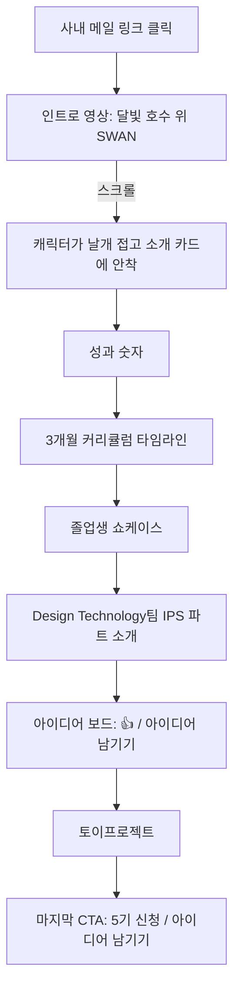

# SWAN 홍보 웹사이트 기획서

> 코딩이 처음인 현업 사람들에게 파이썬을 가르쳐, 자기 업무 자동화 하나는 직접 만들어 돌아가게 하는 사내 교육 **SWAN**(SW Academy for Newbie). 이 교육과 **Design Technology팀 IPS 파트**를 사업부에 알리는 웹사이트.

작성: Design Technology팀 IPS 파트 · 작성일: 2026-10-07 · 버전: v1 (프로토타입 기획)

---

## 요약: 프로젝트 기획 10단계

| 단계 | 핵심 질문 | 우리의 답 |
|---|---|---|
| 01 Project Idea | 무엇을 만드나? | 3개월 오프라인 기수제 파이썬 교육 SWAN(5기 모집)의 사내망 홍보 사이트. 동시에 IPS 파트를 알리고, 내가 만든 프리미엄 웹 퀄리티를 부서장님께 보여주는 포트폴리오. |
| 02 Problem | 누가, 어떤 어려움? | (A) 현업 직원은 자동화하고 싶어도 흩어진 정보 속에서 혼자 시작을 못 하고, 3개월이라는 긴 시간과 "뭐라도 내놔야 한다"는 부담에 신청을 망설인다. (B) 실무진은 필요한 툴이 있어도 부서장님을 거치는 공식 경로뿐이라 작은 불편을 말하지 못한다. |
| 03 User | 어떤 사람, 언제? | 30~40대 엑셀 중심 현업(예: 영업관리 김현수 과장). 사내 **메일 링크를 누른 첫 5초**가 승부처. 궁극적 페인포인트: "3개월 투자하면 내 업무에서 무엇이 달라지는지 안 보인다." |
| 04 Goal | Before → After | 메일만 보고 넘기던 사람이 → 사이트를 끝까지 스크롤하며 "나도 되겠다", "저기 부탁해 볼까"를 느낀다. 지표: 5기 신청 정원 이상, 아이디어 접수 모집 기간 10건+ |
| 05 Core Action | 반드시 해야 하는 행동 | **홍보 우선**: ① 인트로에 꽂히기 → ② 스크롤하며 SWAN·IPS 파트 이해 → ③ 다음 행동 하나(신청 / 아이디어 남기기 / 쇼케이스 구경) |
| 06 Core Feature | MVP 기능 | 백조 마스코트 인트로 연출, 성과 숫자, 3개월 커리큘럼 타임라인, 졸업생 쇼케이스, IPS 파트 소개, 아이디어 보드(공개 + 👍), 토이프로젝트, 고정 [5기 신청] |
| 07 User Flow | 진입 → 완료 | 메일 링크 → 인트로(변신) → 소개 카드 착지 → 성과 → 커리큘럼 → 쇼케이스 → IPS 파트 → 아이디어 보드 → 토이프로젝트 → CTA(날아오름) |
| 08 Core Screens | 화면 | 원페이지 9섹션: 내비 / 인트로 / 성과 / 커리큘럼 / 쇼케이스 / IPS 파트 / 아이디어 보드 / 토이프로젝트 / CTA·푸터 |
| 09 Research | 조사 | 미작성 — 수강생 피드백·수료생 결과물 확보 후 채움. 쇼케이스는 예시/빈 상태 |
| 10 Reference | 참고 → 적용 | **소이정**(soijeong.com) → 섹션을 넘나드는 마스코트, 키네틱 타이포, 섹션별 배경 전환, 세계관 카피, GSAP+Lenis. **사용자 인트로 데모** → 영상→캐릭터 분리→카드 착지 연출 |

### 한 장 컨셉
- **무드**: 달빛 호수의 밤 (night `#0b1424` · moon `#f3ead2` · glow `#7fe3e6` · amber `#e8b36a`)
- **히어로 카피**: 메인 "처음이어도, 우아하게." + 서브 "3개월 뒤, 매일 하던 반복 업무가 Python으로 가벼워집니다."
- **슬로건**: "물 위에선 우아하게, 물 밑에선 열심히 코딩하기"
- **가이드 캐릭터**: 노트북 든 안경 백조. 인트로에서 변신 → 소개 카드 → IPS 파트 → 마지막 CTA에서 다시 날아오름
- **스택**: React + Vite + TypeScript + Tailwind + GSAP ScrollTrigger + Lenis, 사내망 정적 배포

---

## STEP 01. Project Idea — 만들 프로젝트 정하기

상태: 작성 완료 (2026-10-07)

### 프로젝트 이름
**SWAN** (SW Academy for Newbie). 부서장님이 운영하는 사내 파이썬 교육 프로그램의 홍보 웹사이트.

### 한 문장 정의 (친구에게 설명하듯)
> 코딩이 처음인 현업 사람들에게 파이썬을 가르쳐서, 자기 업무 자동화 하나는 직접 만들어 돌아가게 하는 사내 교육. 이 교육을 알리고 수강생을 모으는 웹사이트.

### 서비스 개요
부서장님이 운영하는 3개월 오프라인 기수제 파이썬 교육 SWAN의 홍보 사이트다. 방문자는 일정과 커리큘럼을 확인하고 바로 수강신청을 할 수 있다. 졸업생 결과물과 교육 성과로 "나도 할 수 있겠다"는 확신을 준다. 동시에 현업에 필요한 웹·툴을 개발해 주는 **우리 부서**의 존재와 개발 요청 창구를 사업부에 알린다.

### 사이트 목표 (우선순위)
1. **수강신청** — 1순위
2. **부서 홍보 및 개발 요청 유입** — 2순위

### 교육 운영 정보
| 항목 | 내용 |
|---|---|
| 운영 방식 | 기수제, 오프라인 |
| 기간 | 3개월 |
| 수업 빈도 | 주 2~3회, 회당 약 2시간 (부서장님 일정에 맞춰 유동적) |
| 정원 | 한 기수 약 8~10명 |
| 진행 현황 | 4기까지 완료 → 다음 모집은 **5기** |
| 누적 졸업생 | 약 32~40명 (추정, 정확한 수치 확인 필요) |

### 작동 방식
1. **첫 화면**: 다이나믹한 인트로와 함께 SWAN이 무엇인지 한눈에 보여준다. "5기 모집 중"과 수강신청 버튼이 바로 보인다.
2. **일정·커리큘럼 확인 (핵심)**: 3개월 동안 무엇을 배우고 어떤 결과물을 만드는지 본다.
3. **성과 확인**: 누적 졸업생 수 등 숫자로 교육 성과를 보여준다.
4. **졸업생 쇼케이스**: 역대 졸업생이 만든 자동화나 툴을 구경한다.
5. **수강신청 (1순위)**: 5기에 신청한다.
6. **부서 소개와 개발 요청 (2순위)**: "직접 배우기 어렵다면 우리 부서에 맡기세요" 흐름으로 개발 요청을 남긴다.
7. **토이프로젝트 모집**: 졸업생끼리 함께할 사이드 프로젝트 멤버를 모집하고 참여한다.

### 주요 특징
- **수강신청 중심 구조**: 어느 섹션에서든 신청 버튼에 닿을 수 있다.
- **일정·커리큘럼 강조**: 3개월 여정을 주차별 타임라인으로 시각화한다. (제안)
- **성과 숫자**: 누적 졸업생 수, 기수 수 등을 카운트업 애니메이션으로 보여준다. (제안)
- **졸업생 쇼케이스**: 실제 업무 자동화 결과물을 전시한다.
- **토이프로젝트 모집 게시판**: 졸업생 전용. 교육 이후에도 커뮤니티가 이어지게 한다.
- **부서 홍보와 개발 요청 창구**: 교육 사이트를 부서의 쇼룸으로도 활용한다.
- **프리미엄 인터랙션**: 스크롤 애니메이션 등 "사내 사이트 같지 않은" 퀄리티를 지향한다. (제안)

### 제공 방식
| 항목 | 내용 |
|---|---|
| 플랫폼 | 웹 (**사내망 전용**) |
| 가입·로그인 | 미정 (STEP 11) — 토이프로젝트 게시판이 졸업생 전용이라 구분 방법 필요 |
| 수강신청 방식 | 미정 (사이트 자체 폼 / 사내 시스템 연결) |
| 콘텐츠 | 실물 사례는 있으나 무엇을 넣을지 미정 |
| 출시 시점 | 5기 모집 전 |

### 왜 이 프로젝트인가
- **계기**: 5기 모집이 다가온다.
- **조직적 이유**: SW 개발자가 적은 사업부에서 부서 인지도를 높여야 한다.
- **개인적 이유 (진짜 동기)**: 내가 프리미엄급 고퀄리티 웹을 만들 수 있다는 걸 부서장님께 보여주고 싶다. 동시에 부서장님의 교육 운영에 실질적인 도움이 되고 싶다.
  → 이 사이트는 **SWAN의 홍보물이면서 우리 부서 개발 역량의 포트폴리오**다. (제안)

### 열린 질문
- 정확한 누적 졸업생 수
- 수업 일정이 유동적이라면 사이트에 일정을 어떻게 표시할지 (고정 시간표 / 주차별 주제만 / 별도 공지)
- 5기 모집 기간과 개강일
- 쇼케이스에 넣을 실물 선정

## STEP 02. Problem — 해결할 문제 정의하기

상태: 작성 완료 (2026-10-07) — 페르소나·빈도는 예시, 추후 실제 사례로 교체

이 사이트는 두 집단의 문제를 다룬다.
- **(A) 현업 직원**: 반복 업무를 자동화하고 싶지만 혼자서는 시작을 못 한다 → 수강신청 대상
- **(B) 사업부 실무진**: 필요한 툴이 있어도 편하게 요청할 창구가 없다 → 부서 홍보·개발 요청 대상

---

### (A) 누가 — 대표 타겟: 김현수 (37세, 영업관리 과장) (제안·예시)
- **일**: 사업부 영업관리. 매주 각 팀의 실적 엑셀을 받아 하나로 취합해 보고서를 만든다.
- **하루**: 오전에 메일로 엑셀 수합, 오후에 복붙·서식 맞추기, 수시로 오류 수정.
- **관련 습관**: 엑셀 함수는 잘 쓰고, 매크로는 녹화해 본 정도. "파이썬이나 AI로 하면 된다던데"라는 말은 들어 봤다.

#### 얼마나 자주 겪나 (제안·예시)
- **매주**: 월요일 오전 5개 팀 실적 엑셀 취합, 약 1시간 30분
- **매월**: 월말 실적 보고서 작성, 반나절
- **문득**: 양식이 바뀔 때마다 처음부터 다시 맞추느라 야근

#### 이 사람이 바라는 것
> "이거 버튼 하나로 끝나면 좋겠는데... 누가 좀 만들어 주거나, 내가 할 줄 알면 좋겠다."

### 왜 시작을 못 하나 — 신청을 막는 장벽
| 장벽 | 실제 마음 |
|---|---|
| **긴 교육 시간 부담** | 3개월, 주 2~3회 자리를 비운다. 그만큼 시간을 썼으니 **"뭐라도 가져가야 한다"**는 심리적 부담이 생긴다. (공식 수료 조건은 없음) |
| **흩어진 정보** | 요즘은 AI로 코딩·환경 세팅을 해결하는 방법도 많지만, 정보가 흩어져 있어 **어디서부터 해야 할지 모른다**. |
| **혼자 하다 막힘** | 폐쇄망 환경 세팅(pip 등) 같은 기술적 관문에서 막히기 쉽다. (예시 — 교육에서는 세팅을 같이 해 줌) |

### 현재 임시방편과 한계
| 방법 | 어떻게 쓰고 있나 | 한계 |
|---|---|---|
| 수작업으로 버티기 | 매주 복붙과 엑셀 함수로 처리 | 시간이 계속 새고, 실수가 반복된다 |
| 혼자 만들어 보기 | 유튜브·블로그·AI를 보고 시도 | 정보가 흩어져 있고, 사내 환경의 기술적 관문에서 막혀 포기한다 |
| 엑셀 매크로 | 매크로 녹화로 일부 자동화 | 양식이 바뀌면 깨지고, 고칠 줄 모른다 |

#### 정리: 왜 여전히 고통받는가
자동화하고 싶은 마음은 있고 방법도 세상에 많지만, **흩어진 정보 속에서 혼자 길을 찾기 어렵다**. 체계적으로 배울 기회(SWAN)가 있어도 **긴 교육 시간과 "뭔가 내놔야 한다"는 부담** 때문에 선뜻 손을 들지 못한다.
→ 사이트가 풀어야 할 것 (제안)
- "3개월 동안 무엇을 얻어 가는지"를 **구체적으로** 보여줘 시간 투자의 가치를 확신시킨다 (커리큘럼·졸업생 결과물)
- "결과물 부담 없이, 옆에서 같이 해 준다"는 안심을 준다

---

### (B) 사업부 실무진 — 개발 요청의 문제
- 필요한 툴이 있어도 대부분 **수작업으로 버티거나 혼자 만들다 실패**한다.
- 현재 개발 요청은 **부서장님을 통해서만** 들어온다.
- 부서장님께 직접 요청하는 건 **공식적인 무게감**이 있어서, 실무진이 정말 원하는 작은 불편("이거 좀 자동화되면 좋겠다")은 쉽게 말하지 못한다.

#### 정리
실무 현장의 진짜 니즈는 많지만, **가볍게 말할 수 있는 창구가 없어서** 우리 부서까지 도달하지 못한다.
→ 사이트가 풀어야 할 것: **부담 없이 아이디어를 던질 수 있는 비공식적·가벼운 요청 창구** (제안)

## STEP 03. User — 핵심 사용자 구체화하기

상태: 작성 완료 (2026-10-07) — 페르소나는 예시, 추후 실제 인물로 교체 가능

### 핵심 사용자 집단의 공통 특성 (제안)
- **나이/직군**: 30~40대 사무직 현업 (영업관리, 품질, 구매, 기획 등 엑셀 중심 업무)
- **디지털 습관**: 엑셀 능숙, 코딩 경험 없음. ChatGPT류 AI는 써 봤거나 들어 봄
- **환경**: 사내망 PC에서 업무 중 짬을 내 접속. 모바일 접속은 거의 없음
- **유입 경로**: 사내 **메일** 공지의 링크

### 사용자 유형과 페르소나 (예시)
| 유형 | 페르소나 | 이 사이트에서 하는 일 |
|---|---|---|
| 수강 희망자 | **김현수** (37, 영업관리 과장) | 메일 링크로 들어와 커리큘럼·쇼케이스를 보고 5기 신청 |
| 졸업생 | **박지은** (33, 품질팀 대리, 3기) | 직접 만든 "불량 리포트 자동 생성기"를 쇼케이스에 등록, 토이프로젝트 멤버 모집·참여 |
| 실무진 요청자 | **이준호** (29, 구매팀 사원) | 부서장님께 말하기 애매한 "발주서 자동 정리" 아이디어를 가볍게 남김 |
| 관리자 | **나 + 부서장님** (공동 운영) | 신청자·요청 확인, 기수 정보 수정, 쇼케이스·토이프로젝트 관리(직접 등록 가능) |
| 팀장급 (참고) | 별도 페르소나 없음 | 팀원 수강 승인 판단 시 참고 → 수강신청 섹션에 "팀에 주는 이득" 문구 (제안) |

#### 권한 정리
- **로그인: 사내 SSO**
- 비로그인(누구나): 소개·커리큘럼·쇼케이스 열람 (제안)
- 졸업생: 쇼케이스·토이프로젝트 글 작성
- 관리자: 전체 관리 + 직접 등록
- 수강신청·개발 요청: SSO 로그인 사용자 (제안 — 이름·부서 자동 입력으로 1분 신청)

### 언제 사이트를 보나 — 핵심 순간 (제안)
| 시점 | 행동 | 고충의 순간 | 사이트가 들어갈 자리 |
|---|---|---|---|
| ⭐ 메일 받은 직후 | 업무 중 모집 메일 링크 클릭 | "3개월? 바쁜데..." 첫 5초 안에 흥미를 못 느끼면 닫음 | 첫 화면 임팩트 + "3개월 뒤 당신이 만들 것" 한 줄 |
| 고민 중 | 커리큘럼·일정 확인 | "뭘 배우는지, 시간 얼마나 뺏기는지" | 주차별 커리큘럼, 수업 빈도 명시 |
| 결정 직전 | 쇼케이스 구경 | "나 같은 비전공자도 되나?" | 나와 비슷한 직무 졸업생 결과물 |
| 신청 | 신청 버튼 클릭 | 절차가 복잡하면 미룸 | 1분 안에 끝나는 신청 폼 |

#### 패턴 정리 → 설계 원칙
- 첫 방문은 메일 클릭 한 번뿐 → **첫 화면에서 끝까지 끌고 가는 원페이지 스토리텔링**
- 업무 중 짧게 봄 → 스크롤만으로 핵심이 다 전달되고, 신청 버튼이 항상 가까이 있어야 함

### 기존 자구책 (STEP 02 참고)
| 방법 | 어떻게 했나 | 왜 오래 못 갔나 |
|---|---|---|
| 수작업 | 복붙·엑셀 함수 | 시간이 계속 새고 실수 반복 |
| 혼자 학습 | 유튜브·블로그·AI | 정보가 흩어져 시작점을 못 잡고, 사내 환경에서 막힘 |
| 엑셀 매크로 | 매크로 녹화 | 양식 바뀌면 깨지고 고칠 줄 모름 |

#### 공통 실패 이유
혼자서는 "어디서부터, 무엇을 만들지"가 안 보인다.

### 궁극적 페인포인트
> **"3개월을 투자하면 내 업무에서 무엇이 달라지는지 눈에 보이지 않아서, 손을 들지 못한다."**
- 정보가 흩어져 있어 혼자서는 시작점을 못 잡는다
- 긴 시간 투자에 비해 얻을 결과가 불확실하게 느껴진다
- **이 사이트가 풀어야 할 단 하나**: "3개월 뒤의 나"를 구체적으로 보여주기 (졸업생 결과물·커리큘럼·성과 숫자)

## STEP 04. Goal — 서비스가 만들어낼 변화 정의하기

상태: 작성 완료 (2026-10-07) — 모집 기간·오픈일 미정, 지표 목표치는 제안값

### Before (현재 상태)
김현수 과장은 월요일 아침 "SWAN 5기 모집" 메일을 받는다. 본문에는 일정과 신청 방법만 텍스트로 적혀 있다. "3개월이나? 뭘 배우는 거지?" 하고 잠깐 고민하다가 밀린 엑셀 취합으로 돌아가고, 메일은 그대로 묻힌다.

구매팀 이준호 사원은 발주서 정리 자동화가 있었으면 좋겠다고 늘 생각한다. 하지만 부서장님께 공식 요청할 만한 일인지 몰라서 말을 꺼내지 못한다.

1~4기 졸업생들이 만든 결과물은 각자의 PC 안에만 있다. 우리 부서가 무엇을 하는 곳인지 사업부 대부분이 모른다.

### After (이상적 목표 상태)
같은 메일을 받은 김현수 과장은 링크를 누른다. 첫 화면에서 **"처음이어도, 우아하게."**와 서브카피 **"3개월 뒤, 매일 하던 반복 업무가 Python으로 가벼워집니다."**, 그리고 움직이는 인트로를 본다. 스크롤을 내리며 주차별 커리큘럼과 누적 졸업생 숫자를 보고, 자기와 같은 영업관리 직무 졸업생이 만든 "실적 자동 취합기"를 발견한다. "나도 이거면 되겠다." SSO로 이름과 부서가 자동 입력된 신청 폼을 1분 만에 제출한다.

이준호 사원은 같은 사이트의 **"이런 거 있으면 좋겠다"** 창구에 발주서 아이디어를 두 줄로 남긴다. 부서장님께 직접 말하지 않아도 된다.

졸업생 박지은 대리는 자기 툴을 쇼케이스에 올리고 토이프로젝트 팀원을 모집한다. 사이트 자체가 **"우리 부서는 이 정도 퀄리티를 만든다"**는 증거가 된다.

### 측정 지표 (제안값)
#### 신청이 늘었는가
- **5기 신청자 수**: 정원(10명) 이상, 가능하면 15명 이상 — 경쟁이 생길 만큼 관심을 끌었는가
- **메일 → 방문 → 신청 전환율**: 방문자의 10% 이상 — 사이트가 실제로 설득했는가

#### 부서가 알려졌는가
- **개발 요청·아이디어 접수 수**: 모집 기간(약 1개월) 동안 10건 이상 — 가벼운 창구가 작동하는가
- **순방문자 수**: 사업부 인원의 30% 이상 (사업부 인원 확인 필요) — 메일 한 통으로 얼마나 퍼졌는가

#### 졸업생이 참여하는가
- **쇼케이스 등록 수**: 오픈 1개월 내 10개 이상 — 졸업생이 자랑하고 싶은 공간인가
- **토이프로젝트 모집 글**: 오픈 후 2개 이상 — 교육 이후 커뮤니티가 이어지는가

#### 나의 목표
- **부서장님 반응**: "이거 누가 만들었어?" — 프리미엄 퀄리티를 증명했는가

### 열린 질문
- 5기 모집 기간, 개강일, 사이트 오픈 목표일 (미정)
- 사업부 전체 인원 (방문자 목표 산정용)
- 히어로 문구 확정

## STEP 05. Core Action — 핵심 행동 정의하기

상태: 작성 완료 (2026-10-07)

> ⚠️ 우선순위 조정: **홍보가 수강신청보다 우선**. 첫 프로토타입은 홍보(SWAN·부서 알리기)에 집중하고, 수강신청 기능은 후순위.

### 궁극적 목적
> 사업부 사람들이 **SWAN과 우리 부서가 무엇을 하는지 한눈에 알고**, "나도 배워 볼까" 또는 "저기에 부탁해 볼까"라는 생각을 갖게 만드는 것.

### 핵심 행동: 사이트를 끝까지 보고 "알게 되기" (홍보)
1. **메일 링크로 들어와 첫 화면에 꽂히기**: 다이나믹한 인트로
2. **스크롤하며 이해하기**: SWAN 소개 → 커리큘럼·일정 → 성과 숫자 → 졸업생 쇼케이스 → 우리 부서 소개
3. **다음 행동 하나 하기**: 수강신청 버튼 / 아이디어 남기기 / 쇼케이스 구경

### 다른 사용자 유형의 핵심 행동
| 유형 | 핵심 행동 |
|---|---|
| 수강 희망자 | 수강신청 (후순위): SSO 자동 입력 + 짧은 폼 제출 |
| 실무진 | **아이디어·요청 남기기**: 실명(SSO) 작성 + 공개 여부 선택. 공개된 아이디어에 "나도 필요해요 👍" 공감 |
| 졸업생 | 쇼케이스 등록 (제목·설명·스크린샷·기수), 토이프로젝트 모집글 작성·참여 신청 |
| 관리자 (나 + 부서장님) | 신청자 확인·**선발(부서장님)**, 요청 상태 처리, 기수·커리큘럼·쇼케이스 관리 |

### 수강신청 상세 (후순위)
- 자동 입력: 이름, 부서, 사번 (SSO)
- 직접 입력: 자동화하고 싶은 업무 (선택), 지원 동기 한 줄, 팀장 승인 여부 체크 (제안)
- 안내 문구: "만들고 싶은 것이 아직 없어도 괜찮아요" (결과물 부담 해소)
- 처리: **부서장님이 선발**. 결과 통보 방식은 미정

### 아이디어·요청 창구 상세
- 실명(SSO) 작성, **공개/비공개 선택**
- 공개 아이디어는 목록에 노출되고 "나도 필요해요 👍" 공감 가능
- 공감 수 → 우리 부서의 개발 우선순위 근거로 활용
- 부서장님을 통한 공식 요청보다 훨씬 가벼운 경로

### 동기와 트리거
- **외부 트리거**: 사내 모집·홍보 메일의 링크
- **즉각적 혜택**: 1분 안에 "SWAN이 뭔지, 우리 부서가 뭘 하는지" 이해
- **호기심**: 졸업생이 실제로 만든 결과물, 움직이는 숫자
- **귀찮음을 낮추는 장치**: 원페이지 스크롤, 로그인 없이 열람, SSO 자동 입력
- **한 줄 정리**: 스크롤 한 번으로 이해되고, 버튼 한 번으로 다음 행동이 가능해야 한다

### 완료 시점의 결과물과 보상
- 아이디어 등록 직후: "접수됐어요" 피드백 + 내 아이디어가 목록에 뜸
- 조금 뒤: 다른 사람의 👍 공감, 처리 상태 변경 (검토 중 → 개발 중 → 완료)
- 수강신청 직후: 축하 애니메이션 + "5기 신청 완료" 화면 (후순위)

## STEP 06~08. Core Feature · User Flow · Core Screens

상태: 작성 완료 (2026-10-07) — 프로토타입 v0.1 범위로 압축

### 프로토타입 범위
- **원페이지 홍보 사이트**. 홍보(SWAN + Design Technology팀 IPS 파트 알리기)가 1순위.
- 실제 기능(SSO, 게시판 저장, 신청 처리)은 다음 단계. 프로토타입은 화면과 인터랙션만, 데이터는 예시.

### 기능 도출 (요약)
| 사용자 핵심 행동 | 필요한 기능 | 이유 |
|---|---|---|
| 첫 화면에 꽂히기 | 인트로 영상 → 캐릭터가 카드로 날아와 앉는 스크롤 연출 | 메일 클릭 후 5초 안에 흥미 (STEP 03) |
| SWAN 이해하기 | 소개 카드 + 걱정 해소 3가지 | 긴 시간·결과물 부담 해소 (STEP 02) |
| 성과 확인 | 숫자 카운트업 (기수·졸업생·자동화 수) | "3개월 뒤의 나" 근거 |
| 일정·커리큘럼 확인 | 3개월 타임라인, 스크롤 진행선 | 사용자가 가장 중요하다고 한 정보 |
| "나도 되겠다" 확신 | 졸업생 쇼케이스 (직무·기수·Before/After 시간) | 비슷한 직무 결과물 = 최강 설득 |
| 부서 알기 | Design Technology팀 IPS 파트 소개 + 대표 사례 | 홍보 목표 |
| 가볍게 요청 | 아이디어 보드 (공개 아이디어 + 👍 공감) | 공식 요청의 무게감 해소 (STEP 02-B) |
| 커뮤니티 | 토이프로젝트 모집 카드 | 졸업생 참여 |
| 다음 행동 | 고정 내비 [5기 신청], 마지막 CTA | 언제든 신청 가능 |

#### 우선순위
- **MVP(프로토타입)**: 위 전부를 화면으로 (예시 데이터, 버튼은 안내 모달)
- **2단계**: SSO 로그인, 아이디어 등록·공감 저장, 쇼케이스·토이프로젝트 작성, 관리자 화면
- **3단계**: 수강신청 폼·선발 관리(부서장님), 상태 알림

### User Flow (대표 여정)

### 화면 (원페이지 섹션, 위 → 아래)
| # | 섹션 | 내용 | 연출 |
|---|---|---|---|
| 0 | 상단 내비 | SWAN 로고, 섹션 바로가기, [5기 신청] 고정 | 인트로 이후 등장, 블러 배경 |
| 1 | 인트로 | 영상 → "처음이어도, 우아하게." → 캐릭터가 소개 카드 슬롯에 안착 | GSAP ScrollTrigger, 날개 접기 프레임 시퀀스 |
| 2 | 성과 숫자 | 4개 기수 / 졸업생 / 만든 자동화 | 카운트업 |
| 3 | 커리큘럼 | 3개월 4단계 타임라인, 주 2~3회 · 회당 2시간 | 스크롤 진행선 |
| 4 | 쇼케이스 | 졸업생 결과물 카드 | 가로 스크롤(핀 고정) |
| 5 | 부서 소개 | Design Technology팀 IPS 파트, 대표 사례 | 등장 애니메이션 |
| 6 | 아이디어 보드 | 공개 아이디어 + 👍 | 클릭 반응 |
| 7 | 토이프로젝트 | 모집 카드 | — |
| 8 | CTA + 푸터 | "5기에서 만나요" | 달빛 글로우 |

#### 마스코트 여정 (확정)
백조 캐릭터는 인트로 전용이 아니라 사이트 전체의 가이드. 데모의 "슬롯으로 날아가 앉기" 계산을 **공용 부품(MascotGuide)**으로 만들고, 섹션은 빈 슬롯 + 스크롤 구간만 등록한다.

| 단계 | 백조가 등장하는 곳 |
|---|---|
| **1차 (프로토타입)** | ① 인트로 변신 → SWAN 소개 카드 착지 · ② IPS 파트 소개 카드 · ③ 마지막 CTA에서 날개를 다시 펴고 날아오름 (날개 접기 프레임 역재생) |
| 2차 | ④ 커리큘럼 타임라인을 따라 칸 이동 · ⑤ 아이디어 보드에서 말풍선 "남겨 보세요!" |
| 3차 (선택) | 섹션별 새 포즈 에셋 (손 흔들기, 코딩하기 등) |

- 포즈는 2개(날개 편/접은)뿐 → 기울기·흔들림·말풍선으로 변화
- 모바일: 비행 없이 각 카드에 앉아 있는 정적 상태

#### 공통 인터랙션
- 스크롤: Lenis(관성 스크롤) + GSAP ScrollTrigger
- 섹션 전환 시 배경이 호수의 시간대처럼 바뀜 (달밤 → 새벽 안개 → 금빛) (제안)
- 화면보다 큰 키네틱 타이포가 스크롤에 맞춰 가로로 흐름
- 주요 버튼: 달빛(moon) 색 알약형. 보조: 시안 글로우 외곽선
- 섹션 진입 시 아래에서 페이드업
- prefers-reduced-motion: 모든 연출 끄고 최종 상태만

## STEP 09~10. Research · Reference

상태: 작성 완료 (2026-10-07)

### 사용자 제공 에셋 (`C:\Users\sungj\OneDrive\바탕 화면\SWAN\`)
| 에셋 | 내용 | 쓰임 |
|---|---|---|
| 영상 ① 변신 인트로 (`hf_..._075626_....mp4`) | 물 위에 있던 백조가 노트북 든 SWAN 캐릭터로 변신해 날개를 펴고 떠오름 | 첫 화면 인트로 |
| 영상 ② 날개 접기 (`hf_..._085839_....mp4`) | 변신한 캐릭터가 날개를 접음 → 프레임 49장으로 추출(데모 `assets/fold/`) | 스크롤 시 캐릭터가 카드·컴포넌트에 얹히는 연출 |
| 히어로 스틸 (1376×768) | 날개 편 캐릭터 + 달빛 호수 (워터마크 HIGGSFIELD AI 있음 → 사용 시 제거 필요) | 포스터·OG 이미지 후보 |
| 빈 배경 (1024×1024) | 캐릭터 없는 달빛 호수 | 섹션 배경, 마지막 CTA |
| 캐릭터 정면 (회색 배경) | 후드티·안경·노트북 "SWAN" 백조, 날개 접음 | 소개·로고·파비콘 후보 (배경 제거 필요) |
| 캐릭터 (그린 스크린) | 날개 접고 떠 있는 포즈 | 크로마키로 투명화해 재사용 |
| 인트로 데모 zip | `swan-intro.html` + 영상·plate·날개 접기 프레임 49장 | 인트로 연출의 기준 구현 |

#### 두 영상의 관계 (사용자 설명)
처음 인트로에서는 백조가 물 위에 있다가 **변신**한다. 변신한 캐릭터는 이후 스크롤하면 **다른 카드나 컴포넌트 위에 얹히는** 형태로 등장한다. 얹히려면 날개를 접어야 해서 날개 접기 영상을 따로 만들었다.
→ 캐릭터는 인트로 전용이 아니라 **사이트 전체를 안내하는 가이드**다.

### 웹 레퍼런스: 소이정 (https://www.soijeong.com/)
사용자가 원하는 방향: "다이나믹해서 좋아 보인다, 이런 방향으로 하고 싶다."

| 무엇을 참고 | 왜 | SWAN에 무엇을 적용 |
|---|---|---|
| **3D 마스코트가 섹션을 넘나들며 등장** (로봇 캐릭터가 히어로 → 서비스 → 특별함 섹션마다 다른 포즈로 나옴) | 캐릭터가 이야기를 이끌어 스크롤할 이유를 만든다 | SWAN 백조가 인트로에서 변신 → 소개 카드에 앉음 → 이후 섹션마다 카드 위에 얹혀 안내 (**마스코트 여정**) |
| **거대한 키네틱 타이포** ("Beyond Boundaries", "Specialist"가 스크롤에 따라 가로로 흐르고 커짐) | 텍스트만으로도 역동성이 생긴다 | "처음이어도, 우아하게." / "Python for Newbie" 등을 화면 폭보다 크게, 스크롤 연동으로 흐르게 |
| **섹션 전환 시 배경색이 통째로 바뀜** (흰 → 오렌지 → 회색 → 파스텔) | 장면이 바뀌는 느낌, 지루함 방지 | 달밤(남색) → 새벽(푸른 안개) → 금빛 안개 등 **호수의 시간대 변화**로 섹션 전환 (제안) |
| **핀 고정 + 스크롤 연출** (섹션이 멈춘 채 안에서 카드가 바뀜) | 한 화면에 집중시켜 정보를 하나씩 전달 | 커리큘럼 4단계, 쇼케이스 가로 스크롤에 적용 |
| **흐르는 키워드 태그 마키** (Project Keywords) | 하는 일이 많다는 인상을 가볍게 전달 | IPS 파트 소개: "업무 자동화 · 사내 웹 · 대시보드 · 데이터 수집 …" 태그 마키 |
| **스티커·카드 겹침 일러스트** (Specialist 섹션의 카드 더미) | 장난스럽고 손에 잡히는 느낌 | 아이디어 보드를 포스트잇·카드 더미처럼 |
| **"주문하신 서비스 나왔습니다" 세계관 카피** (Website Takeout, Order Now, Pickup) | 일관된 컨셉 카피가 브랜드를 기억에 남긴다 | **호수·백조 세계관 카피** — 예: 쇼케이스 "물 밑의 발차기", CTA "다음 호수에서 만나요" (제안) |
| 기술 스택: **GSAP + ScrollTrigger + Lenis**(부드러운 스크롤) | SWAN 스택과 동일 → 구현 난이도 검증됨 | Lenis 추가 (관성 있는 부드러운 스크롤) |

#### 가져오지 않을 것
- 화면 우측 고정 팝업 배너 (몰입 방해)
- 지나친 정보량(뉴스레터·FAQ·수상 내역) — SWAN은 짧고 굵게

### 에셋에서 도출한 디자인 방향
- **무드**: 달빛 호수의 밤. 고요하고 프리미엄하며, 따뜻한 금빛 안개가 포인트
- **컬러**: night `#0b1424` / deep `#13213a` / mist `#c9d6ea` / moon `#f3ead2` / glow `#7fe3e6`(노트북 화면 시안) / amber `#e8b36a`(안개 금빛)
- **캐릭터 성격**: 안경 쓴 너드 백조, 후드티 — 친근하지만 똑똑한 "개발자 선배"
- **히어로 카피**: 메인 "처음이어도, 우아하게." + 서브 "3개월 뒤, 매일 하던 반복 업무가 Python으로 가벼워집니다."
- **슬로건**: "물 위에선 우아하게, 물 밑에선 열심히 코딩하기"
  (백조가 물 밑에서 발을 젓는 이미지 = 현업에서 조용히 자동화를 굴리는 수료생)
- **폰트**: Gowun Batang(제목, 서정적) · IBM Plex Sans KR(본문) · JetBrains Mono(라벨·코드) — 사내망이라 로컬 번들

### STEP 09 Research
상태: 미작성 — 수강생 피드백·수료생 결과물 아직 없음. 쇼케이스는 **예시 데이터 또는 빈 상태**로 두고 추후 교체.

---

## 부록 A. 구현 준비 (STEP 11)

상태: 작성 완료 (2026-10-07)
(STEP 09 Research: 미작성 — 프로토타입 우선으로 건너뜀 / STEP 10 Reference: 사용자 제작 인트로 데모 + 캐릭터 에셋)

### 기술 스택
- **React + Vite + TypeScript + Tailwind CSS** (사용자가 React에 익숙, 사내 제약 없음)
- 스크롤 애니메이션: **GSAP + ScrollTrigger** (사용자 프롬프트 지정). Framer Motion은 쓰지 않음 (GSAP으로 충분)
- 인트로 구현 프롬프트: `planning/swan/prompts/01-intro-section.md`에 보관
- 폰트: 사내망(폐쇄망)이라 Google Fonts CDN 대신 **@fontsource로 번들에 포함**
- 2단계: SSO 연동 + 백엔드(게시판·공감·신청 저장) — 스택 미정

### 디자인 방향
- 테마: **달빛 호수의 밤** (다크 프리미엄). 캐릭터 에셋과 인트로 영상 톤에서 도출
- 토큰: night `#0b1424` / deep `#13213a` / mist `#c9d6ea` / moon `#f3ead2` / glow `#7fe3e6` / amber `#e8b36a`
- 폰트: Gowun Batang(제목) · IBM Plex Sans KR(본문) · JetBrains Mono(라벨·코드)
- 카피 톤: "처음이어도, 우아하게." / "물 위에선 우아하게, 물 밑에선 열심히 코딩하기"

### 에셋
- 인트로 영상(달빛 호수, 날개 편 캐릭터), 빈 배경 plate, 날개 접기 프레임 49장(투명 webp), 캐릭터 단독 이미지
- 사용자 데모 `swan-intro.html`의 좌표 계산·타이밍을 기준으로 이식

### 데이터
- 프로토타입: 정적 예시 데이터(`src/data`) — 졸업생 수, 커리큘럼, 쇼케이스, 아이디어, 토이프로젝트
- 실물 교체 필요: 정확한 졸업생 수, 쇼케이스 실물, 부서 대표 사례

### 배포
- 사내망 전용. `npm run build` 결과물(dist)을 사내 웹서버에 정적 배포 (외부 CDN 의존 없음)

## 부록 B. 열린 질문 / 다음에 확인할 것
- [ ] 5기 모집 기간 · 개강일 · 사이트 오픈 목표일 (미정)
- [ ] 정확한 누적 졸업생 수 (현재 추정 약 32~40명, 기수당 8~10명 × 4기)
- [ ] 사업부 전체 인원 (방문자 목표 산정용)
- [ ] 쇼케이스 실물 선정 (현재 예시/빈 상태) — STEP 09 함께 채우기
- [ ] IPS 파트 대표 개발 사례
- [ ] 페르소나·반복 업무 빈도는 예시 → 실제 수강생 사례로 교체
- [ ] 수업 일정이 유동적(주 2~3회, 부서장님 일정) → 사이트에 일정을 어떻게 표시할지
- [ ] 수강신청 결과 통보 방식 (사이트 상태 / 메일)
- [x] 히어로 카피 확정: 메인 "처음이어도, 우아하게." + 서브 "3개월 뒤, 매일 하던 반복 업무가 Python으로 가벼워집니다."
- [ ] 히어로 스틸의 HIGGSFIELD AI 워터마크 제거 / 회색 배경 캐릭터 누끼
- [ ] 인트로 프롬프트의 "3장 분할 PNG" 방식 vs 데모의 "프레임 49장" 방식 → 프레임 방식 권장
- [ ] SSO 연동 방식·백엔드 스택 (2단계)
- [ ] 섹션별 배경 시간대 전환 (제안) 채택 여부
